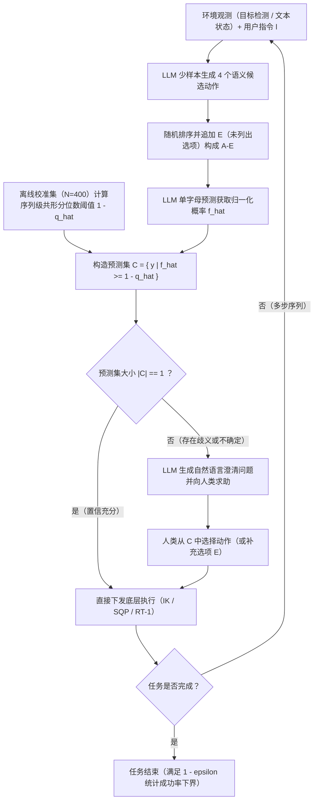

# Robots That Ask For Help: Uncertainty Alignment for Large Language Model Planners

## 一句话定义

KNOWNO（Know When You Don't Know）是一种基于共形预测（Conformal Prediction）的 LLM 机器人规划不确定性对齐框架，通过将动作规划转为单 token 多选题概率校准，在为用户指定的任务成功率 $1-\epsilon$ 提供严格统计保证的同时，最小化向人类请求澄清的次数。

## 英文缩写速查

| 缩写 | 英文全称 | 简要说明 |
|---|---|---|
| KNOWNO | Know When You Don't Know | 本文提出的不确定性对齐框架，使 LLM 规划器在不确定时主动向人类求助 |
| CP | Conformal Prediction | 共形预测，一种无需分布假设即可输出具有覆盖率保证的预测集合的统计校准方法 |
| MCQA | Multiple-Choice Question Answering | 多选题问答，将自由文本规划转化为单字母（`A`–`E`）next-token 概率评估以消除长度偏差 |
| POMDP | Partially Observable Markov Decision Process | 部分可观测马尔可夫决策过程，用于形式化具身规划交互环境 |
| SQP | Sequential Quadratic Programming | 序列二次规划，本文中用于双臂 KUKA 机器人在受限工作空间内的底层轨迹求解 |
| SAM | Segment Anything Model | 图像分割基础模型，与 MDETR 配合在真机桌面整理任务中提取物体吸取掩码 |

## 核心信息

| 字段 | 内容 |
|---|---|
| 论文标题 | *Robots That Ask For Help: Uncertainty Alignment for Large Language Model Planners* |
| 作者 | Allen Z. Ren, Anushri Dixit, Alexandra Bodrova, Sumeet Singh, Stephen Tu, Noah Brown, Peng Xu, Leila Takayama, Fei Xia, Jake Varley, Zhenjia Xu, Dorsa Sadigh, Andy Zeng, Anirudha Majumdar |
| 机构 | Princeton University、Google DeepMind |
| 发表时间 / 预印本 | arXiv:2307.01928v2（2023-09-04） |
| 论文链接 | [arXiv:2307.01928](https://arxiv.org/abs/2307.01928) / [PDF](https://arxiv.org/pdf/2307.01928) |
| 项目主页 | [robot-help.github.io](https://robot-help.github.io) |
| 清单分类 | `model.planning`, `harness.layered_systems` |
| 来源条目 | `survey_ax_2307_01928` |
| 开源 / 验证范围 | 项目页提供补充说明、视频与代码入口；论文涵盖 PyBullet 仿真、UR5 桌面分拣、办公室厨房移动操作（RT-1）及双臂 KUKA IIWA 7 硬件评测（默认 LLM 为 PaLM-2L，另测试 PaLM-2L-IF 与 GPT-3.5） |

## 为什么重要

1. **将“何时该问人类”从手工提示调参升级为可证明的统计保证**：面对“把碗放进微波炉”（台面上有金属碗和塑料碗）等歧义或危险指令，以往方法要么从不求助（如 SayCan），要么依赖手工提示触发（如 Inner Monologue），既无法控制目标成功率，又容易过度打扰用户；KNOWNO 实现了**校准置信度（Calibrated Confidence）**与**最小化求助（Minimal Help）**的统一。
2. **用 MCQA 巧妙破解 LLM 长序列生成概率的“长度偏差”**：直接用自回归联合概率 $\prod p(\sigma_i \mid \sigma_{<i})$ 评估自然语言步骤会严重偏向短句；KNOWNO 先让 LLM 生成 4 个语义互斥选项并追加 `"E) an option not listed here"`，将序列不确定性压缩为单个字母 token 的条件概率，与预训练交叉熵对齐。
3. **首次将共形预测严谨扩展到多步自回归具身规划**：在多步任务中，前一步动作改变后续观测分布，破坏标准 CP 的 i.i.d. 假设；本文提出序列级极小置信度分数 $\hat{f}(x)_y := \min_{t \in [T]} \hat{f}(x_t)_{y_t}$ 与测试时因果重构等价性（Claim 1），并进一步覆盖“单步多正解”与“多步多正解”场景。

## 核心方法

KNOWNO 的核心由“MCQA 置信度提取”和“共形预测校准与因果执行”组成：

1. **多选题生成与单 token 评分（§2 & §A6）**：
   - 给定当前观测文本、用户指令 $l$ 与少样本示例，先提示 LLM 生成 4 个语义不同的候选下一步计划，并在随机打乱顺序后加入选项 `E) an option not listed here`（$Y = \{\text{A}, \text{B}, \text{C}, \text{D}, \text{E}\}$）。
   - 用零样本提示询问 `"Which option is correct? Answer with a single letter."`，直接读取 LLM 对 `A`–`E` 的 next-token 归一化概率 $\hat{f}(\tilde{x}_t)_y$。
2. **单步与多步共形预测校准（§3.1–3.3）**：
   - **单步校准**：从分布 $\mathcal{D}$ 独立同分布采样 $N$ 条校准样本（文中通常 $N=400$），计算非一致性分数 $\kappa_i = 1 - \hat{f}(\tilde{x}_i)_{y_i}$，利用数据集条件保证公式（基于 Beta 分布逆 CDF，取 $\delta=0.01$）调整 $\hat{\epsilon}$ 并计算分位数阈值 $\hat{q}$。
   - **多步序列级校准**：将整条轨迹视为序列样本，定义序列分数为各步最小置信度 $\hat{f}(x)_y = \min_{t \in [T]} \hat{f}(x_t)_{y_t}$ 来标定全局分位数 $\hat{q}$；在线推理时每一步 $t$ 因果构造局部预测集 $C^t(x_t^{\text{test}}) = \{y_t \mid \hat{f}(x_t^{\text{test}})_{y_t} \ge 1 - \hat{q}\}$。Claim 1 证明笛卡尔积 $\mathcal{C}(x)$ 与非因果序列预测集 $C(x)$ 完全等价，从而将序列级 $1-\epsilon$ 成功率下界（Proposition 2）无损迁移至在线单步执行。
   - **多合法选项扩展（§A3–A4）**：当同一步存在多个合法答案（如“拿一瓶汽水”，可乐与雪碧均可），通过算子 $\beta$ 选取有效集合中置信度最高的分支进行校准，保证预测集以至少 $1-\epsilon$ 概率包含至少一个合法选项。
3. **求助触发与执行（§2 & §A8）**：
   - 若 $|C^t| = 1$（单元素集），机器人直接执行该唯一动作；
   - 若 $|C^t| > 1$（或 $|C^t| = 0$ 时），触发人类求助，由 LLM 将预测集中的候选动作转化为自然语言澄清问题，交由人类选择（若选 `E` 则由人类直接给出列表外动作），最后交由底层控制器（IK / SQP / RT-1）执行。

### 方法流程图

## 实验与评测

全篇默认采用 **PaLM-2L** 作为 LLM，并在模拟与三套真实机器人平台上对比了 `Simple Set`（按累计概率截断）、`Ensemble Set`（20 次随机采样 prompt 集成）、`Prompt Set`（直接让 LLM 输出集合）、`Binary`（让 LLM 输出 Certain/Uncertain）与 `No Help` 基线。

### 1. PyBullet 仿真桌面重排（单步，属性 / 数值 / 空间三类歧义，各 200 次试验，§4.1 & Table A1）

- **目标达成一致性（$\epsilon = 0.15$，目标成功率 85%）**：KNOWNO 在三类歧义上的实际成功率与目标 85% 偏差最小，随歧义程度升高（Attribute < Numeric < Spatial），相比相同概率分数的 `Simple Set`，KNOWNO 在相同成功率下将人类求助率降低了高达 **24%**（整体降低 **10%–24%**）。
- **句子级概率与 MCQA 消融（Table A1，$\epsilon = 0.15$）**：直接对自然语言句子打分（`CP w/ RawProb` 与长度归一化的 `CP w/ Perplexity`）在长度方差增大时显著退化（Numeric 歧义下长度方差 8.51）：

| 歧义设置（长度方差） | 方法 | 平均预测集大小 Set Size ↓ | 人类求助率 Help ↓ |
|---|---|---:|---:|
| Attribute（1.52） | **KNOWNO (MCQA)** | **1.18** | **0.18** |
| | CP w/ RawProb / Perplexity | 1.33 / 1.35 | 0.32 / 0.36 |
| Spatial（2.81） | **KNOWNO (MCQA)** | **2.23** | **0.69** |
| | CP w/ RawProb / Perplexity | 2.50 / 2.67 | 0.82 / 0.88 |
| Numeric（8.51） | **KNOWNO (MCQA)** | **2.17** | **0.79** |
| | CP w/ RawProb / Perplexity | 4.06 / 4.06 | 1.00 / 1.00 |

### 2. UR5 真机多步桌面分拣（人类食物偏好歧义，50 次真机试验，目标 $1-\epsilon = 0.75$，Table 1）

在固定同等规划成功率（0.76）的前提下对比（其中 `Simple Set` 需将目标调至 $1-\epsilon = 0.58$ 才对齐，若设 $0.75$ 则步级求助率高达 87%）：

| 方法 | $1-\epsilon$ | Plan Succ | Task Succ | 平均 Set Size ↓ | 步级求助率 Help-Step ↓ | 回合求助率 Help-Trial ↓ |
|---|---:|---:|---:|---:|---:|---:|
| **KNOWNO** | **0.75** | **0.76** | **0.74** | **1.72** | **0.58（降 14%）** | **0.92（降 8%）** |
| Simple Set | 0.58 | 0.76 | 0.72 | 2.04 | 0.72 | 1.00 |
| No Help | — | 0.41 | 0.38 | 0 | 0 | 0 |

### 3. 办公室厨房移动操作（Winograd 指代歧义与安全动作，目标 $1-\epsilon = 0.85$，Table 2）

底层主要采用 **RT-1** 策略（部分复杂任务用脚本策略）；同时测试指令微调模型 `PaLM-2L-IF` 与 `GPT-3.5 (text-davinci-003)`：

| 方法 | 模型 | $1-\epsilon$ | Plan Succ | Task Succ | 平均 Set Size ↓ | 求助率 Help ↓ |
|---|---|---:|---:|---:|---:|---:|
| **KNOWNO** | **PaLM-2L** | **0.85** | **0.87** | **0.76** | **2.22** | **0.67（降 14%）** |
| Simple Set | PaLM-2L | 0.76 | 0.87 | 0.75 | 2.38 | 0.81 |
| No Help | PaLM-2L | — | 0.62 | 0.51 | 0 | 0 |
| KNOWNO | PaLM-2L-IF | 0.85 | 0.86 | — | 1.86 | 0.67 |
| KNOWNO | GPT-3.5 | 0.85 | 0.87 | — | 2.50 | 0.86 |

*注：GPT-3.5 存在明显偏向选项 D/E、排斥 A/B 的位置偏置，导致平均集合增大至 2.50；但因 CP 不依赖基础模型概率本身已校准，KNOWNO 仍通过自动提高求助率（0.86）稳住了 **0.87** 的规划成功率。*

### 4. 双臂 KUKA IIWA 7 硬件可达性歧义（§A5）

在全歧义指令设定（$\epsilon = 0.15$）下，实现 **84% 规划成功率 / 92% 求助率**（10 次实测中成功 9 次、触发求助 9 次）。

## 与现有工作的对比

| 维度 | No Help / SayCan | Binary / Prompt Set 提示基线 | Ensemble Set (20× 采样) | Simple Set (累计阈值) | KNOWNO (本文) |
|---|---|---|---|---|---|
| 误差率可控性 | 不可控（完全无求助） | 不可控（忽略用户指定的 $\epsilon$） | 无严格分布无关保证 | 未经校准，易过保守或欠覆盖 | **严格保证 $1-\epsilon$ 覆盖下界** |
| 推理开销 | 1× | 1× | **20×（极高计算成本）** | 1× | **1×（仅多 1 次单字母评分）** |
| 求助效率 | — | Prompt Set 表现最差（Spatial 仅 35% 成功） | 高成功率区无法继续提升且 20× 耗时 | 需更多求助（高出 10%–24%） | **理论上在给定 $\hat{f}$ 下最小化平均集合大小** |
| 对模型偏差鲁棒性 | 直接受幻觉与偏置伤害 | 极依赖模型自身校准度 | 20 次均漏选正确答案时概率为 0 | 直接暴露未校准偏差 | **CP 自动兜底，模型越偏则越保守多问** |

## 常见误区或局限

1. **统计保证目前仅覆盖“高层 LLM 规划”，未涵盖底层感知与执行误差**：在移动厨房实验中，规划成功率为 87%，但真实任务成功率降至 76%，差距正是由于底层 RT-1 策略约 86% 的执行成功率以及未建模的目标检测误差所致；CP 理论假设场景物体已被完整准确地转为文本输入且选定原语可执行。
2. **依赖校准集与测试场景的独立同分布（i.i.d.）及“忠实人类”假设**：部署前需收集约 $N=400$ 条同分布校准样本（多步标注约需 4 小时，单步约 1.5 小时），且假设人类在被问及预测集时总能给出正确选择（未建模人类误答）。
3. **预设 4+1 选项框架可能限制开放探索空间**：若真正正确答案在第一步 4 个候选中未生成且落入 `"E) 未列出选项"`，人类需直接口头补全动作；此外在 `GPT-3.5` 等较弱模型上仍存在选项字母偏置，且对 `GPT-3 davinci` 做有监督微调来拟合 MCQA 不确定性容易在少样本高复杂度场景过拟合（§A9）。

## 结论

**一句话总判：KNOWNO 用“MCQA 单 token 化 + 因果序列级共形预测”为大模型机器人规划器提供了首个无需微调、可按需设定成功率下界的数学安全护栏。**

1. **MCQA 是获取 LLM 语义不确定性的极简有效接口**：通过将自由生成转成单字母概率分布，在数值/空间/属性歧义下比 RawProb 与 Perplexity 显著缩小预测集与求助率（Numeric 歧义求助率 0.79 vs. 1.00）。
2. **共形预测可无缝适配“动作依赖历史观测”的多步具身规划**：取整条轨迹最低置信度做序列级校准，并在推理期按同分位数逐帧阈值化，等价无损地保住了序列级成功率下界。
3. **不要求 LLM 本身概率校准完美**：即便更换有严重字母位置偏置的模型（如 GPT-3.5），CP 也能自动多拉人类介入以守住 87% 的目标规划成功率。
4. **端到端真机保证尚需叠加底层不确定性校准**：规划层 87% 与真机 76% 之间的落差提醒工程落地需将感知置信度与底层策略（如 RT-1）执行失败概率纳入联合校准或执行监测。

## 关联页面

- [DoReMi 论文节点](paper-agentic-2307-00329.md)
- [SayCan 论文节点](paper-saycan.md)
- [RT-1 论文节点](paper-rt-1.md)
- [Agentic Robots 综述](paper-towards-agentic-robots-survey.md)
- [全量项目节点清单](../overview/awesome-agentic-robots-node-index.md)
- [VLA 方法背景](../methods/vla.md)

## 参考来源

- [官方 Awesome 快照归档](../../sources/repos/awesome-agentic-robots-survey-index.md)
- [arXiv:2307.01928v2 论文页面](https://arxiv.org/abs/2307.01928)（[PDF 原文](https://arxiv.org/pdf/2307.01928)）
- [KNOWNO 官方项目页](https://robot-help.github.io)
