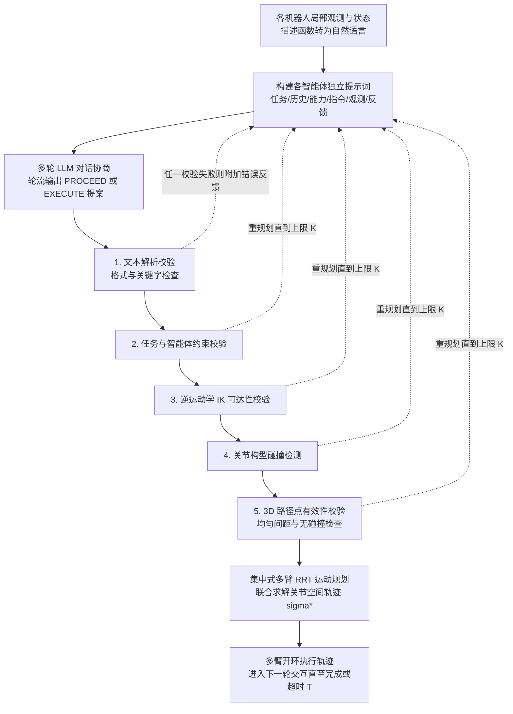

# RoCo: Dialectic Multi-Robot Collaboration with Large Language Models

## 一句话定义

**RoCo**（[arXiv:2307.04738](https://arxiv.org/abs/2307.04738)，[项目页](https://project-roco.github.io)）是哥伦比亚大学提出的多机器人零样本协同框架：让每个机器人由一个大语言模型（LLM）智能体代言，通过自然语言对话完成分工与策略讨论，结合环境校验反馈（格式、约束、逆解与碰撞）迭代修正子任务规划及任务空间 3D 路径点，最终交由集中式多臂 RRT 运动规划器生成无碰撞关节空间轨迹执行。

## 英文缩写速查

| 缩写 | 英文全称 | 简要说明 |
|---|---|---|
| RoCo | Dialectic Multi-Robot Collaboration | 本文提出的多机器人辩证式对话协同框架 |
| LLM | Large Language Model | 大语言模型，本文中同时承担多智能体对话协同与 3D 路径点推理 |
| IK | Inverse Kinematics | 逆运动学，用于检验目标位姿与中间路径点的可达性并求解关节目标 |
| RRT | Rapidly-exploring Random Tree | 快速扩展随机树，本文用于联合规划多机械臂无碰撞关节轨迹 |
| OWL-ViT | Open-World Localization Vision Transformer | 开放词表目标检测模型，用于真机人机协作实验中的桌面物体感知 |

## 核心信息

| 字段 | 内容或状态 |
|---|---|
| 论文 | [arXiv:2307.04738v1](https://arxiv.org/abs/2307.04738)（cs.RO，2023-07-10） |
| 作者与机构 | Zhao Mandi、Shreeya Jain、Shuran Song（Columbia University） |
| 项目页 / 代码入口 | [project-roco.github.io](https://project-roco.github.io)（论文摘要注明项目页提供视频与代码；本页依据论文全文整理，未单独审计外部仓库运行时） |
| 仿真与真机平台 | MuJoCo 仿真基准 RoCoBench（UR5E、Franka Panda、Humanoid 等）；真机 6DoF UR5E + Azure Kinect 顶视 RGB-D |
| 清单分类 / 来源条目 | `model.planning`, `harness.orchestration` / `survey_ax_2307_04738` |

## 为什么重要

- **解决非对称观测与能力下的多机协同问题**：真实多机器人系统常存在各自观测受限或臂长/末端执行器能力不同（如仅能触及桌面一侧），传统单线程集中式提示或硬编码流程难以在零样本条件下完成信息交换与任务分配。
- **用环境校验反馈桥接高层语义与底层可行性**：LLM 单独生成的规划常出现语法错误、违反任务约束、IK 不可达或机械臂自碰撞/碰撞桌面物体的问题；通过分阶段校验并把失败原因写回对话上下文，可在执行前完成多轮自我修正。
- **验证 LLM 的 3D 空间路径点对运动规划的加速作用**：在工作空间高度重叠的放置（placing）子任务中，LLM 提议的任务空间 3D 中间路径点能显著降低集中式多臂 RRT 在 300 秒预算内的规划耗时。
- **提供系统化多机基准与纯文本诊断集**：同时开源面向物理协同的 `RoCoBench`（6 个 MuJoCo 任务）与面向智能体自我认知、沟通与异常适应评估的 `RoCoBench-Text`（5 类问答）。

## 核心方法

RoCo 将合作式多智能体环境形式化为具有有限时域 $T$、全局观测 $O$ 与各智能体局部观测 $\Omega_n \subset O$ 的协作任务，并通过描述函数 $f^n(o_t)$ 将观测转为自然语言提示、通过解析函数将文本子任务映射为末端目标位姿。整体由**多智能体 LLM 对话**、**带环境校验反馈的子任务规划**和**LLM 引导的关节空间多臂运动规划**三部分构成。

### 方法流程图

1. **多智能体 LLM 对话（§3.1）**：每轮环境交互前开启一轮对话，为每个机器人分配独立提示词（包含任务上下文、历史轮次、自身能力约束、通信指令、当前局部观测与可选的失败反馈）。协议规定所有智能体在当前轮至少发言一次后，末尾发言者方可选择 `EXECUTE` 汇总全员子任务（及可选 3D 路径点 `PATH`），否则输出 `PROCEED` 继续讨论。
2. **五级顺序校验与上下文内重规划（§3.2）**：汇总出的子任务规划按严格依赖顺序依次检查：（1）文本解析；（2）任务与能力约束；（3）目标位姿 IK 求解；（4）IK 解的碰撞检查；（5）任务空间 3D 路径点（若任务要求）的 IK、碰撞与均匀步长检查。任一环失败即将具体报错写入所有智能体的提示词重新讨论，单轮最多重规划 $K$ 次。
3. **LLM 引导的多臂 RRT 运动规划（§3.3）**：通过全部校验的子任务目标位姿和中间 3D 路径点经 IK 转换为联合关节空间 $X \in \mathbb{R}^d$ 的目标与中间路标序列，交由集中式 RRT 多臂运动规划器求解无碰撞轨迹 $\sigma^*: [0,1] \to X_{\text{free}}$ 并开环执行。

## 实验与评测

### 1. RoCoBench 仿真基准主结果（§5.1，Table 2）

RoCoBench 基于 MuJoCo 构建 6 类双臂/三臂桌面协作任务（覆盖并行/顺序分解、对称/非对称观测及低/中/高工作空间重叠），主实验使用 **GPT-4**，每任务运行 **20 次**，报告成功率（$\uparrow$）、成功轮均步数（$\downarrow$）与全运行均重规划次数（$\downarrow$）：

| 方法设置 | Pack Grocery (并行/共享/中重叠) | Arrange Cabinet (顺序/非对称/高重叠) | Sweep Floor (并行/非对称/中重叠) | Make Sandwich (顺序/非对称/低重叠) | Sort Cubes (顺序/共享/低重叠) | Move Rope (并行/共享/高重叠) |
|---|---|---|---|---|---|---|
| `Central Plan (oracle)` | **0.82 ± 0.06** (11.1, 3.9) | 0.90 ± 0.07 (4.0, 2.7) | **1.00 ± 0.00** (8.4, 2.0) | **0.96 ± 0.04** (8.8, 1.2) | 0.70 ± 0.10 (8.6, 2.6) | 0.50 ± 0.11 (2.3, 3.9) |
| `Dialog w/o History` | 0.48 ± 0.11 (9.2, 3.1) | **1.00 ± 0.00** (4.2, 1.4) | 0.00 ± 0.00 (N/A, 1.0) | 0.33 ± 0.12 (9.6, 1.8) | 0.73 ± 0.11 (5.8, 1.4) | **0.65 ± 0.11** (3.7, 3.1) |
| `Dialog w/o Feedback` | 0.35 ± 0.10 (18.0, 1.0) | 0.70 ± 0.10 (5.9, 1.0) | 0.95 ± 0.05 (7.6, 1.0) | 0.35 ± 0.11 (12.6, 1.0) | 0.53 ± 0.13 (4.9, 1.0) | 0.45 ± 0.11 (3.4, 1.0) |
| `Dialog (ours)` | 0.44 ± 0.06 (9.9, 3.5) | 0.75 ± 0.10 (4.7, 2.0) | 0.95 ± 0.05 (7.1, 1.0) | 0.80 ± 0.08 (10.2, 1.7) | **0.93 ± 0.06** (4.9, 1.3) | **0.65 ± 0.11** (2.5, 3.1) |

- 尽管分布式对话智能体看不到全知信息，在 *Sort Cubes*（0.93 vs 0.70）与 *Move Rope*（0.65 vs 0.50）上仍反超全知集中式规划器 `Central Plan`（论文指出集中式规划在一次性满足多机约束时更容易出错）。
- 去掉历史记忆（`w/o History`）导致 *Sweep Floor* 完全失败（0.00）；去掉环境反馈（`w/o Feedback`）即使给两倍步数预算也使多数任务成功率显著下降。

### 2. LLM 3D 空间路径点与网格消融（§3.3, §5.2, §13）

- **3D 网格多智能体路径规划玩具实验**：3 个智能体、随机障碍物、最多 5 次带反馈重试，GPT-4 在 30 次测试中达到 **86.7%** 成功率，平均 **2.73** 次尝试；温度约 **0.6** 时表现最佳，$10^3$ 网格相较 $5^3$ 网格成功率明显下降且需要更多次重规划。
- **RoCoBench 多臂 RRT 加速（§5.2）**：在 300 秒规划预算下对比线性插值与硬编码顶视路径点，LLM 路径点在抓取阶段无明显优势，但在碰撞风险更高的放置（placing）子任务（*Pack Grocery* 与 *Move Rope*）上显著缩短了 RRT 规划时间。

### 3. 真机人机协作积木分拣（§5.4, Table 3）

由一台 6DoF UR5E（吸盘末端，GPT-4 控制）与人类协作完成积木分拣（人负责把杯中积木放到桌面，机器人负责从桌面放到木盒；顶视 Azure Kinect + OWL-ViT 感知），每组评估 **10 次**：

| 人类行为类型 | Object Init.（随机初始位置） | Task Order（指定搬运顺序） |
|---|---|---|
| `Human Correction`（纠正感知/对话错误） | **9/10**（均步 5.3） | **8/10**（均步 5.5） |
| `Imperfect Human`（不提供纠错反馈） | **7/10**（均步 5.6） | **6/10**（均步 5.2） |

### 4. RoCoBench-Text 纯文本多智能体推理评测（§6, §14, Table 4）

共包含 5 个子集（Capability 57 题、Memory 44 题、Inquiry 41 题、Responsiveness 96 题、Adaptation 31 题，合计 269 题）：

| 模型 | Self-knowledge: Capability | Self-knowledge: Memory | Communication: Inquiry | Communication: Respond | Adaptation |
|---|---|---|---|---|---|
| `GPT-4-0314` | 0.67 ± 0.06 | 0.84 ± 0.06 | **0.79 ± 0.06** | 0.83 ± 0.04 | 0.68 ± 0.08 |
| `GPT-4-0613` | **0.68 ± 0.06** | **0.91 ± 0.04** | 0.57 ± 0.08 | **0.86 ± 0.03** | **0.71 ± 0.08** |
| `GPT-3.5-turbo` | **0.68 ± 0.06** | 0.59 ± 0.07 | 0.48 ± 0.08 | 0.30 ± 0.05 | 0.58 ± 0.09 |
| `Claude-v1` | 0.37 ± 0.06 | 0.70 ± 0.07 | 0.55 ± 0.08 | 0.60 ± 0.05 | 0.65 ± 0.09 |

## 与现有工作的对比

| 对比维度 / 路线 | 代表工作 | 与 RoCo 的核心差异 |
|---|---|---|
| 单体 LLM 技能/代码规划 | SayCan、Inner Monologue、Code as Policies、ProgPrompt | 面向单机器人单线程推理；RoCo 面向多机器人异构能力与非对称观测下的对话分工 |
| LLM + 传统 TAMP | Text2Motion、AutoTAMP、LLM-GROP | 多为单臂任务与运动规划结合；RoCo 扩展至多臂联合 RRT 规划并引入 LLM 3D 任务空间路径点 |
| 多智能体 LLM 辩论/沙盒 | CAMEL、Generative Agents、Multi-agent Debate | 侧重文本问答事实性或社会模拟；RoCo 需要为物理具身智能体分配各自动作并通过 IK/碰撞物理校验 |
| 集中式多臂规划（Oracle） | 论文 `Central Plan` 基线 | 集中式需一次处理全部约束，在 *Sort Cubes* 等耦合任务中反而不如分布式对话协商稳健 |

## 常见误区或局限

- **仿真依赖完美感知状态（Oracle State）**：RoCoBench 直接读取物体精确坐标与碰撞几何；真机实验中一旦 OWL-ViT 目标检测出错（如误检或漏检），就会导致抓错物体或空抓步数增加（这是真机失败的主要瓶颈）。
- **开环执行无法应对执行期扰动**：RRT 生成关节轨迹后开环下发执行，由于场景被抽象为离散轮次文本，LLM 无法在单步执行中感知“碰倒物体”等微误差并实时纠偏。
- **LLM 对话查询开销与延迟高**：每次对话轮询均需调用闭源大模型，响应延迟限制了其在动态物体或高实时性任务中的应用。
- **多智能体对话中的“从众幻觉”风险**：附录 §12.1 指出，当一个智能体错误宣称“任务已完成”时，其余智能体可能盲目附和并连续多轮选择 `WAIT`，导致实际任务未完成。
- **路径点推理受场景复杂度限制**：在 3D 网格实验中随着网格变大（$5^3 \to 10^3$）与障碍物增多，LLM 一次规划成功率下降。

## 结论

**RoCo 证明了基于自然语言对话的分布式 LLM 协商加上物理级校验反馈，能够在零样本条件下有效驱动异构多机器人协同与多臂运动规划。**

1. **优先引入“文本→约束→IK→碰撞”顺序校验回路**：不要让 LLM 直接开环控制多臂执行，利用确定性校验器把几何与物理报错写回对话上下文是提升可行性的关键。
2. **在局部观测/复杂耦合任务中考虑分布式对话架构**：在 *Sort Cubes* 与 *Move Rope* 上，分布式对话比全知集中式 `Central Plan` 更不容易遗漏单机约束。
3. **用 LLM 生成高层稀疏 3D 路径点辅助 RRT**：在工作空间高度重叠的放置阶段，LLM 提供的语义绕障路径点可明显缩短多臂采样规划时间。
4. **真机部署需配套感知纠错或人机确认机制**：真机性能瓶颈不在对话本身而在开放词表检测（OWL-ViT）精度，引入人类或二次视觉确认可使成功率从 6–7/10 提升至 8–9/10。
5. **警惕对话过早达成虚假共识**：工程实现中应以环境状态校验而非智能体口头声明作为任务终止判据。

## 关联页面

- [Agentic Robots 综述](paper-towards-agentic-robots-survey.md)
- [全量项目节点清单](../overview/awesome-agentic-robots-node-index.md)
- [人形与多机器人协同](../concepts/humanoid-multi-robot-coordination.md)
- [LLM 与机器人控制接口](../concepts/llm-robotics-control-interfaces.md)
- [RRT 运动规划](../methods/rrt.md)
- [VLA 方法背景](../methods/vla.md)

- [机器人智能体执行框架](../methods/robot-agent-harness.md)：对照规划、执行接口与反馈机制。

## 参考来源

- [官方 Awesome 快照归档](../../sources/repos/awesome-agentic-robots-survey-index.md)
- [论文原文 arXiv:2307.04738](https://arxiv.org/abs/2307.04738)（RoCo: Dialectic Multi-Robot Collaboration with Large Language Models，v1）
- [项目页](https://project-roco.github.io)
