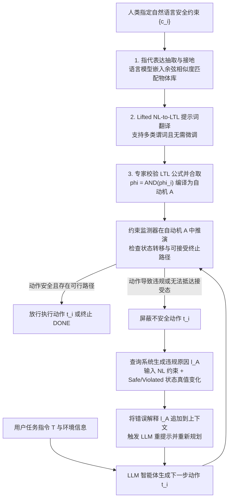

# Plug in the Safety Chip: Enforcing Constraints for LLM-driven Robot Agents

## 一句话定义

**Safety Chip**（[arXiv:2309.09919](https://arxiv.org/abs/2309.09919)，[项目页](https://yzylmc.github.io/safety-chip/)，[官方代码](https://github.com/YzyLmc/ltl_safety)）是布朗大学提出的可插拔机器人安全约束模块：将人类以自然语言给出的禁止性/时序性约束（“don’ts”）经上下文学习翻译并经专家校验为线性时序逻辑（LTL）自动机，在 LLM 智能体规划与执行时实时监测命题真值、剪枝违规动作，并将违规原因回注提示词（reprompting）引导智能体安全重规划。

## 英文缩写速查

| 缩写 | 英文全称 | 简要说明 |
|---|---|---|
| LTL | Linear Temporal Logic | 线性时序逻辑，用于无歧义地形式化表达全局禁忌、先后顺序与触发义务等安全约束 |
| NL | Natural Language | 自然语言，人类设计者向系统输入安全约束的初始表达形式 |
| RE | Referring Expression | 指代表达，翻译阶段从自然语言约束中抽取出并映射到环境实体/地标的短语 |
| HRI | Human-Robot Interaction | 人机交互，本文关注任务规划层面上由语言指定的安全约束满足 |
| PDDL | Planning Domain Definition Language | 规划域定义语言，文中对比的一类形式化规划表征 |

## 核心信息

| 字段 | 内容或状态 |
|---|---|
| 论文 | [arXiv:2309.09919v3](https://arxiv.org/abs/2309.09919)（cs.RO，2023-11-28） |
| 作者与机构 | Ziyi Yang、Shreyas S. Raman、Ankit Shah、Stefanie Tellex（Brown University） |
| 项目页 / 官方代码 | [项目主页](https://yzylmc.github.io/safety-chip/) / [GitHub: YzyLmc/ltl_safety](https://github.com/YzyLmc/ltl_safety)（注：stub 入口记为官方代码仓；本页依据论文全文整理，未单独审计仓库代码运行态） |
| 验证平台与语言模型 | VirtualHome（20 项家务任务，最高 5 条约束）；Boston Dynamics Spot 实机（23 个物体/地标，最高 10 条约束）；主模型 `gpt-4-0613` |
| 清单分类 / 来源条目 | `harness.infrastructure` / `survey_ax_2309_09919` |

## 为什么重要

- **补齐“只教做什么、不教不能做什么”的缺口**：现有 LLM 机器人规划（如 SayCan、Code as Policies）重点解决如何完成任务（“dos”），而现实与工业标准（如 ISO 61508）要求对禁止状态与时序违规提供可验证的安全保障（“don’ts”）。
- **突破纯自然语言约束随复杂度崩塌的瓶颈**：在 Spot 真机实验中，当同时施加超过 5 条安全约束时，直接把约束写进提示词的 `NL Constraints` 安全率跌至 **0%**，而基于形式化自动机的 Safety Chip 仍保持 **100%**。
- **黑盒兼容与主动重规划兼顾**：不依赖于底层语言理解系统的内部结构，最坏情况下可阻断进入不安全状态；当接入 LLM 智能体时，还能通过“自动机状态差异 + LLM 违规解释”进行上下文重提示（reprompting），在不违反安全的前提下完成原任务或主动中止自相矛盾任务。

## 核心方法

系统以**组合 LTL 自动机 $A$** 为核心，串联**自然语言到 LTL 翻译**、**运行时约束监测与剪枝**以及**可查询违规解释与重提示**三大模块。

### 方法流程图

1. **NL 到 LTL 的全提示词翻译与验证（§III-C, Appendix B）**：借鉴 `Lang2LTL` 模块化框架但无需微调。每条约束先抽取指代表达（RE）并基于语义嵌入余弦相似度接地到预定义物体/地标词表，再将替换占位符后的“提升语句（lifted utterance）”翻译为带谓词语法的 LTL 公式（除导航谓词 `agent_at()` 外，支持 `is_switchedon()`、`is_open()`、`is_grabbed()`、`is_touched()`、`is_on()`、`is_in()`）。各子公式以逻辑与（`&`）合取为单一公式 $\phi = \bigwedge_i \phi_i$ 并编译为自动机 $A$，由专家核验公式正确性。
2. **基于自动机推演的动作剪枝（§III-D）**：持续追踪各命题真值并在自动机 $A$ 上推进部分动作轨迹 $\{t_0, \dots, t_i\}$。一条轨迹合法当且仅当所有状态转移有效且末状态仍存在通往接受态的路径（或当执行终止指令时末状态本身位于接受态）。任何导致非法转移或死锁的候选动作会被直接屏蔽。
3. **可查询安全约束与闭环重提示（§III-E, §III-F）**：仅屏蔽不安全动作不会改变 LLM 的条件概率分布，模型仍可能反复采样同类错误动作。因此当监测器拦截违规时，将 NL 约束、合法/非法动作及自动机给出的命题真值变化（`Safe` vs `Violated`）送入查询系统，生成自然语言违规解释 $l_A$ 并作为 `Error:` 反馈写回规划器提示词，将采样分布由 $P(t'_i \mid l_{\text{agent}}, T_{0:i-1})$ 修正为 $P(t'_i \mid l_{\text{agent}}, T_{0:i-1}, l_A)$。

## 实验与评测

### 1. VirtualHome 仿真实验（§IV, Table I）

在 2 个家庭环境中评估 20 项任务，每项任务逐步施加 1 到 5 条可满足约束（覆盖 Menghi 等人的回避与触发模式），所有模型均使用 `gpt-4-0613`：

| 方法 | Four Room 成功率 | Four Room 安全率 | Mobile Manipulation 成功率 | Mobile Manipulation 安全率 |
|---|---:|---:|---:|---:|
| `Base Model`（无约束感知） | 90% | 38% | 94% | 30% |
| `NL Constraints`（原始 NL 约束） | **100%** | 56% | **100%** | 56% |
| `NL Constraints*`（专家重写的精确 NL） | **100%** | 54% | 96% | 62% |
| `Safety Chip`（自动翻译未校验） | 76% | 84% | 88% | 94% |
| `Safety Chip*`（专家校验 LTL） | 98% | **100%** | 98% | **100%** |

- `Four Room` 仅使用 `agent_at()` 导航谓词；`Mobile Manipulation` 扩展到 6 个操作状态谓词并在平均包含 105 个物体的环境中测试。
- 即使未经过专家校验的自动翻译版 `Safety Chip`，安全率（84% / 94%）也远高于直接提示自然语言约束的基线（54%–62%）；经过专家校验的 `Safety Chip*` 在两组仿真中均达到 **100%** 安全率且保持 **98%** 任务成功率。

### 2. Boston Dynamics Spot 实机部署与高复杂度压测（§V, Table II）

在包含 23 个物体与地标的室内扫描图环境中运行 2 项移动操作任务，每项任务约束数量翻倍至最多 **10 条**（`temperature = 0`，每项运行 2 次，假设专家已校验 LTL 且无机械执行故障）：

| 方法 | 综合成功率 | 综合安全率 | `< 5` 条约束安全率 | `> 5` 条约束安全率 |
|---|---:|---:|---:|---:|
| `Code as Policies` | 53% | 55% | 70% | 40% |
| `NL Constraints` | **98%** | 34% | 75% | 0% |
| `Safety Chip` | **98%** | **100%** | — | **100%** |

- **自相矛盾任务中止测试（3 项任务）**：当安全约束与任务目标本身冲突时，`NL Constraints` 与 `Code as Policies` 仍试图完成任务并触发安全违规，而 `Safety Chip` 成功捕获冲突并安全中止，未访问任何不安全状态。

## 与现有工作的对比

| 对比路线 | 代表方法 | 核心差异与局限 |
|---|---|---|
| 纯提示词内联约束 | `NL Constraints`（SayCan / LLM-Planner 风格） | 依赖 LLM 内部推理，>5 条约束时安全率崩塌至 0%，且在目标冲突时仍倾向执行违规动作 |
| 代码生成策略 | `Code as Policies`（CaP） | 一次性生成完整 Python 脚本，结构上难以在单步动作间接入闭环状态校验与重提示纠错 |
| 神经网络安全打分 | Grounded Decoding 等 | 依赖预训练安全/可供性模型，难以零样本定制新环境或新人类禁忌且缺乏形式化保证 |
| LLM + PDDL 规划 | LLM+P | 要求问题能完整纳入 PDDL 语法，表达力受限；Safety Chip 把形式化约束限制在安全模块内，规划仍保留 LLM 的 NL 灵活性 |

## 常见误区或局限

- **仍需人类专家核验翻译出的 LTL 公式**：若跳过专家验证（即表格中的非 `*` 版本），NL-to-LTL 错译会拉低表现（Four Room 中 `Safety Chip` 成功率由 98% 降至 76%、安全率由 100% 降至 84%）。
- **依赖准确的命题真值函数与预定义词表**：仿真中直接读取模拟器状态判定真值，真机中假设预定义技能和状态访问接口可靠，且不支持开放词表新谓词或神经网络真值估计（论文列为未来工作）。
- **真机实验假设无底层机械/执行故障**：验证聚焦于“任务规划层的约束遵守能力”，而非物理碰撞恢复或传感器噪声处理。
- **不等于已通过 ISO 61508 认证**：论文明确指出，该方法提供了一条可验证的形式化表达路径，但真正满足 ISO 61508 工业安全标准超出本文范围。

## 结论

**Safety Chip 验证了“LLM 负责高层规划与自然语言交互 + 形式化 LTL 自动机负责硬性监测与违规解释”的混合架构是提升机器人智能体安全合规性的有效路径。**

1. **不要依赖提示词自身去遵守复杂禁忌**：随着约束数量超过 5 条或目标与约束冲突，纯文本提示和代码生成策略的安全率会断崖式下跌。
2. **用自动机状态差异驱动 LLM 解释，而非让 LLM 直接做安全判定**：LLM 易产生分类幻觉，应由确定的自动机判断 `Safe`/`Violated`，仅让 LLM 把真值变化翻译成人话错误提示。
3. **重提示（Reprompting）是维持高成功率的关键**：仅做动作掩码不改变模型后续采样分布，必须把违规解释回注上下文才能引导规划绕开禁区（在 Spot 上维持 98% 成功率）。
4. **把“验证翻译公式”替代“手写公式”**：工程上采用提示词分段生成 LTL + 人工核验合取，可显著降低形式化安全规则的编写门槛。
5. **在开放环境部署前需补齐感知接地**：未来落地需结合基于视觉/神经网络的命题真值估计器，以摆脱对模拟器真值或预扫描物体库的依赖。

## 关联页面

- [Agentic Robots 综述](paper-towards-agentic-robots-survey.md)
- [全量项目节点清单](../overview/awesome-agentic-robots-node-index.md)
- [安全滤波器（Safety Filter）](../concepts/safety-filter.md)
- [机器人安全状态机](../concepts/robot-safety-state-machine.md)
- [LLM 与机器人控制接口](../concepts/llm-robotics-control-interfaces.md)
- [ArmedAgent：编码智能体具身安全](paper-armedagent-coding-agent-embodied-safety.md)
- [ProgPrompt](paper-agentic-2209-11302.md)

- [机器人智能体执行框架](../methods/robot-agent-harness.md)：对照规划、执行接口与反馈机制。

## 参考来源

- [官方 Awesome 快照归档](../../sources/repos/awesome-agentic-robots-survey-index.md)
- [论文原文 arXiv:2309.09919](https://arxiv.org/abs/2309.09919)（Plug in the Safety Chip: Enforcing Constraints for LLM-driven Robot Agents，v3）
- [项目页](https://yzylmc.github.io/safety-chip/) 与 [官方代码仓库](https://github.com/YzyLmc/ltl_safety)
