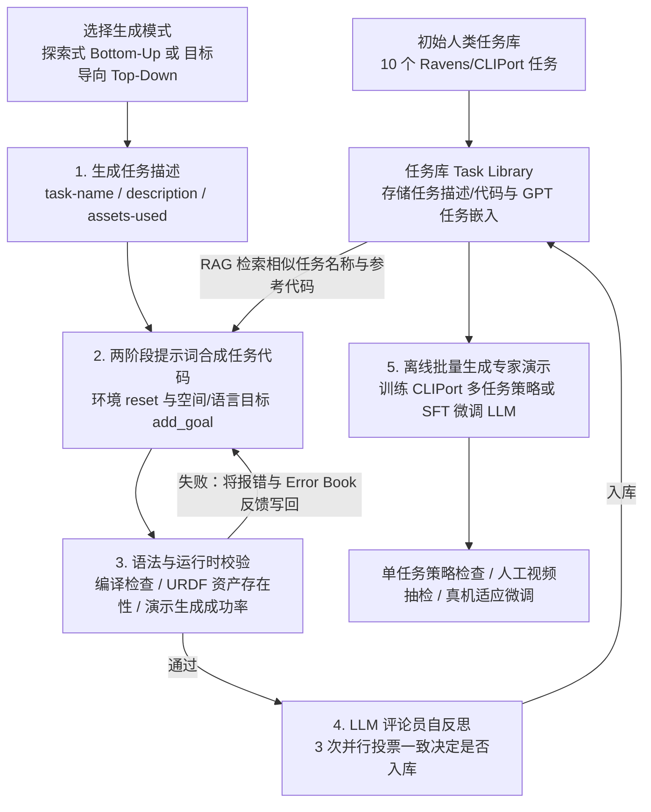

# GenSim: Generating Robotic Simulation Tasks via Large Language Models

## 一句话定义

**GenSim**（[arXiv:2310.01361](https://arxiv.org/abs/2310.01361)，ICLR 2024，[项目页](https://liruiw.github.io/gensim)，[官方代码](https://github.com/liruiw/GenSim)）是一套面向策略学习的 LLM 自动仿真任务生成框架：通过程序合成自动编写桌面操作任务的资产配置、目标判定与语言指令代码并产出专家演示，经多级执行验证与任务库自反思筛选后，用于多任务视觉-语言-动作策略预训练及开源/闭源大模型的代码微调。

## 英文缩写速查

| 缩写 | 英文全称 | 简要说明 |
|---|---|---|
| GenSim | Generating Robotic Simulation Tasks via LLMs | 本文提出的大模型自动仿真任务与演示生成框架 |
| RAG | Retrieval-Augmented Generation | 检索增强生成，本文用于从任务库检索参考代码以辅助新任务生成 |
| SFT | Supervised Fine-Tuning | 有监督微调，利用 GPT-4 生成的任务库微调 GPT-3.5 与 Code-LLaMA |
| LoRA | Low-Rank Adaptation | 低秩自适应微调方法，用于在双 V100 GPU 上微调 Code-LLaMA-Instruct |
| URDF | Unified Robot Description Format | 统一机器人描述格式，仿真任务代码中用于加载机械臂与桌面物体资产 |

## 核心信息

| 字段 | 内容或状态 |
|---|---|
| 论文 | [arXiv:2310.01361v2](https://arxiv.org/abs/2310.01361)（cs.LG，2024-01-21；ICLR 2024 会议论文） |
| 作者与机构 | Lirui Wang、Yiyang Ling、Zhecheng Yuan、Mohit Shridhar、Chen Bao、Yuzhe Qin、Bailin Wang、Huazhe Xu、Xiaolong Wang（MIT CSAIL、UCSD、上海交大、清华、华盛顿大学、CMU） |
| 项目页 / 代码 / Demo | [liruiw.github.io/gensim](https://liruiw.github.io/gensim) / [GitHub: liruiw/GenSim](https://github.com/liruiw/GenSim) / [HF Demo](https://huggingface.co/spaces/Gen-Sim/GenSim)（本页依据论文全文整理，未单独审计外部仓库运行时） |
| 仿真与真机平台 | 仿真：PyBullet / Ravens（UR5e + 吸盘，顶视 RGB-D）；真机：XArm-7 + 吸盘 + 俯视 RGB-D 相机 |
| 清单分类 / 来源条目 | `environment.task_generation` / `survey_ax_2310_01361` |

## 为什么重要

- **将仿真扩展重点从“场景随机化”推进到“任务级多样性”**：传统域随机化主要改变物体位姿与纹理，人工设计基准往往只有十余至上百个任务；GenSim 把每个任务定义为一类可执行代码，从 10 个人工 Ravens/CLIPort 任务自动扩展出 120 个多样化任务（开源发布 100 任务基准）。
- **把大模型推理能力蒸馏到低层视觉-运动策略**：LLM 不直接在真机在线推理，而是通过批量合成仿真任务与专家演示，将语言-空间组合能力蒸馏到轻量级双流 Transporter（CLIPort）策略网络中，显著增强少样本与零样本任务泛化。
- **形成任务库驱动的模型自举与微调闭环**：用 GPT-4 生成的高质量任务代码库（112 个任务）反哺微调 GPT-3.5 与开源 `Code-LLaMA-Instruct 7B/13B`，使开源模型也能稳定输出结构化 PyBullet 任务类。

## 核心方法

GenSim 由**任务创建器（Task Creator）**、**任务库（Task Library）**与**LLM 监督多任务策略（Multitask Policy）**三大组件构成，支持**探索式（Bottom-Up）**与**目标导向式（Top-Down）**两种生成模式。

### 方法流程图

1. **双模式两阶段任务创建器（§2.1, Appendix D.2）**：
   - **探索式（Exploratory / Bottom-Up）**：在未知目标任务时，从任务库已有名称与代码出发，以 `temperature=1` 鼓励提出新颖且物理可行的任务描述，再以 `temperature=0` 从库中检索参考代码（RAG）合成完整 `Task` Python 类。
   - **目标导向（Goal-directed / Top-Down）**：给定目标任务名称（如 `build-car`），自顶向下拆解并生成有助于通往目标的课程任务及目标代码本身。
2. **多级反馈与任务库记忆（§2.2, Appendix D.5）**：生成的任务代码需依次经过 Python 语法检查、PyBullet 运行时与专家演示生成验证（如环境演示成功率低于 50% 或超时则拒绝），随后由 3 个并行 LLM 评论员（`temperature=0.5`）一致表决是否具备新颖性与语言-代码一致性后才写入任务库。此外利用代码嵌入（PCA + t-SNE 聚类）检索相关任务用于联合策略训练。
3. **策略蒸馏与模型微调（§2.3, §3.1, Appendix A.4）**：利用任务库自动采集专家演示，训练支持多样本批处理的 CLIPort 双流策略（顶视 RGB-D 下采样至 $320 \times 160$ 输出抓取与放置可供性图）。同时将 112 个 GPT-4 生成任务打包用于对 GPT-3、GPT-3.5 及 `Code-LLaMA-Instruct 7B/13B` 进行 LoRA 有监督微调。

## 实验与评测

### 1. LLM 仿真任务代码生成评测（§3.1, Fig. 6, Appendix A.1/A.4）

- **探索式生成**：从 10 个人工任务起步，共生成 **120** 个多样化任务（开源释放 100 任务基准）；消融显示“任务描述与代码分离的两阶段提示链 + 少样本参考 + 任务库”在 `syntax-correct`、`runtime-verified` 与 `task completed` 三级递进通过率上明显优于单提示词与零样本设置。
- **目标导向生成（10 个留出任务 × 3 次尝试）**：GPT-4 整体领先；未经微调的 `Code-LLaMA-Instruct` 在零样本/少样本下几乎无法遵循 Ravens 类结构，在 112 个 GPT-4 任务上经 LoRA 微调（10 epochs，3000 次迭代，双 V100 约 4 小时）后，代码生成性能接近 GPT-3.5。
- **人工视觉抽检开销（§3.4, Table 3）**：3 名不同经验用户抽检 30 个生成任务视频，平均每任务耗时约 **10 秒**（User 1: 12.83s / 通过率 0.80；User 2: 5.11s / 0.63；User 3: 17.4s / 0.41），平均通过率超过 **50%**。

### 2. 仿真策略训练与任务级泛化（§3.2, §3.4, Table 2）

在 Ravens 基准（0–100 部分计分制，UR5e + 吸盘）上评估语言条件策略：

- **少样本联合训练增益**：在 5 条演示等低数据条件下，联合相关 GPT-4 生成任务训练可将原 CLIPort 任务性能提升 **超过 50%**。
- **零样本跨任务迁移**：仅在 10 个原 CLIPort 任务上训练的策略在 GPT 任务上成功率 **低于 5%**；随着预训练 GPT 任务数量增加，策略对未见过的 Ravens 基准任务展现出约 **40%** 的零样本迁移性能。
- **生成任务可学性验证（Table 2，每任务 200 条演示，10 任务子集）**：GPT-4 生成任务的平均单任务成功率为 **75.8%**、多任务成功率为 **74.1%**，与人工设计的 CLIPort 任务（单任务 **76.6%**，多任务 **76.1%**）几乎持平。代表任务得分如下：

| 示例生成任务 | 单任务成功率 (%) | 多任务成功率 (%) | 示例生成任务 | 单任务成功率 (%) | 多任务成功率 (%) |
|---|---:|---:|---|---:|---:|
| `build-car` | 84.1 | 85.4 | `insert-blocks-lineup` | 30.8 | 40.2 |
| `color-coordinated-sphere-insertion` | 84.1 | 80.0 | `move-piles-along-line` | 67.8 | 49.0 |
| `cylinder-ring-stack` | 99.2 | 93.0 | `manipulating-two-ropes` | 99.0 | 98.8 |
| `multi-level-block-construction` | 27.7 | 32.7 | `color-ordered-insertion` | 93.0 | 94.0 |
| `stack-blocks-in-container` | 82.0 | 81.0 | `align-cylinders-in-zones` | 91.2 | 87.8 |

### 3. 真机 XArm-7 Sim2Real 长程任务适应（§3.3, Table 1, Appendix C）

在真机 XArm-7（吸盘末端 + 俯视 RGB-D）上，用少量真机数据（12 项任务合计 205 个 episode / 665 个样本，配合颜色抖动与语言重标注）对仿真预训练策略微调 50 个 epoch（< 3 小时），每任务测 **10 次**：

| 预训练与适应设置 | 12 项真机任务平均成功率 | 典型任务表现与观察 |
|---|---:|---|
| `No Adaptation`（仿真策略零样本直迁） | **0%** (0/10 全任务) | 无真机微调时无法适应真实桌面视觉域，可供性热图发散 |
| `No Pretrain`（仅用真机少样本从头训） | **27.5%** | 在 `block-tower-on-corner`、`pair-blocks-on-line`、`build-wheel` 等长程任务均为 0/10 |
| `CLIPort`（仅 10 个人工仿真任务预训练） | **39.2%** | 在 `build-wheel`（0/10）、`pair-blocks-on-line`（0/10）上明显受限 |
| `GenSim (50 Tasks)`（50 个生成任务预训练） | **46.7%** | 较 `CLIPort` 提升，但 `build-wheel` 仍为 0/10 |
| `GenSim (70 Tasks)`（70 个生成任务预训练） | **62.5%** | 较 `CLIPort` 提升超 **20%**（摘要称较基线提升 25%），`stack-block` 达 10/10、`build-wheel` 达 3/10，且能迁移至未见资产任务（`sort-garbage` 4/10、`place-bread` 3/10） |

## 与现有工作的对比

| 对比维度 | 传统域随机化 / 资产生成 | LLM 规划/奖励生成（Code as Policies / Yu et al.） | GenSim |
|---|---|---|---|
| 扩展对象 | 物体位姿、颜色、纹理或单个 3D 资产 | 在线策略代码或单任务 RL 奖励函数 | **任务逻辑本身**（资产组合、目标函数、语言模板与演示） |
| 数据流向 | 固定任务集内增加视觉/物理扰动 | LLM 直接参与运行时推理 | 离线生成仿真任务库并蒸馏为低层多任务视觉-运动策略 |
| 泛化目标 | 物体实例级或视觉域鲁棒性 | 依赖在线 LLM 调用的零样本规划 | 无需在线 LLM 的端到端策略**任务级泛化**与真机快速适应 |

## 常见误区或局限

- **仅覆盖俯视吸盘 Pick-and-Place 任务**：论文所有仿真与真机动作均参数化为两组末端位姿（使用吸盘），尚未扩展至多指灵巧操作、高自由度接触丰富动作或复杂动力学任务。
- **代码生成仍存在幻觉与语义错位**：附录 A.5 详细列出六大失败模式——**重复任务**（换名不换质）、**语言与代码目标不匹配**（执行校验无法自动发现）、**不可达/未接地的动作序列**（如用铲子过墙或物理不可行的堆碗）、**冗余噪声描述**、**任务分布失衡**（偏向颜色匹配抓放）以及**语法/API 幻觉**。
- **自动校验指标不完备，仍需人工把关**：语法与演示生成通过率高并不保证语言指令与任务物理行为一致，大规模训练前仍需轻量人工视频抽检过滤。
- **真机零样本直迁不可行**：`No Adaptation` 在真机 12 任务上全为 0%，Sim2Real 迁移仍依赖每任务 10–25 个真机样本的 50-epoch 微调。

## 结论

**GenSim 验证了用 LLM 批量合成可执行仿真任务代码并蒸馏到视觉-语言-动作策略的可行性：任务数量与多样性的扩展（10 $\to$ 70 任务）直接转化为多任务策略的少样本、零样本与真机适应增益。**

1. **采用“描述先行 + RAG 参考代码 + 多级校验”的两阶段代码生成链**：避免零样本直出长仿真脚本导致的 API 幻觉与结构崩塌。
2. **不能只用“代码可运行”作为入库标准**：必须结合多 LLM 评论员一致性反思与轻量人工视频抽检，拦截“代码能跑但与语言描述不符”的隐性脏任务。
3. **根据目标选择任务采样策略**：做单任务少样本增强时用代码嵌入检索最相关任务联合训练（提升 >50%）；训练通用基座策略时用探索式生成拉大任务多样性（70 任务真机微调达 62.5%）。
4. **用合成任务库微调开源代码模型可大幅降本**：基于 GPT-4 产出的 112 个任务做 LoRA 微调，能使 Code-LLaMA-13B 具备接近 GPT-3.5 的仿真代码生成能力。
5. **Sim2Real 仍需少量真机微调与数据重标注**：预训练赋予了语义与结构先验，但跨越真实相机与桌面背景差异仍需配套少量真实示教微调。

## 关联页面

- [Agentic Robots 综述](paper-towards-agentic-robots-survey.md)
- [全量项目节点清单](../overview/awesome-agentic-robots-node-index.md)
- [MetaGenSim：学习该在仿真里生成什么数据](paper-metagensim.md)
- [Sim2Real](../concepts/sim2real.md)
- [机器人仿真三层架构](../concepts/robot-simulation-three-layers.md)
- [生成式数据增强](../methods/generative-data-augmentation.md)
- [行为克隆（Behavior Cloning）](../methods/behavior-cloning.md)

- [机器人智能体执行框架](../methods/robot-agent-harness.md)：对照规划、工具调用与反馈的系统边界。

## 参考来源

- [官方 Awesome 快照归档](../../sources/repos/awesome-agentic-robots-survey-index.md)
- [论文原文 arXiv:2310.01361](https://arxiv.org/abs/2310.01361)（GenSim: Generating Robotic Simulation Tasks via Large Language Models，ICLR 2024 / v2）
- [GenSim 项目页](https://liruiw.github.io/gensim) 与 [官方代码仓库](https://github.com/liruiw/GenSim)
