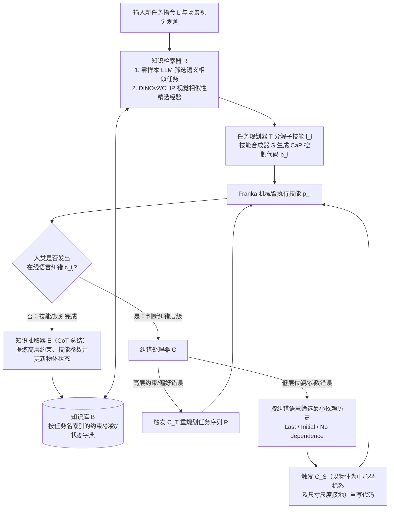

# Distilling and Retrieving Generalizable Knowledge for Robot Manipulation via Language Corrections

## 一句话定义

**DROC**（Distillation and Retrieval of Online Corrections，[arXiv:2311.10678](https://arxiv.org/abs/2311.10678)，[项目页](https://sites.google.com/stanford.edu/droc)）是斯坦福大学与 Google DeepMind 提出的 LLM 机器人纠错与记忆复用框架：在执行期动态判断人类在线语言纠错属于高层任务规划还是底层技能代码参数，按需抽取最小历史上下文完成修正；在任务结束后利用思维链将交互历史蒸馏为可复用的结构化知识库，并通过语言语义与 DINOv2/CLIP 视觉特征检索服务新任务。

## 英文缩写速查

| 缩写 | 英文全称 | 简要说明 |
|---|---|---|
| DROC | Distillation and Retrieval of Online Corrections | 本文提出的在线语言纠错蒸馏与检索系统 |
| CaP | Code as Policies | 用 LLM 将语言技能直接合成为可执行机器人控制代码的基础范式与对比基线 |
| SAM | Segment Anything Model | 通用图像分割模型，本文中与 CLIP 联合构成开放词表物体感知模块 |
| DINOv2 | Self-Distilled Vision Transformer v2 | 无监督视觉特征模型，本文用于衡量物体形状与状态相似性的视觉检索 |
| CoT | Chain-of-Thought | 思维链提示技术，知识抽取器用其总结可泛化经验与更新物体状态 |

## 核心信息

| 字段 | 内容或状态 |
|---|---|
| 论文 | [arXiv:2311.10678v2](https://arxiv.org/abs/2311.10678)（cs.RO，2024-03-21） |
| 作者与机构 | Lihan Zha、Yuchen Cui、Li-Heng Lin、Minae Kwon、Dorsa Sadigh（Stanford University）；Montserrat Gonzalez Arenas、Andy Zeng、Fei Xia（Google DeepMind） |
| 项目页 / 资料入口 | [sites.google.com/stanford.edu/droc](https://sites.google.com/stanford.edu/droc)（论文脚注注明项目页提供完整提示词与视频；本页依据论文全文整理，未见独立源码仓库链接） |
| 硬件与模型栈 | 真机 Franka Emika Panda 桌面操作；LLM 模块统一采用 GPT-4；视觉感知使用 SAM + CLIP，检索采用 DINOv2 + CLIP |
| 清单分类 / 来源条目 | `model.adaptation`, `harness.skills` / `survey_ax_2311_10678` |

## 为什么重要

- **同时打通“高层规划纠错”与“低层技能参数纠错”**：以往方法要么只能改任务步骤顺序（如 Inner Monologue），要么只改单层轨迹/奖励；DROC 能在同一交互流中既响应“应该先开抽屉”，也响应“往右偏一点 / 再继续一点”等依赖动作历史和物体坐标系的细粒度修正。
- **把一次性上下文纠错沉淀为长期跨任务记忆**：传统上下文缓冲会随任务结束或长度溢出而丢失纠错经验；DROC 在线蒸馏“机器人约束（如单臂限制）、用户偏好、场景状态与抓取参数”，从而在相同或相似新任务上持续降低人类干预次数 $\bar{J}$。
- **证明视觉相似性对操作知识检索的必要性**：仅靠文本指令相似度无法区分“横杆把手抽屉 vs 旋钮抽屉”或“正放水杯 vs 倒扣水杯”，引入 DINOv2 视觉-视觉检索可准确匹配对应的底层操作策略与抓取位姿。

## 核心方法

DROC 将操作任务分解为任务规划器 $T: L \mapsto (\ell_1, \dots, \ell_M)$ 与代码级技能合成器 $S: \ell \mapsto p$（基于 CaP 风格 Python API，感知调用 SAM + CLIP），并在其外围构建三大核心推理模块：**纠错处理器 $C$（怎么改）**、**知识抽取器 $E$（记什么）**与**知识检索器 $R$（取什么）**。

### 方法流程图

1. **纠错处理器 $C$（how-to-respond，§III）**：
   - **分层路由**：首先由 LLM 判别人类中断纠错 $c^i_j$ 属于高层（如约束“单臂一次只能抓一物”或用户偏好，交由 $C_T$ 重规划）还是低层（如末端偏移、抓取参数，交由 $C_S$ 重写代码）。
   - **最小历史依赖裁剪**：直接把完整交互历史 $H$ 塞进提示词会淹没关键信号；DROC 仅向 LLM 传入当前纠错文本 $c^i_j$，将其对历史上下文的依赖归类为三档之一——`(a) Last interaction`（如“Keep going”）、`(b) Initial interaction`（如“Now you can continue”）或 `(c) No dependence`（如“Move right a little bit”），从而精准抽取出 $H^i_r$。
   - **物体中心坐标系与模糊尺度接地**：$C_S$ 结合物体几何属性（如法向量）推断人类指令使用的是绝对坐标系还是以物体为中心的局部坐标系（如开抽屉时的“向前一点”即朝向抽屉），并将“a little bit”等模糊距离锚定到目标物体的尺寸尺度。
2. **知识抽取器 $E$（what-to-remember，§III）**：在技能或整套规划成功后，以思维链（CoT）从完整历史 $H$ 中分别蒸馏**规划级知识**（任务约束、机器人物理限制、用户偏好、歧义物体消解标签）与**技能级知识**（抓取位姿、拉出距离等保存变量、修正后代码/计划与物体视觉特征），以任务名为键存入字典知识库 $B$，并同步更新物体状态（如 `top drawer(open)`）。
3. **知识检索器 $R$（what-to-retrieve，§III）**：面对新任务查询时分两步检索：（a）先由 LLM 零样本筛选语义相关的历史任务（全局共享的机器人约束和用户偏好始终被检索）；（b）再比对目标物体的视觉相似度以锁定正确经验——对于“不同状态/几何形状决定不同动作策略”的匹配，采用现成 **DINOv2** 特征做视觉-视觉匹配；当查询本身含颜色等视觉描述（如“white drawer”）时，采用 **CLIP** 特征做视觉-语义匹配。

## 实验与评测

全部实验在真机 **Franka Emika Panda** 桌面环境上完成，所有 LLM 模块采用 **GPT-4**。

### 1. 技能级在线纠错与跨迭代泛化（§IV, Table I, Fig. 3）

在 **5 项技能级操作任务**上进行评测，每项任务跨不同物体位置/实例重复迭代 3 次（每次更换配置），每组取 **6 轮实验平均**（由 3 位作者担任 oracle 用户提供一致纠错）：

- **任务集（Table I）**：`Open drawer`（2 个抽屉，学习 Grasp/Pull）、`Put scissors in drawer`（2 把剪刀 × 2 抽屉）、`Put tape in drawer`（5 种胶带 × 2 抽屉）、`Hang cup on the rack`（正放与倒扣两种杯姿）、`Pick up object`（6 种物体）。
- **核心量化结论（摘要与 §IV 正文）**：
  - 相比直接把纠错当作全新指令的 `Code as Policies (CaP)` 基线，DROC 在**第一轮所需的纠错次数不到 CaP 的一半**；
  - 经过**两轮迭代**积累知识后，DROC 在新物体位置与实例上**几乎不再需要人类纠错（little to no corrections）**。
  - 在包含颜色干扰与朝向差异的 `Hang cup on the rack` 消融中，去掉视觉检索的 `Ours-V` 无法区分倒扣杯（需先翻转再挂）与正放杯，证实了 DINOv2 视觉检索的必要性；去掉初始历史蒸馏（`Ours-H`）或历史裁剪抽取器（`Ours-E`）均不如完整 DROC。
  - **跨物体/跨任务技能参数迁移（`Ours+Transfer`）**：在 `Pick up object` 复用其他物体历史、在 `Put tape in drawer` 复用 `Put scissors in top white drawer` 历史后，进一步降低了所需在线纠错次数。

### 2. 规划级知识蒸馏与跨任务迁移（§IV, Table I & Table II）

在 **7 个长程规划场景**上测试四类知识泛化（每个场景先在左侧训练任务接受纠错并蒸馏知识，再在右侧未见测试任务上统计平均所需纠错次数，每场景重复 **3 次试验**）：

| 泛化维度 | 训练 $\to$ 测试任务示例（蒸馏核心约束） | `DROC (Ours)` 测试均纠错次数 $\downarrow$ | `Ours-R`（无蒸馏仅朴素检索计划） $\downarrow$ |
|---|---|---:|---:|
| User Preferences（用户偏好） | *Put scissors in drawer* $\to$ *Clean the table*（文具放白抽屉）；*Bring cup of coffee* $\to$ *Make cup of coffee*（不喝黑咖啡） | **0.5** | 1 |
| Feasibility of Plans（规划可行性） | *Heat milk in fridge* $\to$ *Slice carrot*（“单臂机器人”）；*Sort blocks to drawer*（同色同抽屉） | **0.67** | 1.33 |
| Common-sense Reasoning（常识推理） | *Put shoes on rack* $\to$ *Sort clothes into shelf*；*Set dinner table* $\to$ *I want to have lunch* | **0** | 1.5 |
| Scene Information（场景信息） | *Place book on shelf* $\to$ *Put DVD on shelf*（“白架子已满”） | **0.5** | 1.5 |

## 与现有工作的对比

| 对比方法 | 处理纠错的方式 | 与 DROC 的核心差异 |
|---|---|---|
| Inner Monologue / ReAct | 通过上下文内语言反馈调整高层步骤规划 | 仅限任务规划层，无法针对细粒度动作参数纠错，且上下文覆盖后即遗忘 |
| Language-to-Reward / KITE / VoxPoser | 修改底层奖励函数、关键点或 3D 价值图以响应低层纠错 | 聚焦低层控制修正，缺乏高层规划纠错与跨任务经验蒸馏机制 |
| Code as Policies (`CaP`) | 将纠错作为全新指令重新生成代码 | 无纠错历史抽取、无经验蒸馏与视觉检索模块，首轮纠错次数超过 DROC 两倍 |
| Voyager / ExpeL | 在游戏或问答中总结经验并做文本相似度检索 | 面向纯文本或仿真游戏；DROC 解决物理操作中的层次化纠错与视觉外观（DINOv2）检索难题 |

## 常见误区或局限

- **依赖人类在线观察并主动触发纠错**：系统假设人类用户能在机器人即将犯错时及时发现并提供准确的自然语言修正（论文指出当时 VLM 尚无法替代人类识别“抓偏几厘米”之类的细粒度操作失败）。
- **物体状态追踪未实现全自动视觉闭环**：论文提到测试时发现开源 VLM 对视角与物体位置敏感、需要大量提示词调优，因此实际实现将初始状态设为 `N/A`，由 LLM 在技能执行与纠错后文本更新物体状态。
- **底层能力受限于预定义代码 API 与视觉分割**：技能合成依赖于人工预先封装好的动作/感知函数（`move_to_pose`、`get_task_pose`、SAM+CLIP），无法通过语言纠错学出 API 之外的新型灵巧接触技能。
- **依赖闭源大模型 GPT-4 推理**：所有模块均运行在 GPT-4 上，实时交互延迟与知识库随长期运行可能出现的规则冲突消解未在文中深入评测。

## 结论

**DROC 展示了一条无需重新训练底层策略权重、通过“分层纠错 + 结构化蒸馏 + 语义/视觉双路检索”让机器人越用越少人类干预的轻量适配路径。**

1. **不要把所有纠错历史一股脑塞进提示词**：按“上一轮 / 初始轮 / 无依赖”对低层纠错做依赖分类裁剪，比全量历史（`Ours-E`）更准确且节省上下文。
2. **明确分离“规划重排”与“代码参数重生成”两条路径**：高层约束与低层位姿纠错所需的上下文与输出形式完全不同，必须先判别层级再路由处理。
3. **跨任务检索必须引入形状敏感的视觉特征**：对于物理操作而言，文本指令和纹理相似具有欺骗性，DINOv2 特征能有效区分把手类型或物体朝向差异。
4. **用 CoT 蒸馏结构化约束替代原始对话复用**：在四类规划级迁移任务中，仅检索原始计划的 `Ours-R` 所需纠错次数是蒸馏版 DROC 的 2 倍以上（1–1.5 vs 0–0.67）。
5. **交互式纠错时优先在物体中心坐标系下 grounding 方向与尺度**：将“往左一点”映射到目标物体法向与尺寸比例，是单目/局部纠错成功的关键工程技巧。

## 关联页面

- [Agentic Robots 综述](paper-towards-agentic-robots-survey.md)
- [全量项目节点清单](../overview/awesome-agentic-robots-node-index.md)
- [Agent 记忆与睡眠整合](../concepts/agent-memory-and-dreaming.md)
- [LLM 与机器人控制接口](../concepts/llm-robotics-control-interfaces.md)
- [Agentic 操作策略](../methods/agentic-manipulation-policies.md)
- [Voyager](paper-agentic-2305-16291.md)
- [REFLECT](paper-agentic-2306-15724.md)

- [机器人操作](../tasks/manipulation.md)：了解物体操作和抓取任务。

## 参考来源

- [官方 Awesome 快照归档](../../sources/repos/awesome-agentic-robots-survey-index.md)
- [论文原文 arXiv:2311.10678](https://arxiv.org/abs/2311.10678)（Distilling and Retrieving Generalizable Knowledge for Robot Manipulation via Language Corrections，v2）
- [DROC 项目页](https://sites.google.com/stanford.edu/droc)
