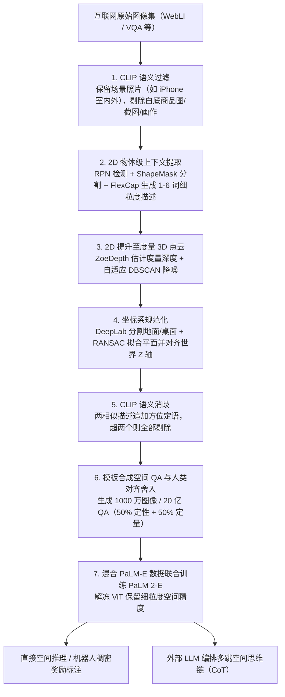

# SpatialVLM: Endowing Vision-Language Models with Spatial Reasoning Capabilities

## 一句话定义

**SpatialVLM**（[arXiv:2401.12168](https://arxiv.org/abs/2401.12168)，[项目页](https://spatial-vlm.github.io/)）是 Google DeepMind 与 Google Research 提出的数据合成与视觉-语言模型预训练方案：组合开放词表区域描述、分割与单目度量深度估计等现成视觉专家模型，将大规模 2D 互联网图像提升至规范化 3D 点云，自动生成 20 亿条 3D 空间问答对来联合微调 VLM，从而赋予模型定性空间关系判断与定量物理尺度（米/厘米）估计能力。

## 英文缩写速查

| 缩写 | 英文全称 | 简要说明 |
|---|---|---|
| VLM | Vision-Language Model | 视觉-语言模型，本文中以 PaLM 2-E（PaLM 2-S 骨干）为训练对象 |
| VQA | Visual Question Answering | 视觉问答任务，本文合成的 3D 空间推理训练与评测形式 |
| CoT | Chain-of-Thought | 思维链推理，本文中由外部 LLM 拆解复杂问题并反复查询 SpatialVLM 完成多跳空间推理 |
| DBSCAN | Density-Based Spatial Clustering of Applications with Noise | 基于密度的点云聚类算法，本文用于自适应去除 3D 物体点云离群点 |
| RANSAC | Random Sample Consensus | 随机抽样一致算法，本文用于拟合地面/桌面平面以实现点云坐标系规范化 |

## 核心信息

| 字段 | 内容或状态 |
|---|---|
| 论文 | [arXiv:2401.12168v1](https://arxiv.org/abs/2401.12168)（cs.CV，2024-01-22） |
| 作者与机构 | Boyuan Chen、Zhuo Xu、Sean Kirmani、Danny Driess、Pete Florence、Brian Ichter、Dorsa Sadigh、Leonidas Guibas、Fei Xia（Google DeepMind、Google Research） |
| 项目页 / 开源说明 | [spatial-vlm.github.io](https://spatial-vlm.github.io/)（本页依据论文全文整理；论文聚焦数据流水线与 PaLM 2-E 训练配方，未提供独立开源代码仓或模型权重下载说明） |
| 数据集与训练规模 | 1,000 万真实图像、**20 亿条**空间 VQA（50% 定性 + 50% 定量）；基座 `PaLM 2-E-S`（批大小 512，先冻结 ViT 训 110k 步，再解冻/冻结分支微调 70k 步） |
| 清单分类 / 来源条目 | `data.annotation` / `survey_ax_2401_12168` |

## 为什么重要

- **定位出 VLM“空间盲区”的数据根因**：GPT-4V 等前沿大模型在 3D 空间距离与尺寸比较上常拒绝作答或输出像素级错误答案，作者验证这并非模型架构瓶颈，而是互联网图文对缺乏 3D 度量空间标注。
- **首次在互联网规模把 2D 照片提升为 3D 度量空间 VQA 监督**：不依赖渲染器有限的合成资产，直接利用真实世界照片（WebLI 等）结合现成专家模型自动产出 20 亿条包含真实物理尺度单位的数据。
- **零外部工具即可输出物理尺度，并解锁机器人稠密奖励与多跳推理**：训练后的 VLM 不仅自身具备直接空间推理能力（且不损伤通用 VQA 表现），还能直接担任桌面操作轨迹的开放词表稠密奖励标注器，或作为 LLM 思维链调用的空间测量工具。

## 核心方法

SpatialVLM 包含两条主线：**3D 空间 VQA 自动数据合成流水线（§3.1–§3.2）**与**直接空间推理训练 + 空间思维链编排（§3.3）**。

### 方法流程图

1. **场景过滤与细粒度 2D 上下文抽取（§3.1, Appendix A.2）**：先用 CLIP 提示词过滤掉白底单物体图、画作与 GUI 截图（正例使用 `"an iphone photo of an indoor/outdoor scene"` 以匹配深度模型视场角分布）；随后运行 RPN+NMS 提框、类别无关分割 `ShapeMask` 与可配置长度的物体描述模型 `FlexCap`（1–6 词，如 `"cake shaped like a house"`），避免粗粒度目标类别导致的指代混淆。
2. **2D 到规范化 3D 点云及消歧（§3.1, Appendix A.2）**：利用单目度量深度模型 `ZoeDepth` 与视场角将像素反投影为米级 3D 点云，并用基于物体尺度自适应的 DBSCAN 去噪；接着用轻量分割模型识别地面/桌面并用 RANSAC 拟合主平面，将点云从相机坐标系旋转平移至世界水平坐标系（若平面点数不足则跳过依赖重力方向的仰角/上下类问题）。之后用 CLIP 嵌入余弦距离对同类描述消歧（成对相似补加方位后缀，三个及以上相似直接删除）。
3. **VQA 模板合成、训练与空间 CoT（§3.2–§3.3）**：围绕至多两个物体合成定性关系（左右、上下、前后、大小、高矮、宽窄比较）与定量数值问答（3D 中心距离、间隙、高度、宽度、海拔差、左右/前后差等；正文称 38 类、每类约 20 问句模板与 10 答句模板，附录 A.3 列举 43 个细分题型），并引入概率决策树模拟人类舍入习惯（如 0.86m 以 75% 概率答为 `1m`，20% 概率切换英制单位）。训练沿用 PaLM-E 架构但将语言骨干换为 **PaLM 2-S**，按 `174:2.5` 采样比（5% 空间推理 token）与原 PaLM-E 数据混合训练。复杂多跳任务则交由外部 LLM（如 `text-davinci-003` 或 GPT-4）拆解为原子问题反复询问 SpatialVLM。

## 实验与评测

### 1. 人工标注 Spatial VQA 基准评测（§4.1, Table 1 & Table 2）

在所有模型均未见过的 WebLI 图像子集上由人类标注 **331 道定性题** 与 **215 道定量题**（共 546 题）：

| 模型 | 定性二元谓词准确率 (Table 1) | 定量：成功输出数字比例 (Table 2) | 定量：落入真值 [50%, 200%] 区间比例 (Table 2) |
|---|---:|---:|---:|
| `GPT-4V`（2023-11 访问） | 68.0% | 1.0% | 0.0% |
| `LLaVA-1.5` | 71.3% | 20.9% | 13.0% |
| `InstructBLIP` | 60.4% | 26.0% | 7.9% |
| `PaLI`（PaLI-X 55B） | 60.7% | 52.0% | 5.3% |
| `PaLM-E`（12B） | 50.2% | 83.2% | 23.7% |
| `PaLM 2-E`（基线，未加空间数据） | 50.4% | 88.8% | 33.9% |
| `SpatialVLM (Ours)` | **75.2%** | **99.0%** | **37.2%** |

- `GPT-4V` 面对物理距离询问几乎总是拒答（如回复缺乏测量参照物），仅 1.0% 输出数字；`SpatialVLM` 在 99.0% 的题目中给出合法数值答案，且准确率大幅领先所有基线。

### 2. 通用 VQA 能力保持（§4.2, Table 3）

| 通用 VQA 基准 | `PaLM 2-E`（无空间协同训练） | `SpatialVLM (Ours)` | 变化 |
|---|---:|---:|---:|
| `OKVQA` | **61.4%** | 61.0% | -0.4% |
| `VQA v2` (test-dev) | 76.6% | **79.0%** | **+2.4%** |

### 3. 关键消融：ViT 冻结与合成噪声鲁棒性（§4.3–§4.4, Table 4 & Table 5）

- **解冻 ViT 对细粒度距离估计的作用（Table 4，从 110k 步起继续微调 70k 步）**：

| 视觉编码器设置 | `[50, 200]%` | `[66.7, 150]%` | `[90, 110]%`（高精度） |
|---|---:|---:|---:|
| `Frozen ViT` | 34.9% | 9.3% | 5.6% |
| `Unfrozen ViT` | **37.2%** (+2.3%) | **10.7%** (+1.4%) | **8.4%** (+2.8%) |

  表明基于对比学习/分类预训练的冻结 ViT 会丢失精细几何信息，解冻 ViT 对高精度尺度估计尤为关键。

- **带高斯噪声训练数据的鲁棒性（Table 5，1 米内桌面操作数据 + 深度相机真值）**：

| 注入标签高斯噪声标准差 (std) | 0 | 0.1 | 0.2 | 0.3 |
|---|---:|---:|---:|---:|
| 均方误差 MSE (m) | 0.046 | 0.053 | **0.039** | 0.048 |
| `[50, 200]%` 准确率 | 59.0% | 55.8% | **61.1%** | **61.1%** |

  即使对真实深度衍生问答注入高达 0.3m 的高斯噪声，模型仍保持相近准确率，说明大规模合成监督可容忍单目深度估计固有的中等噪声。

### 4. 下游具身应用验证（§4.5, Fig. 5 & Fig. 6）

- 在真实机械臂抓放轨迹（“pick orange tea bottle”、“put apple into the bowl”、“pick up the apple”）上逐帧询问夹爪与目标物体距离（通过多次采样取平均消除舍入抖动），SpatialVLM 能够输出随接近过程**单调变化**的稠密距离估计与奖励信号。

## 与现有工作的对比

| 对比方向 | 代表工作 | 与 SpatialVLM 的核心差异 |
|---|---|---|
| 显式 3D 场景图 / SLAM | ConceptGraphs、Scene Graphs、SLAM | 需要显式建图与图上路径搜索；SpatialVLM 将空间关系与尺度隐式编码进 VLM 权重，直接端到端问答 |
| 传统 2D 空间 VQA 数据集 | Visual Genome、VSR、CLEVR | 局限于 2D 图像平面像素关系或合成渲染场景；SpatialVLM 面向真实互联网照片构建米级 3D 空间数据 |
| 通用指令微调 VLM | GPT-4V、LLaVA-1.5、InstructBLIP、PaLM-E | 训练混比偏重语义描述，缺乏度量尺度监督导致 3D 距离表现差；SpatialVLM 注入 5% 空间数据即补齐短板且不损通用 VQA |

## 常见误区或局限

- **误差特性直接继承自上游深度专家模型**：误差分析（Fig. 11）表明 SpatialVLM 在 **1–10 米**中距场景表现最好，这与 `ZoeDepth` 的度量精度区间一致；超远距离或非标准视场角图像的相对误差会明显放大。
- **原位单轮模板仅覆盖至多两个物体**：直接空间推理数据集按双物体模板构造，面对“三物体是否构成等腰三角形”等复杂几何问题时，仍需借助外部 LLM 发起多轮空间思维链（CoT）查询。
- **人类对齐舍入与回归均值偏差**：训练数据人为加入近似舍入（如把 0.86m 舍入为 1m）提升了对话自然度，但在机器人高精度控制/奖励标注场景需在推理时多次采样求平均（且强正则化会使距离预测略向均值收缩）。
- **人工基准自身也存在估算噪声**：人类标注者往往习惯将 0.8m 估成 1m，限制了高精度区间（如 `[90, 110]%`）的评测上限。

## 结论

**SpatialVLM 证明了通用 VLM 欠缺 3D 度量空间推理主要是“数据配比”问题而非架构缺陷，借助现成视觉专家模型在真实互联网图像上合成 3D 空间 VQA 数据即可低成本解锁空间测量与具身奖励能力。**

1. **不要直接用冻结的对比学习 ViT 做高精度度量空间任务**：解冻 ViT 微调能显著提升 `[90, 110]%` 高精度距离估计表现（5.6% $\to$ 8.4%）。
2. **仅需 5% 空间推理 token 混比即可见效且不伤通用能力**：在 PaLM 2-E 中混入 `174:2.5` 的空间 VQA 数据不仅大幅提升空间任务，还在 VQA v2 上带来 +2.4% 增益。
3. **2D 到 3D 数据合成必须包含“坐标规范化”与“指代消歧”**：通过地面/桌面 RANSAC 平面矫正将相机系转入世界系，并用 FlexCap + CLIP 相似度剔除同类多物体歧义，是合成数据可用的前提。
4. **合成数据的中等噪声不会摧毁 VLM 空间常识学习**：在 0–0.3m 高斯噪声测试下指标稳定，证明不必等到单目深度估计绝对完美才大规模合成训练数据。
5. **机器人调用时应采用“多采样均值”与“LLM 编排 CoT”**：在策略奖励标注等精细场景通过多次采样抵消舍入策略带来的量化损失，复杂多步空间约束则交给外部 LLM 分解调用。

## 关联页面

- [Agentic Robots 综述](paper-towards-agentic-robots-survey.md)
- [全量项目节点清单](../overview/awesome-agentic-robots-node-index.md)
- [3D 空间视觉问答（3D Spatial VQA）](../concepts/3d-spatial-vqa.md)
- [具身感知六种空间表征](../concepts/embodied-perception-six-spatial-representations.md)
- [面向机器人的密集描述](../concepts/dense-captioning-for-robotics.md)
- [SpatialVLA](paper-spatialvla.md)
- [SPA-Bench：VLA 空间接地评测](paper-spa-bench-spatial-grounding-vla.md)

- [视觉表征学习](../methods/visual-representation-learning.md)：对照相关方法与适用场景。
- [操作任务（Manipulation）](../tasks/manipulation.md)：对照夹爪到目标的距离如何成为抓放轨迹的奖励信号；不把距离估计当成完整策略。

## 参考来源

- [官方 Awesome 快照归档](../../sources/repos/awesome-agentic-robots-survey-index.md)
- [论文原文 arXiv:2401.12168](https://arxiv.org/abs/2401.12168)（SpatialVLM: Endowing Vision-Language Models with Spatial Reasoning Capabilities，v1）
- [SpatialVLM 项目页](https://spatial-vlm.github.io/)
