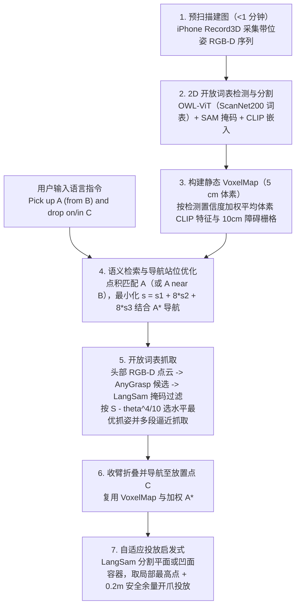

# OK-Robot: What Really Matters in Integrating Open-Knowledge Models for Robotics

## 一句话定义

**OK-Robot**（Open-Knowledge Robot，[arXiv:2401.12202](https://arxiv.org/abs/2401.12202)，[项目页](https://ok-robot.github.io)）是纽约大学与 AI at Meta 提出的零样本开放词表移动操作集成框架：通过 iPhone 预扫描构建体素语义地图（VoxelMap），结合加权 A* 导航、LangSam 语言掩码过滤的 AnyGrasp 水平偏好抓取以及自适应投放启发式，在无需针对新家庭重新训练的前提下实现真机“拾取-投放（pick-and-drop）”并系统剖析长尾失效根因。

## 英文缩写速查

| 缩写 | 英文全称 | 简要说明 |
|---|---|---|
| OK-Robot | Open-Knowledge Robot | 本文提出的基于公开预训练开放知识模型的零样本机器人系统 |
| OVMM | Open-Vocabulary Mobile Manipulation | 开放词表移动操作，在未知家庭中根据自然语言执行任意物体的导航、抓取与放置 |
| VLM | Vision-Language Model | 视觉-语言模型（如 CLIP、OWL-ViT、LangSam），负责开放词表物体检测与定位 |
| SAM | Segment Anything Model | 通用图像分割模型，本文中与 OWL-ViT 串联细化 2D 物体掩码 |
| RGB-D | Red-Green-Blue + Depth | 彩色与深度图像，iPhone Record3D 建图与 Stretch 头部抓取感知的输入格式 |

## 核心信息

| 字段 | 内容或状态 |
|---|---|
| 论文 | [arXiv:2401.12202v2](https://arxiv.org/abs/2401.12202)（cs.RO，2024-02-29） |
| 作者与机构 | Peiqi Liu、Yaswanth Orru、Nur Muhammad Mahi Shafiullah、Lerrel Pinto（New York University）；Jay Vakil、Chris Paxton（AI at Meta） |
| 项目页 / 开源状态 | [ok-robot.github.io](https://ok-robot.github.io)（论文明确宣布已公开代码、模块与实验视频；注：抓取模块 AnyGrasp 为免费申请使用但受 License 限制的闭源商业 SDK，文中额外对比了纯开源替代方案 Open Graspness） |
| 硬件与感知栈 | **Hello Robot: Stretch** 移动操作机器人 + iPhone `Record3D`（<1 分钟扫房、<5 分钟建图，10 分钟内即可开工） |
| 清单分类 / 来源条目 | `harness.infrastructure` / `survey_ax_2401_12202` |

## 为什么重要

- **证明“无需微调的开放知识拼装”在真实家庭的可行性**：此前 NeurIPS 2023 HomeRobot OVMM 挑战赛冠军方案仅达 33% 成功率；OK-Robot 在 10 个真实未见纽约家庭中零样本取得 **58.5%** 成功率（近 1.8 倍提升），在去杂物与消除语言歧义后达 **82.4%**。
- **揭示模块级集成细节决定系统上限**：同等预训练模型下，导航站位代价函数、偏向水平抓取以容忍手眼标定误差（$S - \theta^4/10$）、凹面容器投放高度计算等工程细节直接决定真机成功率。
- **用 171 次真机试验定量拆解长尾失败模式**：指出即便各单模块独立成功率 $\ge 80\%$，无错误恢复的线性状态机也会因乘法级误差累积（multiplicative error accumulation）把端到端成功率拉低至 60% 以下。

## 核心方法

OK-Robot 解决 `"Pick up A (from B) and drop it on/in C"` 任务，由**开放词表物体导航**、**开放词表抓取**与**投放启发式**三个子系统通过线性状态机串联。

### 方法流程图

1. **开放家庭物体建图与导航（§II-A）**：
   - **VoxelMap 记忆**：用 iPhone `Record3D` 绕房间拍摄 1 分钟以内带位姿 RGB-D 视频；每帧运行 `OWL-ViT`（配合 ScanNet200 标签表作为查询）和 `SAM` 得到掩码与 CLIP 向量，反投影并体素化至 **5 cm** 分辨率，每个体素存储置信度加权的 CLIP 特征均值（<5 分钟完成处理）。
   - **语义检索与复合关系**：对单物体取与查询文本嵌入点积最大的体素；对 `"A on B"` 关系则近似为 `"A near B"`，计算 A 的 top-10 点与 B 的 top-50 点之间两两 $L_2$ 距离并取最小者。
   - **可操作站位与类 Voronoi 路径规划**：导航不仅要靠近目标，还需留出夹爪伸展空间并远离障碍物，因此最小化站位代价 $s(\vec{x}) = s_1(\vec{x}) + 8s_2(\vec{x}) + 8s_3(\vec{x})$（分别为距目标距离、保持约 40cm 级可操作间距、距 30cm 内障碍物倒数惩罚）。随后在 **10cm × 10cm** 栅格（障碍物外扩 **20 cm** 碰撞半径，未探索格不可通行）上以 $s_3$ 为节点启发式运行 A*，自动走走廊中线。
2. **开放词表单目 RGB-D 抓取（§II-B）**：到达目标附近后，头部相机拍摄单帧 RGB-D，输入 `AnyGrasp` 生成全场景平行爪候选抓姿及 graspness 分数 $S$；再用 `LangSam` 根据目标文本分割 2D 掩码，将落在掩码内的候选抓姿按 $S - (\theta^4/10)$ 重排（$\theta$ 为抓取法线与地面法线夹角），优先选择对跨家庭手眼标定误差更鲁棒的**水平抓取**。执行时沿接近向量以渐缩步长 $\langle \vec{p}-0.2\vec{a}, \vec{p}-0.08\vec{a}, \vec{p}-0.04\vec{a}, \vec{p} \rangle$ 预抓取并闭环夹紧，随后抬臂收回腕部将物体折叠至机身轮廓内移动。
3. **凹面兼容投放启发式（§II-C）**：区别于 HomeRobot 假设放置面为平面的做法，到达放置点 C 后用 `LangSam` 分割目标容器/台面点云并对齐至机器人前向-地面坐标系，在横向中位数附近取 $z_{\max} = 0.2 + \max\{z \mid (x,y,z)\in P_a; 0 \le x \le x_m; |y-y_m|<0.1\}$（加 0.2 m 防碰撞缓冲）作为投放高度松爪。

## 实验与评测

### 1. 10 个未见真实家庭的 171 次零样本测试与清理消融（§III-A, §III-C, Fig. 6, Appendix E）

在纽约 10 个真实家庭环境中随机挑选桌面可抓物体，使用 **GPT-4V** 生成无偏语言查询，不重置环境连续执行 pick-and-drop：

| 环境清理阶段 | 全流程成功率 | 导航失败率 | 操作（抓取）失败率 | 放置阶段说明 |
|---|---:|---:|---:|---|
| `Cleanup: none`（自然杂乱原貌，10 家庭） | **58.5%**（Fig. 6 约 58%） | 15% | 25% | 约 2%（各阶段基本恒定） |
| `Cleanup: low`（初步整理并筛除歧义） | **71%** | 12% | 16% | 基本恒定 |
| `Cleanup: high`（去杂物+清晰查询+剔除对抗物体） | **82.4%**（Fig. 6 约 82%） | 4% | 13% | 基本恒定 |

- 论文另在匹兹堡（杂乱在用家庭厨房）与弗里蒙特（大型受控公寓）两处纽约以外家庭成功复现了整套系统。

### 2. 实验室 3 环境组件消融（§III-B, Fig. 5, Appendix A）

- **语义记忆模块对比**：`VoxelMap` 在三套实验室环境中平均表现小幅领先 `CLIP-Fields` 和 `USA-Net`，且方差显著更低、稳定性最好。
- **抓取模块对比**：`AnyGrasp` 显著优于其他方案，相对第二名 `Top-down grasp`（HomeRobot 启发式）提升近 **50%**；而简单的 `Top-down grasp` 反而击败了开源的 `Open Graspness` 与在固定桌上训练的 `Contact-GraspNet`（后者在移动头部视角下难给出有效抓姿）。

### 3. 全实验长尾失效归因拆解（§III-D, Fig. 4）

聚合所有实验中的三大首要失败原因分别为：
1. **语义记忆检索错目标（9.3%）**：CLIP/OWL-ViT 对提示词措辞敏感（相似表述中一个能命中、另一个却检索到同场景相似物）。
2. **抓取模块生成难执行或有碰撞抓姿（8.0%）**：基于单视角 RGB-D、未针对 Stretch 夹爪形态训练，导致超出关节限位/臂展，或沿固定直线逼近轨迹碰撞周边障碍；对透明物体（点云残缺）、扁平物（巧克力棒、扑克牌/书本难以两指夹起）和圆柱滚动体不稳定。
3. **机器人硬件限制（7.5%）**：Hello Robot Stretch 满伸展负载上限仅 **1 kg**（拿不起满瓶洗洁精），高台面/床铺中央够不到，跨家庭运输导致 RealSense 手眼标定漂移，以及小轮径底盘在地毯与地板交界处打滑。

## 与现有工作的对比

| 对比工作 | 定位与特点 | 与 OK-Robot 的核心差异 |
|---|---|---|
| HomeRobot OVMM / UniTeam | 2023 OVMM 竞赛基准与冠军模块化方案（33% 成功率） | OK-Robot 替换了更强的 OWL-ViT+SAM+AnyGrasp 组合、引入水平抓取偏好与凹面投放启发式，真实家庭达 58.5%（近 1.8×） |
| CLIP-Fields / USA-Net / ConceptGraphs | 基于神经场或 3D 场景图的开放词表记忆与导航 | 多侧重导航到物体附近；OK-Robot 显式优化“臂展可达且留出夹爪空间”的站位函数并走完真机抓放全闭环 |
| SayPlan / GPT-4V 规划器 | 侧重多步高层任务规划与场景图推理 | 与 OK-Robot 互补：SayPlan 等不处理底层抓取与放置执行细节，OK-Robot 专注单步开放词表 pick-and-drop 物理落地 |
| 端到端大模型（RT-1 / RT-2） | 需要大规模机器人示教数据训练动作输出 | OK-Robot **零机器人微调数据**，完全靠现成公开模型与几何/运动学启发式组合上线 |

## 常见误区或局限

- **静态地图假设**：VoxelMap 与 2D 障碍栅格在首轮 iPhone 扫描后固定不变，无法动态更新日常家庭中被移动的物体或新障碍物。
- **仅输出抓姿而非无碰撞抓取轨迹**：AnyGrasp 只给末端目标位姿，机械臂沿固定直线逼近时仍可能撞到周围杂物。
- **开环线性状态机缺乏失败检测与重试**：任一环节失败即整条任务失败，导致单模块均 $\ge 80\%$ 时整体成功率仍低于 60%。
- **缺少人机交互消歧**：当场景存在多个相似物体或查询词模糊（9.3% 失败来源）时，系统不会主动向用户确认目标。
- **物理形态与感知硬约束**：平行两指爪难以抓取桌面贴合扁平物，且严重依赖单视角深度点云质量（透明/反光材质易失败）与 1 kg 负载上限。

## 结论

**OK-Robot 揭示了开放知识机器人系统落地的核心规律：在现有强大 VLM 与抓取预训练模型基础上，真正决定真实家庭成功率的往往不是端到端重训，而是模块衔接处的几何站位、抓取姿态过滤、标定容错与失败恢复设计。**

1. **先用“预扫描 VoxelMap + 现成 VLM + 预训练抓取”打通零样本基线**：无需微调即可在 10 分钟内于全新家庭实现近 60%（整理环境后超 82%）的开放词表抓放。
2. **导航目标不能只看视觉距离，必须编码“可操作工作空间”**：通过 $s_1 + 8s_2 + 8s_3$ 同时约束臂展可达、夹爪展开余量与障碍物避让，避免“走太近反而抓不到”。
3. **优先选择对标定误差不敏感的抓取姿态**：利用 $S - \theta^4/10$ 惩罚倾斜抓取、偏向水平抓姿，能显著提升移动机器人跨场景部署时的鲁棒性。
4. **必须打破线性开环状态机以对抗乘法误差累积**：加入执行后视觉成功校验、失败重试与语义歧义交互确认，是把 58.5% 推向更高可靠性的直接杠杆。
5. **警惕开源/闭源抓取模型与相机视角的分布偏移**：移动头部相机与固定桌面相机视角差异巨大，选型前需在目标机器人真实视角下实测消融（文中 Contact-GraspNet 即因视角偏移失效）。

## 关联页面

- [Agentic Robots 综述](paper-towards-agentic-robots-survey.md)
- [全量项目节点清单](../overview/awesome-agentic-robots-node-index.md)
- [零样本物体导航](../tasks/zero-shot-object-navigation.md)
- [抓取位姿估计](../methods/grasp-pose-estimation.md)
- [具身语义认知地图](../concepts/embodied-semantic-cognitive-map.md)
- [LLM 与机器人控制接口](../concepts/llm-robotics-control-interfaces.md)
- [机器人操作任务](../tasks/manipulation.md)

- [机器人智能体执行框架](../methods/robot-agent-harness.md)：对照规划、执行接口与反馈机制。

## 参考来源

- [官方 Awesome 快照归档](../../sources/repos/awesome-agentic-robots-survey-index.md)
- [论文原文 arXiv:2401.12202](https://arxiv.org/abs/2401.12202)（OK-Robot: What Really Matters in Integrating Open-Knowledge Models for Robotics，v2）
- [OK-Robot 项目页](https://ok-robot.github.io)
