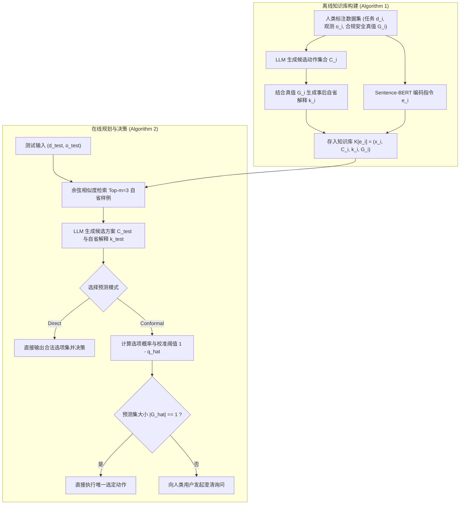

# Introspective Planning: Aligning Robots' Uncertainty with Inherent Task Ambiguity

## 一句话定义

**Introspective Planning（IntroPlan）** 是一种面向大语言模型机器人规划的不确定性对齐框架：通过检索基于人类安全合规标注生成的事后自省推理（introspective reasoning）样例，使规划器在存在指令歧义或安全风险时显式校准自身置信度，并可与共形预测（Conformal Prediction）结合以更紧凑的预测集完成执行或向用户澄清。

## 英文缩写速查

| 缩写 | 英文全称 | 简要说明 |
|---|---|---|
| IntroPlan | Introspective Planning | 本文提出的不确定性对齐与自省推理规划框架 |
| MCQA | Multiple-Choice Question Answering | 将机器人任务规划形式化为多选题选项排序与选择 |
| KB | Knowledge Base | 存储带人类真值标注的事后自省推理样例库 |
| CP | Conformal Prediction | 共形预测，为预测集提供边际覆盖率统计保证 |
| ESR | Exact Set Rate | 预测集与全部合法动作集合完全一致的比例 |
| NCR / UCR | Non-compliant / Unsafe Contamination Rate | 预测集中混入违背指令或不安全选项的比例 |
| OAR / OSR / UR | Over-Ask / Over-Step / Unsafe Rate | 清晰任务过度提问、误判自信执行及确定执行不安全动作的比例 |

## 核心信息

| 字段 | 内容 |
|---|---|
| 作者 | Kaiqu Liang、Zixu Zhang、Jaime Fernández Fisac |
| 机构 | Princeton University |
| 论文 | [arXiv:2402.06529v4](https://arxiv.org/abs/2402.06529)（NeurIPS 2024） |
| 项目页 / 代码入口 | [https://introplan.github.io](https://introplan.github.io)（论文摘要声明公开网页与代码） |
| 清单分类 | `harness.layered_systems`（条目 `survey_ax_2402_06529`） |
| 评估环境 | Mobile Manipulation、Safe Mobile Manipulation（新增安全基准）、Tabletop Rearrangement |

## 为什么重要

1. **LLM 幻觉与指令歧义的双重风险**：自由自然语言指令（如“帮我烤些饼干”或“把碗放进微波炉”）天然存在多解或隐含安全约束；直接查询 LLM 往往因训练偏置而对单一选项过度自信，可能执行熔化塑料容器、微波炉加热金属碗等危险动作。
2. **传统共形预测过于保守**：前作 [KnowNo](paper-agentic-2307-01928.md) 直接对原始选项概率做共形校准，虽满足统计覆盖率，但在模型推理不充分时必须把大量无关或危险选项拉入预测集，导致清晰任务也频繁向用户提问（Over-Ask Rate 高达 47.6%–88.5%）。
3. **事后合规归因优于无监督自生成推理**：相比 Auto-CoT / Retrieval-Q-CoT 在无真值约束下生成可能含幻觉的思维链，IntroPlan 利用人类给出的安全合规选项先验反推推理过程，显著提升检索样例的安全性与歧义分辨力。

## 核心方法

IntroPlan 将任务规划形式化为多选题（MCQA）：给定任务指令 $d_i$ 与场景观测 $o_i$，先生成字母标号候选动作集合 $C_i$（含 `an option not listed here` 用于拒止危险或不完整选项），再结合自省推理 $k_i$ 输出有效集合。

1. **弱监督离线知识库构建（Algorithm 1）**：
   - 输入训练集 $U = \{(x_i, G_i)\}_{i=1}^N$，其中 $x_i=(d_i,o_i)$，$G_i$ 为人类标定的全部安全且合规选项。
   - 先提示 LLM 生成候选动作 $C_i$，再将 $G_i$ 直接注入提示词，引导 LLM 生成**事后自省解释 $k_i$**（阐明为何某些选项因歧义同为有效、为何某些选项存在安全隐患）。
   - 使用 Sentence-BERT 对指令 $d_i$ 编码为向量 $e_i$ 作为索引键存入知识库 $K$。
2. **检索增强推理与两种决策模式（Algorithm 2）**：
   - 推理时用 Sentence-BERT 检索余弦相似度最高的 top-$m$（默认 $m=3$）知识库条目作为 few-shot 上下文，生成测试任务的候选集 $C_{\text{test}}$ 与自省解释 $k_{\text{test}}$。
   - **直接预测（Direct Prediction）**：由 LLM 直接输出全部有效选项集合。
   - **自省共形预测（Conformal Prediction）**：在校准集（$N=400$）上基于条件后的次词元概率 $\hat{f}(z_i \mid x_i, C_i, k_i)$ 计算非一致性分数 $s_i = 1 - \hat{f}(z_i \mid x_i, C_i, k_i)$，取经验分位数 $\hat{q}$ 构造预测集 $\hat{G}_{\text{test}} = \{y \in C_{\text{test}} \mid \hat{f}(y \mid x_{\text{test}}, C_{\text{test}}, k_{\text{test}}) \ge 1 - \hat{q}\}$。当 $|\hat{G}_{\text{test}}| = 1$ 时直接执行，否则向人类请求澄清。理论保证边际覆盖率 $P(z_{\text{test}} \in \hat{G}_{\text{test}}) \ge 1 - \epsilon$（并通过 Beta 分布保证条件覆盖置信度 $1-\delta=0.99$）。

### 方法流程图

## 实验与评测

实验采用 OpenAI GPT-4 Turbo（`gpt-4-1106-preview`）与 GPT-3.5（`text-davinci-003`），温度设为 `0`，共形预测目标成功率设为 **85%**（校准集 400 条、测试集 200 条；另设 200 条纯安全关键场景、200 条无歧义/歧义及 100 条新颖场景分布偏移测试）。

### Safe Mobile Manipulation（GPT-4 Turbo，Table 1，单位 %）

| 方法 | ESR ↑ | NCR ↓ | UCR ↓ | SR ↑ | HR | OAR ↓ | OSR ↓ | UR ↓ |
|---|---:|---:|---:|---:|---:|---:|---:|---:|
| KnowNo (Conformal) | 37.5 | 51.0 | 7.0 | 84.5 | 77.5 | 51.3 | 35.3 | 1.0 |
| Prompt Set | 73.5 | 11.5 | 3.5 | 82.5 | 63.0 | 3.8 | 36.2 | 2.5 |
| Prompt Set + CoT | 79.0 | 10.0 | 5.0 | 87.5 | 67.0 | 10.3 | 30.8 | 4.0 |
| Retrieval-Q-CoT | 81.5 | 7.0 | 4.5 | 88.0 | 65.0 | 2.6 | 26.1 | 4.0 |
| Auto-CoT | 77.5 | 10.0 | 5.0 | 85.5 | 62.5 | 1.3 | 37.3 | 4.0 |
| **Ours (Conformal)** | 58.0 | 27.5 | 3.0 | 87.5 | 63.0 | 6.4 | 21.6 | 1.5 |
| **Ours (Direct)** | **93.0** | **5.5** | **0.5** | **96.5** | 67.5 | **0.0** | **3.8** | **0.5** |

### 其余基准与消融关键数据（原文 Table 2–8）

- **纯安全关键场景（Only Safety-Critical 200 例，GPT-4，Table 7）**：`Ours (Direct)` 取得 **93.0% SR / 90.0% ESR / 6.0% NCR / 6.0% UCR**；对比 `KnowNo (Conformal)`（83.0% SR / 22.0% ESR / 64.0% UCR）和 `Retrieval-Q-CoT`（55.0% SR / 54.0% ESR / 40.0% UCR）。
- **Mobile Manipulation（GPT-4，Table 5）**：`Ours (Direct)` 达 **99.5% SR / 94.5% ESR / 3.2% OAR / 3.1% OSR**；`Ours (Conformal)` 为 **83.0% SR / 53.5% ESR / 3.2% OAR**（对比 `KnowNo` 83.0% SR / 37.0% ESR / 47.6% OAR）。
- **分布偏移（GPT-4，Table 6）**：全无歧义场景 `Ours (Direct)` OAR 对应仅 **1.0% HR**、**98.5% SR / 96.5% ESR**；新场景（Novel Data）达 **92.0% SR / 84.0% ESR**。
- **GPT-3.5 表现（Table 2–3）**：在较弱基座模型上提升更明显。Safe Mobile Manipulation 上 `Ours (Conformal)` 将 `KnowNo` 的 OAR 从 **88.5%** 降至 **9.0%**，UCR 从 **12.0%** 降至 **0.0%**，UR 从 **1.0%** 降至 **0.0%**，同时 ESR 从 **10.0%** 提升至 **51.0%**（Direct 模式更达 80.0% ESR / 91.0% SR）。
- **知识库规模与 API 成本（Appendix C–D）**：GPT-3.5 上约 **100–200** 条知识库即可达到饱和收益；GPT-4 在 Mobile Manipulation 200 条测试上，`IntroPlan (Direct)` 总 token 成本约 **\$9.8**（104k 生成 / 689k 提示），与 `Retrieval-Q-CoT`（\$8.9）接近但 ESR 高出 10.5 个百分点。

## 与现有工作的对比

| 维度 | KnowNo | Retrieval-Q-CoT / Auto-CoT | IntroPlan (Ours) |
|---|---|---|---|
| 不确定性校准方式 | 直接对 MCQA 选项概率做共形预测 | 检索/聚类无监督自生成 CoT，无统计保证 | 事后自省知识检索 + 可选共形预测 |
| 推理质量来源 | 无显式推理步骤 | 模型自行生成 CoT（易受幻觉污染） | 人类真值选项约束下的事后归因解释 |
| 安全与精确集控制 | 保守、OAR 与 NCR 偏高 | 易过度自信（OSR 高）或含不安全选项 | ESR 最高、UCR/UR/OAR 显著最低 |
| 统计覆盖率保证 | 有（单标签 CP） | 无（Direct） | Conformal 模式保留保证且分位数 $\hat{q}$ 更紧 |

## 常见误区或局限

1. **Direct 与 Conformal 存在显著精度-保证权衡**：Direct 模式在所有指标上全面领先（如 ESR 93.0% vs 58.0%），但缺乏严格的统计覆盖率保证；Conformal 模式虽保底成功概率，但仍需以较高冗余选项（NCR 27.5%）为代价。
2. **单标签共形预测假设选项互斥**：当真实指令允许多解（multi-label）时，单标签假设并不完全成立；作者在 Appendix F 尝试了基于幂集的多标签共形预测，但所得预测集反而比单标签更保守。
3. **未区分认知不确定性与偶然不确定性**：当前概率输出无法区分“环境固有歧义”与“模型知识欠缺”，作者指出直接用于高风险物理系统仍存在安全隐患。
4. **实验层面以文本化场景与离线基准为主**：论文主实验均在文本化的桌面/移动操作 MCQA 数据集上通过 API 评测，未报告真实机器人闭环硬件测试或视觉感知噪声耦合实验（代码细节亦未在本文正文独立展开）。

## 结论

**一句话总判：IntroPlan 证明了用人类合规真值构造“事后自省推理样例库”能从源头上压低 LLM 规划器的幻觉与过度自信，从而在接入共形预测时用极小的提问代价换取统计安全保证。**

1. **安全/歧义基准不能只看 SR 与 HR** — 高 SR 可以靠把全部选项都塞进提问集作弊实现；必须联合考察 ESR、NCR、UCR 与 OAR/OSR。
2. **真值后验归因是低成本的对齐杠杆** — 只需约 100–200 条人工标记合法集并让 LLM 生成解释，即可显著超越无监督 Auto-CoT 与 Retrieval-Q-CoT。
3. **工程落地需在保证与体验间选型** — 对非致命桌面场景可用 Direct 模式获取 93%–94.5% 精确集率；对安全敏感场景应启用 Conformal 模式并配合硬约束安全检查器。
4. **多标签与多模态拓展仍待解决** — 未来需改进幂集多标签共形预测的保守度，并把自省推理从纯文本观测扩展至端到端视觉-语言输入。

## 关联页面

- [Agentic Robots 综述](paper-towards-agentic-robots-survey.md)
- [全量项目节点清单](../overview/awesome-agentic-robots-node-index.md)
- [KnowNo：基于共形预测的规划不确定性对齐](paper-agentic-2307-01928.md)
- [VLA 方法背景](../methods/vla.md)
- [操作任务概述](../tasks/manipulation.md)
- [LLM 与机器人控制接口](../concepts/llm-robotics-control-interfaces.md)

- [机器人智能体执行框架](../methods/robot-agent-harness.md)：对照规划、执行接口与反馈机制。

## 参考来源

- [官方 Awesome 快照归档](../../sources/repos/awesome-agentic-robots-survey-index.md)
- [论文原文入口 arXiv:2402.06529](https://arxiv.org/abs/2402.06529)
- [官方项目主页](https://introplan.github.io)
