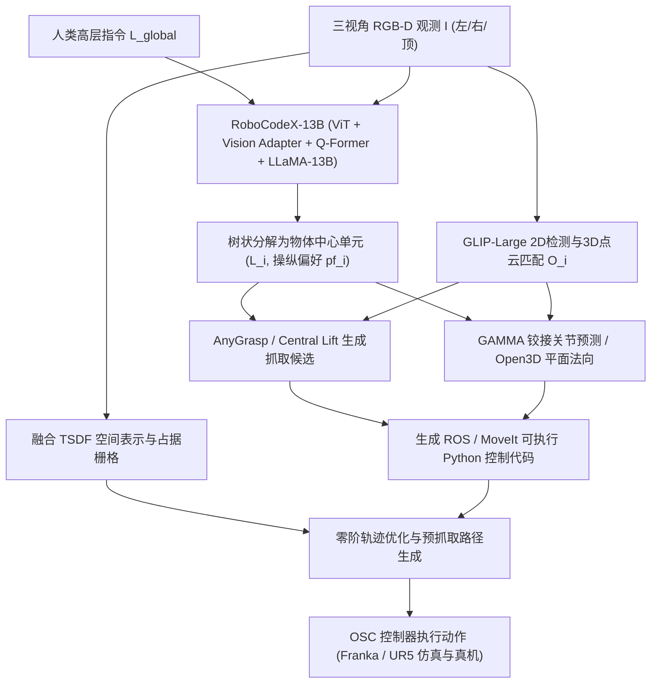

# RoboCodeX: Multimodal Code Generation for Robotic Behavior Synthesis

## 一句话定义

**RoboCodeX** 是一个面向通用机器人行为合成的多模态大语言模型（13B）代码生成框架，通过树状思维将长程指令分解为以物体为中心的操纵单元，预测零件级可供性、物理关节约束与抓取偏好，并将其编译为跨平台可执行的控制代码。

## 英文缩写速查

| 缩写 | 英文全称 | 简要说明 |
|---|---|---|
| MLLM | Multimodal Large Language Model | 融合视觉与语言理解并输出代码的多模态大模型 |
| TSDF | Truncated Signed Distance Field | 截断有符号距离场，融合三视角 RGB-D 的 3D 空间表示 |
| SFT | Supervised Fine-Tuning | 有监督微调，结合自更新偏好标注提升代码成功率 |
| G-VQA | General Visual Question Answering | 通用视觉问答数据（如 ShareGPT4V），防止微调过拟合 |
| OSC | Operational Space Controller | 操作空间控制器，用于执行密集 6-DoF 末端轨迹点 |
| SPL | Success weighted by Path Length | 具身导航中的路径长度加权成功率指标 |

## 核心信息

| 字段 | 内容 |
|---|---|
| 作者 | Yao Mu、Junting Chen、Qinglong Zhang、Shoufa Chen、Qiaojun Yu 等（通讯：Mingyu Ding、Ping Luo） |
| 机构 | HKU、OpenGVLab（Shanghai AI Lab）、ETH Zurich、SJTU、CUHK、Tsinghua、UC Berkeley |
| 论文 | [arXiv:2402.16117v1](https://arxiv.org/abs/2402.16117)（2024-02-25） |
| 项目页 | [https://sites.google.com/view/robocodexplus](https://sites.google.com/view/robocodexplus) |
| 清单分类 | `harness.skills`（条目 `survey_ax_2402_16117`） |
| 核心基座 | EVA-CLIP ViT-G/14 + 多尺度 Vision Adapter + Q-Former + LLaMA-13B（总约 13B 架构） |

## 为什么重要

1. **弥合高层语义与物理几何执行之间的鸿沟**：以 Code-as-Policies、ProgPrompt 为代表的早期代码生成框架主要依赖纯文本场景描述与静态 API，缺乏对物体形状、关节旋转/平移轴方向、桌面支撑法向等视觉物理偏好的直接推理能力。
2. **以代码为桥梁实现跨机器人本体泛化**：相比把动作直接耦合到特定机械臂关节空间的端到端 VLA 策略，RoboCodeX 输出基于 `perception_utils` 与 `motion_utils`（ROS / MoveIt / OMPL）的偏好驱动代码，仅替换机器人配置文件即可在 Franka Panda 与 UR5 间零样本迁移。
3. **解决长API提示词与细粒度视觉细节的显存矛盾**：通过 Q-Former 压缩视觉序列长度、同时用 Vision Adapter 提取 ViT 四个阶段的 `[CLS]` 特征，兼顾长代码生成上下文与局部物体几何理解。

## 核心方法

1. **三视角 3D 感知融合**：采集左、右、顶三视角 RGB-D 数据，融合为 TSDF 与占据栅格图；用 GLIP-Large 进行开放词汇 2D 检测并通过几何重叠与朝向一致性匹配到 3D 点云 $O_i$。
2. **树状多模态代码分解（Tree-of-Thought）**：以父节点形式将全局指令 $L_{\text{global}}$ 分解为若干以物体为中心的操纵单元 $U_{\text{task}} \to (u_1, \dots, u_n)$，每个单元附带子任务描述 $L_i$ 与操纵偏好 $pf_i$，并进一步展开为 4 个执行要素：
   - **零件可供性（Part-level Affordance）**：定位如抽屉把手等交互区域；
   - **抓取位姿候选与偏好选择**：调用预训练 **AnyGrasp** 生成候选抓取（取 top-10）或 **Central Lift** 垂直抓取，按模型推理出的 `preferred_position`、`preferred_approach_direction`、`preferred_plane_normal` 择优；
   - **物理属性预测**：用微调后的 **GAMMA**（PointNet++ 分割刚体零件、偏移量与关节轴）预测铰接物体的旋转/移动关节信息，用 Open3D 提取桌面平面法向；
   - **轨迹生成与执行**：基于 ROS/MoveIt/OMPL 与占据图零阶轨迹优化生成无碰撞 6-DoF 末端轨迹，抓取采用预抓取减速逼近策略 $\langle \vec{p}-0.1\vec{a},\, \vec{p}-0.08\vec{a},\, \vec{p}\rangle$。
3. **多模态推理预训练 + 迭代自更新 SFT**：
   - 预训练：基于 HM3D 场景与 Google Scanned Objects / YCB / OmniObject3D / AKB-48 构建仿真环境，用 GPT-4 合成任务与代码（GPT-3.5 过滤），并与 ShareGPT4V、SViT、LLaVA-150K 混合训练。
   - SFT 自更新：基于 RT-1 与 LIBERO 任务模板扩展任务，对语法正确但执行失败的代码**穷举搜索抓取方式、偏好方向与轨迹策略**；随后让 GPT-4V 分析胜出选项原因并总结为思维链代码注释标签，同时混入 ShareGPT4V-7B 数据集防止指令微调过拟合。

### 方法流程图

## 实验与评测

### 1. Gazebo 仿真操作任务对比（50 次试验平均成功率，Table 1）

环境基于 ROS + Gazebo + MoveIt/OMPL 与 Franka 机械臂，涵盖 42 类 YCB/GSO 物体及 5 个 PartNet-Mobility 柜体：

| 模型 | Pick & Place | Drawers | Doors | Put obj. in drawer | Multi-stage |
|---|---:|---:|---:|---:|---:|
| GPT-3.5 (纯文本场景) | 0.45 | 0.44 | 0.20 | 0.36 | 0.20 |
| GPT-4 (纯文本场景) | 0.56 | 0.68 | 0.46 | 0.48 | 0.44 |
| GPT-4V (多模态) | 0.63 | 0.68 | 0.52 | 0.55 | 0.50 |
| **RoboCodeX (Ours)** | **0.80** | **0.84** | **0.74** | **0.68** | **0.64** |

RoboCodeX 在 Pick & Place 上相对 GPT-4V 提升 **+17 个百分点**（0.80 vs 0.63），在需要判断旋转/推拉物理约束的开关门（0.74 vs 0.52）与长程多阶段任务（0.64 vs 0.50）上优势同样显著。

### 2. 具身导航与通用多模态评测（Table 2 & Table 3）

- **具身物体导航（L3MVN 边界选择框架，Table 2）**：
  - HM3D：Success **40.0%** / SPL **24.2%**（高于 ESC(GPT-3.5) 的 39.2% / 22.3%、Pixel-Nav(GPT-4) 的 37.9% / 20.5%、L3MVN(GPT-2) 的 35.2% / 16.5%）。
  - HSSD：Success **40.3%** / SPL **22.0%**（高于 ESC(GPT-3.5) 的 38.4% / 19.4%）。
- **通用 VQA（Table 3）**：RoboCodeX-13B 在 LLaVA-Bench 取得 **71.5**、MM-Vet 取得 **31.0**（同体量 LLaVA-1.5-13B 为 70.7 / 35.4）。
- **铰接物体关节预测（微调 GAMMA，Table 5）**：Cabinet / Microwave / Refrigerator 的 $\text{AP}_{75}$ 分别为 **83.13 / 95.72 / 89.75**，关节类型准确率达 **97.5% / 100% / 100%**。

### 3. 消融、失败归因与真机迁移（Fig. 4–6）

- **消融实验（Fig. 5）**：去掉基于偏好的抓取选择（`w/o preference` 直接取 AnyGrasp 最高分）、去掉多尺度 `vision adapter`、或 SFT 阶段不混入通用 VQA（`w/o G-VQA`），均导致成功率下降；其中去掉 `G-VQA` 会引发严重过拟合与指令遵循退化。
- **失败分析（Fig. 6）**：长程任务中任务语义理解基本正确，主要失败来源于**次优抓取位姿选择（Grasping failed）**与**轨迹规划/碰撞错误**，RoboCodeX 相比 GPT-4V 显著压低了这两类失败比例。
- **真机零样本迁移（Sec. 4.4 / Appendix F）**：无需任何针对具体机械臂的微调，仅更改配置文件即可在 **Franka Emika Panda** 与 **UR5** 真机上完成多阶段拾放、放可乐罐进抽屉、化妆品装袋等任务。

## 与现有工作的对比

| 维度 | Code-as-Policies / ProgPrompt | GPT-4V 零样本代码生成 | RoboCodeX (Ours) |
|---|---|---|---|
| 感知输入 | 依赖外部检测转为纯文本/API调用 | 端到端图像+文本，但缺专用训练 | 多视角 RGB-D + TSDF + ViT 多尺度特征 |
| 物理与抓取偏好 | 无专门约束推理或依赖手工规则 | 易忽略物体朝向与关节轴向约束 | 显式生成位置/接近方向/法向偏好并过滤 AnyGrasp/GAMMA |
| 训练范式 | 零样本 / few-shot 提示 | 闭源 API，无法针对机器人自更新 | 合成预训练 + 执行搜索自更新 CoT SFT + 通用 VQA 混训 |
| 开源模型能力 | 较弱 | 闭源 GPT-4V | 13B 开源架构在 5 类操作任务上全面超越 GPT-4V |

## 常见误区或局限

1. **高度依赖外部视觉与抓取几何工具链**：代码执行正确性依赖 GLIP-Large、AnyGrasp（仅适用平行夹爪）、微调 GAMMA 及 MoveIt/OMPL；任一底层模块失效仍会导致抓取或轨迹失败。
2. **闭环感知更新仍依赖显式代码调用**：策略在物体中心单元间需通过 `detect_objects()` 重新感知环境，缺乏高频视觉闭环力控，难以应对高动态或易变形/滑动的精细接触操作。
3. **代码开源状态需核查**：项目页给出 `robocodexplus`，但论文本身（arXiv v1）未直接提供 GitHub 仓库链接与可运行入口细节。
4. **真机评估为定性展示**：论文在 Franka 与 UR5 真机上展示了跨本体零样本成功样例，但未给出真机与仿真同口径的大样本定量成功率对比表。

## 结论

**一句话总判：RoboCodeX 的核心价值在于把“物理交互偏好与关节约束”作为多模态思维链显式写入机器人生成代码，从而用 13B 模型在操作合成上击败闭源 GPT-4V 并实现跨机械臂零样本迁移。**

1. **代码+偏好比纯坐标输出更易泛化** — 将几何求解交给 AnyGrasp/GAMMA/MoveIt，让 MLLM 专注推理“从哪抓、沿哪条轴推拉”，能跨 Franka 与 UR5 复用。
2. **自更新搜索是提升代码微调数据质量的关键** — 通过仿真试错穷举参数再用 GPT-4V 回写原因注释，解决了高质量多模态机器人思维链数据稀缺的问题。
3. **机器人微调必须混入通用 VQA 数据** — 实验证明去掉 `G-VQA` 会迅速导致模型丧失通用指令跟随能力。
4. **长程任务的瓶颈仍在抓取与规划衔接** — 任务分解已较为可靠，下一步工程优化重点应放在抓取稳定性与无碰撞轨迹优化耦合上。

## 关联页面

- [Agentic Robots 综述](paper-towards-agentic-robots-survey.md)
- [全量项目节点清单](../overview/awesome-agentic-robots-node-index.md)
- [Code as Policies：用语言模型生成机器人策略代码](paper-pai-2209-07753-codeaspolicies.md)
- [ProgPrompt：基于上下文代码提示的机器人任务规划](paper-agentic-2209-11302.md)
- [VLA 方法背景](../methods/vla.md)
- [操作任务概述](../tasks/manipulation.md)
- [LLM 与机器人控制接口](../concepts/llm-robotics-control-interfaces.md)

- [智能体机器人操作策略](../methods/agentic-manipulation-policies.md)：对照操作场景中的规划、执行与反馈接口。

## 参考来源

- [官方 Awesome 快照归档](../../sources/repos/awesome-agentic-robots-survey-index.md)
- [论文原文入口 arXiv:2402.16117](https://arxiv.org/abs/2402.16117)
- [官方项目主页](https://sites.google.com/view/robocodexplus)
