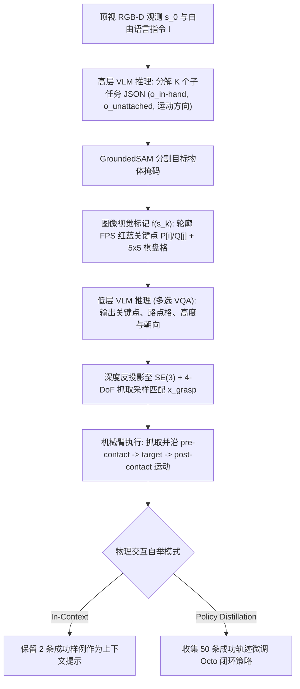

# MOKA: Open-World Robotic Manipulation through Mark-Based Visual Prompting

## 一句话定义

**MOKA（Marking Open-world Keypoint Affordances）** 是一种基于标记视觉提示的开放世界机器人操作方法，通过在 RGB 图像上叠加物体候选关键点与自由空间网格编号，将连续三维动作生成转化为预训练视觉语言模型（VLM）擅长的多选视觉问答（VQA），再映射为 $\text{SE}(3)$ 轨迹执行。

## 英文缩写速查

| 缩写 | 英文全称 | 简要说明 |
|---|---|---|
| MOKA | Marking Open-world Keypoint Affordances | 本文提出的基于视觉标记点可供性的开放世界操作框架 |
| VLM | Vision-Language Model | 视觉语言模型（本文主实验使用 GPT-4V） |
| VQA | Visual Question Answering | 视觉问答，本文用于替代直接预测连续坐标 |
| FPS | Farthest Point Sampling | 最远点采样，用于在物体掩码轮廓上提取候选关键点 |
| SoM | Set-of-Mark | 标记集合视觉提示范式，激发 VLM 的区域指代能力 |
| DDPM | Denoising Diffusion Probabilistic Model | 蒸馏阶段 Octo 扩散策略头采用的训练目标 |

## 核心信息

| 字段 | 内容 |
|---|---|
| 作者 | Fangchen Liu*、Kuan Fang*、Pieter Abbeel、Sergey Levine |
| 机构 | University of California, Berkeley |
| 论文 | [arXiv:2403.03174v3](https://arxiv.org/abs/2403.03174)（2024-09-04） |
| 项目页 / 官方代码 | [https://moka-manipulation.github.io](https://moka-manipulation.github.io) / [https://github.com/moka-manipulation/moka](https://github.com/moka-manipulation/moka) |
| 清单分类 | `harness.layered_systems`（条目 `survey_ax_2403_03174`） |
| 硬件平台 | 7-DoF Franka Emika 机械臂 + Robotiq 2F-85 夹爪（5 Hz），ZED 2.0 顶视/正视 + ZED mini 腕部 RGB-D |

## 为什么重要

1. **避免“图像转纯文本”导致几何细节丢失**：Code-as-Policies、VoxPoser 等早期方法需先将视觉场景转为文本或边界框再交由 LLM 规划，极易丢失细长工具、透明物体、可变形体（如扫帚毛刷、耳机线、花束）的部位功能信息。
2. **用多选 VQA 弥补 VLM 连续 3D 坐标预测短板**：直接让 GPT-4V 输出连续 2D/3D 坐标往往精度极差；MOKA 将物体表面可供性与自由空间轨迹离散化为图像上的红/蓝点标号（`P[i]`/`Q[j]`）和 `5×5` 棋盘格（`a1`–`e5`），无需微调 VLM 即可零样本驱动真实机械臂。
3. **打通“零样本 VLM 数据生成器 → 端到端闭环策略”的飞轮**：MOKA 采集的成功真机轨迹可直接作为上下文样例（In-Context）提升 VLM 推理，也可用于微调开源机器人基础模型 Octo，实现无 VLM 推理延迟的闭环控制。

## 核心方法

1. **以物体为中心的点式可供性表示（Point-Based Affordance）**：将每个子任务划分为可选的抓取阶段（Grasping Phase）与操纵阶段（Manipulation Phase），由五类点及姿态/高度属性描述：
   - $x_{\text{grasp}}$（握持点）：位于手持物体 $o_{\text{in-hand}}$ 上，决定夹爪抓握位置；
   - $x_{\text{function}}$（功能接触点）：位于 $o_{\text{in-hand}}$ 上将与目标接触的部位（若无手持物体则位于夹爪自身）；
   - $x_{\text{target}}$（目标点）：位于环境物体 $o_{\text{unattached}}$ 上的被接触点或放置目的地；
   - $x_{\text{pre-contact}}$ 与 $x_{\text{post-contact}}$（接触前后路点）：自由空间路点，与 $x_{\text{target}}$ 共同定义功能点依次经过的 3D 路径，并由 VLM 指定高度属性（`same` 或 `above`）与夹爪朝向（由 $x_{\text{grasp}} \to x_{\text{function}}$ 轴向离散选择）。
2. **两级分层 VLM 推理与标记视觉提示**：
   - **高层任务分解**：输入初始顶视 RGB 图 $s_0$ 与自由指令 $l$，让 GPT-4V 输出 JSON 子任务序列，抽取各阶段 `instruction`、`object_grasped`、`object_unattached` 与 `motion_direction`。
   - **图像自动标记 $f(s_{t(k)})$**：用 GroundedSAM（GroundingDINO + SAM）分割两类物体掩码；在轮廓上经最远点采样（FPS）加几何中心生成 $K+1$ 个候选点，分别以红点 `P[i]` 标于手持物体、蓝点 `Q[j]` 标于目标物体；全图叠加 `5×5` 棋盘格（列 `a`–`e`、行 `1`–`5`）。
   - **低层 VQA 推理与 3D 运动生成**：VLM 以 JSON 格式点选关键点标号、前后路点网格、高度与目标朝向；2D 关键点经深度图反投影至机械臂坐标系；抓取阶段结合基于局部点云采样的 30 个对跖 4-DoF 候选抓取（DexNet 2.0 方式），选取离 $x_{\text{grasp}}$ 最近者执行，再按 $x_{\text{pre-contact}} \to x_{\text{target}} \to x_{\text{post-contact}}$ 执行接触操纵。
3. **物理交互自举（Bootstrapping）**：
   - **MOKA In-Context**：仅在提示词中附带 2 个成功轨迹的标记图像与响应字典，无需修改主提示结构。
   - **MOKA Distilled**：收集每任务 50 条成功轨迹（含正视与腕部视角），全量微调 `octo-base`（800K 轨迹预训练的扩散 Transformer 策略，学习率 `3e-4`、batch size `256`、200k 步）。

### 方法流程图

## 实验与评测

在真实 7-DoF Franka Emika + Robotiq 2F-85 平台上评估 4 项两阶段任务（每子任务 10 次试验，Table I），并扩展展示清毛刷、关抽屉、递剪刀、插花共 8 项任务（Table III）：

### 主实验成功率对比（每子任务 10 次试验，Table I）

| 方法 | 擦桌-移眼镜 | 擦桌-扫垃圾 | 清洗手表-放入 | 清洗手表-按键 | 备礼-放填充物 | 备礼-放香水 | 收电脑-拔线 | 收电脑-合盖 |
|---|---:|---:|---:|---:|---:|---:|---:|---:|
| Code-as-Policies | 0.7 | 0.6 | 0.6 | **1.0** | **1.0** | 0.7 | 0.4 | 0.8 |
| VoxPoser | 0.6 | 0.0 | 0.6 | 0.8 | **1.0** | 0.6 | 0.5 | 0.8 |
| MOKA Zero-Shot (Ours) | 0.6 | 0.6 | 0.7 | **1.0** | **1.0** | 0.7 | 0.5 | 0.8 |
| MOKA Distilled (Octo) | **1.0** | 0.7 | 0.8 | 0.8 | **1.0** | 0.7 | **1.0** | **1.0** |
| **MOKA In-Context (Ours)** | 0.9 | **0.9** | **0.9** | **1.0** | **1.0** | **0.9** | **1.0** | 0.9 |

- **工具使用与可变形/细长物体优势明显**：在“用扫把将垃圾扫向桌面右侧”（Table Wiping Subtask II）中，VoxPoser 需大量针对体素分辨率的调参且无法自动确定扫把功能端与握持端，成功率为 **0.0**；MOKA Zero-Shot 达 **0.6**，In-Context 达 **0.9**。
- **提示设计消融（Table IX，推理成功率/10次）**：去掉分层推理（`w/o hierarchy`）导致所有任务推理大幅崩塌（如擦桌两阶段从 0.7/0.7 跌至 0.1/0.1，收电脑从 0.6/0.8 跌至 0.0/0.1）；去掉关键点定义或 CoT 步骤提示同样导致多数子任务下降。
- **失败模式拆解（Fig. 4）**：MOKA Zero-Shot 存在 VLM 推理错误（如把扫把拿反、错按笔记本铰链）与低层执行错误（如按偏按钮、电缆从夹爪滑脱）；In-Context 显著减少推理错误，而 Distilled 策略彻底移除 VLM 推理环节，消除了推理失败并提升了动态执行成功率。

## 与现有工作的对比

| 维度 | Code-as-Policies | VoxPoser | MOKA (Ours) |
|---|---|---|---|
| 核心表征 | Python 技能原语调用脚本 | LLM 生成的 3D 体素代价/价值地图 | 2D 标记关键点 + 自由空间网格路点 ($\text{SE}(3)$ 映射) |
| 视觉接地方式 | 依赖固定检测 API 转写边界框 | 依赖开放词表分割构建体素图（对分辨率敏感） | GroundedSAM 标注候选点 + GPT-4V 直接做多选 VQA |
| 人工提示开销 | 需手工编写各任务代码范例 | 需编写代码样例与体素超参 | 零样本可用，2 条直观标注图像即可显著增益 |
| 技能扩展方式 | 受限于预定义原语库 | 受限于价值图运动规划表达力 | 点式运动统一覆盖抓取/按压/推动/工具使用，并可蒸馏到 Octo |

## 常见误区或局限

1. **受限于 VLM 对 3D 物理与接触动力学的理解**：当前预训练 VLM（GPT-4V）仍难以精确推理三维空间旋转与精细接触力学，限制了复杂 $\text{SE}(3)$ 细粒度动作合成；高度也仅离散化为 `same` / `above` 两档。
2. **VLM 推理高延迟不支持高频闭环**：每步需移开机械臂至中立位拍无遮挡顶视图并调用 GPT-4V，导致系统以开环分段（5 Hz 底层控制 + 高层静态等待）运行，无法完成高动态操作；高实时性场景需依赖 MOKA Distilled。
3. **当前点式表示尚未覆盖双臂与全身控制**：论文指出要拓展至双臂协同（bimanual）或移动操作全身控制，需扩充关键点集合及对应姿态约束字段。
4. **部分依赖外部组件鲁棒性**：GroundedSAM 掩码分割失败或深度图噪声（如透明/反光物体、细线）会直接影响反投影 3D 位置与候选抓取质量。

## 结论

**一句话总判：MOKA 找到了让通用 VLM 零样本操控真实机械臂的高性价比接口——与其让模型盲猜三维坐标，不如在图像上画好候选点与网格让它做多选，并用收集到的成功轨迹蒸馏闭环小模型。**

1. **视觉标记把连续控制降维成 VLM 强项** — 轮廓 FPS 关键点 `P/Q` 加上 `5×5` 棋盘格，兼顾物体部位语义与自由空间方向规划。
2. **分层分解不可省略** — 消融证明跳过高层子任务拆解（`w/o hierarchy`）会让 VLM 在多物体画面中完全迷失顺序。
3. **用“VLM 零样本采数 + 扩散策略蒸馏”解决部署延迟** — 在本工作中 MOKA Distilled 将 `octo-base` 在拔线/合盖任务推至 1.0 成功率，证明了该飞轮的可行性。
4. **复杂接触任务仍需几何抓取采样兜底** — VLM 只负责指定语义抓取区域，实际 4-DoF 稳定抓姿仍需局部点云对跖采样器完成。

## 关联页面

- [Agentic Robots 综述](paper-towards-agentic-robots-survey.md)
- [全量项目节点清单](../overview/awesome-agentic-robots-node-index.md)
- [Code as Policies：用语言模型生成机器人策略代码](paper-pai-2209-07753-codeaspolicies.md)
- [VLA 方法背景](../methods/vla.md)
- [Agentic 操作策略方法](../methods/agentic-manipulation-policies.md)
- [操作任务概述](../tasks/manipulation.md)
- [LLM 与机器人控制接口](../concepts/llm-robotics-control-interfaces.md)

## 参考来源

- [官方 Awesome 快照归档](../../sources/repos/awesome-agentic-robots-survey-index.md)
- [论文原文入口 arXiv:2403.03174](https://arxiv.org/abs/2403.03174)
- [官方代码仓库](https://github.com/moka-manipulation/moka)
