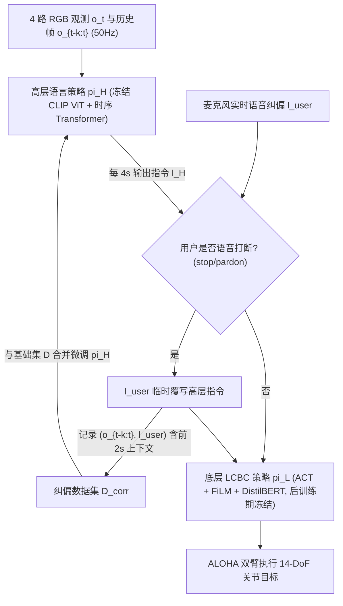

# Yell At Your Robot: Improving On-the-Fly from Language Corrections

## 一句话定义

**YAY Robot（Yell At Your Robot）** 是一种面向长程灵巧双臂操作的分层语言纠偏学习系统，将冻结的语言条件化动作分块底层策略与可随人类实时口头纠偏持续微调的高层语言指令策略相结合，无需额外遥操作即可即时纠错并提升自主成功率。

## 英文缩写速查

| 缩写 | 英文全称 | 简要说明 |
|---|---|---|
| YAY Robot | Yell At Your Robot | 本文提出的实时语言纠偏与高层持续后训练框架 |
| LCBC | Language-Conditioned Behavior Cloning | 语言条件行为克隆，基于 ACT+FiLM 构建的底层多技能策略 |
| ACT | Action Chunking with Transformers | 动作分块 Transformer 架构，用于高精度双臂连续控制 |
| FiLM | Feature-wise Linear Modulation | 特征级线性调制，用于融合视觉特征与语言嵌入 |
| HG-DAgger | Human-Gated DAgger | 人类门控交互式模仿学习，本文将其推广至高层语言动作空间 |

## 核心信息

| 字段 | 内容 |
|---|---|
| 作者 | Lucy Xiaoyang Shi、Zheyuan Hu、Tony Z. Zhao、Archit Sharma、Karl Pertsch、Jianlan Luo、Sergey Levine、Chelsea Finn |
| 机构 | Stanford University、UC Berkeley |
| 论文 | [arXiv:2403.12910v1](https://arxiv.org/abs/2403.12910)（2024-03-19） |
| 项目页 / 代码入口 | [https://yay-robot.github.io/](https://yay-robot.github.io/)（论文摘要声明公开视频与代码） |
| 清单分类 | `model.adaptation`（条目 `adaptation_ax_2403_12910`） |
| 硬件与任务 | ALOHA 双臂系统（14-DoF 关节目标，50 Hz，4 路 RGB）；装密封袋（Bag Packing）、配坚果混合零食（Trail Mix）、擦洗盘子（Plate Cleaning） |

## 为什么重要

1. **解决长程灵巧任务的误差累积难题**：在透明袋装物、舀取食材、双臂擦盘等接触密集任务中，单阶段即便有较高成功率，多阶段串联后整体成功率也会指数级下降；重新收集整条长程遥操作演示成本极高。
2. **把 DAgger 从底层电机动作搬到高层语言指令空间**：相比需要遥操作接管的 HG-DAgger 或只在离散方向词汇集内纠偏的 RT-H，YAY Robot 允许非专业用户直接用自然语言（如“用海绵把袋口撑大点”、“左移一点”、“顺时针转右夹爪”）实时干预，并用少量纯语音数据进行高层迭代微调。
3. **验证预训练 VLM 直接做高频灵巧高层决策的局限性**：消融表明直接用零样本 GPT-4V 作为高层策略会在 2–3 步后频繁出现空间状态幻觉（如夹爪已触桌仍指令下移、海绵在袋外却指令松手），而结合物理交互微调的高层策略能真正感知底层能力边界。

## 核心方法

1. **语言条件化底层策略 $\pi_L(a_t \mid o_t, l_t)$（LCBC）**：
   - 基于 **ACT**（EfficientNet-b3 图像编码 + Transformer 编解码器 + 关节位置嵌入）改造，采用 **FiLM** 层将 **DistilBERT** 编码的语言指令融入视觉特征，输出 14-DoF 双臂目标关节位置。
   - **数据采集与清洗工程**：采用“实时口述 + USB 脚踏板 + Whisper 转录”替代事后视频打标；设置**指令踏板**与**纠偏踏板**，自动过滤纠偏发生前的错误动作片段，同时保留纠偏动作作为底层通用微调技能库（如微调夹爪、抖动袋子、旋转手腕）。
2. **时序上下文高层语言策略 $\pi_H(l_t \mid o_{t-k:t})$**：
   - 使用冻结权重的 **CLIP ViT** 编码 4 路摄像头图像，取**间隔 1 秒的最近 4 帧历史图像**并加入正弦时间位置编码，经 Transformer 与 MLP 输出语言嵌入；每 4 秒（200 步）查询一次，与全量指令库 DistilBERT 嵌入计算余弦相似度后以交叉熵损失训练，推理时通过 `argmax` 选择最匹配命令（微调预测偏移量使其倾向提前预测下一技能）。
3. **实时语音干预与迭代后训练（Post-Training）**：
   - **部署即时适应**：麦克风监听语音；用户说 `"stop"` 或 `"pardon"` 中断高层指令，随后说出纠偏指令 $l_{\text{user}}$ 直接驱动冻结的底层策略 $\pi_L(a_t \mid o_t, l_{\text{user}})$。
   - **高层持续改进**：自动保存干预时刻及前 2 秒的观测上下文 $(o_{t-k:t}, l_{\text{user}})$ 存入纠偏数据集 $D_{\text{corr}}$；每轮后将底层策略冻结，仅在 $D \cup \bigcup_{i=1}^n D_{\text{corr}}^{(i)}$ 上微调高层策略 $\pi_H$，使模型学会在相似失败状态下主动发出纠偏命令。

### 方法流程图

## 实验与评测

在真实 ALOHA 平台三项长程双臂任务上各进行 **20 次试验**（Base 数据集规模见 Table III：装袋 1,170 条轨迹 / 41,517 技能段 / 1,054 唯一指令；配零食 317 条 / 7,008 段；擦盘子 265 条 / 3,236 段）。

### 1. 纠偏收益与对比 Flat BC（Table I、Fig. 6 & 正文定量结果）

- **实时口头纠偏（`YAY Robot + Oracle Corrections`）**：各阶段成功率相比基础策略（Base Policy）即时提升：装袋 **+25%–50%**、配零食 **+30%–45%**、擦盘子 **+15%–25%**（整体从约 15% 提升至 50%）。
- **高层策略微调后自主执行（`YAY Robot after Finetuning`，无任何人工干预）**：仅使用相当于基础数据集 **4%–11%** 片段数量的纯语音纠偏数据（Table IV：装袋 3 轮 2,028 段 = 4.8%，配零食 3 轮 292 段 = 4.2%，擦盘子 2 轮 348 段 = 10.8%），各阶段自主成功率相比基础策略提升：装袋 **+20%–45%**、配零食 **+15%–20%**、擦盘子 **+15%–25%**；三项任务整体平均提升 **20%**（摘要/Fig. 6，部分关键阶段从 15% 升至 45%）。
- **分阶段对比扁平策略 Flat BC（ACT，Table I，成功率 %）**：

| 任务 | 子阶段 | Base Policy (分层基础) | Flat BC (扁平 ACT) |
|---|---|---:|---:|
| Bag Packing | 1 item | **65** | 25 |
| Bag Packing | 2 items | **20** | 0 |
| Bag Packing | 3 items | 0 | 0 |
| Trail Mix Preparation | 1 ingredient | 55 | **60** |
| Trail Mix Preparation | 2 ingredients | **35** | 20 |
| Trail Mix Preparation | 3 ingredients | **20** | 5 |
| Plate Cleaning | Prepare plate & sponge | **85** | 80 |
| Plate Cleaning | Clean 12 gummies | **60** | 55 |

（注：Base Policy 经后训练微调后各阶段进一步大幅超越上述基线，且擦盘热力图 Fig. 9 显示纠偏后盘面擦拭覆盖率明显扩大，主动纠偏指令占比显著提高。）

### 2. 关键消融实验（Sec. V-D & Table II）

- **脚本高层（Scripted High-Level）**：即使采用最优固定指令序列，因无法对执行失误做出反应，性能比自主学习的 Base Policy 下降最高达 **30%**。
- **GPT-4V 高层**：无法准确理解多视角空间接触状态，常在 2–3 步后发出无效或错误指令。
- **One-Hot vs 语言嵌入**：装袋任务包含 1,054 条唯一指令（前文正文提及约 1,200 级规模词汇量），One-Hot 编码无法利用语义相似性而显著劣于 DistilBERT 嵌入。
- **数据过滤质量 vs 数量（Table II）**：保留出错前片段的 `All Data` 在装袋 1 item 上成功率从 `Filtered Data` 的 **25%** 跌至 **10%**（配零食 3 ingredients 从 5% 跌至 0%），验证脚踏板自动过滤错误前缀的必要性。

## 与现有工作的对比

| 维度 | HG-DAgger / Teleop HIL | OLAF | RT-H | YAY Robot (Ours) |
|---|---|---|---|---|
| 人工反馈模态 | 低层遥操作/示教接管 | 事后语言重标动作 | 语言动作层级（固定空间方向纠偏） | 自由自然语言实时语音纠偏（含任务偏好与灵巧微调） |
| 即时在线修正 | 需物理/遥操作接管 | 事后更新，非实时 | 支持语言纠偏 | **实时打断并直接驱动底层 LCBC** |
| 持续自主进化 | 需持续遥操作收集动作标签 | 单轮动作重标 | 侧重层级动作预测 | **冻结底层，仅用 4%–11% 语音数据迭代微调高层** |
| 任务复杂度 | 长程双臂需高昂遥操作成本 | 依赖显式状态/单臂为主 | 固定空间移动为主 | 双臂接触密集长程任务（ALOHA） |

## 常见误区或局限

1. **受限于底层 LCBC 的语言覆盖与执行上限**：即便由人类实时提供近似最优口头纠偏（Oracle），系统整体成功率也仅达约 50% 左右，表明性能天花板很大程度受限于底层 ACT 策略对未见组合指令的泛化与灵巧操作鲁棒性。
2. **高层策略为闭集检索而非开放文本生成**：$\pi_H$ 通过余弦相似度在训练指令词表中做检索分类，无法在自主运行阶段凭空生成训练集外的新指令文本。
3. **仅支持口头语音，不支持多模态指向**：在空间指代不清或需指定具体物体的场景中，尚无法结合手指点选（pointing）等手势沟通。
4. **实验为单套固定桌面双臂场景**：数据采集与评测均在固定 ALOHA 工位完成，跨场景/跨物体泛化依赖重新采集语言标注演示。

## 结论

**一句话总判：YAY Robot 证明了在长程双臂模仿学习中，把人类干预降维成“对高层策略喊话纠偏”是极具性价比的持续学习范式——无需再动遥操作手柄，仅靠 4%–11% 的语音纠偏片段即可把自主成功率平均推高 20 个百分点。**

1. **语言接口让底层纠偏技能得以复用** — 在基础数据采集时就用脚踏板区分并收集微调类指令，是系统能听懂实时纠偏的前提。
2. **错误前缀必须剔除后再做行为克隆** — 混合含错全量数据反而让策略学会犯错，物理脚踏板分流比事后人工看视频剪辑高效得多。
3. **预训练 VLM 尚不能直接接管高频灵巧高层** — 缺少物理交互对齐的 GPT-4V 极易误判细小物体是否在袋内或是否触桌，必须依赖交互数据微调高层策略。
4. **下一步提分关键在强化底层多技能基座** — 高层纠偏微调已经逼近人类口头 Oracle 上限，继续提升上限需扩大底层 VLA/LCBC 的技能广度与精细度。

## 关联页面

- [Agentic Robots 综述](paper-towards-agentic-robots-survey.md)
- [全量项目节点清单](../overview/awesome-agentic-robots-node-index.md)
- [ACT（Action Chunking with Transformers）论文页](paper-act.md)
- [ALOHA 双臂遥操作平台](aloha.md)
- [Action Chunking 方法页](../methods/action-chunking.md)
- [模仿学习方法概述](../methods/imitation-learning.md)
- [双臂操作任务](../tasks/bimanual-manipulation.md)

## 参考来源

- [官方 Awesome 快照归档](../../sources/repos/awesome-agentic-robots-survey-index.md)
- [论文原文入口 arXiv:2403.12910](https://arxiv.org/abs/2403.12910)
- [官方项目主页](https://yay-robot.github.io/)
