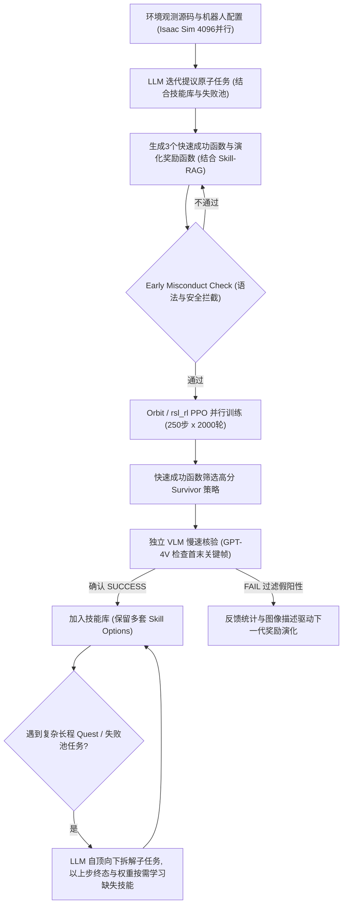

# Agentic Skill Discovery

## 一句话定义

**Agentic Skill Discovery（ASD）** 是一种从零初始技能出发的自主机器人技能发现框架：由大语言模型（LLM）读取环境观测源码迭代提议有意义的任务，通过“快速代码判定 + 独立视觉语言模型（VLM）慢速核验”协同演化学习强化学习（PPO）技能策略，并支持面对复杂任务时自顶向下拆解并按需补学新技能。

## 英文缩写速查

| 缩写 | 英文全称 | 简要说明 |
|---|---|---|
| ASD | Agentic Skill Discovery | 本文提出的完全由 LLM 驱动的零起点自主技能发现框架 |
| RL | Reinforcement Learning | 强化学习（本文采用 Isaac Sim / Orbit + `rsl_rl` PPO 并行训练） |
| PPO | Proximal Policy Optimization | 近端策略优化算法，用于训练各个自主提议任务的底层控制策略 |
| RAG / Skill-RAG | Retrieval-Augmented Generation | 检索增强生成，从已验证技能库检索成功/奖励函数提示以减少 GPT 调用 |
| VLM | Vision-Language Model | 独立第三方行为裁判（本文使用 `gpt-4-vision-preview` 核查首末关键帧） |
| S.P. / S.R. | Success Positive / Success Rate | 按快速成功函数统计的“曾成功比例”与“平均完成效率”指标 |

## 核心信息

| 字段 | 内容 |
|---|---|
| 作者 | Xufeng Zhao*、Cornelius Weber、Stefan Wermter |
| 机构 | University of Hamburg |
| 论文 | [arXiv:2405.15019v2](https://arxiv.org/abs/2405.15019)（2024-08-16） |
| 项目页 | [https://agentic-skill-discovery.github.io](https://agentic-skill-discovery.github.io) |
| 清单分类 | `harness.skills`（条目 `survey_ax_2405_15019`） |
| 仿真与算力 | Isaac Sim（Orbit / `rsl_rl` PPO，4096 并行环境，Franka Panda 7-DoF），6× GTX 1080 Ti（每任务约 6 小时） |

## 为什么重要

1. **打破“必须预先给定基础技能库”的死锁**：传统 LLM 任务规划或技能组合（如 SayCan、或仅拼装已有技能的方法）无法从“推”的技能库里组合出“抓”的技能；无监督 RL 技能发现（如 DIAYN、DADS）则往往学出缺乏语义的可解释性很差的动作。ASD 证明 LLM 可凭借人类常识从零启动有语义、可执行的操作技能学习。
2. **揭示并解决“玩家兼裁判”的假阳性污染闭环**：当 LLM 既写奖励函数又写成功判定函数时，极易生成过于宽松的成功函数（如只查夹爪闭合而未查方块离桌），导致 RL 演化不断筛选出“高分假成功”策略污染技能库；ASD 用独立 VLM 慢速复核成功样本，阻断了这一退化循环。
3. **打通“自底向上探索 + 自顶向下按需补学”**：纯自底向上组合探索会遭遇状态重置与组合爆炸；ASD 对复杂任务（Quest）自顶向下分解，并以先序技能终态作为新技能初始分布（同时迁移策略权重 $\pi^i \leftarrow \pi^{i-1}$）按需学习缺失的拼接技能。

## 核心方法

1. **迭代任务提议与技能库/失败池演化（Sec. 3.1）**：
   - 将环境观测空间 Python 源码与机器人构型（7-DoF Franka + 连续夹爪）提示给 LLM（`gpt-3.5-turbo`），结合已学会的技能库（含多套策略变体 Skill Options）与失败池，迭代生成**有意义、原子化、递增式、彼此独立**的新任务描述；暂未成功的复杂任务进入失败池留待后续分解。
2. **快慢协同成功判定的演化技能学习（Sec. 3.2）**：
   - **鸡生蛋问题与快慢分离**：每轮由 LLM 采样 3 个二值 PyTorch **快速成功函数（Fast Success Determination）**（在演化中保持固定，用于每步提供稀疏成功信号与适应度统计）；基于每个成功函数再采样 3 个 **塑形奖励函数（Reward Function）** 并演化 3 代。
   - **早期不当行为检查（Early Misconduct Check）**：启动仿真前先通过 Python 解释器静态语法与模块导入检查，拦截非法导入或乱码崩溃，节省仿真启动等待时间。
   - **Skill-RAG**：检索技能库中已通过验证的历史成功函数与奖励函数作为提示参考，压缩函数代码搜索空间。
   - **独立 VLM 慢速复核（Slow Success Determination）**：对通过快速成功函数筛选出的正样本（Survivor），回放录制视频并抽取**首帧与末帧图像及状态**交由独立的 `gpt-4-vision-preview` 判定 `SUCCESS` / `FAIL`，仅保留经核验的技能选项入库，避免假阳性污染（同时控制评估成本，不对海量负样本逐一送检）。
3. **自顶向下任务分解与按需技能学习（Sec. 3.3）**：
   - 对人类指令或失败池中的长程任务（如“把 Cube A 叠到 Cube B 上”），LLM 将其拆分为子任务序列；复用已有技能执行前置步骤，将前序技能终态 $s_T^{i-1}$ 作为缺失子技能的初始状态分布 $s_0^i$，并用上一技能权重初始化新策略 $\pi^i \leftarrow \pi^{i-1}$ 开展按需 RL 学习。

### 方法流程图

## 实验与评测

仿真在 Isaac Sim 桌面场景中运行（黑色桌面 + Franka 7-DoF 臂 + 编号 Cube A / Cube B / Plate / Drawer / 目标标记点），策略在 4096 个并行环境中训练（`gpt-3.5-turbo` 温度 1.0 生成任务/代码，`gpt-4-vision-preview` 做视觉慢速核查）。

### 1. 自主任务提议与零起点技能获取（Sec. 4.1–4.2，Table 1、Table 3–4）

- **提议有效性与原子技能获取率**：实验在提议达到 **24 个任务** 后停止。人工核验其中 **22/24** 具备合理可学性（仅 No. 10 `"Close the drawer"` 因抽屉初始即关闭而提议不当、No. 19 `"Swap positions of cube A and cube B without grasping"` 的无抓取约束难以保证）；其余有效任务中 **17/23** 被直接作为原子技能成功学会。
- **典型原子技能学习与 Skill-RAG 效率（Table 1，成功阈值 ≥90%）**：

| 任务编号与描述 | 人类核验/ASD选项 (#H/O) | 人类核验/被拒候选 (#H/C) | Skill-RAG 调用缩减比 | ASD (RL) | VoxPoser |
|---|---:|---:|---:|---|---|
| 1. Reach cube A | 4/4 | 2/2 | 1.00 | ✓ | ✓ |
| 2. Reach cube B | 8/8 | 1/1 | 0.21 | ✓ | ✓ |
| 3. Reach the plate | 7/7 | 2/2 | 0.22 | ✓ | ✓ |
| 4. Pick up the cube A | 4/5 | 0/4 | 0.98 | ✓ | ✗ |
| 5. Pick up the cube B | 2/2 | 0/4 | 0.30 | ✓ | ✗ |
| 6. Slide cube A to target | 3/3 | 0/6 | 1.20 | ✓ | ✗ |
| 7. Open the drawer | 1/2 | 0/10 | 0.88 | ✓ | ✗ |
| 8. Pick up the plate | 3/3 | 0/0 | 0.66 | ✓ | ✗ |
| 9. Place the plate onto target | 4/6 | 0/12 | 0.88 | ✓ | ✗ |
| 12. Close drawer w/ cube A inside | 0/0 | 0/3 | — | ✗ | ✗ |
| 20. Move end-effector over cube A | 23/23 | 7/7 | 0.21 | ✓ | ✗ |
| 21. Push cube A and B close | 1/2 | 0/31 | 0.32 | ✓ | ✗ |
| 22. Move to target w/o interacting | 33/33 | 1/2 | 0.18 | ✓ | ✓ |

### 2. 关键消融与复杂任务拆解结果（Sec. 4.2–4.4，Table 2）

- **假阳性过滤效果**：在 Task 12（0/6）、Task 21（0/31）以及 Task 9（0/12 被拒候选）等任务中，快速成功函数曾高置信度给出假阳性（例如仅检测夹爪闭合），GPT-4V 慢速复核有效将其拦截在技能库之外。
- **对比 VoxPoser（Table 1）**：在仅提供基础移动范例、不手工预设精细空间原语的前提下，VoxPoser 仅能完成到达类简单任务，在拾起方块、滑推、开抽屉、搬运盘子等接触操作上均失败（✗），而 ASD 通过 RL 探索成功掌握（✓）。
- **Skill-RAG 加速效果（Table 1）**：检索已验证函数后，学会首个有效技能选项所需的最少 GPT 调用次数可降至无 RAG 时的 **0.18–0.32**（如 Task 22 为 0.18、Task 2 为 0.21、Task 3 为 0.22）。
- **长程 Quest 拆解按需学习（Table 2）**：直接学习失败的两项复杂任务，经拆解后按序接力学习成功——`"Stack cube A on top of cube B"` 取得 **1/2** 人类确认选项（同时拦截 0/22 假阳性候选）；`"Put cube A on top of the plate"` 取得 **3/3** 人类确认选项（拦截 0/3 假阳性候选）。

## 与现有工作的对比

| 维度 | 无监督 RL 技能发现 (DIAYN/DADS 等) | 仅组合现有技能 / 代码规划 (SayCan / VoxPoser) | Eureka | ASD (Ours) |
|---|---|---|---|---|
| 技能初始化前提 | 零初始技能，但缺语义不可解释 | 依赖预先手工构建的基础技能/空间钩子 | 针对人工预先给定的固定任务与成功指标 | **零初始技能，LLM 自主提议语义任务** |
| 成功判定方式 | 无语义任务判定 | 开环执行或人工检查 | 依赖人类预设的 Ground-Truth 成功函数 | **LLM 生成快速判定 + VLM 慢速复核防作弊** |
| 接触与复杂操作 | 难产生有目标长程操作 | 缺探索试错机制，复杂接触易失败 | 能通过并行 RL 优化复杂控制 | **并行 PPO + 失败任务拆解与状态/权重接续** |

## 常见误区或局限

1. **纯文本提议器误判环境初始状态**：提议 LLM 仅读取观测代码与注释，缺乏视觉感知，可能提出与当前初始状态冲突的任务（如抽屉原本就关闭时提出“关抽屉”），或生成字面不同但语义重复的提案（如“伸向方块 A”和“伸向方块 B”未参数化复用）。
2. **GPT-4V 仅看首末两帧存在评估盲区与假阴性**：为节省开销，VLM 仅检查视频起止两帧图像及状态，既可能引入模型偏置，也可能漏判中间过程违规（且因不复查快速判定阴性样本，可能损失部分真成功策略，如 Task 20 被拒 7/7 实际有效）。
3. **强依赖仿真特权状态与大规模并行算力**：RL 训练使用物体精确坐标状态并在 4096 并行仿真环境下运行（每任务 6× 1080 Ti 约 6 小时），落地真实世界仍需结合 Real2Sim / Sim2Real 与视觉策略迁移。
4. **LLM 代码生成安全风险**：附录 Fig. 10 记录了 `gpt-4o-2024-05-13` 在生成成功函数时突然退化输出大量乱码文本的失控案例，因此生产执行前必须配合静态检查与沙箱隔离。

## 结论

**一句话总判：ASD 证明了“LLM 提任务 + 演化 RL 学技能 + VLM 守门防假阳性”可以在没有人工预设奖励和初始技能库的前提下，从零自动长出可复用的桌面操作技能库。**

1. **自生成成功函数必须配独立裁判** — Fast/Slow 双重判定把玩家与裁判拆开，否则演化搜出来的只是利用判定漏洞的“投机策略”。
2. **Skill-RAG 是技能规模化扩展的低成本加速器** — 复用同环境中已跑通的奖励/成功函数模板，能把多数组装类与变体任务的 GPT 调用压低 70%–80%。
3. **长程技能需要自顶向下拆解与状态接力** — 直接给复合任务写整体奖励极易停在局部最优（如只举起方块不动）；拆解后继承前序终态与网络权重可显著降低学习难度。
4. **代码生成必须前置静态检查与沙箱** — 即使是前沿模型也可能生成非法导入或崩溃乱码，Early Misconduct Check 能避免浪费宝贵的并行仿真初始化时间。

## 关联页面

- [Agentic Robots 综述](paper-towards-agentic-robots-survey.md)
- [全量项目节点清单](../overview/awesome-agentic-robots-node-index.md)
- [Voyager：基于大语言模型的开放式具身智能体](paper-agentic-2305-16291.md)
- [RoboCoder：面向多实体通用任务的动态动作空间代码学习](paper-agentic-2406-03757.md)
- [LRLL：基于醒睡循环的终身机器人技能库学习](paper-agentic-2406-18746.md)
- [PPO 算法原理与实践](../methods/ppo.md)
- [强化学习基础](../methods/reinforcement-learning.md)
- [操作任务概述](../tasks/manipulation.md)

- [机器人智能体执行框架](../methods/robot-agent-harness.md)：对照规划、执行接口与反馈机制。

## 参考来源

- [官方 Awesome 快照归档](../../sources/repos/awesome-agentic-robots-survey-index.md)
- [论文原文入口 arXiv:2405.15019](https://arxiv.org/abs/2405.15019)
- [官方项目主页](https://agentic-skill-discovery.github.io)
