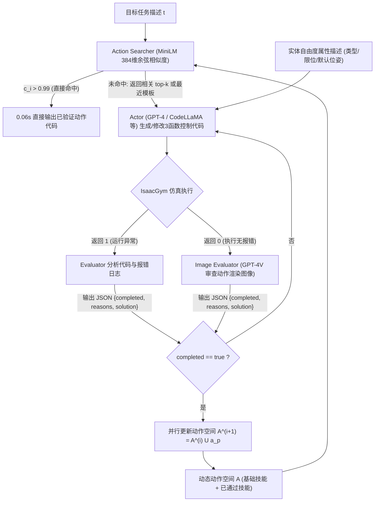

# RoboCoder: Robotic Learning from Basic Skills to General Tasks with Large Language Models

## 一句话定义

**RoboCoder** 是一个结合轻量级动作检索器（Searcher）、代码生成模型（Actor）与视觉评估器（Evaluator）的闭环机器人代码学习框架，通过仿真执行图像反馈迭代修复关节控制代码，并将通过检验的新技能并行扩充回动态动作空间，实现从少量基础技能向多本体复杂任务的泛化。

## 英文缩写速查

| 缩写 | 英文全称 | 简要说明 |
|---|---|---|
| LLM | Large Language Model | 大语言模型，在框架中担任生成与修改控制代码的 Actor |
| VLM | Vision-Language Model | 视觉语言模型（GPT-4V），担任基于动作图像判断成败的 Evaluator |
| DOF | Degree of Freedom | 自由度，控制代码直接设置各实体关节位置、速度与状态转移 |
| MiniLM / MiniLMv2 | MiniLM Sentence Transformer | 21M 轻量级 384 维句向量编码器，用于快速检索相似技能 |
| ReAct / Self-Repair | Reasoning & Acting / Reflexion | 对比基线：无动态动作库更新或仅依赖代码/终端文本反馈的修复方法 |

## 核心信息

| 字段 | 内容 |
|---|---|
| 作者 | Jingyao Li、Pengguang Chen、Sitong Wu、Chuanyang Zheng、Hong Xu、Jiaya Jia |
| 机构 | The Chinese University of Hong Kong（CUHK）、SmartMore |
| 论文 | [arXiv:2406.03757v1](https://arxiv.org/abs/2406.03757)（2024-06-06） |
| 项目页 / 代码 | 论文摘要声明“Our codes will be released”，正文与快照均未给出公开仓库 URL |
| 清单分类 | `harness.skills`（条目 `survey_ax_2406_03757`） |
| 评测平台 | IsaacGym（7 类本体，共 80 个手工设计测试任务） |

## 为什么重要

1. **指出纯代码自修复在具身控制上的“假通过”陷阱**：传统基于代码和终端日志的评估器（Code Evaluator）往往在只看源代码或未报语法错时就误判任务已完成，导致迭代过早终止；RoboCoder 证明引入渲染动作图像由 VLM（GPT-4V）做视觉验收能带来巨大提升（+31.27% vs 仅 +1.35%）。
2. **构建跨 7 种差异巨大形态的多任务代码学习基准**：从 21-DoF 人形（Human）、12-DoF 四足（Anymal）、8-DoF Ant、2-DoF Cartpole、4-DoF 柜体到 Franka Panda（9-DoF）与 Kinova（6-DoF）机械臂，用统一关节控制接口测试模型从少量基础技能迁移到 80 个复杂任务的能力。
3. **用动态动作空间缓存实现推理百倍级加速**：将验证通过的代码并行沉淀进向量化动作库后，后续命中任务由 21M MiniLMv2 在 **0.06 秒**内直接召回，避免每次都耗时 54 秒调用大型代码模型重新生成。

## 核心方法

RoboCoder 不经过强化学习参数更新，而是让 Actor 直接生成包含 `set_initial_dof_position()`、`set_speeds()`、`set_state_destination()` 三个标准 Python 接口的关节状态机代码，围绕三模块闭环运转：

1. **双阈值动作检索器（Searcher，$f_s$）**：使用轻量级 Sentence Transformer（MiniLM / 21M MiniLMv2，384 维）计算目标任务 $t$ 与动作空间 $A=\{a_1,\dots,a_n\}$ 的余弦相似度 $c_i$，按双阈值路由（$\Lambda_h=0.99$，$\Lambda_l=0.5$）：
   - **直接命中（$\exists c_i > \Lambda_h$）**：认为任务已存在于动作库，无需调用 LLM，直接输出匹配代码；
   - **相关参考（$\exists c_i > \Lambda_l$）**：提取相似度超过下限的 top-$k$ 相关技能代码传给 Actor 参考组合；
   - **冷启动模板（$\forall c_i < \Lambda_l$）**：仅返回最接近的 1 条代码作为语法与自由度模板。
2. **代码生成器（Actor，$f_a$）**：接收检索到的参考动作、该实体的完整自由度属性表（运动类型、上下限、默认值等）以及上一轮评估修复建议，生成或改写三函数控制脚本。评测覆盖 GPT-4（默认）、GPT-3.5、CodeLLaMA-Instruct（13B/34B）、StarCoder-15B、WizardCoder-15B。
3. **基于运行与视觉图像的双路评估器（Evaluator，$f_e$）**：在 IsaacGym 中执行候选代码：
   - 若返回 `1`（执行报错）：将代码与报错信息交由 Evaluator 分析原因并输出结构化 JSON（`completed`、`reasons`、`solution`）；
   - 若返回 `0`（运行成功）：截取动作执行序列图像输入 **GPT-4V**（Image Evaluator），从物理行为上核查是否真正完成任务，未完成则返回具体关节修正方案供 Actor 迭代（最多 $N$ 轮）。
4. **并行动作空间自更新（Parallel Action Space Update）**：相比串行逐任务更新，RoboCoder 在每轮并行测试所有待解任务；每轮结束将通过验证的新动作 $a_p$ 立即并入 $A^{(i+1)} = A^{(i)} \cup a_p$，使下一轮中的高难度任务能够检索并复用刚学会的简单动作。

### 方法流程图

## 实验与评测

基准涵盖 IsaacGym 中 7 类实体的 **80 项任务**（Table 8：Human 18 项、Ant 8 项、Cartpole 7 项、Sektion Cabinet 7 项、Franka Panda 17 项、Kinova 12 项、Anymal 11 项；初始动作空间见 Table 9，除 Human 含 15 项基础动作外，其余实体仅提供 1–3 项基础动作）。

### 核心定量结果

- **整体通过率提升**：
  - 基础能力评测中，即便 **GPT-4（3-shot）** 在 Human 实体上也仅取得 **47%** 通过率。
  - **RoboCoder** 在 Human 实体上相比 GPT-4 取得 **36% 相对提升**（Fig. 9 中 GPT-4 曲线亦显示相对其自身基线提高 **30.56%**）；在四足机器人 **Anymal** 上达到 **92%** 通过率。
  - 跨全部 7 个实体的平均对比（Fig. 10）中，RoboCoder 相比此前方法（`simple-react` 与 `self-repair` / Reflexion）平均高出 **10.34%**。
- **模块消融实验（Sec. 4.3 & Fig. 6–8）**：

| 消融维度 | 对比设置 | 定量观察结果 |
|---|---|---|
| 评估反馈理由 | RoboCoder vs `w/o reason feedback` | 有理由与方案反馈平均高出 **20.82%** |
| 图像 vs 纯代码评估 | Image Evaluator (GPT-4V) vs Code Evaluator | Code Evaluator 前 1–2 轮误判完成导致停滞，仅涨 **1.35%**；Image Evaluator 经迭代提升 **31.27%** |
| 检索策略 | Related Searcher vs Random Searcher | 首轮通过率高出 **15.28%**，末轮高出 **5.45%** |
| 推理耗时（单张 A800） | 21M MiniLMv2 Searcher vs 34B CodeLLaMA | Searcher 检索仅 **0.06 秒**，对比 34B CodeLLaMA 耗时 **54 秒** |

- **多基座模型泛化（Fig. 9）**：框架在 StarCoder-15B、WizardCoder-15B、CodeLLaMA-Instruct（13B/34B）、GPT-3.5 与 GPT-4 上均带来多轮迭代增益，其中基座越强（如 GPT-4）利用视觉反馈自纠的能力提升越明显。

## 与现有工作的对比

| 维度 | Eureka / 语言写奖励 RL 方法 | ReAct / Reflexion (Self-Repair) | RoboCoder (Ours) |
|---|---|---|---|
| 控制输出形式 | 训练 RL 奖励函数，需海量交互训练 | 文本/代码轨迹或固定原语 | **直接生成 3 函数关节状态机代码，免 RL 训练** |
| 评估信号来源 | 依赖人工预设环境成功指标 | 多依赖代码运行输出/终端文本反馈 | **运行报错 + GPT-4V 动作渲染图像双路视觉验收** |
| 技能库演化 | 多数单任务独立训练，难跨任务复用 | 历史经验停留在单任务上下文记忆 | **并行动作空间扩张 + 21M MiniLM 快速检索复用** |
| 测试覆盖范围 | 单一或少数机器人臂/手任务 | 偏重编程题或少数家居任务 | **7 种形态（人形/四足/多足/机械臂/柜体）80 任务** |

## 常见误区或局限

1. **仅在简化仿真环境中验证，尚未上真机**：论文明确指出由于硬件与物理世界复杂性限制，所有方法仅在简化的 IsaacGym 仿真中完成测试，尚未部署验证至真实物理机器人。
2. **任务复杂度偏重纯运动学姿态控制**：基准中的 80 个任务大多聚焦关节转动、抬手、屈膝、推拉固定位置等基础或组合动作，较少涉及复杂环境感知、未知接触摩擦或物理常识推理。
3. **代码控制范式假设已知精确关节索引与限位**：Actor 依赖详尽的 DOF 定义表直接规划 `set_state_destination`，对于缺乏闭环力控的高动态平衡任务（如真机双足抗扰动行走）直接开环目标位姿控制难以稳健成立。
4. **开源仓库尚未在论文中落地链接**：摘要虽声明将释放代码，但未附带可访问的 GitHub 地址，复现基准与提示词工程需进一步等待或核查后续发布。

## 结论

**一句话总判：RoboCoder 验证了一个朴素却极有效的具身代码自进化原则——光看代码报错无法保证机器人“做对了动作”，必须用视觉评估器盯着渲染结果纠偏，再用轻量向量检索把修好的代码固化成可秒级复用的技能库。**

1. **代码自修复必须引入视觉闭环** — 对比实验（31.27% vs 1.35%）清楚说明，没有图像反馈的 Code Evaluator 会大量“自以为成功”而提前终止纠偏。
2. **向量检索缓存能把大模型昂贵推理摊薄到 0.06 秒** — 将 21M MiniLMv2 置于大语言模型前端，在技能库随时间膨胀后可把重复任务的推理延迟降低三个数量级。
3. **并行更新比串行更适合技能迁移** — 每轮同时跑全量任务并共享新通过的技能，能让简单动作在下一轮立刻成为复杂动作的脚手架。
4. **面向物理世界仍需跨越动力学与真机鸿沟** — 从当前运动学关节状态机迈向真机操作与动态行走，还需接入闭环感知与底层鲁棒控制器。

## 关联页面

- [Agentic Robots 综述](paper-towards-agentic-robots-survey.md)
- [全量项目节点清单](../overview/awesome-agentic-robots-node-index.md)
- [Agentic Skill Discovery：零初始技能的演化式技能发现](paper-agentic-2405-15019.md)
- [LRLL：基于醒睡循环的终身机器人技能库学习](paper-agentic-2406-18746.md)
- [RoboCodeX：树状多模态机器人代码生成](paper-agentic-2402-16117.md)
- [LLM 与机器人控制接口](../concepts/llm-robotics-control-interfaces.md)
- [移动与足式运动控制任务](../tasks/locomotion.md)

- [智能体机器人操作策略](../methods/agentic-manipulation-policies.md)：对照操作场景中的规划、执行与反馈接口。

## 参考来源

- [官方 Awesome 快照归档](../../sources/repos/awesome-agentic-robots-survey-index.md)
- [论文原文入口 arXiv:2406.03757](https://arxiv.org/abs/2406.03757)
