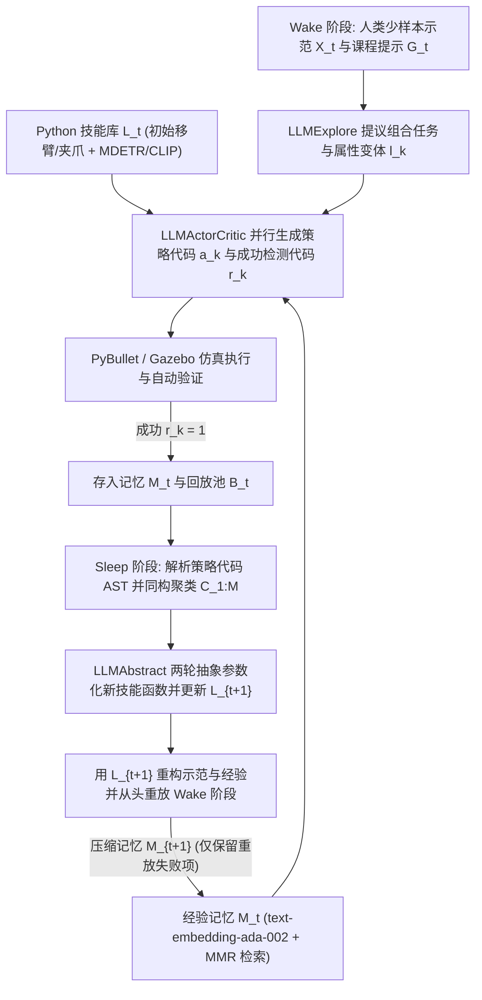

# Lifelong Robot Library Learning: Bootstrapping Composable and Generalizable Skills for Embodied Control with Language Models

## 一句话定义

**LRLL（Lifelong Robot Library Learning）** 是一种面向具身控制的免梯度终身技能库学习框架，受醒睡（Wake-Sleep）库学习启发，通过冻结 LLM 在 Wake 阶段探索生成并自验证新任务经验、在 Sleep 阶段对成功代码做抽象语法树（AST）聚类与函数提炼并重放压缩记忆，使机器人技能库随课程周期持续生长而不产生灾难性遗忘或提示词饱和。

## 英文缩写速查

| 缩写 | 英文全称 | 简要说明 |
|---|---|---|
| LRLL | Lifelong Robot Library Learning | 本文提出的基于醒睡循环的终身机器人代码技能库学习智能体 |
| AST | Abstract Syntax Tree | 抽象语法树，Sleep 阶段用于对结构同构的策略代码聚类 |
| MMR | Maximum Marginal Relevance | 最大边界相关性检索，用于在经验记忆中召回兼顾相似与多样的少样本上下文 |
| SA / UA / UI | Seen Attributes / Unseen Attributes / Unseen Instructions | 测试划分：已见属性、未见属性、未见指令与未见属性 |
| FT / BT | Forward Transfer / Backward Transfer | 终身学习评估指标：前向组合迁移与后向抗遗忘保持能力 |

## 核心信息

| 字段 | 内容 |
|---|---|
| 作者 | Georgios Tziafas、Hamidreza Kasaei |
| 机构 | University of Groningen（Department of Artificial Intelligence） |
| 论文 | [arXiv:2406.18746v2](https://arxiv.org/abs/2406.18746)（2024-07-15） |
| 项目页 | [https://gtziafas.github.io/LRLL_project](https://gtziafas.github.io/LRLL_project) |
| 清单分类 | `harness.skills`（条目 `survey_ax_2406_18746`） |
| 仿真与真机 | PyBullet（Ravens 41 个任务模板，4 阶段课程）+ Gazebo；双臂 UR5e 真机 + Kinect（MDETR + CLIP + GR-ConvNet） |

## 为什么重要

1. **同时绕开端到端微调遗忘与静态 LLM 提示饱和**：传统端到端多任务策略（如 CLIPort）在持续加入新任务时面临严重的灾难性遗忘且对未见指令泛化崩溃；静态代码提示（如 Code-as-Policies）在课程后期随着上下文样例堆叠出现**提示词饱和（prompt saturation）**，导致模型忽略早期范例或错用作用域外变量。
2. **把 DreamCoder 式醒睡库学习引入 LLM 机器人控制**：LRLL 不更新任何神经网络梯度，而是让知识在**经验记忆 $M_t$** 与**Python 技能库 $L_t$** 之间持续流转——先在仿真中探索积累样例，再把重复代码模式蒸馏为高层 API 函数并重构压缩记忆，实现长达多周期的组合外推。
3. **非专家用户仅用自然语言提示与少样本示范即可课程式教学**：人类只需在每轮提供少量示范与课程方向提示（hints），即可引导机器人从基础空间定位一步步演化到复杂长程多物体重排。

## 核心方法

系统以只含基础末端移动、夹爪开合及预训练视觉原语（MDETR 指代检测 + CLIP 开放属性分类）的初始库 $L_0$ 起步，按周期循环执行两阶段学习：

1. **经验记忆与 MMR 检索**：记忆 $M_t$ 存储 $\langle l^{(i)}, a^{(i)}, r^{(i)} \rangle$（指令、策略代码、仿真特权成功检查代码），用 `text-embedding-ada-002` 编码指令；检索时采用**最大边界相关性（MMR）**取 top-$k$ 既相似又多样的上下文样例。
2. **Wake 阶段（人类引导 + 仿真自主探索）**：
   - 人类教师输入本周期少样本示范 $X_t$ 与课程提示 $G_t$。
   - `LLMExplore`（两步链式调用，分别提议任务组合与概念变体，温度 `0.1`）结合记忆状态不断提出新任务 $l_{1:K}$。
   - `LLMActorCritic` 并行生成策略代码 $a_k$（带内联思维链注释）与仿真成功检查代码 $r_k$，在仿真中运行验证；成功样本写入记忆 $M_t$ 与当前周期回放缓冲区 $B_t$。
3. **Sleep 阶段（AST 聚类 + 函数抽象 + 重放压缩）**：
   - 将 $B_t$ 中的策略代码解析为**抽象语法树（AST）**，忽略变量名与常量差异进行同构聚类，得到 $M$ 个代码簇 $C_{1:M}$。
   - `LLMAbstract`（两轮提示：先按簇生成通用参数化 Python 函数及 docstring，再做跨样例通用化抽取）将高频模式与样板代码提炼为新技能函数加入技能库 $L_{t+1} = L_t \cup \{\text{LLMAbstract}(C_m)\}$。
   - 使用新技能库重构已有示范与经验（`Refactor`），随后**仅凭重构后的示范从头重放 Wake 阶段**，仅将重放失败的经验重构后留存在 $M_{t+1}$ 中，从而大幅压缩记忆体积并缩短提示词长度。

### 方法流程图

## 实验与评测

基于 PyBullet（Ravens 桌面方块与碗环境）设计包含 **41 个任务模板**的 4 阶段终身课程：（1）Spatial Coordination（空间定位）、（2）Visual Reasoning（属性与数量/空间关系推理）、（3）Object Manipulation（单物体拾放）、（4）Rearrangement（多物体长程重排），每组重复 3 个随机种子、每模板评测 10 次。所有 LLM 调用默认使用 `gpt-3.5-turbo`。

### 1. 跨课程周期泛化成功率对比（Table I，单位 %）

| 方法 | 分割平均 SA ↑ | 分割平均 UA ↑ | 分割平均 UI ↑ | Rearrangement UI ↑ |
|---|---:|---:|---:|---:|
| CLIPort（仅前两阶段适用） | 84.5 | 25.5 | 2.2 | — |
| LLM-static（类 CaP 静态提示） | 94.5 | 91.9 | 76.8 | 60.6 |
| **LRLL (Ours)** | **96.9** | **97.1** | **86.6** | **70.9** |

（LRLL 在 4 个周期 UI 分割上分别为：Spatial **100.0%**、Visual **85.1%**、Object Manipulation **90.4%**、Rearrangement **70.9%**，在未见属性 UA 上相对 `LLM-static` 提升约 **+6%**、未见指令 UI 上提升约 **+10%**。）

### 2. 终身学习前向/后向迁移与消融（Table II，单位 %）

| 方法 | Average FT (前向迁移) ↑ | Average BT (后向保持) ↑ | Rearrangement FT ↑ |
|---|---:|---:|---:|
| LLM-static | 65.1 | 78.9 | 45.7 |
| LRLL-no-wake（无自主探索） | 51.3 | 50.5 | 50.0 |
| LRLL-no-sleep（无 AST 技能抽象） | 80.6 | 89.6 | 64.0 |
| **LRLL (Ours)** | **88.1** | **93.5** | **70.2** |

### 3. 记忆压缩、嵌入选型与真机零样本迁移（Sec. IV-C & IV-D）

- **Sleep 阶段压缩收益（Fig. 4）**：通过技能重构与重放压缩，存储经验嵌入所需的内存空间实现 **8 倍缩减（×8 decrease in RAM）**，同时生成更短的函数调用代码，显著减少所需检索样例数与 API 成本。
- **嵌入模型对比**：`text-embedding-ada-002` 显著优于 Sentence-BERT；后者容易被字面名词重合误导（例如同出现某物体名词但任务逻辑完全不同）。
- **双臂 UR5e 真机零样本迁移（Sec. IV-D）**：在 Gazebo 仿真完成 4 阶段课程学习后，零样本迁移至由 **双 UR5e 机械臂 + Kinect 相机** 构成的真实平台（接入 MDETR、CLIP 与 GR-ConvNet 4-DoF 抓取合成），覆盖 12 类家居物品的桌面属性推理与重排任务；观察到的主要失误来源于运动碰撞与 CLIP 属性误分类。

## 与现有工作的对比

| 维度 | CLIPort (端到端模仿学习) | Code-as-Policies / LLM-static | Voyager / 仅记忆检索方法 | LRLL (Ours) |
|---|---|---|---|---|
| 技能库可成长性 | 固定任务头与数据，易遗忘 | 静态原语库，新功能靠专家手动添加 | 可向记忆库增补完整代码，但不重构基元 | **Wake 探索 + Sleep AST 抽象出新 Python API** |
| 上下文稳定性 | 无上下文概念 | 课程后期出现**提示词饱和**（性能衰减） | 需检索较多长代码块，提示词膨胀 | **重构压缩后内存降 8×，代码短且稳定** |
| 未见指令长程泛化 | UI 仅 2.2% | UI 76.8%，FT 65.1% | 受限于检索器质量（`no-sleep` FT 80.6%） | **UI 86.6%，FT 88.1%，BT 93.5%** |

## 常见误区或局限

1. **受限于前端固定视觉 API 的感知能力**：当前依赖 MDETR 与 CLIP 的组合，仅能处理指代表达与属性分类，缺乏开放式多模态视觉-空间推理能力（真机主要错误亦包含 CLIP 误分类）。
2. **纯语言/符号原语示范难以覆盖精细接触技能**：人类示范以代码/原语组合表达，难以直接习得需要连续力控或复杂铰接轨迹的灵巧操作（论文指出未来需融合视频示范或动力学示教）。
3. **跨领域与换模型仍需调整起始引导提示**：虽然省去了每个新任务的手工提示工程，但更换全新领域或底层 LLM 时仍需重新打磨 Explore 与 Abstract 模块的初始系统提示。
4. **商业 API 延迟与调用成本**：探索与双轮抽象依赖多次 LLM 调用（本文用 `gpt-3.5-turbo`），探索频率高时受限于商业 API 速率与费用。

## 结论

**一句话总判：LRLL 用无梯度的“醒睡库学习（Wake 探索 + Sleep AST 抽象重构）”完美解决了代码生成智能体“只会越记越长、不会越学越精”的痛点，在避开灾难性遗忘的同时把内存压缩了 8 倍。**

1. **光靠 RAG 存代码不够，必须做 AST 抽象重构** — 对比 `LRLL-no-sleep` 与完整 LRLL（FT 80.6% → 88.1%，RAM 降 8×），证明把重复代码块提炼成带 docstring 的 Python 函数才是长期可扩展的关键。
2. **自主探索是抽象器的燃料** — `LRLL-no-wake` 因单样本示范过于稀疏，抽象退化成“一任务一函数”（FT 跌至 51.3%）；只有 Wake 阶段充分扩增同构变体，Sleep 阶段才能提炼出真正通用的参数化接口。
3. **语义嵌入质量直接决定代码检索上限** — 应选用擅长捕获任务动作语义的嵌入模型（如 `text-embedding-ada-002`），避免小模型因共享物体名词产生误检索。
4. **代码符号层天然适合 Sim2Real 零样本迁移** — 在 Gazebo/PyBullet 习得的纯 Python 技能逻辑只需替换真机视觉与抓取底层（MDETR+CLIP+GR-ConvNet）即可直接上 UR5e 双臂运行。

## 关联页面

- [Agentic Robots 综述](paper-towards-agentic-robots-survey.md)
- [全量项目节点清单](../overview/awesome-agentic-robots-node-index.md)
- [Code as Policies：用语言模型生成机器人策略代码](paper-pai-2209-07753-codeaspolicies.md)
- [Agentic Skill Discovery：零初始技能的演化式技能发现](paper-agentic-2405-15019.md)
- [RoboCoder：面向多实体通用任务的动态动作空间代码学习](paper-agentic-2406-03757.md)
- [VLA 方法背景](../methods/vla.md)
- [操作任务概述](../tasks/manipulation.md)
- [LLM 与机器人控制接口](../concepts/llm-robotics-control-interfaces.md)

## 参考来源

- [官方 Awesome 快照归档](../../sources/repos/awesome-agentic-robots-survey-index.md)
- [论文原文入口 arXiv:2406.18746](https://arxiv.org/abs/2406.18746)
- [官方项目主页](https://gtziafas.github.io/LRLL_project)
