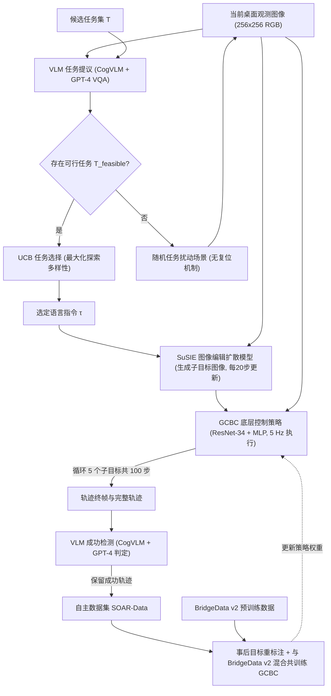

# Autonomous Improvement of Instruction Following Skills via Foundation Models

**SOAR（Scaled Collection for Autonomous Improvement）**

## 一句话定义

通过将自然语言指令跟随解耦为互联网预训练的「语言到子目标图像生成器」与基于事后目标重标注的自监督「图像目标条件控制策略」，结合冻结 VLM 的任务提议与成功检测，使真机机械臂集群能够在无人类监督与人工复位条件下持续自主采集数据并翻倍提升策略成功率。

## 英文缩写速查

| 缩写 | 英文全称 | 简要说明 |
|---|---|---|
| SOAR | Scaled Collection for Autonomous Improvement | 本文提出的语义感知自主数据采集与策略自改进系统 |
| VLM | Vision-Language Model | 视觉-语言模型，本文使用 CogVLM 执行任务可行性判断与成功检测 |
| GCBC | Goal-Conditioned Behavioral Cloning | 目标条件行为克隆，基于当前观测与目标图像预测动作 |
| LCBC | Language-Conditioned Behavioral Cloning | 语言条件行为克隆，直接以语言嵌入为条件的基线策略 |
| UCB | Upper Confidence Bound | 上置信界多臂赌博机算法，用于在可行任务中最大化任务探索多样性 |
| HER | Hindsight Experience Replay | 事后目标重标注思路，将轨迹未来实际到达帧作为自监督目标图像 |

## 核心信息

| 字段 | 内容 |
|---|---|
| 机构 | UC Berkeley（BAIR） |
| 作者 | Zhiyuan Zhou*、Pranav Atreya*、Abraham Lee、Homer Walke、Oier Mees、Sergey Levine |
| 论文 | [arXiv:2407.20635v2](https://arxiv.org/abs/2407.20635)，CoRL 2024 |
| 项目页 / 官方代码 | [auto-improvement.github.io](https://auto-improvement.github.io) / [rail-berkeley/soar](https://github.com/rail-berkeley/soar) |
| 清单分类 | `data.collection`（条目 `survey_ax_2407_20635`） |
| 硬件与数据规模 | 5 台 WidowX 250 6-DoF 机械臂；开源 **SOAR-Data** 共 30,582 条轨迹（3M transitions，53 组物体，5 套桌面） |

## 为什么重要

1. **突破纯遥操作数据瓶颈：** 互联网规模的文本/图像难以直接映射到真机控制，而实验室人工遥操作成本高昂；SOAR 验证了真机集群在无人工干预与场景复位条件下自主采集并反哺策略的可行性。
2. **语义与控制解耦的抗噪机制：** 直接对语言条件策略（LCBC）做自主自训练高度依赖精准的轨迹成功标签与语言标注，VLM 误判会导致性能退化；SOAR 将语义泛化交给冻结的图像编辑扩散模型（SuSIE），底层控制只需用事后重标注图像目标（hindsight goals）做自监督 GCBC，对 VLM 成功检测中的假阳性具有强鲁棒性。
3. **无复位（Reset-Free）连续采集：** 轨迹失败后无需人工恢复初始桌面状态，VLM 会根据当前新场景直接提议下一步可行任务，使 5 台机械臂得以长期自主运行（1K 轨迹/机/天量级）。

## 核心方法

SOAR 系统包含四个协同模块：预训练底座、VLM 任务提议与成功检测、解耦的指令跟随执行、以及基于成功轨迹的混合共训练（Co-Training）。

1. **VLM 任务提议（Task Proposals）：** 给定环境预定义的可执行任务候选集 $T = \{\tau_1, \dots, \tau_k\}$，利用 GPT-4 少样本将每条语言任务转换为 VQA 布尔问答对（例如将「把绿方块放入木碗」转化为「绿方块是否在木碗里？」），再由冻结的 **CogVLM** 结合初始视角图像回答并经 GPT-4 解码，筛选出当前状态下尚未完成且可行的任务子集 $T_{\text{feasible}}$；随后采用 UCB 算法挑选采样次数最少、不确定性最高的任务执行：
   $$\tau_{\text{command}} = \arg\max_{\tau_i \in T_{\text{feasible}}} \sqrt{\frac{\log(N+1)}{n(\tau_i)+1}}$$
2. **解耦的指令跟随策略（SuSIE + GCBC）：**
   - **语义层（冻结）：** 使用在互联网数据预训练并在机器人数据微调的语言条件图像编辑扩散模型 **SuSIE**（classifier-free guidance 图像权重 2.0、文本权重 7.5），根据当前图像与语言指令生成子目标图像。每条 100 步轨迹顺序生成 5 个子目标，每个子目标执行 20 步（5 Hz delta 末端执行器控制，256×256 俯视 RGB）。扩散采样的随机性天然提供了目标导向的探索噪声。
   - **控制层（可改进）：** 底层 **GCBC** 策略由带 GroupNorm 的 ResNet-34 编码（当前帧与目标帧沿通道拼接）后接 3 层 256 维 Swish MLP，输出高斯动作分布均值。预训练阶段使用 BridgeData v2，目标帧从未来 `[0, 24]` 步均匀采样。
3. **VLM 成功检测（Success Detection）：** 复用任务提议阶段的 VQA 提问，将轨迹末帧输入 CogVLM 并解码布尔结果（真值条件与可行性判断相反），过滤出语义成功轨迹用于聚焦有用交互。
4. **自监督策略改进（Policy Improvement）：** 在预训练数据集（BridgeData v2，1.87M transitions）与 VLM 筛选后的自主数据（416K transitions）上共训练 GCBC 策略。自主数据中采用未来 `[0, 12]` 步事后目标重标注，并按 BC-Zero 做法将连续两步动作相加（$a'_t \leftarrow a_t + a_{t+1}$）以缓解高斯头均值化导致的动作幅度偏小问题；单场景改进将自主数据上采样 10×，跨场景通才策略采用 80% 预训练 + 20% 自主数据配比。

### 方法流程图

## 实验与评测

所有实机实验均在 5 台配备亚克力防掉落挡板的 WidowX 250 6-DoF 机械臂上进行，共构建 **10 个存在明显分布偏移的场景**（跨 5 套桌面，其中 3 套桌面未出现在 BridgeData v2；19 种物体中 14 种未见，覆盖抓取放置、开合抽屉与可变形布料折叠/展开），采集约 120 机械臂小时。

1. **单场景自主改进（Figure 5）：** 在 BridgeData v2（1.87M transitions）与各场景自主数据共训练后，10 个场景全部显著提升，平均任务成功率从预训练基线的 **28%** 跃升至 **57%**（实现 **>2×** 提升）。
2. **跨场景通才策略与 LCBC 对比（Table 1，3 个场景共 6 项未见预训练任务）：**

| 方法 | 仅预训练 (pre-trained) | +单场景自主数据 (+scene) | +全部 10 场景自主数据 (+all) |
|---|---|---|---|
| **GCBC + SuSIE（SOAR）** | **0.33** | **0.58** | **0.65**（正迁移） |
| LCBC（ResNet-34 + FiLM + MUSE） | 0.00 | 0.32 | 0.28（数据增多反而下降） |

3. **与同类自改进基线对比（Table 2，Scene 1 两项任务）：** 将需专家演示的基线改为使用相同自主数据后，`Put green block in (#1)` 与 `Take green block out (#1)` 成功率：**SOAR 为 0.8 / 0.7**，而 **RoboFuME（0 / 0）** 与 **DIAL（0 / 0）** 均未能学出有效技能。
4. **自主数据采集效率对比（Appendix D，2 小时实机采集）：**
   - 预训练已见场景（蘑菇 + 蓝碗）：SOAR（GCBC+SuSIE）成功率为 **35.0%**，LCBC 为 **13.9%**。
   - 未见桌面与未见物体：SOAR 成功率为 **26.1%**，LCBC 为 **0%**（语言接地失效）。
5. **VLM 成功检测质量（546 条人工标注样本）：** CogVLM 分类总体准确率为 **78.87%**，精确率 **0.63**，召回率 **1.0**（几乎无漏检，但存在一定比例假阳性）。
6. **开源数据集 SOAR-Data：** 总计 **30,582 条轨迹**（约 3M transitions，10,018 条成功 + 20,564 条失败，每条 100 步），覆盖 5 套桌面、53 组物体，每条附带 VLM 语言标注、5 张 SuSIE 子目标图及 VLM 成功标签。

## 与现有工作的对比

| 对比维度 | SOAR | LCBC / DIAL | RoboFuME | AutoRT |
|---|---|---|---|---|
| 语言与控制是否解耦 | **是**（SuSIE 生图 + GCBC 控制） | 否（语言直接条件动作/奖励） | 否（语言条件 Q 函数与策略） | 仅任务提议，无闭环改进 |
| 目标环境是否需人工演示 | **否**（仅用自主数据 + 预训练） | DIAL 需专家演示微调 CLIP/VLM | 需目标任务专家演示与微调 | 侧重遥操作/脚本采集 |
| 对 VLM 假阳性标签的鲁棒性 | **高**（GCBC 训练不直接依赖语言/成功标签） | 低（错标直接污染条件行为克隆） | 低（语言 Q 函数在大数据上脆弱） | 不适用 |
| 是否开源完整自改进流水线与数据 | **是**（开源代码 + 30.5K 轨迹） | DIAL 仅论文方法 | 部分开源 | 未涵盖闭环策略自改进 |

## 常见误区或局限

- **仍依赖预定义任务清单：** 受限于 CogVLM 对机器人物理可达性与工作空间边界的联合推理能力，任务提议并非完全自由生成，而是需要预先为每个场景提供候选语言任务列表 $T$，由 VLM 判断当前是否可行。
- **未利用失败轨迹训练且难以习得全新技能：** 本文 GCBC 仅在 VLM 判定成功的自主轨迹上共训练（虽未丢弃失败数据的潜力，但在实验中未将其纳入），因此主要强化并泛化预训练中已有基础原语（如抓取、放置、开关抽屉、折布）到新场景与难抓取姿态，尚未验证从零习得全新动态技能（如倾倒、抛掷、擦拭）或灵巧手内重定位。
- **硬件与模块长尾故障：** 长时间无人值守运行中，低成本 WidowX 机械臂会出现电机故障（通过软件检测重启并丢弃故障轨迹缓解）；SuSIE 偶发图像幻觉通常在 20 步后由下一张子目标图自动纠偏。

## 结论

SOAR 证明了「互联网预训练视觉生成/理解大模型 + 事后目标重标注的自监督底层控制」是让真机集群在无人工监督下实现策略翻倍自改进的有效架构。

- **解耦优于端到端直连：** 在自主噪声数据上，不要直接用 VLM 弱标签训练 LCBC，而应拆分为「冻结子目标图像生成 + 事后重标注 GCBC」，可彻底规避 VLM 假阳性对语言接地的污染。
- **多任务混训可产生正迁移：** 聚合全部 10 个场景的自主数据训练通才 GCBC（0.65）显著优于仅用单场景数据（0.58），适合多机集群数据汇总迭代。
- **工程防呆是无人值守的前提：** 长时自主采集需配套物理边界防护（如亚克力挡板）、无复位任务流转（空集时随机扰动）及硬件异常自动软件重启剔除机制。
- **动作幅值重标定细节不可忽视：** 共训练自主数据时需叠加连续两步动作（$a'_t \leftarrow a_t + a_{t+1}$）与较短目标采样窗口（`[0, 12]` 步），防止高斯 MLP 回归导致动作趋于保守停滞。

## 关联页面

- [Agentic Robots 综述](paper-towards-agentic-robots-survey.md)
- [全量项目节点清单](../overview/awesome-agentic-robots-node-index.md)
- [模仿学习](../methods/imitation-learning.md)
- [强化学习](../methods/reinforcement-learning.md)
- [扩散模型](../concepts/diffusion-model.md)
- [机器人操作任务](../tasks/manipulation.md)
- [RoboCat：自改进通用操作智能体](paper-agentic-2306-11706.md)

## 参考来源

- [官方 Awesome 快照归档](../../sources/repos/awesome-agentic-robots-survey-index.md)
- [arXiv:2407.20635v2 原文](https://arxiv.org/abs/2407.20635)
- [SOAR 项目页](https://auto-improvement.github.io) 与 [官方 GitHub 仓库](https://github.com/rail-berkeley/soar)
