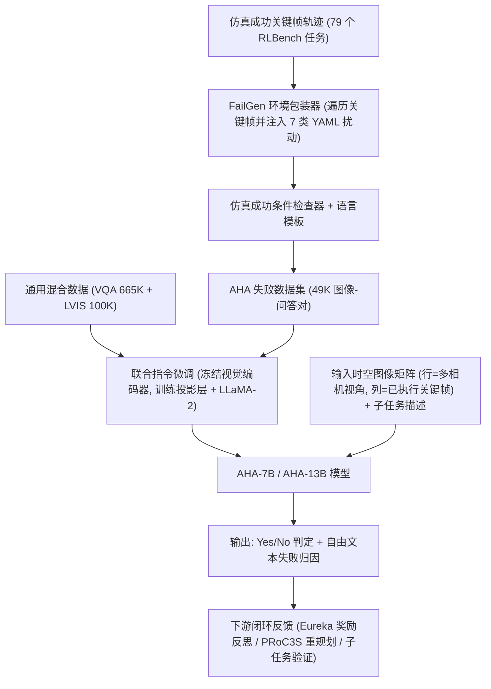

# AHA: A Vision-Language-Model for Detecting and Reasoning Over Failures in Robotic Manipulation

## 一句话定义

**AHA** 是一个面向机器人操作失败检测与自由文本归因推理的开源视觉-语言模型，通过仿真环境程序化失败轨迹生成流水线 **FailGen** 构建大规模失败数据集进行指令微调，从而在不牺牲通用 VQA 常识的前提下向强化学习、TAMP 规划与零样本轨迹生成提供可纠正错误的自然语言反馈。

## 英文缩写速查

| 缩写 | 英文全称 | 简要说明 |
|---|---|---|
| AHA | A Vision-Language-Model for Detecting and Reasoning Over Failures | 本文提出的开源操作失败检测与归因 VLM（7B/13B） |
| VLM | Vision-Language Model | 视觉-语言模型 |
| FailGen | Failure Generation Wrapper | 包裹仿真器的程序化关键帧扰动框架，用于自动生成失败数据 |
| TAMP | Task and Motion Planning | 任务与运动规划（文中下游集成 PRoC3S） |
| RLHF | Reinforcement Learning with Human Feedback | 基于人类反馈的强化学习 |
| ROUGE-L | Recall-Oriented Understudy for Gisting Evaluation - Longest Common Subsequence | 基于最长公共子序列的文本生成质量评价指标 |

## 核心信息

| 字段 | 内容 |
|---|---|
| 机构 | NVIDIA、University of Washington、Universidad Católica San Pablo、MIT、Nanyang Technological University、AI2 |
| 作者 | Jiafei Duan、Wilbert Pumacay、Nishanth Kumar、Yi Ru Wang、Shulin Tian、Wentao Yuan、Ranjay Krishna、Dieter Fox、Ajay Mandlekar*、Yijie Guo* |
| 论文 | [arXiv:2410.00371v1](https://arxiv.org/abs/2410.00371)（2024-10-01） |
| 项目页 | [aha-vlm.github.io](https://aha-vlm.github.io/) |
| 清单分类 | `harness.monitoring_and_recovery`（条目 `survey_ax_2410_00371`） |
| 训练数据规模 | **AHA Dataset (Train)** 49K 失败样本（79 个 RLBench 任务）+ VQA 665K + LVIS 100K |

## 为什么重要

1. **从「二元成败判定」迈向「语言级失败归因」：** 既有成功检测器往往只输出 Yes/No 标签，无法告诉上游规划器或策略究竟是抓空、滑落、平移偏移、旋转角度错误还是动作顺序颠倒；AHA 输出结构化成败判定与自由文本病因解释，直接驱动闭环纠错。
2. **用程序化仿真扰动低成本规模化造失败数据：** 真实世界安全、密集地采集各类错误轨迹成本极高；FailGen 直接包裹 RLBench/ManiSkill 的关键帧演示，通过 YAML 配置系统性注入 7 类标准失败模式，并验证了在纯仿真失败数据上微调的模型能够零样本迁移至全新仿真器（ManiSkill-Fail）与真机 UR5 数据集（RoboFail）。
3. **验证对下游代理系统的实质增益：** 不止于离线基准打分，论文将 AHA-13B 直接嵌入 Eureka（RL 奖励反思）、PRoC3S（TAMP 规划反馈）与 Manipulate-Anything（零样本子任务验证），在真实控制闭环中稳定超越 GPT-4o / GPT-4V。

## 核心方法

AHA 的核心由**七类失败分类体系**、**FailGen 程序化数据管线**与**时空矩阵化指令微调**三部分组成：

1. **操作失败分类体系（7 种模式）：** 基于 DROID、Open-X Embodiment 与策略回放分析并借鉴 REFLECT，定义：
   - **物体中心失败（Object-centric）：** `No_Grasp`（到达抓取位姿但未闭合夹爪）、`Slip`（抓取后移动中途松脱滑落）、`Wrong_object`（操作了与指令不符的错误物体）。
   - **动作中心失败（Action-centric）：** `Translation`（X/Y/Z 平移偏移）、`Rotation`（roll/yaw/pitch 姿态角偏移）、`No_Rotation`（缺少所需旋转）、`Wrong_action`（关键帧执行顺序错乱，如未开抽屉先放方块）。
2. **FailGen 程序化数据生成：** 作为环境包装器挂载在 RLBench（及 ManiSkill）上，扫描成功演示的每个关键帧并结合仿真成功检查器生成 YAML 扰动配置（禁用夹爪、提前释放、扰动位姿/朝向、锁定旋转轴、重排关键帧或替换目标物体映射），配合子任务语言模板自动生成 **49K** 问答对。
3. **时空图像矩阵与模型微调：**
   - 将多视角 `{V_0, ..., V_n}` 排为行、子任务关键帧序列 `{S_0, ..., S_t}` 排为列（尚未执行的未来关键帧以白色图像块填充）拼成单张输入矩阵 $I$，配合当前子任务提示词输入 VLM，依次输出 `"Yes"/"No"` 与自由文本失败原因。
   - 基于 **LLaVA-v1.5**（7B 与 13B，LLaMA-2 + 2 层线性投影 + 冻结视觉编码器与分词器），将 **49K AHA 数据**与 **665K VQA** 及 **100K LVIS** 边框检测数据联合共微调，以保持通用视觉常识。

### 方法流程图

## 实验与评测

评估覆盖三个微调阶段完全未见的域外数据集：**AHA dataset (Test)**（10 个未见 RLBench 任务的 11K 样本）、**ManiSkill-Fail**（不同仿真器与视角下的 4 个任务 130 样本）和 **RoboFail**（真机 UR5 机械臂 7 个任务）。

1. **失败检测与自由文本推理主对比（Table 2，含 ROUGE-L / 余弦相似度 / 二元成功率 / Claude-3-Sonnet LLM 模糊匹配）：**

| 模型 | 数据集 | ROUGE-L ↑ | Cosine Sim ↑ | Binary Success ↑ | LLM Fuzzy Match ↑ |
|---|---|---|---|---|---|
| **AHA-13B (Ours)** | AHA Test / ManiSkill / RoboFail | **0.446 / 0.600 / 0.280** | **0.583 / 0.681 / 0.471** | **0.702 / 1.000 / 0.643** | 0.768 / **0.633 / 0.465** |
| AHA-7B | AHA Test / ManiSkill / RoboFail | 0.434 / 0.609 / 0.204 | 0.574 / 0.680 / 0.394 | 0.691 / 1.000 / 0.625 | 0.695 / 0.532 / 0.439 |
| GPT-4o-ICL (5-shot) | AHA Test / ManiSkill / RoboFail | 0.226 / 0.341 / 0.236 | 0.380 / 0.429 / 0.429 | 0.611 / 0.971 / 0.571 | 0.776 / 0.630 / 0.418 |
| GPT-4o (Zero-shot) | AHA Test / ManiSkill / RoboFail | 0.251 / 0.142 / 0.114 | 0.308 / 0.335 / 0.318 | 0.500 / 0.688 / 0.554 | **0.784** / 0.453 / 0.438 |
| LLaVA-v1.5-13B (Base) | AHA Test / ManiSkill / RoboFail | 0.061 / 0.000 / 0.000 | 0.208 / 0.208 / 0.203 | 0.080 / 0.022 / 0.000 | 0.648 / 0.270 / 0.404 |

- 综合全部指标与数据集，**AHA-13B** 超过次优基线（GPT-4o-ICL）**10.3%**（在 AHA Test / ManiSkill-Fail / RoboFail 上分别高出 **12.6% / 13.4% / 4.9%**），超过 6 个对比模型均值 **35.3%**，较零样本 GPT-4o 高出 **20.0%+**，较基座 LLaVA-v1.5-13B 高出 **43.0%+**。
2. **通用 VQA 常识保留（Table 3）：** AHA-13B 在 MMBench（65.20 vs 67.70）、ScienceQA（71.94 vs 73.21）、TextVQA（65.20 vs 67.40）、POPE（85.74 vs 88.00）和 VizWiz（53.45 vs 53.01）上与 LLaVA-13B 平均仅差 **1.5%**。
3. **数据规模缩放律（Figure 3 Left）：** 在 3k、6k、12k、34k、48k、60k 微调数据规模上测试 ManiSkill-Fail，四项指标均值呈现二次拟合正斜率 **0.0022**。
4. **下游机器人闭环任务增益（Section 5.3，平均较 GPT-4 模型高出 21.4%）：**
   - **RL 奖励合成（Eureka + PPO，5 个 ManiSkill 任务，1,000 测试步）：** 较 GPT-4o 反馈提升任务成功率 **22.34%**。
   - **TAMP 规划修正（PRoC3S，3 个任务各 10 次试验，上限 100 采样步与 3 轮反馈）：** 较 GPT-4o 反馈提升成功率 **36.7%**。
   - **零样本数据验证（Manipulate-Anything，4 个 RLBench 任务各 25 episode）：** 用 AHA-13B 替换 GPT-4V 子任务验证模块后，平均任务成功率提升 **5%**。

## 与现有工作的对比

| 对比维度 | AHA | REFLECT | 通用商业 VLM（GPT-4o / Gemini-1.5 Flash） | 二元成功检测器（VIP / 早期 VLM 分类器） |
|---|---|---|---|---|
| 输出形式 | 二元判定 + 自由文本详细归因 | 层级摘要 + 基于多模态异常的失败解释 | 自由文本（但未经操作失败对齐） | 仅标量/二元成功概率 |
| 数据获取方式 | **FailGen 在仿真中自动程序化扰动生成 49K 样本** | 依赖预采集运行日志与手工规则管道 | 互联网通用多模态语料 | 人工标注成功/失败帧 |
| 跨形态与真机迁移 | 仅仿真训练即可零样本迁移至 ManiSkill 与真机 UR5（RoboFail） | 主要验证于预设场景经验库 | 真机开放语义强但对夹爪微距/姿态失败不敏感 | 跨视角与跨任务泛化较弱 |
| 对闭环规划与奖励的助益 | 在 Eureka / PRoC3S / Manipulate-Anything 均有实测提升（均 +21.4%） | 支持 LMP 纠错重规划 | 在细粒度操作失败原因上常产生幻觉 | 无法提供修改奖励或规划代码的具体语义线索 |

## 常见误区或局限

- **归因表达受限于预设失败分类法：** 论文在结论中指出，AHA 当前生成的失败原因语言高度贴合微调数据中定义的 7 类失败模板；对于分类法之外的开放式物理异常（如软体变形失控、复杂碰撞卡死），覆盖能力仍有限。
- **输入依赖关键帧分割与多视角拼接：** 评估矩阵要求预先提取子任务边界关键帧并按时间步与视角拼接为单张网格图，面对高度连续、无明显关键帧停顿的动态操作时需额外分段机制。
- **训练仅基于刚体仿真扰动：** 当前 49K 训练数据全部通过扰动成功专家关键帧合成，作者建议未来通过蒸馏大规模预训练策略在仿真中主动采样真实闭环失败轨迹，以扩充更开放的失败模式分布。

## 结论

AHA 证明了利用仿真器程序化注入操作失败模式（FailGen）并联合通用 VQA 数据微调开源 VLM，可以低成本培养出超越闭源旗舰模型（GPT-4o）的机器人失败归因专家，且具备跨仿真器与真机的迁移能力。

- **闭环系统应引入「归因型」而非仅「二元型」Critic：** 在 Eureka 奖励反思或 PRoC3S 规划回环中，具体指出「旋转轴偏差」或「未先开抽屉」能直接加速 LLM 修正代码（带来 22%–37% 成功率跃升）。
- **微调领域 VLM 务必保留通用数据共训：** 混入 VQA（665K）与 LVIS（100K）使 AHA-13B 在专精失败推理的同时仅损失 ~1.5% 通用 VQA 性能，避免灾难性遗忘。
- **用关键帧矩阵编码短程时序：** 当底座 VLM 仅支持单图或有限图像输入时，将「行=相机视角、列=时序关键帧」拼接为单图，是跨数据集统一表达多视角时序演化的实用工程范式。
- **数据缩放仍具潜力：** 从 3K 到 60K 数据仍保持正向增益（梯度 0.0022），后续可将 FailGen 扩展至更多物理引擎与策略真实失败回放。

## 关联页面

- [机器人视觉感知栈选型闭环](../queries/robot-perception-stack-selection-loop.md)
- [Agentic Robots 综述](paper-towards-agentic-robots-survey.md)
- [全量项目节点清单](../overview/awesome-agentic-robots-node-index.md)
- [VLA 方法背景](../methods/vla.md)
- [机器人操作任务](../tasks/manipulation.md)
- [仿真评测基础设施](../concepts/simulation-evaluation-infrastructure.md)
- [REFLECT：机器人经验总结与失败解释](paper-agentic-2306-15724.md)
- [DoReMi：计划-执行失配检测与恢复](paper-agentic-2307-00329.md)
- [Eureka：基于 LLM 编码的奖励设计](paper-eureka-llm-reward-design.md)

## 参考来源

- [官方 Awesome 快照归档](../../sources/repos/awesome-agentic-robots-survey-index.md)
- [arXiv:2410.00371v1 原文](https://arxiv.org/abs/2410.00371)
- [AHA 项目页](https://aha-vlm.github.io/)
