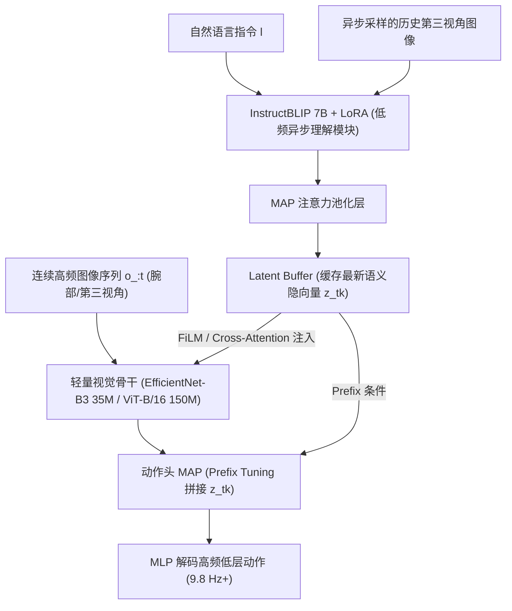

# HiRT: Enhancing Robotic Control with Hierarchical Robot Transformers

## 一句话定义

**HiRT** 是一种受人类认知双系统理论启发的分层交互式模仿学习框架，通过让十亿级参数视觉-语言模型（InstructBLIP 7B）低频异步输出并缓存多模态语义隐向量，来引导高频轻量级视觉动作策略（35M/150M）实时控制机器人，兼顾开放语义泛化与动态场景快速响应。

## 英文缩写速查

| 缩写 | 英文全称 | 简要说明 |
|---|---|---|
| HiRT | Hierarchical Robot Transformer | 本文提出的分层机器人 Transformer 策略框架 |
| VLA | Vision-Language-Action | 视觉-语言-动作模型 |
| VLM | Vision-Language Model | 视觉-语言模型，本文采用 InstructBLIP (7B) 作为理解模块 |
| MAP | Multi-head Attention Pooling | 多头注意力池化模块，用于聚合语言隐特征与视觉 tokens |
| FiLM | Feature-wise Linear Modulation | 特征级线性调制层，用于 CNN 视觉骨干的条件注入 |
| LoRA | Low-Rank Adaptation | 低秩自适应微调技术，用于高效微调 VLM 理解模块 |

## 核心信息

| 字段 | 内容 |
|---|---|
| 机构 | 清华大学交叉信息研究院（IIIS）、UC Berkeley、上海期智研究院 |
| 作者 | Jianke Zhang*、Yanjiang Guo*、Xiaoyu Chen、Yen-Jen Wang、Yucheng Hu、Chengming Shi、Jianyu Chen† |
| 论文 | [arXiv:2410.05273v3](https://arxiv.org/abs/2410.05273)，CoRL 2024 |
| 项目页 / 官方发布入口 | 待核实：论文文本及清单未披露独立项目页或官方代码仓地址 |
| 清单分类 | `harness.layered_systems`（条目 `survey_ax_2410_05273`） |
| 核心模块参数量 | 上层 VLM：InstructBLIP (7B, LoRA 微调)；下层策略：仿真 EfficientNet-B3 (~35M) / 真机 ViT-B/16 (150M) |

## 为什么重要

1. **解决大 VLA 高延迟阻碍动态操控的痛点：** 诸如 RT-2、Vanilla-VLA 等数十亿参数的端到端 VLA 在推理时帧率仅约 4 Hz，动作延迟大，只能胜任准静态任务；当目标物体处于移动状态或环境发生快速变化时，高延迟会导致抓空或碰撞风险。
2. **异步隐空间缓存实现频率与泛化的灵活权衡：** HiRT 不让 VLM 直接自回归吐出离散动作 token，而是将其作为 System 2 抽取时域缓变语义隐向量存入缓冲区，由轻量 System 1 在高频闭环中消费最近一次隐向量，推理频率由 4.1 Hz 提升至 9.8 Hz（甚至在间隔 6 步更新时达 13.42 Hz）。
3. **验证异步随机采样训练对时间失配的鲁棒性：** 由于低频 VLM 更新与高频执行存在时间差，训练时随机抽取过去观测窗口中的第三视角帧喂给 VLM，使下层策略学会在轻微过时的语义条件下依然结合当前高频图像 context 完成精准控制。

## 核心方法

HiRT 将语言条件操控策略 $\pi(a|o,l)$ 分解为慢速理解模块 $F_\theta$ 与快速执行模块 $S_\phi$：

1. **多模态理解模块（System 2，$F_\theta$）：**
   - 采用开源 **InstructBLIP (7B)**（包含 ViT、带可学习查询向量的 Q-Former 与 LLaMA）。在异步采样时刻 $\hat{t}_k$，对单帧视觉观测 $\bar{o}_{\hat{t}_k}$ 与自然语言指令 $l$ 进行编码，提取 LLM 最终层输出 $X^{L+1}_{\hat{t}_k}$，经单层 **MAP** 注意力池化聚合为连续语义隐向量 $z_{\hat{t}_k} = F_\theta(\bar{o}_{\hat{t}_k}, l)$ 并写入隐变量缓存（Latent Buffer）。
   - 训练时对 InstructBLIP（含 ViT、Q-Former、LLaMA）全面插入 LoRA 进行微调。
2. **轻量隐条件执行策略（System 1，$S_\phi$）：**
   - 在每步高频推理时读取最近观测图像序列 $o_{:t}$（**不包含机器人本体状态输入**，完全依赖视觉与语言），通过轻量预训练视觉骨干编码为视觉 tokens $X^v_{:t}$：仿真使用 **EfficientNet-B3**（约 35M 参数），真机使用 **ViT-B/16**（约 150M 参数）。
   - 采用三种条件注入方式引导视觉编码与动作解码：
     - **FiLM 条件（CNN 适用）：** $\hat{H} = W_\gamma x_{t_k} \cdot H + W_\beta x_{t_k}$；
     - **Cross-Attention 条件（ViT 适用）：** 在每层自注意力后插入交叉注意力 $\hat{H} = \text{CrossAttn}(H, W_h x_{t_k}) + H$；
     - **Prefix Tuning（动作头适用）：** 将 VLM 隐向量作为前缀拼接至视觉 tokens 输入 MAP 与 MLP 动作头：$a_t = \text{MLP}(\text{MAP}([x_{t_k}, X^v_{:t}]))$。
3. **异步采样与训练目标：**
   - 推理时 VLM 与执行策略并行异步运行；为消除训练-推理时间错位，训练时从历史观测窗口 $o_{:t}$ 中随机采样一帧第三视角图像送入 VLM。
   - 优化最大似然模仿学习目标：末端执行器连续相对位姿（或连续关节动作）采用 MSE 损失，离散夹爪状态采用 BCE 损失。

### 方法流程图

## 实验与评测

实验涵盖两个仿真基准（Metaworld 20 任务、Franka-Kitchen 5 已见 + 2 未见换色场景）与 Franka Emika Panda 真机环境（2,000 条遥操作/脚本轨迹，腕部+第三视角相机，均无本体状态输入）。

1. **准静态任务成功率与推理速度（Table 1）：**

| 方法 | 推理速度 (Hz) ↑ | Metaworld 20 任务 | Franka-Kitchen (Seen 5 / Unseen 2) | 真机 PickPlace | 真机 ButtonPress | 真机 CableRoute | 真机 DrawerOpen | 真机均值 |
|---|---:|---:|---:|---:|---:|---:|---:|---:|
| RT-1 | **20.1** | 65.8% | 63.8% / 33.0% | 35.0% | 70.0% | 55.0% | 40.0% | 55.0% |
| Diffusion Policy (DP) | 4.6 | 52.2% | — | 30.0% | 70.0% | 30.0% | 50.0% | 45.0% |
| Vanilla-VLA（RT-2 复现） | 4.1 | 73.8% | 73.4% / 70.0% | **70.0%** | 85.0% | **65.0%** | **65.0%** | **71.3%** |
| **HiRT (Ours)** | 9.8 | **76.4%** | **80.8% / 76.0%** | **70.0%** | **90.0%** | 60.0% | 60.0% | 70.0% |

- 相对直接使用纯语言嵌入的 RT-1，HiRT 在已见任务上平均高出 **20%**，在全新测试场景高出 **30%**；相比 Vanilla-VLA，HiRT 在保持同等真机准静态成功率（70.0% vs 71.3%）与更高仿真成绩的同时，推理速度从 **4.1 Hz 翻倍至 9.8 Hz**。
2. **真机动态操控任务（Table 2，目标物体以约 1 cm/s 匀速移动）：**

| 方法 | 准静态参考耗时 (s) ↓ | Seen 成功率 ↑ | Unseen 成功率 ↑ | Average 成功率 ↑ |
|---|---:|---:|---:|---:|
| Diffusion Policy | 10.38 | 20.0% | 15.0% | 18.0% |
| RT-1* | 14.22 | 25.0% | 10.0% | 18.0% |
| Vanilla-VLA | 9.25 | 55.0% | 40.0% | 48.0% |
| **HiRT (Ours)** | **6.18** | **80.0%** | **70.0%** | **75.0%** |

- 在动态追踪抓取任务中，Vanilla-VLA 因推理滞后常抓空，HiRT 将平均成功率从 **48.0% 提升至 75.0%**，同时将静态参考耗时压缩至 **6.18 s**。
3. **关键模块消融（Table 3，Franka-Kitchen）：**
   - 完整 HiRT：**80.8% (Seen) / 76.0% (Unseen)**，9.8 Hz。
   - 去掉交叉注意力与前缀条件仅留 FiLM（`HiRT-CD`）：降至 **64.2% / 61.5%**（下降 ~20%）。
   - 去掉历史多帧图像仅用单帧（`HiRT-IC`）：降至 **58.8% / 47.0%**。
   - 同时去掉两者（`HiRT-IC-CD`）：骤降至 **48.0% / 9.5%**。
4. **异步采样训练消融（Table 4）：** 当推理时 VLM 每 6 步更新一次（总频率 **13.42 Hz**），使用随机历史采样训练的 HiRT 在已见/未见场景分别达 **63.4% / 52.5%**，而同步训练的 `HiRT-AS` 降至 **52.2% / 50.0%**（已见场景掉点超 10%）。

## 与现有工作的对比

| 对比维度 | HiRT | Vanilla-VLA（RT-2 范式） | RT-1 / BC-Z | RoboDual |
|---|---|---|---|---|
| 上下层接口 | 连续隐向量 $z_{\hat{t}_k}$（VLM 最后层 MAP 聚合） | VLM 直接自回归输出离散动作 token | 仅纯文本编码器（无当前视觉融合） | 离散动作块 + Task/Action Latents 双重接口 |
| 下层执行策略 | 确定性轻量视觉策略（EfficientNet/ViT + MAP-MLP） | 无独立下层 | 单体 ResNet/EfficientNet + FiLM | Diffusion Transformer (DiT, 20M) 动作去噪 |
| 执行频率 | 异步解耦达 **9.8 Hz–13.42 Hz** | ~4.1 Hz | ~20.1 Hz | 15 Hz（实机） |
| 异步对齐机制 | 训练期随机采样历史第三视角帧喂给 VLM | 同步阻塞 | 同步单阶段 | 滑窗截断 + 偏移量 $\tau$ 延迟感知训练 |

## 常见误区或局限

- **仍受限于演示数据覆盖范围与高速动态上限：** 论文在结论中明确指出，受数据收集限制，HiRT 尚未应用于高速飞行物接取或快速手内/桌面姿态调整等高动态任务（文中真机动态测试移动速度为 1 cm/s 匀速移动）。
- **无动作扩散头与本体状态融合：** 下层策略采用确定性单步回归而非扩散动作块生成，且实验故意未使用关节本体状态，虽然凸显了视觉-语言泛化能力，但在强多模态动作分布或纯接触精细力控场景下可能不如扩散策略（如 RoboDual）或带本体感知的策略。
- **未公开独立代码仓/项目页：** 论文与当前调研快照未提供可访问的官方代码仓库与权重下载入口，复现需自行基于 InstructBLIP + LoRA 搭建。

## 结论

HiRT 验证了「低频 VLM 提取视觉-语言融合隐特征 + 异步缓存 + 高频多帧轻量视觉策略」能够在不显著牺牲泛化能力的前提下将 VLA 控制频率翻倍，并大幅改善动态移动目标的操控成功率。

- **多帧历史上下文是高频执行器不可或缺的输入：** 去掉图像上下文（`HiRT-IC`）导致未见场景成功率从 76.0% 跌至 47.0%，单帧难以支撑精准动作生成。
- **条件注入不能仅靠单一 FiLM：** 结合 Cross-Attention 与动作头 Prefix Tuning 相比仅保留 FiLM 带来约 20% 的绝对性能提升。
- **异步部署必须配合训练期延迟/历史采样对齐：** 若推理计划将 VLM 间隔拉大至 6 步以上以换取 >13 Hz 控制率，训练时务必随机抽样历史帧喂给 VLM，否则已见任务准确率会直接跌落约 10 个百分点。

## 关联页面

- [Agentic Robots 综述](paper-towards-agentic-robots-survey.md)
- [全量项目节点清单](../overview/awesome-agentic-robots-node-index.md)
- [VLA 方法背景](../methods/vla.md)
- [模仿学习](../methods/imitation-learning.md)
- [控制与推理频率解耦](../concepts/control-inference-frequency-decoupling.md)
- [机器人操作任务](../tasks/manipulation.md)
- [RoboDual：协同广义高效的双系统操作框架](paper-agentic-2410-08001.md)

- [机器人智能体执行框架](../methods/robot-agent-harness.md)：对照规划、执行接口与反馈机制。

## 参考来源

- [官方 Awesome 快照归档](../../sources/repos/awesome-agentic-robots-survey-index.md)
- [arXiv:2410.05273v3 原文](https://arxiv.org/abs/2410.05273)
