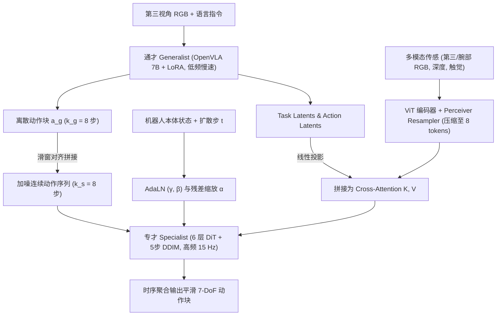

# Towards Synergistic, Generalized, and Efficient Dual-System for Robotic Manipulation

**RoboDual**

## 一句话定义

**RoboDual** 是一种协同融合大参数 VLA 通才（System-2）与轻量 Diffusion Transformer 专才（System-1）的双系统机器人操作框架，使专才策略在通才的离散动作块与任务/动作隐表征共同引导下，仅用约 20M 可训练参数与极少特定任务数据即可实现高频（15 Hz）、多模态且强泛化的真机精准控制。

## 英文缩写速查

| 缩写 | 英文全称 | 简要说明 |
|---|---|---|
| RoboDual | Synergistic, Generalized, and Efficient Dual-System | 本文提出的通才-专才协同双系统操作架构 |
| VLA | Vision-Language-Action | 视觉-语言-动作模型，本文通才基于 OpenVLA (7B) |
| DiT | Diffusion Transformer | 扩散 Transformer，本文专才骨干（约 16.2M–20M 参数） |
| CFG | Classifier-Free Guidance | 无分类器引导，用于调节通才条件与本体状态对动作去噪的控制强度 |
| DDIM | Denoising Diffusion Implicit Models | 去噪扩散隐式模型，本文推理仅需 5 步即可生成动作块 |
| AdaLN | Adaptive Layer Normalization | 自适应层归一化，用于注入时间步与机器人本体状态 |

## 核心信息

| 字段 | 内容 |
|---|---|
| 机构 | 香港大学（HKU）、上海人工智能实验室（Shanghai AI Lab）、智元机器人（AgiBot）、上海交通大学（SJTU） |
| 作者 | Qingwen Bu、Hongyang Li、Li Chen、Jisong Cai、Jia Zeng、Heming Cui、Maoqing Yao、Yu Qiao |
| 论文 | [arXiv:2410.08001v3](https://arxiv.org/abs/2410.08001)（2025-02-06） |
| 项目页 | [opendrivelab.com/RoboDual](https://opendrivelab.com/RoboDual/) / [robodual.github.io](https://robodual.github.io) |
| 清单分类 | `harness.layered_systems`（条目 `survey_ax_2410_08001`） |
| 关键指标 | CALVIN ABC→D 平均长度 **3.66**（+12%）；真机控制频率 **15 Hz**（3.8× OpenVLA）；仅 20M 专才参数 + 8 GPU 小时训练 |

## 为什么重要

1. **同时补齐 VLA 通才与小模型专才的短板：** 7B 级 VLA（如 OpenVLA）具备互联网级语义理解但推理慢（3.9 Hz 导致真机抖动与错位）、单帧第三视角 RGB 受限且微调昂贵；而 ACT/Diffusion Policy 等专才精度高但无法跨多指令与未见物体泛化。RoboDual 让两者形成互补协同，而非二选一。
2. **数据解耦与无痛扩展多模态传感器：** 通才无需为新增深度、触觉或腕部相机重新昂贵预训练（避免灾难性遗忘），所有额外传感模态与本体状态均由轻量专才通过 Perceiver Resampler（8 个可学习查询）低成本接入（每新增一种模态仅增加 7.5M 参数）。
3. **极致的适应效率与低算力部署：** 在已有通才基础上，仅需 1 小时（8×A100，8 GPU-hours）微调 20M 参数专才即可获得比再训数天 VLA 更大的收益（3.44 vs 3.27）；在 8GB 显存 RTX 4060 笔记本 GPU 上对通才做 4-bit 量化后，专才仍可全精度运行并大幅领先基线。

## 核心方法

RoboDual 将操作策略拆分为异步协同的两大系统：

1. **通才策略（Generalist, System-2）：**
   - 基于 **OpenVLA**（Prismatic-7B：融合 DINOv2 + SigLIP 视觉编码器、对齐投影层与 LLaMA-2 7B），通过 LoRA 在目标环境微调。
   - 扩展自回归预测单步动作为长度 $k_g = 8$ 的**离散动作块**（将 LLaMA 词表最不常用的 256 个词映射为 `[-1, 1]` 均匀分箱，步间以 `[space]` 分隔），并输出高维 **Task Latents** 与 **Action Latents**。
2. **专才策略（Specialist, System-1）：**
   - 主体为堆叠 6 层 **DiT Block**（8 头、隐藏维 256、旋转位置编码、16.2M 基础参数），将 7-DoF 动作视作 7 通道“像素”序列，预测未来长度 $k_s = 8$ 的连续动作块，并采用指数加权时序聚合（$w_i = \exp(-0.1 \cdot i)$）平滑输出。训练采用 100 步扩散与直接样本预测，推理使用 **5 步 DDIM** 与 CFG（引导尺度 $w_g=3$，条件丢弃率 0.1）。
   - **四路统一条件注入：**
     1. *本体状态 + 扩散步数 $t$*：经 2 层 MLP 通过 AdaLN（$\gamma, \beta$）与残差缩放 $\alpha$ 调制；
     2. *多模态传感观测*：RGB 使用冻结 DINO ViT，其他模态/视角用 6 层轻量 ViT（6.4M）提取 196 tokens 后经 **Perceiver Resampler**（1.1M）压缩为 8 tokens；
     3. *通才离散动作块*：与对应时间步加噪动作沿通道拼接并线性投影；
     4. *通才 Task & Action Latents*：线性投影后与重采样观测 tokens 拼接作为交叉注意力的 Keys 与 Values。
3. **滑窗条件与延迟感知训练（Shifted-Window & Latency-Aware Training）：**
   - 推理时通才每执行 1 次（实机取第 8 步动作或动作块），专才异步推进 $\tau_s$ 步（实机 8 步仅耗时 0.035 s），仅保留通才未来 $k_g - \tau_s$ 步预测作为后续条件。
   - 训练时人为注入领先/滞后偏移 $\tau \in [0, k_g]$，迫使专才学会弥补双系统推理周期异步造成的时间差。

### 方法流程图

## 实验与评测

1. **CALVIN ABC→D 长程零样本泛化（Table 1，1,000 条 5 连任务链，仅用 Lang 子集训练）：**

| 方法 | 1 步 | 2 步 | 3 步 | 4 步 | 5 步 | 平均完成长度 (Avg. Len.) ↑ |
|---|---:|---:|---:|---:|---:|---:|
| RoboFlamingo | 82.4% | 61.9% | 46.6% | 33.1% | 23.5% | 2.48 |
| SuSIE (All) | 87.0% | 69.0% | 49.0% | 38.0% | 26.0% | 2.69 |
| GR-1 | 85.4% | 71.2% | 59.6% | 49.7% | 40.1% | 3.06 |
| 3D Diffuser Actor | 92.2% | 78.7% | 63.9% | 51.2% | 41.2% | 3.27 |
| **RoboDual (Ours)** | **94.4%** | **82.7%** | **72.1%** | **62.4%** | **54.4%** | **3.66**（较通用基线 +12%） |

- 在 **GPT-4 改写的自由表达指令测试（Table 2）** 上，RoboDual 平均完成长度保持 **3.47**（5 连成功率 48.8%），而 LCB（1.78）、3D Diffuser Actor（1.42）和 RoboFlamingo（0.40）均大幅下滑。
2. **真机 ALOHA 7-DoF 对比与四维泛化（Figure 3 & Table 3，单目 RGB 192×256，每任务 15 次试验）：**
   - **5 项真机操作总均值（Fig 3）：** `RoboDual-single` **86.7%**、`RoboDual-multi` **86.7%**，显著领先 OpenVLA（62.7%）、Diffusion Policy（56.0%）、Octo（49.3%）与 ACT（37.3%）；在更广泛真机设置下论文摘要报告较 OpenVLA 综合提升 **26.7%**（整体较最优基线高出 **+20%** 以上，所有任务最低不低于 60%）。
   - **四维泛化均值（Table 3，位置变化 / 视觉干扰 / 未见背景 / 新物体）：**
     - ACT：**21.7%**（46.7 / 26.7 / 0 / 13.3）
     - Octo：**23.4%**（20.0 / 60.0 / 6.7 / 6.7）
     - Diffusion Policy：**40.0%**（53.3 / 40.0 / 26.7 / 40.0）
     - OpenVLA：**41.7%**（26.7 / 73.3 / 20.0 / 46.7）
     - **RoboDual-single / multi：** **70.0%**（93.3 / 80.0 / 60.0 / 46.7） / **68.3%**（86.7 / 73.3 / 53.3 / 60.0）
   - **RTX 4060 8GB 笔记本 4-bit 量化扩展干扰评测（Table 6）：** RoboDual **60.0%** vs OpenVLA **46.6%** vs DP **26.7%**。
3. **训练效率、少样本数据效率与推理速度（Fig 5, Table 4, Sec 4.4）：**
   - **训练算力：** 通才单独在 CALVIN 训至收敛（3.27）需约 1,400 GPU-hours；叠加 20M 参数专才仅在 8×A100 训练 **1 小时（8 GPU-hours）** 即达 **3.52**，最终达 **3.66**。
   - **CALVIN 少样本（Table 4a）：** 仅用 **5% / 10%** 演示数据时，RoboDual 保持 **3.59 / 3.62** 平均长度，而 RoboFlamingo 跌至 **1.35 / 1.71**。
   - **真机少样本（Table 4b，`Put block into bowl`）：** 5 / 10 / 100 条演示下，RoboDual 达 **73.3% / 80.0% / 93.3%**，同期 DP 为 20.0% / 20.0% / 53.3%，ACT 为 0% / 6.7% / 46.7%。
   - **推理频率：** NVIDIA A5000 Ada 上 OpenVLA 为 **3.9 Hz**，RoboDual 达 **15 Hz**（**3.8×** 提速，8 步专才推理仅 **0.035 s**）。
4. **消融实验（Fig 6）：** 去掉 Task Latents 使 CALVIN 平均长度下降 0.14；加入离散动作条件带来明显细化增益；新增深度/触觉/腕部视角持续提升表现；条件机制上 Cross-Attention 略优于 In-Context Conditioning 与 FiLM 且计算更省。

## 与现有工作的对比

| 对比维度 | RoboDual | OpenVLA（纯通才） | Diffusion Policy / ACT（纯专才） | HiRT |
|---|---|---|---|---|
| 动作生成机制 | 7B VLA（离散块+隐特征）→ 20M DiT 扩散精修 | 单体 7B 自回归离散 token | 纯小模型扩散或 CVAE-Transformer | 7B InstructBLIP 隐向量 → 35M/150M 确定性回归 |
| 实机控制频率 | **15 Hz** | 3.9 Hz | 高频但单任务 | 9.8 Hz（区间 6 步时 13.42 Hz） |
| 额外传感模态扩展 | 专才侧 Perceiver Resampler 无痛接入（+7.5M/模态） | 需重训 7B 底座，易遗忘 | 原生支持但无语言语义泛化 | 仅演示多视角 RGB |
| 少样本迁移（5% 数据） | CALVIN 3.59；真机 5 条 73.3% | 需大量目标数据适配动作空间归一化 | 5 条真机仅 0%–20% | 未测试极少样本极限 |

## 常见误区或局限

- **仍需对通才进行目标域 LoRA 微调：** 论文附录 A 明确指出，受新相机视角、本体构型和 OpenX 数据集特定动作空间归一化统计差异影响，直接零样本部署 OpenVLA/Octo 成功率为 0%，因此 RoboDual 仍采用「先对通才做多任务 LoRA 微调，再训专才」的两阶段流程，并非免微调开箱即用。
- **固定异步步长比例假设：** 当前部署假设通才与专才的推理时间恒定，每次通才推理固定对应固定步数（如 8 步）的专才滚动，在算力负载波动或需要动态重规划频率的场景下缺少自适应调节。
- **「不遵循指令」仍是最主要失败原因：** 附录 D 对 100 次真机测试做 Sankey 归因分析发现，最主要的失败来源仍是「Not Following Instruction」，表明离散动作与隐特征这两座“桥梁”仍未能把 VLA 的全部指令理解能力无损传递给专才。

## 结论

RoboDual 为大参数 VLA 走向高频率、低数据门槛与多传感器真机部署提供了一条清晰可复现的工程路径：保留 7B VLA 做低频语义大脑，将高频精细控制、多模态融合与局部适应全权交给轻量 DiT 专才。

- **双重桥梁优于单一隐向量：** 同时向 DiT 传入通才的离散粗糙动作块（通道拼接）和 Task/Action Latents（Cross-Attention），既给出轨迹先验又保留多任务语义。
- **用专才隔离多模态接入成本：** 当真机需要接入腕部相机、深度或触觉时，冻结通才、仅在 20M DiT 侧挂载轻量 ViT + Perceiver Resampler，可在不破坏互联网先验的前提下快速收敛。
- **少样本场景优先引入通才先验：** 仅 5 条真机演示即可借助通才的物体位置与语义先验实现 73.3% 成功率并泛化到未见位置，大幅降低新任务示教开销。
- **训练时务必加入延迟偏移模拟：** 通过随机时间偏移 $\tau \in [0, k_g]$ 训练专才基于略微过时的通才输出去噪未来动作，是异步双系统实机不抖动的关键保障。

## 关联页面

- [Agentic Robots 综述](paper-towards-agentic-robots-survey.md)
- [全量项目节点清单](../overview/awesome-agentic-robots-node-index.md)
- [VLA 方法背景](../methods/vla.md)
- [OpenVLA：开源视觉-语言-动作模型](paper-openvla.md)
- [Diffusion Transformer（DiT）](../concepts/diffusion-transformer.md)
- [控制与推理频率解耦](../concepts/control-inference-frequency-decoupling.md)
- [HiRT：分层机器人 Transformer](paper-agentic-2410-05273.md)
- [机器人操作任务](../tasks/manipulation.md)

## 参考来源

- [官方 Awesome 快照归档](../../sources/repos/awesome-agentic-robots-survey-index.md)
- [arXiv:2410.08001v3 原文](https://arxiv.org/abs/2410.08001)
- [RoboDual 项目页](https://opendrivelab.com/RoboDual/)
