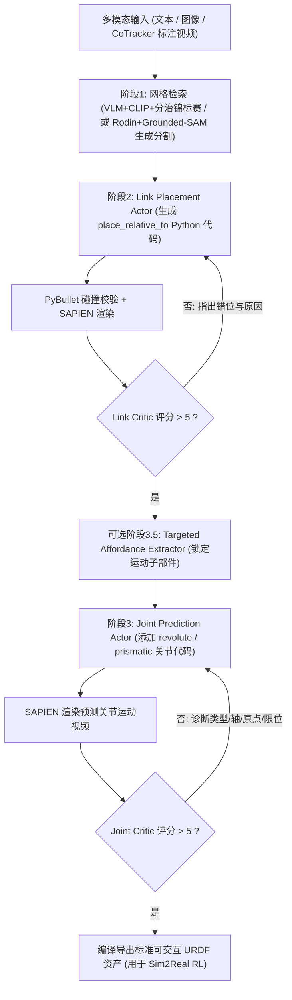

# Articulate-Anything: Automatic Modeling of Articulated Objects via a Vision-Language Foundation Model

## 一句话定义

**Articulate-Anything** 是一个基于视觉-语言大模型（VLM）的 Actor-Critic 代理系统，能够从文本、单张图像或任意演示视频自动合成可编译为标准 URDF 的高层 Python 建模程序，通过仿真渲染自评估与迭代修正完成三维网格检索、部件空间摆放与运动关节预测。

## 英文缩写速查

| 缩写 | 英文全称 | 简要说明 |
|---|---|---|
| URDF | Unified Robot Description Format | 统一机器人描述格式，以树状 Link 与 Joint 表达可交互三维物体 |
| VLM | Vision-Language Model | 视觉-语言模型，本文主系统采用 Gemini Flash-1.5 担任 Actor 与 Critic |
| ID / OOD | In-Distribution / Out-of-Distribution | 分布内类别（基线训练的 5 类）与分布外未见类别（其余 41 类） |
| CLIP | Contrastive Language-Image Pre-training | 用于文本/图像检索候选 3D 网格的跨模态相似度模型 |
| PPO | Proximal Policy Optimization | 近端策略优化算法，用于在生成资产上训练下游 Sim2Real 操控策略 |

## 核心信息

| 字段 | 内容 |
|---|---|
| 机构 | 宾夕法尼亚大学（University of Pennsylvania） |
| 作者 | Long Le、Jason Xie、William Liang、Hung-Ju Wang、Yue Yang、Yecheng Jason Ma、Kyle Vedder、Arjun Krishna、Dinesh Jayaraman、Eric Eaton |
| 论文 | [arXiv:2410.13882v4](https://arxiv.org/abs/2410.13882)，ICLR 2025 |
| 项目页 | [articulate-anything.github.io](https://articulate-anything.github.io/) |
| 清单分类 | `environment.reconstruction`（条目 `survey_ax_2410_13882`） |
| 底层引擎与模型 | Gemini Flash-1.5（≤20 条少样本示例）、PyBullet（碰撞检测）、SAPIEN（渲染）、CoTracker（视频运动轨迹标注） |

## 为什么重要

1. **打破可交互 3D 仿真资产极度稀缺的瓶颈：** Objaverse 等静态 3D 库已达千万级（10M+），而带部件与关节标注的 PartNet-Mobility 仅有约 2,300 个物体；人工制作单个可交互资产耗时数十分钟（实测平均超 40 分钟），严重制约仿真规模化训练。
2. **用高层 Python API 替代直接生成冗长 XML/URDF：** 直接令大模型吐出 URDF 易因 XML 冗长产生幻觉，且局部相对坐标系与旋转轴计算极其繁琐；Articulate-Anything 设计 `add_link`、`place_relative_to`、`make_revolute_joint`、`make_prismatic_joint` 等高层 Python 原语并借助物理引擎碰撞检测自动对齐接触，大幅降低推理难度。
3. **视频输入消解静态图歧义并实现真机 Sim2Real：** 单张图像无法判断窗户是推拉还是翻开、转椅是升降还是旋转；接入带 CoTracker 轨迹的视频与视觉 Critic 自检闭环后，系统可精准还原真实运动关节并直接用于 Robosuite PPO 训练，零样本迁移至 Franka Panda 真机达 100% 成功率。

## 核心方法

系统将难以联合优化的总体损失 $L_{\text{total}} = L_{\text{mesh}} + L_{\text{link}} + L_{\text{joint}}$ 拆解为三阶段（加可选第 3.5 阶段），所有 VLM 代理均基于 **Gemini Flash-1.5** 并配合不超过 20 个上下文示例：

1. **网格检索（Mesh Retrieval，或扩展为生成+分割）：**
   - **视觉输入（图像/视频）：** VLM 识别前景物体（视频可利用运动线索）→ CLIP 筛出 Top-k 相似类别 → **Hierarchical ObjectSelector** 采用分治锦标赛递归对比渲染候选图，选出视觉最匹配的网格作为 $L_{\text{mesh}}$ 代理。附录 A.8 亦验证了接入 Rodin 生成网格 + 多视角 Grounded-SAM 3D 部件分割的定制化资产生成路径。
   - **文本输入：** `TaskSpecifier` 细化稀疏描述 → `LayoutPlanner` 规划部件名称与尺寸 → 通过 VLM 重标注的 PartNet-Mobility 部件 CLIP 文本嵌入检索并按目标尺寸缩放。
2. **部件空间摆放（Link Placement, Actor-Critic）：**
   - Actor 编写 `place_relative_to(..., placement=..., clearance=0.0)` 代码，底层调用 PyBullet 碰撞检测紧贴放置部件防止穿模。
   - 存在视觉输入时（视频取首帧），SAPIEN 渲染预测模型；Critic 对比真值图像定位代码错误并输出 `realism_rating ∈ [0, 10]`（$L_{\text{link}}$ 代理），评分低于 5 则反馈给 Actor 迭代重写。
3. **运动关节预测（Joint Prediction, Actor-Critic）与目标可操作性抽取（可选）：**
   - 可选调用 `Targeted Affordance Extractor` 根据彩色分割图与输入视频锁定发生运动的特定子部件，降低 token 消耗与调试难度。
   - Actor 补全旋转/移动关节代码；Critic 将仿真中关节运动渲染视频与输入真值视频（辅以 CoTracker 轨迹）对比，按严重程度排查 4 类失败（关节类型 → 关节轴 → 关节原点 → 运动范围限制），迭代修正直至 `realism_rating > 5`。

### 方法流程图

## 实验与评测

主基准为完整 **PartNet-Mobility** 数据集（约 2.3K 物体、1.9K 旋转关节、7.6K 移动关节），成功判据为位置误差 < 50 mm 且角度误差 < 0.25 rad（约 14.3°）；若物体的 Link Placement 失败，其全部关节均判为失败。

1. **PartNet-Mobility 全量类别对比（Fig 5, Fig 8, Appendix Table 1）：**

| 方法 | 全部 46 类关节预测成功率 ↑ | ID（5 类）/ OOD（41 类） | 无效输出率（环/重边/语法错） | 关节类型错误率 ↓ | 关节轴误差 (rad) ↓ | 关节原点误差 (m) ↓ | 网格 Chamfer 距离 ↓ |
|---|---|---|---|---:|---:|---:|---:|
| URDFormer (DINO) | 8.7% | — | **59.1%** | 0.460 ± 0.033 | 0.261 ± 0.583 | 0.547 ± 0.317 | 0.437 ± 0.217 |
| URDFormer (Oracle) | — | 24.7% / 13.5% | — | 0.556 ± 0.025 | 0.374 ± 0.666 | 0.581 ± 0.355 | 0.429 ± 0.267 |
| Real2Code (Oracle) | 12.2% | 20.2% / 11.1% | 17.5% | 0.537 ± 0.014 | 1.006 ± 0.723 | 0.294 ± 0.417 | 0.229 ± 0.166 |
| **Articulate-Anything** | **75.0%** | 统一少样本无区分 | — | **0.021 ± 0.003** | **0.141 ± 0.441** | **0.200 ± 0.380** | **0.1007 ± 0.062** |

- 全部类别 Link Placement 平均成功率为 **0.86（86%）**，Joint Prediction 为 **0.75（75%）**；Articulate-Anything 失败分布为：Link 错误 **14.7%**、关节轴 **5.5%**、原点 **2.6%**、类型 **1.7%**、限位 **0.4%**（Fig 8）。
- 在户外实拍 LiDAR 扫描真值测试（Appendix Table 2）上，结合 Rodin 网格生成的变体平均 Chamfer 距离达 **0.0703**，检索变体为 **0.1102**，对比 Real2Code（0.1085）与 URDFormer（0.2291）。
2. **输入模态消融（Fig 6，无 Critic 单轮 Actor，Link 在 Faucet / Joint 在 StorageFurniture）：**
   - Link Placement：纯文本 **48.9%** → 图像 **68.6%**。
   - Joint Prediction：纯文本 **1.3%** → 图像 **54.4%** → 视频 **77.7%**，证实视频对消解关节运动歧义具有决定性作用。
3. **Actor-Critic 迭代增益与少样本/底座鲁棒性（Fig 9, 10, 11）：**
   - 经 3 轮自评估迭代，Link Placement 从 **80.2% 提升至 86.0%（+5.8%）**，Joint Prediction 从 **72.6% 提升至 75.0%（+2.4%）**；Critic 判断与人工真值高度一致（仅存在少量 4.57%–5.68% 假阳性漏检细微错位）。
   - 上下文示例从 0 增至 20 条（StorageFurniture），Joint 成功率由 **4.6% → 17.8% → 44.5% → 77.7%**；替换底座 VLM 均保持高水平：Gemini Flash-1.5 **77.7%**、GPT-4o **70.4%**、Claude-3.5 Sonnet **85.7%**。
4. **Sim2Real 强化学习真机应用（Sec 6 & Fig 12）：** 利用手机拍摄视频生成的 4 类资产（微波炉、笔记本电脑、马桶、橱柜）在 Robosuite 中用 PPO 训练 2M 步并部署至真实 Franka Panda 机械臂，**4 项任务均实现 100% 真机成功率**（与人类使用 RialTo GUI 精标资产持平），且平均每项任务节省 **40.58 分钟**人工扫描与标注时间（具体节省：微波炉 26.10 分钟、笔记本 30.54 分钟、马桶 51.52 分钟、橱柜 54.16 分钟）。

## 与现有工作的对比

| 对比维度 | Articulate-Anything | URDFormer | Real2Code |
|---|---|---|---|
| 输入模态 | **文本 / 单图 / 随手拍视频** | 裁剪图像 + Grounding DINO 边界框 | 多视角图像（DUSt3R + 微调 SAM）或 3D OBB 文本 |
| 建模抽象层级 | 高层 Python API + 碰撞检测编译 URDF | 直接预测离散化部件坐标与父子关系 | 代码生成（直接面向 OBB 边界框参数） |
| 闭环自我纠错 | **有（Actor-Critic 仿真渲染对比迭代）** | 无（开环前向预测） | 无（开环预测，且 17.5% 输出语法/拓扑无效） |
| 泛化范围 | 全 PartNet-Mobility 46 类 **75.0%** 成功率 | 仅限 5 个训练类（24.7%），OOD 跌至 13.5% | 5 类 20.2%，OOD 跌至 11.1% |

## 常见误区或局限

- **主流水线依赖现有 3D 资产库检索：** 默认模式从 PartNet-Mobility 检索部件并缩放，因此生成外观的几何精细度受候选库限制；虽然附录 A.8 展示了接入 Rodin 文本/图像生图模型与 Grounded-SAM 3D 部件分割的原型，但尚未作为主基准大规模定量评测。
- **细小部件与奇异不规则运动仍是盲区：** 附录 A.6 分类别统计（Fig 22）显示，大型家具与常见家电（遥控器 98%、键盘 95%、微波炉 92%、笔记本 92%）准确率极高，但**折叠椅、时钟、地球仪、钳子、风扇、剪刀**等小型或复杂联动部件的关节预测成功率为 **0%**（图 22 末尾多类为 0.00–0.08），作者指出需引入相机局部放大（zoom-in）等视觉机制改进。
- **Critic 存在一定乐观偏差：** 混淆矩阵（Fig 15）显示 Critic 倾向于高估自身预测，主要误差来自把轻微错位的模型判为成功（Link 假阳性 4.57%，Joint 假阳性 5.68%）。

## 结论

Articulate-Anything 证明了将三维铰接物体重建重新表述为「高层 Python API 程序综合 + 仿真渲染驱动的 VLM Actor-Critic 闭环」，足以跨越从 8%–12% 到 75% 的精度鸿沟并打通视频到真机 Sim2Real RL 的资产管线。

- **优先让 VLM 生成高层运动学原语而非原生 URDF：** 通过 API 封装前向运动学与 PyBullet 碰撞对齐，可将结构幻觉降至极低水平。
- **消除关节歧义必须提供运动视频：** 静态单图在 Joint Prediction 上比视频低 23 个百分点以上（54.4% vs 77.7%），构建交互数字孪生应优先采集简单的开合视频。
- **可用 40 分钟/物体的边际成本对比选型：** 对橱柜、马桶、微波炉、笔记本等常见铰接物，自动生成资产在真机 PPO 策略上可复现人工标注的 100% 成功率；但涉及钳子、剪刀等细小精密铰链工具时目前仍需人工精修。
- **关注 Critic 的假阳性漏检：** 自动化流水线批量产出资产前，建议对 Critic 接近阈值（5–7 分）的样本保留抽检或辅以物理碰撞/可动范围脚本校验。

## 关联页面

- [Agentic Robots 综述](paper-towards-agentic-robots-survey.md)
- [全量项目节点清单](../overview/awesome-agentic-robots-node-index.md)
- [URDF 机器人描述格式](../concepts/urdf-robot-description.md)
- [Sim2Real 迁移](../concepts/sim2real.md)
- [仿真评测基础设施](../concepts/simulation-evaluation-infrastructure.md)
- [机器人操作任务](../tasks/manipulation.md)
- [Agentic Real2Sim：VLM 编排的物理 Real2Sim](paper-agentic-real2sim.md)

## 参考来源

- [官方 Awesome 快照归档](../../sources/repos/awesome-agentic-robots-survey-index.md)
- [arXiv:2410.13882v4 原文](https://arxiv.org/abs/2410.13882)
- [Articulate-Anything 项目页](https://articulate-anything.github.io/)
