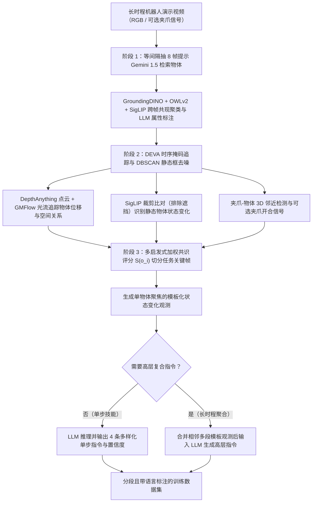

# Scaling Robot Policy Learning via Zero-Shot Labeling with Foundation Models

## 一句话定义

NILS（Natural language Instruction Labeling for Scalability）是一种面向长时程、未整理机器人演示视频的零样本自动标注系统，通过组合冻结的视觉-语言与感知基础模型完成物体检索、以物体为中心的状态变化追踪、关键状态分段和可调粒度的自然语言指令生成。

## 英文缩写速查

| 缩写 | 英文全称 | 简要说明 |
|---|---|---|
| NILS | Natural language Instruction Labeling for Scalability | 本文提出的零样本长时程机器人轨迹分段与语言标注框架 |
| VLM | Vision-Language Model | 视觉-语言模型，文中用于多帧场景物体检索（如 Gemini 1.5）与闭源基线对比 |
| LLM | Large Language Model | 大语言模型，文中用于推断物体可交互属性及基于模板观测生成多样化任务指令 |
| CVLM | Contrastive Vision-Language Model | 对比式视觉-语言编码器（如 SigLIP），用于跨帧同义词对齐与静态物体状态评分 |
| CG | Correct Grounding | 正确接地率，衡量下游策略是否准确趋近并与语言指定的目标物体交互 |
| UVD | Universal Visual Decomposer | 通用视觉分解器，文中用作基于嵌入空间（如 VIP）的关键状态检测零样本对比基线 |

## 核心信息

| 字段 | 内容 |
|---|---|
| 论文标题 | *Scaling Robot Policy Learning via Zero-Shot Labeling with Foundation Models* |
| 作者 | Nils Blank, Moritz Reuss, Marcel Rühle, Ömer Erdinç Yağmurlu, Fabian Wenzel, Oier Mees, Rudolf Lioutikov |
| 机构 | Karlsruhe Institute of Technology (KIT)、UC Berkeley |
| 发表会议 / 预印本 | CoRL 2024（8th Conference on Robot Learning）；arXiv:2410.17772v2（2024-10-26） |
| 论文链接 | [arXiv:2410.17772](https://arxiv.org/abs/2410.17772) / [PDF](https://arxiv.org/pdf/2410.17772) |
| 项目主页 | [robottasklabeling.github.io](http://robottasklabeling.github.io) |
| 清单分类 | `data.annotation` |
| 来源条目 | `survey_ax_2410_17772` |
| 开源 / 验证范围 | 论文声明已在项目主页开源自动标注代码与生成的标注数据集；实验覆盖 BridgeV2（含 31k 规模化子集）、Fractal（87k 全量）与自采 Kitchen Play 数据集，累计标注 115k+ 轨迹（430+ 小时），并在 SIMPLER 仿真与 WidowX / Toy Kitchen 真机上训练语言条件策略验证 |

## 为什么重要

1. **打破语言条件策略的数据标注成本与质量瓶颈**：现有大型机器人数据集（如 BridgeV2、DROID）多依赖事后众包标注，不仅成本高昂（BridgeV2 全集约 \$10,000），且存在低质噪声（甚至出现 YouTube 链接）、模板化导致表达单一、以及时间粒度（单步原子动作 vs. 多步复合任务）极不一致的问题。
2. **揭示单一大模型 VLM 在机器人视频时空接地上的不足**：直接向 Gemini 1.5、GPT-4o 等视频 VLM 输入多帧画面往往难以切分长时程演示并准确推理细粒度空间动作变化（即使给定真值关键帧，Gemini 1.5 接地准确率仅 0.16、GPT-4o 仅 0.51）；NILS 证明将冻结基础模型模块化组合并引入显式 3D/光流/追踪后处理可大幅超越端到端 VLM（达 0.84）。
3. **支持完全离线且粒度可控的大规模数据飞轮**：无需任何域内微调或机器人本体专属训练，即可从纯 RGB 视频（可选融合夹爪闭合本体信号）切分出单步任务并进一步聚合为高层多步指令，为 Octo、BESO 等策略提供可扩展的语言标注供给。

## 核心方法

NILS 采用全冻结预训练基础模型的三阶段流水线，所有模块均支持按同类模型无缝替换：

1. **阶段 1：场景物体多帧共识检索（Identifying Objects in the Scene）**
   - 从长时程视频等间隔抽取 8 帧，提示 VLM（Gemini 1.5）为每帧输出简洁唯一的物体名称及颜色描述，以缓解交互遮挡漏检。
   - 针对跨帧命名不一致问题，利用 GroundingDINO 生成检测框并计算帧内 IOU 共现关系，结合检测器置信度与 SigLIP 裁剪区域图文相似度，以及 OWLv2 无类别目标性（objectness）过滤，将不同帧对同一物体的称呼聚类为“代表性规范名称 + 同义词表”。
   - 最后由 LLM（Gemini Pro）为每个物体标注 `movable`、`is container`、`states` 和 `interactable` 属性，过滤无效交互。
2. **阶段 2：以物体为中心的场景注释与信号追踪（Object-Centric Scene Annotations）**
   - **时序掩码与静态框稳健化**：利用 GroundingDINO 与分割模型提取掩码，通过基于 XMem 的 DEVA 融合新检出与传播掩码并聚合类别分数；对橱柜/抽屉等静态物体，先剔除统计离群框再经 DBSCAN 聚类取最高置信簇，消除遮挡抖动。
   - **四类核心变化信号提取**：
     1. *物体运动与空间关系*：结合边界框位移与 GMFlow 光流检测微小运动，利用 DepthAnything v2 将掩码投影至与桌面/炉灶平面法向对齐的 3D 点云，并通过单应性变换（homography）构建表面 $3\times 3$ 网格与空间关系图。
     2. *物体状态变化*：裁剪带边距的物体图像（根据机器人掩码 IOU 排除遮挡帧），用 SigLIP/CLIP 文本提示计算状态变化（如抽屉从 `open` 变为 `closed`）。
     3. *夹爪-物体邻近性*：利用分割掩码与估计深度计算末端与物体距离，连续 3 帧低于逐物体阈值则记录接近交互。
     4. *夹爪开合信号*（可选）：当轨迹包含本体夹爪信号时，记录闭合转开启时刻作为释放关键点。
3. **阶段 3：启发式共识关键帧切分与可控粒度标签生成（Keystate Detection & Label Generation）**
   - 通过加权启发式共识得分 $S(o_i) = \sum_k \alpha_k S_k(o_i)$（各信号等权，阈值 $\theta_o$ 默认 0.25–0.30）识别任务边界，并对邻近高分候选进行聚合去噪。
   - 在相邻关键状态之间提取**聚焦单一目标物体**的模板化观测文本（约束上下文以减少幻觉），提示 LLM（Gemini Pro）先逐步推理再输出 4 条多样化自由文本指令及置信度评分（0–10）；若将连续多个底层关键状态片段的模板观测合并输入 LLM，即可自底向上生成高层复合任务指令，实现任务粒度可控。

### 方法流程图

## 实验与评测

### 1. 关键帧检测与多帧物体检索（Figure 4 & Table 3 & Table 6）

- **Stage 1 物体检索召回率（Table 3，BridgeV2 + Kitchen Play 共 185 个物体）**：
  - `Ours (Gemini)` 达到 **`0.94`**，显著高于单帧查询 `Single Frame (Gemini)`（`0.70`）、加装 Set-of-Mark 的 `Ours (Gemini) + SOM`（`0.74`）、`Ours (GPT4V)`（`0.67`）、预定义词表 `OWLv2 + SigLIP`（`0.63`）以及开源基线 `Ours (Prismatic)`（`0.48`）。
- **关键帧切分表现（Figure 4 & Table 6）**：
  - 在 Kitchen Play 与 BridgeV2 上，NILS（及融入夹爪信号的 `NILS + Gripper`）在精确率与召回率上均超过 `UVD` 与均匀采样基线。
  - 在仅使用低分辨率 RGB 的 **CALVIN 仿真**（Table 6，无夹爪信号）上，容忍窗口 $\epsilon=8$ 时 NILS Precision/Recall 为 **`0.37 / 0.21`**（UVD VIP 基线 `0.16 / 0.06`）；$\epsilon=16$ 时为 **`0.53 / 0.31`**（UVD `0.28 / 0.10`）。

### 2. 语言指令接地准确率（Table 1 & Table 7）

在 14 条长时程轨迹（12 条 BridgeV2 × 20 任务 + 2 条 Kitchen Play × 24 任务）混合数据集上由人工评估生成指令的正确性：

| 方法 | 是否使用真值关键帧 (GT Keystates) | 接地准确率 (Accuracy) ↑ |
|---|---|---:|
| XCLIP | ✓ | 0.05 |
| VideoLLaVA | ✓ | 0.03 |
| Gemini 1.5 | ✓ | 0.16 |
| GPT-4o | ✓ | 0.51 |
| **NILS（自主检测关键帧）** | ✗ | **0.66** |
| **NILS（给定真值关键帧）** | ✓ | **0.84** |
| NILS w/o Temporal Aggregation (TA) | ✗ | 0.46 |
| NILS w/o Multi-Frame Object Retrieval (MFOR) | ✗ | 0.38 |
| NILS w/o Depth Information (DI) | ✗ | 0.47 |

- 在 Kitchen Play 多选题定量评测（Table 7，$\epsilon=8$ 含歧义/严格单选）中，NILS 搭配 GPT-4 可达 `0.84 / 0.77`、Gemini (Lang) `0.80 / 0.61`、GPT-3.5 `0.70 / 0.55`、Mixtral8x7b `0.66 / 0.52`，而直接端到端视频模型 S3D、XCLIP、Gemini 仅为 `0.04`、`0.07`、`0.13 / 0.03`。

### 3. 大规模标注成本与下游语言条件策略训练（Table 2, Table 8, Table 9, Table 10）

- **BridgeV2 规模化标注成本**：为 31k 条 BridgeV2 轨迹自动标注仅花费约 **\$200 USD**（同期众包标注约 \$5,000 USD；全量约 \$10,000 USD），并在词频统计（Figure 6）中显著提升了动词、物体与空间关系词汇的多样性。
- **Octo 策略跨数据集评测（Table 2 / Table 8 / Table 9，训练 300k 步）**：

| 评测环境 | 指标 | Gemini 标注 | NILS 自动标注 | 人类众包标注 (GT) |
|---|---|---:|---:|---:|
| **SIMPLER BridgeV2**（3 任务均值） | Correct Grounding (CG) / Success | 11% / 0% | **29.6% / 2.8%** | 41.7% / 4.2% |
| **SIMPLER Fractal**（87k 全量 + Bridge 联合训练） | Average Success | — | **3.1%** | 1.9% |
| **WidowX 真机（Spoon on Towel）** | Success / CG（15 次试验） | — | **66% / 100%** | 60% / 93% |
| **WidowX 真机（Sushi in Bowl）** | Success / CG（15 次试验） | — | **60% / 80%** | 60% / 73% |
| **WidowX 真机均值** | Success / CG | — | **63% / 90%** | 60% / 83% |

- **自采 Toy Kitchen Play 真机 BESO 策略（Figure 12 & Table 10，12 任务 × 3 次试验）**：过滤歧义标签后的 `NILS` 策略在正确接地率上与 `Human` 标注持平（**`0.89` vs. `0.89`**），成功率接近（`0.47` vs. `0.58`）；若保留低置信/多标签噪声（`NILS Noisy`），接地率与成功率则分别跌至 `0.58` 和 `0.28`。

## 与现有工作的对比

| 维度 | UVD (2024) | REFLECT (2023) | RoboVQA (2024) / DIAL (2022) | NILS (本文) |
|---|---|---|---|---|
| 关键帧切分依据 | 预训练图像嵌入（CLIP/VIP）距离 | 依赖仿真真值状态构建场景图 | 依赖已知切分点或分段采样 | **多启发式共识（检测/光流/深度/状态/夹爪）** |
| 是否需要微调或域内标注 | 无需微调（仅切分无语言生成） | 需要已知计划与真值状态 | 需收集域内监督数据微调 VLM/CLIP | **零样本全冻结基础模型，无需域内微调** |
| 真机长时程纯 RGB 视频适用性 | 仅切分关键帧，无法生成任务语义 | 依赖仿真状态，真机难以直接迁移 | 受限于特定域微调分布 | **已在 BridgeV2 / Fractal / 真机厨房验证** |
| 指令颗粒度与多样性 | 无指令生成 | 固定模板失败解释 | 依赖训练标注粒度 | **支持单步→复合任务聚合，同义词丰富** |

## 常见误区或局限

1. **离线算力开销大，不适合在线实时标注**：NILS 串联了 Gemini 1.5/Pro、GroundingDINO、OWLv2、SigLIP、DEVA、DepthAnything v2、GMFlow 等多个大模型，在单张 RTX 3090 GPU 上标注一条含 50 个任务的 8 分钟长轨迹需约 **7 分钟**，定位为离线数据管线而非在线控制模块。
2. **高度依赖“可分割物体”假设（High Objectness）**：对于颗粒状物质（如米粒）或视觉外观高度相似的物体（如同色同形积木），开放词汇检测器与追踪器难以区分实例，从而影响标注精度。
3. **域迁移与关联噪声风险**：预训练开放词汇检测器主要训练于真实自然图像，面对玩具厨房（如将玩具香蕉误检为海绵）或低分辨率抽象仿真场景（如 CALVIN）时仍需人工提供预期物体提示工程；此外，当环境噪声同时触发多个相关启发式信号时，可能产生高置信度的假阳性关键帧。
4. **低质量/歧义标签不过滤会伤害策略学习**：Kitchen Play 消融实验（`NILS` 0.47 vs. `NILS Noisy` 0.28）表明，必须依据 LLM 输出置信度与单一任务筛选剔除歧义片段，盲目将所有候选指令注入训练集反而会显著降低策略表现。

## 结论

**一句话总判：NILS 用模块化冻结基础模型组合与时空后处理，替代了端到端视频 VLM 与昂贵众包，证明零样本自动标注在成本降为 1/25 的同时，能在 Fractal 与 WidowX 真机上训出比肩甚至超越人类标注的语言条件策略。**

1. **多帧共识与 3D/时序聚合是 VLM 接地的关键前提**：单帧检索（0.70）与无时序聚合（0.46）或无深度信息（0.47）都会使 NILS 性能腰斩，工程上必须用跨帧追踪与平面投影补全基础模型的时空短板。
2. **单物体聚焦提示有效抑制 LLM 幻觉**：在 Stage 3 中按关键帧区间构建“单物体聚焦”的观测模板而非整张全场景图，能大幅提高指令准确度并支持按片段合并控制任务粒度。
3. **优先用置信度过滤歧义标签而非追求 100% 召回**：真机策略对比显示，保留不确定多标签（`NILS Noisy`）会使接地率从 0.89 暴跌至 0.58；在自动标注流水线中严格宁缺毋滥比全量保留更重要。
4. **模块化替换随基础模型演进直接受益**：由于所有感知与推理组件均未微调，随着更强的开放词汇检测器、单目深度与多模态模型发布，无需重训即可同步提升标注上限。

## 关联页面

- [Agentic Robots 综述](paper-towards-agentic-robots-survey.md)
- [全量项目节点清单](../overview/awesome-agentic-robots-node-index.md)
- [自动标注流水线](../methods/auto-labeling-pipelines.md)
- [模仿学习](../methods/imitation-learning.md)
- [VLA 方法背景](../methods/vla.md)
- [Octo 论文节点](paper-octo.md)

## 参考来源

- [官方 Awesome 快照归档](../../sources/repos/awesome-agentic-robots-survey-index.md)
- [arXiv:2410.17772v2 论文页面](https://arxiv.org/abs/2410.17772)（[PDF 原文](https://arxiv.org/pdf/2410.17772)）
- [NILS 官方项目页](http://robottasklabeling.github.io)
