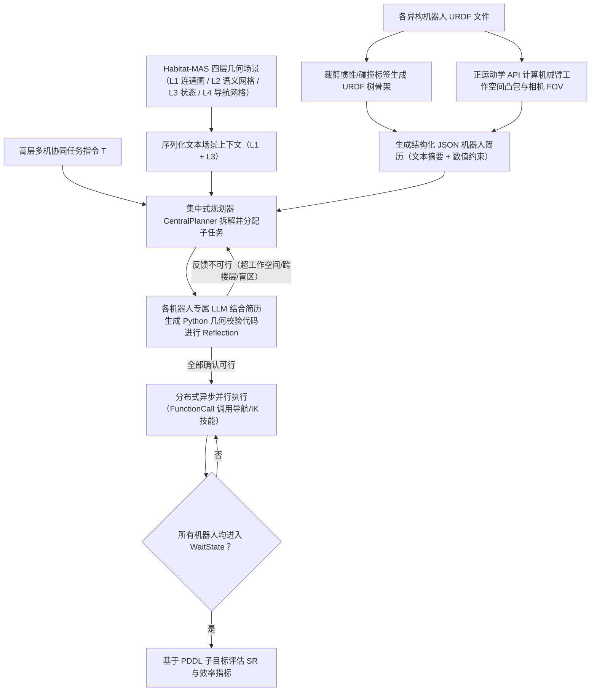

# EMOS: Embodiment-aware Heterogeneous Multi-robot Operating System with LLM Agents

## 一句话定义

EMOS 是一种面向异构多机器人系统（HMRS）的本体感知型 LLM 多智能体操作系统框架，通过从 URDF 与正运动学 API 自动生成包含文本摘要与几何数值的“机器人简历（Robot Resume）”，并在“集中式讨论校验 + 分布式并行执行”层级架构下完成跨移动、视角与机械臂工作空间约束的协同规划。

## 英文缩写速查

| 缩写 | 英文全称 | 简要说明 |
|---|---|---|
| EMOS | Embodiment-aware Heterogeneous Multi-robot Operating System | 本文提出的具身感知异构多机器人 LLM 多智能体调度与执行系统 |
| HMRS | Heterogeneous Multi-Robot System | 异构多机器人系统，包含无人机、足式机器人、轮式移动操作臂等不同硬件形态 |
| MAS | Multi-Agent System | 多智能体系统，本文中为每个实体机器人绑定一个专属 LLM 智能体并与领导者智能体交互 |
| URDF | Unified Robot Description Format | 统一机器人描述格式，EMOS 通过裁剪其树骨架并结合正运动学工具提取机器人能力简历 |
| FOV | Field of View | 相机视场角，EMOS 用以数值化评估传感器视锥能否覆盖高处或遮挡目标物体 |
| PDDL | Planning Domain Definition Language | 规划领域定义语言，Habitat-MAS 用其将复合任务拆解为中间子目标谓词进行评测 |

## 核心信息

| 字段 | 内容 |
|---|---|
| 论文标题 | *EMOS: Embodiment-aware Heterogeneous Multi-robot Operating System with LLM Agents* |
| 作者 | Junting Chen*, Checheng Yu*, Xunzhe Zhou*, Tianqi Xu, Yao Mu†, Mengkang Hu, Wenqi Shao, Yikai Wang‡, Guohao Li, Lin Shao‡ |
| 机构 | National University of Singapore (NUS)、香港大学、上海人工智能实验室、KAUST、牛津大学、清华大学、南京大学、复旦大学 |
| 预印本 | arXiv:2410.22662v2（2025-02-17） |
| 论文链接 | [arXiv:2410.22662](https://arxiv.org/abs/2410.22662) / [PDF](https://arxiv.org/pdf/2410.22662) |
| 项目主页 | [emos-project.github.io](https://emos-project.github.io/) |
| 清单分类 | `harness.orchestration` |
| 来源条目 | `survey_ax_2410_22662` |
| 开源 / 验证范围 | 论文发布了项目主页与 Habitat-MAS 基准（覆盖 Matterport3D 27 个多层真实扫描场景与 HSSD 34 个合成场景，GPT-4o 2024-05 版在 519 个 episode 子集上完成主评测）；底层执行关闭 PyBullet 物理碰撞，采用接触吸附抓取与经典轨迹规划/IK |

## 为什么重要

1. **从“人工角色扮演”迈向“自下而上的物理本体自省”**：传统软件型 LLM 多智能体框架（如 MetaGPT、CAMEL）依赖人工编写角色提示词，难以在机器人形态与传感器组合变化时泛化；EMOS 让智能体直接读取 URDF 与运动学数值，自主发现自身能走楼梯还是平地、相机视锥能否看到高柜、机械臂凸包是否够得着目标，向 Rizk et al. (2019) 定义的 Level-4 全自动异构多机器人系统推进了一步。
2. **揭示“纯文本描述不足以支撑精确几何操作”**：消融实验表明，去掉正运动学数值与代码推理后，单层与多层协同重排成功率分别暴跌 67.5%（`28.35% → 9.20%`）与 71.4%（`13.46% → 3.85%`），证明空间可达性判定必须结合精确数学计算而非仅靠语言常识。
3. **补齐多层室内异构协同基准空白**：Habitat-MAS 围绕移动（跨楼层）、感知（视锥视角）、操作（工作空间）和综合重排构建了 4 类刚需异构协作的任务，且经过反作弊过滤确保单个机器人或随机策略无法完成，为后续 HMRS 规划研究提供了标准化测试平台。

## 核心方法

EMOS 运行在底层场景构建之上，整体包含三个级联阶段（论文指出场景构建集成于 Habitat-MAS 平台，EMOS 核心为阶段 2 与阶段 3）：

1. **场景上下文构建（Scene Context Construction）**
   - 借鉴 Hydra 四层环境表征（假设配备理想多机语义 SLAM 与真值网格/里程计）：**L1 区域连通图** $G=(V, E)$（房间/走廊/楼梯连通性）、**L2 语义网格**、**L3 智能体/物体状态**、**L4 Recast 导航网格（Navmesh）**。
   - 将 L1 与 L3 序列化为文本场景上下文供 LLM 推理，L2 与 L4 留给底层导航与运动学规划使用。
2. **机器人简历生成（Robot Resume Generation，JSON 格式）**
   - *URDF 树骨架摘要*：先剔除 URDF 中冗余的 `<inertial>`、`<visual>`、`<collision>` 标签以防上下文过长导致退化，仅保留 Link/Joint 树状骨架交由 LLM 总结移动、感知与操作能力文本描述。
   - *正运动学数值特征*：通过正运动学 API 加载 URDF，计算末端可达点集凸包（如 Fetch 机械臂工作空间中心与半径）、相机视锥模型（$\theta_{\text{FOV}} = 2 \tan^{-1}(\frac{x}{2f})$）及底盘通行特性，输出结构化 **JSON** 简历（格式消融中 JSON 达 0.7，优于 XML 0.6、Markdown 0.5 与自然语言 0.3）。
3. **层级式任务规划、分配与异步执行（Hierarchical Planning & Execution）**
   - 采用星形拓扑（HMAS-2 结构）：
     - **集中式小组讨论（同步）**：领导者 `CentralPlanner` 将任务 $T$ 拆解为子任务 `subtask_i`；各机器人专属智能体结合自身 `resume_i` 执行 `Reflection`，编写并运行 Python 代码计算 3D 欧氏距离或视锥角度，验证几何可行性并将反馈返回领导者重规划，直至全部机器人确认可行。
     - **分布式并行动作执行（异步）**：各机器人智能体独立维护局部历史 `history_i`，循环调用专属技能库 API（`navigate_to`、`move_arm_to`、`pick`、`place` 等）并在完成后进入 `WaitState`，待全部进入等待状态即结束任务。

### 方法流程图

## 实验与评测

### 1. Habitat-MAS 主实验与模块消融（Table 1, Table 2, Table 3 & Figure 5）

评测基于 GPT-4o（2024-05 版）在 519 个 episode 子集上进行，涵盖 4 类机器人（Fetch 轮式+7-DoF 旋转臂、Stretch 轮式+伸缩棱柱臂、DJI M100 无人机+RGBD 无机械臂、Spot 足式+7-DoF 旋转臂）与 4 类任务：

| 方法配置 | 整任务成功率 (SR) ↑ | 子目标成功率 (Sub-goal SR) ↑ | Token 消耗 ↓ | 仿真步数 ↓ | Token 效率 (Tokens/SR) ↓ |
|---|---:|---:|---:|---:|---:|
| **EMOS（完整方法）** | **37.82%** | **81.26%** | 80,783 | 2,358 | **2,135.99** |
| w/o Numerical（去除正运动学数值与代码推理） | 23.56% | 71.04% | 53,201 | 2,983 | 2,258.11 |
| w/o Robot resume（仅人工角色描述，无 URDF） | 15.63% | 65.27% | 64,600 | 3,125 | 4,133.08 |
| w/o Discussion（无中心分配与自省，直接执行） | 15.23% | 72.45% | **36,377** | **2,332** | 2,388.51 |

分任务成功率与 PDDL 子目标细分结果（正文第 4.4 节 & Table 3）：
- **Task 1（跨楼层导航）**：完整 EMOS 为 `37.37%`；去除简历降至 `14.14%`，而 `w/o Discussion` 为 `22.42%`（说明盲目角色扮演反而容易诱导幻觉）。
- **Task 2（协同感知辅助操作）**：完整 EMOS 为 `52.94%`；去除简历降至 `28.32%`。
- **Task 3（单层异构臂工作空间重排）**：完整 EMOS 为 `28.35%`；`w/o Numerical` 暴跌至 `9.20%`（甚至低于 `w/o Robot resume` 的 `12.99%`），验证精确机械臂可达性计算不可或缺。
- **Task 4（多层多机多物体综合重排）**：完整 EMOS 为 `13.46%`，`w/o Numerical` 跌至 `3.85%`。
- **四类 PDDL 子目标成功率（Table 3）**：完整 EMOS 在 `Robot At Object`、`Robot At Receptacle`、`Object At Receptacle`、`Robot Detect Object` 上分别为 **`88.27%`**、**`88.90%`**、**`57.04%`** 与 **`93.81%`**。

### 2. 简历格式与系统可扩展性评测（Table 4, Table 5, Table 6）

- **简历格式对比（Table 4，10 个感知任务采样）**：`JSON`（**0.7**）> `XML`（0.6）> `Markdown`（0.5）> `Natural Language`（0.3），其中 Markdown 与 XML 在未调优提示下更易引发输出格式幻觉。
- **机器人数量扩展（Table 5，10 个操作任务中缩放 Fetch 数量 2→4→6→10）**：成功率从 `80%` 降至 `60% → 70% → 50%`，Token 消耗由 `48,779` 升至 `151,952`（10 机上下文膨胀导致明显幻觉）。
- **物体数量扩展（Table 6，固定 2 台 Fetch，目标物体数 1→2→3→5）**：成功率保持在 `90% → 80% → 80% → 70%`，Token 由 `25,778` 增至 `197,485`。

## 与现有工作的对比

| 维度 | RoCo (2023) | CoELA / MetaGPT / CAMEL | HMAS-2 (Chen et al., 2024) | EMOS (本文) |
|---|---|---|---|---|
| 多机能力建模方式 | 任务文本约定多臂分工 | 人工编写固定角色扮演提示词 | 多机对话通信拓扑研究 | **URDF 树骨架摘要 + 正运动学 API 数值自省（Robot Resume）** |
| 异构覆盖范围 | 主要针对固定桌面多机械臂 | 通用软件智能体或同构具身智能体 | 偏重同构或简化的地面多机 | **覆盖无人机、足式、轮式+不同自由度机械臂** |
| 空间与物理可达性校验 | IK + 碰撞检测闭环检查航点 | 依赖自然语言常识，无几何工具 | 无针对 URDF 几何工作空间的显式校验 | **由智能体自动生成 Python 代码核算 3D 距离与相机 FOV** |
| 协作架构 | 对话式协商 + 集中式 RRT 规划 | 去中心化对话或固定流水线 | 集中规划 + 反思反馈星形拓扑 | **继承 HMAS-2 讨论拓扑 + 下层分布式异步并行执行** |

## 常见误区或局限

1. **仿真层关闭了物理动力学与真实感知噪声**：Habitat-MAS 为聚焦高层规划而关闭了 PyBullet 碰撞与物理接触仿真（抓取采用接触即吸附），且默认假设具备完美的多机语义 SLAM（L1–L3 直接取自真值网格与里程计），未验证真实 SLAM 建图误差与力控抓取失败下的闭环恢复。
2. **数值代码反思仍会出现空间几何幻觉**：Appendix C.1 案例显示，即使提示了水平距离与高度差公式，LLM 偶尔仍会写错校验代码（例如仅比较高度差与臂展半径，或凭空虚构第三维坐标），导致错判可达范围。
3. **复杂长时程多楼层协同成功率仍偏低**：在最复杂的 Task 4（多层多机多物体重排）上，完整 EMOS 的整任务成功率仅 `13.46%`；且系统缺乏运行期因某台机器人执行失败后的全局动态重协商机制（失败但自认为完成时直接进入 WaitState）。
4. **星形集中讨论在机器人数量增多时面临上下文瓶颈**：当机器人从 2 台增至 10 台时，Token 消耗翻了 3 倍以上（48.8k → 152.0k）且成功率降至 50%，未来需引入分层子群讨论（delegate meeting）以支撑大规模集群。

## 结论

**一句话总判：EMOS 证明了“URDF 文本摘要 + 正运动学数值工具 + 反思代码校验”是打通异构多机器人具身感知协作的关键接口，其价值在需要精确工作空间与跨楼层分工的任务中远超人工角色扮演。**

1. **用结构化 JSON 简历替代人工角色 Prompt**：从 URDF 裁剪骨架并结合正运动学 API 生成 JSON 简历，可将全任务成功率从 `15.63%` 提升至 `37.82%`（Token 效率最优，2,135.99/SR）。
2. **操纵类协作必须做数值几何验证**：单靠 URDF 文本提示无法让 LLM 准确判断机械臂工作空间（单层重排仅 `9.20%`），引入 Python 代码计算 3D 欧氏距离与视锥夹角可带来 3 倍以上收益（`28.35%`）。
3. **分层异步执行兼顾协同正确性与系统吞吐**：同步小组讨论解决分工与可达性验证，下层分布式 FunctionCall 并行执行则避免了单机阻塞和串行拖慢（平均步数保持在 2,358 步）。
4. **落地真机前需补齐感知噪声与失败重规划闭环**：由于当前基准理想化了 SLAM 与抓取物理，实际部署需接入真实 Hydra-multi 建图误差容错与执行异常触发再讨论机制。

## 关联页面

- [Agentic Robots 综述](paper-towards-agentic-robots-survey.md)
- [全量项目节点清单](../overview/awesome-agentic-robots-node-index.md)
- [RoCo 论文节点](paper-agentic-2307-04738.md)
- [人形与多机器人协同](../concepts/humanoid-multi-robot-coordination.md)
- [LLM 机器人控制接口](../concepts/llm-robotics-control-interfaces.md)
- [多智能体强化学习（MARL）](../methods/marl.md)
- [CTDE vs 去中心化 MARL](../comparisons/ctde-vs-decentralized-marl.md)

- [机器人智能体执行框架](../methods/robot-agent-harness.md)：对照规划、执行接口与反馈机制。

## 参考来源

- [官方 Awesome 快照归档](../../sources/repos/awesome-agentic-robots-survey-index.md)
- [arXiv:2410.22662v2 论文页面](https://arxiv.org/abs/2410.22662)（[PDF 原文](https://arxiv.org/pdf/2410.22662)）
- [EMOS 官方项目页](https://emos-project.github.io/)
