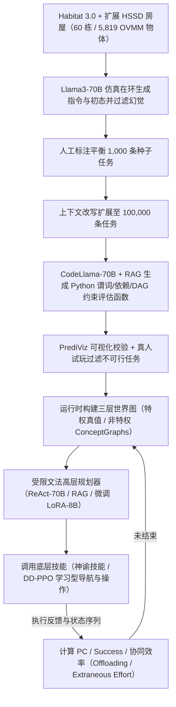

# PARTNR: A Benchmark for Planning and Reasoning in Embodied Multi-agent Tasks

## 一句话定义

PARTNR（Planning And Reasoning Tasks in humaN-Robot collaboration）是由 Meta FAIR 推出的大规模具身人机协作规划与推理基准，包含 100,000 条带时空及异构能力约束的自然语言任务与结构化 Python 评估函数，并配套支持非特权三维场景图感知、学习型底层技能及浏览器端真人在线协同评测（HITL）。

## 英文缩写速查

| 缩写 | 英文全称 | 简要说明 |
|---|---|---|
| PARTNR | Planning And Reasoning Tasks in humaN-Robot collaboration | 本文提出的人机具身协作规划与推理基准及开源评测套件 |
| HSSD | Habitat Synthetic Scenes Dataset | Habitat 合成室内场景数据集，本文扩展了 60 套可交互铰接家具房屋用于评测 |
| OVMM | Open-Vocabulary Mobile Manipulation | 开放词汇移动操作物体集合，PARTNR 从中引入 5,819 个物体实例（155 类） |
| PC | Percent Complete | 任务完成百分比，衡量时序与依赖约束下已满足评估命题的比例 |
| HITL | Human-in-the-Loop | 真人在环评测，通过部署在 AWS 上的浏览器交互系统由 129 名真人与 AI 实时协作 |
| RAG | Retrieval-Augmented Generation | 检索增强生成，基线 `ReAct+RAG` 通过句子相似度检索训练集成功轨迹辅助规划 |

## 核心信息

| 字段 | 内容 |
|---|---|
| 论文标题 | *PARTNR: A Benchmark for Planning and Reasoning in Embodied Multi-agent Tasks* |
| 作者 | Matthew Chang, Gunjan Chhablani, Alexander Clegg, Mikael Dallaire Cote, Ruta Desai, Michal Hlavac, Vladimir Karashchuk, Jacob Krantz, Roozbeh Mottaghi, Priyam Parashar, Siddharth Patki, Ishita Prasad, Xavier Puig, Akshara Rai, Ram Ramrakhya, Daniel Tran, Joanne Truong, John M. Turner, Eric Undersander, Tsung-Yen Yang（按姓氏字母序） |
| 机构 | FAIR, Meta |
| 预印本 | arXiv:2411.00081v1（2024-10-31；论文标注日期 2024-11-04） |
| 论文链接 | [arXiv:2411.00081](https://arxiv.org/abs/2411.00081) / [PDF](https://arxiv.org/pdf/2411.00081) |
| 官方代码与主页 | [facebookresearch/partnr-planner](https://github.com/facebookresearch/partnr-planner) / [aihabitat.org/partnr](https://aihabitat.org/partnr) |
| 清单分类 | `environment.task_generation`, `environment.benchmarking` |
| 来源条目 | `survey_ax_2411_00081` |
| 开源 / 验证范围 | 附录 A.1 确认已完整开源基准任务、评估系统、基线规划框架、扩展 HSSD 场景资产（基于 `habitat-lab` 与 `habitat-sim v0.3.2`）、100k 任务集以及 DD-PPO 底层技能和微调 Llama3.1-8B 权重；全部评测在 Habitat 3.0 仿真及 AWS Web HITL（129 名真人参与者）上完成 |

## 为什么重要

1. **首次在 10 万级自然语言规模上统一考察时空约束与异构能力协同**：既往具身协作基准要么规模极小且无自然语言（如 FurnMove 30、RoCo 6、CoELA 44），要么缺少时间先后顺序与人类专属技能约束；PARTNR 同时覆盖无约束（Constraint-free）、空间（Spatial）、时序（Temporal）和异构（Heterogeneous）四大协同轴。
2. **建立“仿真在环 + 检索增强评估生成 + 可视化人工核验”的数据工厂**：结合 `Llama3-70B-Instruct` 任务生成、`CodeLlama-70B-Instruct` 评估函数生成与 `PrediViz` 2D 谓词可视化标注，把评估代码准确率从 50% 提升到 92%（联合准确率 83%），将高错率自由生成（约 90% 需清洗）收敛到可规模化扩展（仅约 10% 需过滤）。
3. **用真人实验刺破“LLM 协作已足够好用”的幻觉**：尽管单智能体或特权条件下 LLM 成功率可达 73%–74%，一旦撤除特权感知与神谕技能，成功率骤降至 **30%**（人类高达 93%）；且去中心化 LLM 产生高达 **300% 额外无效工作量**，与真人搭档时甚至拖慢真人完成任务的速度（比单人独立完成更慢）。

## 核心方法

PARTNR 的方法体系由“半自动任务与评估生成管线”和“分层多智能体基线架构”两部分构成：

1. **半自动任务与评估函数生成（1k 种子 → 100k 全集）**
   - **仿真在环指令生成**：解析 Habitat 3.0 扩展 HSSD 房屋（60 栋、可开关铰接家具与表面标记点），让 `Llama3-70B-Instruct` 生成任务指令、初态和干扰杂物，随即在仿真器中校验房间存在性与动作可执行性（剔除 `folding` 等不支持动作）；人工整理出 1,000 条均衡覆盖四类约束的种子任务，再通过上下文改写扩增至 100,000 条（训练集 37 栋 100k、验证集 13 栋 1,000 条、测试集 10 栋 1,000 条），最终经 Web HITL 试玩剔除物理不可行任务。
   - **Python 谓词评估系统**：由于 PDDL/BDDL 难以表达动态时间依赖与同/异指代歧义，设计三元 Python 评估函数：
     - *Propositions*（支持列表 OR 歧义、`number=k` 子集计数、`arg_match`）；
     - *Dependencies*（`after_satisfied`、`after_unsatisfied`、`while_satisfied`）；
     - *Constraints*（有向无环图 `TemporalConstraint`、`SameArgConstraint`、`DifferentArgConstraint`、`TerminalSatisfactionConstraint`），输出 `Percent Complete (PC)`、`Success (S)` 与自然语言 `Failure Explanation (FE)`。
2. **分层人机协同基线架构（World Graph + Constrained ReAct / LoRA + Low-level Skills）**
   - **三层层次世界图（World Graph）**：以 `House → Room → Furniture → Object/Agent` 组织语义、3D 坐标和状态；非特权版本基于修改版 **ConceptGraphs**（`YOLOv8x-worldv2` + SAM 分割 + `Meta-CLIP ViT-H-14` 多视角分类 + `Llama3.1-70B-Instruct` 房间归属推断），随智能体探索与动作实时更新。
   - **受限语法的高层规划器**：对比集中式（单 LLM 控双智能体）、去中心化（人类与 Spot 机器人各由独立 LLM 控制）及单智能体配置；所有输出均采用文法受限解码（Constrained Generation），确保仅对已观测实体调用合法原语（如 `Explore`、`Navigate`、`Open`、`Close`、`Pick`、`Place`、`Wait`、`Done`；`Clean`/`Fill`/`Pour`/`PowerOn`/`PowerOff` 仅限人类调用）。
   - **轻量模型蒸馏微调**：从 `ReAct (70B)` 在训练集成功轨迹中切分出 1,226 个 episode（15,889 条成功动作样本），用 LoRA（$r=132, \alpha=128$）微调 `Llama3.1-8B`，推理延迟从 `4.55s/步` 降至 `0.53s/步`（提速 8.6×）。
   - **底层技能库**：对比特权神谕技能与基于 RGBD 视觉 + DD-PPO 分布式强化学习训练的导航与操作策略。

### 方法流程图

## 实验与评测

### 1. 自动化基线全维度拆解评测（Table 2, Table 10, Table 11 & Table 13）

在验证集（1,000 episodes）上的系统对照实验（主基线采用 `Llama3.1-70B-Instruct` 与微调 `Llama3.1-8B`）：

| 方法 | 控制方式 | 底层技能 | 可观测性 / 感知 | Sim Steps ↓ | Success Rate ↑ | Percent Complete ↑ | Planning Cycles ↓ |
|---|---|---|---|---:|---:|---:|---:|
| Heuristic-Expert | Centralized | Oracle | Full（特权） | 1260.88±26.97 | 0.84±0.01 | 0.94±0.01 | N/A |
| ReAct | Centralized | Oracle | Full（特权） | 1347.43±33.80 | 0.74±0.01 | 0.88±0.01 | 17.49±0.34 |
| ReAct-Single | Single Agent | Oracle | Partial（特权） | 2519.02±57.48 | 0.73±0.01 | 0.85±0.01 | 18.68±0.33 |
| ReAct | Centralized | Oracle | Partial（特权） | 2298.13±61.39 | 0.74±0.01 | 0.85±0.01 | 20.73±0.51 |
| ReAct | Decentralized | Oracle | Partial（特权） | 3295.20±76.27 | 0.73±0.01 | 0.86±0.01 | 15.24±0.31 |
| ReAct + RAG | Decentralized | Oracle | Partial（特权） | 3467.47±82.39 | 0.71±0.01 | 0.84±0.01 | 14.75±0.31 |
| **Finetuned (8B)** | Decentralized | Oracle | Partial（特权） | 3228.96±75.14 | 0.70±0.01 | 0.84±0.01 | **12.85±0.24** |
| ReAct-8B | Decentralized | Oracle | Partial（特权） | 3699.45±87.40 | 0.64±0.02 | 0.80±0.01 | 23.15±0.47 |
| ReAct | Decentralized | Learned | Partial（特权） | 6494.88±181.52 | 0.57±0.02 | 0.76±0.01 | 22.72±0.58 |
| **ReAct（全非特权）** | Decentralized | Learned | **ConceptGraph** | 12490.80±208.90 | **0.30±0.01** | **0.56±0.01** | 23.84±0.45 |

*注：测试集（Table 11）上任务难度更高，Heuristic-Expert 为 `0.69`、ReAct Decentralized Partial Oracle 为 `0.63`、Finetuned 8B 为 `0.51`、ReAct Learned 为 `0.50`。*

关键定量发现：
- **去中心化协作的“协调税”（Table 12）**：尽管去中心化机器人帮人类分担了 **`59.6%`** 的子任务（Task Offloading），但其无效动作比例（Extraneous Effort）高达 **`0.21`**，比集中式（`0.04`）和单智能体（`0.047`）暴增 **300%+**（重复做对方已完成的步骤或撤销已完成放置），导致仿真总步数（3,295）反超单智能体（2,519，慢约 1.3×）。
- **任务类型难度分化（Table 13）**：在去中心化部分可观测下，Constraint-free（`0.82`）与 Spatial（`0.82`）尚可，而 **Temporal** 骤降至 **`0.60`**（相对下降 27%），**异构/物体状态任务**降至 **`0.66`**（相对下降 20%）。
- **小模型蒸馏收益（Table 2 & A.9）**：微调 `Llama3.1-8B` 接近 `70B` 表现（`0.70` vs. `0.73`），推理速度提升 **8.6×**（单步规划 `0.53s` vs. `4.55s`）；有趣的是用 `ReAct` 轨迹蒸馏的效果优于用特权 `Heuristic-Expert` 轨迹蒸馏（Table 9：`0.70` vs. `0.63`）。

### 2. 真人在环协同评测（Human-in-the-Loop, Table 3 & Table 14，129 名受试者）

| 协作模式 | Validation SR ↑ | Validation Sim Steps ↓ | Test SR ↑ | Test Sim Steps ↓ | Task Offloading ↑ | Exploration Steps ↓ |
|---|---:|---:|---:|---:|---:|---:|
| Single-user（单人独立） | **0.93±0.01** | 3046.99±80.79 | **0.89±0.01** | 3937.87±110.53 | N/A | 2459.22 |
| Multi-user（双人协作） | **0.93±0.01** | **2369.55±49.33** | 0.85±0.01 | **2667.86±58.07** | **0.59 / 0.60** | **1762.47** |
| Human-ReAct (70B) | 0.91±0.01 | 4267.71±83.40 | 0.87±0.01 | 4080.10±72.24 | 0.16 / 0.12 | 2624.39 |
| Human-Finetuned (8B) | 0.92±0.01 | 3443.33±61.46 | 0.87±0.01 | 3403.03±62.08 | 0.26 / 0.26 | 2164.94 |

- 人类单人/双人均可完成 93% 的验证集任务，且双人协作比单人更快（2,369 vs. 3,046 步）；但当真人与 LLM 机器狗搭档时，虽然 `Finetuned 8B` 凭借更快推理卸载了 `26%` 任务（优于 70B ReAct 的 `16%`），**人机团队总步数仍慢于真人独自完成**（验证集 3,443 / 4,267 步 vs. 3,046 步；且远远慢于双人协作的 2,369 步）。

## 与现有工作的对比

| 维度 | ALFRED / ALFWorld | BEHAVIOR-1K (2023) | WAH / Co-ELA (2024) | PARTNR (本文) |
|---|---|---|---|---|
| 环境与协同模式 | 3D 单房 / 文本单智能体 | 3D 多房（多为单智能体重排） | 3D 多房人机/多机（无或极少自然语言） | **3D-M（60 栋 HSSD 房屋）双智能体 / 真人 HITL** |
| 任务数量与语言 | 25,743 / 模板或众包 | 1,000 BDDL 活动 | WAH 1,211 / Co-ELA 44 | **100,000 开放自然语言任务** |
| 约束覆盖范围 (CSTH) | 无约束 + 空间 + 时序 (CST) | CST | 仅无约束重排 (C) | **完整覆盖无约束 + 空间 + 时序 + 异构 (CSTH)** |
| 评估体系 | PDDL / BDDL 终态校验 | BDDL（不支持时变顺序依赖） | 终态检查 | **Python 谓词 + 时序 DAG + 同/异参数依赖 + 失败解释** |

## 常见误区或局限

1. **不能将特权条件下的 73% 成功率等同于真实可用水平**：当从仿真神谕技能切换为 DD-PPO 学习型技能、并将特权场景图替换为 ConceptGraphs 视觉建图后，最强的去中心化 ReAct 成功率立即从 `0.73` 腰斩再降到 **`0.30`**，暴露出规划器极度脆弱于物体误分类（如架子识别为桌子）与抓取失败恢复。
2. **微调小模型在跨场景测试集上存在泛化衰减**：虽然在验证集上微调 `Llama3.1-8B`（`0.70`）追平了 `70B ReAct`（`0.73`），但在更难的未见房屋测试集（Table 11）上掉到了 `0.51`（低于 `70B ReAct` 的 `0.63`）；不过在真人 HITL 中，8B 模型的低延迟仍使其整体表现优于 70B。
3. **当前自动化生成仍有约 17% 残余错误需靠 HITL 兜底**：10 万级自动化流水线的指令准确率约 90%（主要失败为幻觉物体）、评估函数约 92%（主要失败为时序分组错误与“房间 vs. 家具”过度约束），验证集与测试集均经人工核验清洗，而全量训练集仍有未经逐条人工精修的噪声。
4. **LLM 缺乏对搭档隐式意图的在线追踪与协商能力**：论文基线仅通过世界图变化与动作历史推断人类行动，缺乏主动语言沟通或意图建模，导致 300% 的重复/无效劳动。

## 结论

**一句话总判：PARTNR 通过 10 万条带时空与异构约束的自然语言协作任务及真人在线评测，清晰量化了“特权 73% vs. 非特权 30% vs. 人类 93%”的能力鸿沟，指出未来具身协作智能体的核心瓶颈在于抗感知误差、失败恢复与低延迟意图协调。**

1. **评测协作规划器必须撤除神谕感知与技能**：`0.73 → 0.57（学习技能）→ 0.30（ConceptGraphs）` 的断崖式下跌表明，脱离感知噪声与执行失败谈规划指标会严重高估 LLM 实用性。
2. **真机人机协作中“推理延迟”与“准确率”同等重要**：8.6× 加速的微调 8B 模型虽在自动评测略逊于 70B，但在 HITL 中完成更快、卸载更多任务（26% vs. 16%），实时交互系统应优先优化响应速度。
3. **使用 `ReAct` 失败-成功交互轨迹蒸馏优于用“上帝视角专家”蒸馏**：Table 9 表明只用探索/试错轨迹蒸馏出的 8B 模型（`0.70`）优于用特权启发式专家数据训练（`0.63`），因为后者缺乏部分可观测下的探索行为模式。
4. **建立可解释失败诊断闭环是下一步重点**：PARTNR 原生提供 Python 评估的 `Failure Explanation` 与多维度协作指标（Task Offloading、Extraneous Effort），可直接用于训练具备自纠错与伙伴意图预测的多模态规划器。

## 关联页面

- [具身大模型评测基准选型闭环](../queries/embodied-eval-benchmark-selection-loop.md)
- [Agentic Robots 综述](paper-towards-agentic-robots-survey.md)
- [全量项目节点清单](../overview/awesome-agentic-robots-node-index.md)
- [AI Agent 评估](../concepts/ai-agent-evaluation.md)
- [人形与多机器人协同](../concepts/humanoid-multi-robot-coordination.md)
- [LLM 机器人控制接口](../concepts/llm-robotics-control-interfaces.md)
- [EMOS 论文节点](paper-agentic-2410-22662.md)
- [分层强化学习](../methods/hierarchical-reinforcement-learning.md)

## 参考来源

- [官方 Awesome 快照归档](../../sources/repos/awesome-agentic-robots-survey-index.md)
- [arXiv:2411.00081v1 论文页面](https://arxiv.org/abs/2411.00081)（[PDF 原文](https://arxiv.org/pdf/2411.00081)）
- [PARTNR 官方代码库](https://github.com/facebookresearch/partnr-planner)
- [PARTNR 官方项目页](https://aihabitat.org/partnr)
