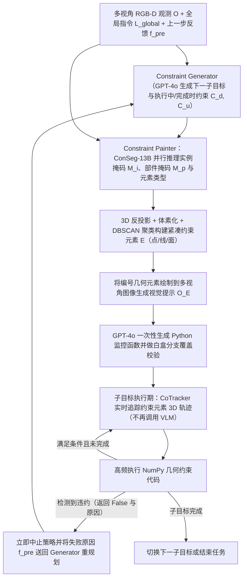

# Code-as-Monitor: Constraint-aware Visual Programming for Reactive and Proactive Robotic Failure Detection

## 一句话定义

Code-as-Monitor（CaM）是一种基于约束感知视觉编程的开放集机器人失败检测与监控范式，通过将物理约束抽象为点/线/面等 3D 几何“约束元素”并在子目标起始由 VLM 一次性生成监控代码，实现无需高频调用 VLM 的实时反应式（事后检出）与主动式（事前预防）失败拦截与重规划闭环。

## 英文缩写速查

| 缩写 | 英文全称 | 简要说明 |
|---|---|---|
| CaM | Code-as-Monitor | 本文提出的统一反应式与主动式失败检测的约束感知视觉编程框架 |
| ConSeg | Constraint-aware Segmentation | 本文基于 LISA 微调的多粒度约束感知实例与部件分割模型（13B） |
| CE | Constraint Element | 约束元素，将约束关联物体或部件抽象为点、线、面等紧凑 3D 几何元素 |
| VLM | Vision-Language Model | 视觉-语言模型，CaM 仅在子目标起始调用一次 GPT-4o 生成约束与监控代码 |
| VQA | Visual Question Answering | 视觉问答，传统失败检测方法（如 DoReMi）依赖频繁 VQA 询问导致耗时与误判 |
| DGN | DexGraspNet 2.0 | 灵巧手生成式抓取开环策略，文中在 UR5 + Leap Hand 真机上验证 CaM 的闭环赋能 |

## 核心信息

| 字段 | 内容 |
|---|---|
| 论文标题 | *Code-as-Monitor: Constraint-aware Visual Programming for Reactive and Proactive Robotic Failure Detection* |
| 作者 | Enshen Zhou*, Qi Su*, Cheng Chi*†, Zhizheng Zhang, Zhongyuan Wang, Tiejun Huang, Lu Sheng†, He Wang† |
| 机构 | 北京航空航天大学、北京大学、北京智源人工智能研究院（BAAI）、Galbot |
| 预印本 | arXiv:2412.04455v3（2025-03-21） |
| 论文链接 | [arXiv:2412.04455](https://arxiv.org/abs/2412.04455) / [PDF](https://arxiv.org/pdf/2412.04455) |
| 项目主页 | [zhoues.github.io/Code-as-Monitor](https://zhoues.github.io/Code-as-Monitor/) |
| 清单分类 | `harness.monitoring_and_recovery` |
| 来源条目 | `survey_ax_2412_04455` |
| 开源 / 验证范围 | 论文发布项目主页并详述了基于 BridgeData V2 构建的 10,181 轨迹（219,356 张图像）ConstraintSeg 数据集与 ConSeg-13B 训练配方；实验覆盖 CLIPort（UR5 吸盘/铲刀）、OmniGibson（Fetch + ReKep）、RLBench（Franka + ARP）及 UR5 + Leap Hand 灵巧手真机（真机上直接零样本使用 `ConSeg-base`） |

## 为什么重要

1. **首次在一个统一框架中同时解决反应式与主动式失败检测**：以往方法（如 Inner Monologue 仅在子目标结束后检查、DoReMi 轮询 VLM 做 VQA）大多聚焦于“已经失败”的反应式检测；CaM 将“执行中必须维持的约束 $C_d$”（主动预防，如移锅时锅面倾斜角度超过 15° 即拦截）与“完成时必须满足的约束 $C_u$”（反应检出，如龙虾跳出锅外）统一形式化。
2. **用“子目标起始一次代码生成 + CoTracker 实时追踪”打破 VLM 实时性瓶颈**：不在控制循环内重复调用 VLM，而是利用 VLM 生成轻量级 NumPy 几何监控函数并追踪 3D 约束元素轨迹，在 OmniGibson 上将执行时间缩短 **34.8%**、Token 消耗降低 **52.2%**，且避免了单帧 VQA 在 3D 空间姿态与计数上的频繁误判。
3. **可直接将开环策略改造为适应动态干扰的闭环系统**：在 UR5 + Leap Hand 真机上配合开环抓取策略 DexGraspNet 2.0，当人类在抓取中途移动目标或从手中抽走物体时，CaM 实时捕捉状态违约并触发重规划（如推理抓取任务从 0% 提升至 60%–90%）。

## 核心方法

CaM 在双视角 RGB-D 观测 $O$（如前视 + 顶视 / 腕部）下运行，包含三大核心模块：

1. **约束生成器（Constraint Generator）**
   - 在每个子目标起始，GPT-4o 根据多视角图像 $O$、全局指令 $L_{\text{global}}$、上一子目标 $l_{\text{pre}}$ 及监控反馈 $f_{\text{pre}}$，输出下一子目标 $l_{\text{next}}$ 与两类文本约束：$C_d$（执行期间需维持的主动约束）和 $C_u$（完成时需达成的目标约束）。
2. **约束绘制器（Constraint Painter：ConSeg-13B + 3D 约束元素管线）**
   - **ConSeg-13B 多粒度约束感知分割**：基于 LISA 架构（冻结 LLaVA + SAM 视觉编码器/解码器 + LoRA + `<SEG>` Token MLP），在通用分割/VQA 数据集及自建 **ConstraintSeg**（由 BridgeData V2 10,181 条抓放轨迹、219,356 帧经 GPT-4o 分解与 Grounded SAM / Semantic SAM 标注并人工筛选而成）上训练；给定文本约束 $c$，依次预测实例掩码 $M_i$、部件级掩码 $M_p$ 及元素类型文本 $l_e$（点/线/面）。
   - **3D 约束元素提取**：将多视角 $M_p$ 结合深度图反投影并融合为 3D 点云，过滤离群点后按元素类型 $l_e$ 确定体素尺寸（如平面划分 $2\times 2$ 体素）并进行 **DBSCAN 聚类**提取代表点，再在同一实例掩码 $M_i$ 内连线成紧凑 3D 几何元素（点、线、面；机械臂末端点直接由正运动学 FK 获取），最后以带编号的颜色标记回绘至多视角图像生成视觉提示 $O_E$。
3. **实时监控模块（Real-time Constraint Monitor）**
   - GPT-4o 结合 $l_{\text{next}}$、$C_d \cup C_u$ 与视觉提示 $O_E$ 一次性编写 Python 监控函数 `constraint_monitor(end_effector, element_position, is_finished)`，并在执行前通过白盒路径覆盖测试验证所有 `if-else` 分支可执行性（出错则重生成）。
   - 子目标执行期间不再调用 VLM：仅使用 **CoTracker** 实时追踪约束元素 3D 轨迹（含历史窗口 $T$ 以支持如“移动 2cm”或“旋转 180°”等高精度判断），持续运行 NumPy 几何代码；一旦返回 `False` 即刻中止当前策略并将失败原因字符串作为 $f_{\text{pre}}$ 交由上层重规划。

### 方法流程图

## 实验与评测

跨 3 大仿真器（CLIPort、OmniGibson、RLBench）与 1 套真机环境系统评测，在严重干扰下 CaM 整体平均成功率提升 **28.7%**、执行时间缩短 **31.8%**：

### 1. CLIPort 仿真实验（Table 1 & Table 8，UR5 吸盘/铲刀，5 种子 × 12 回合）

| 任务与干扰设定 | 基线 CLIPort SR | +Inner Monologue SR / 时间 | +DoReMi SR / 时间 | **+CaM (Ours) SR / 时间** |
|---|---:|---:|---:|---:|
| Stack in Order（掉落概率 $p=0.0$） | 100.00% | 100.00% / 13.4s | 100.00% / 13.4s | **100.00% / 13.4s** |
| Stack in Order（掉落概率 $p=0.15$） | 56.67% | 81.67% / 34.8s | 83.33% / 26.0s | **95.00% / 21.0s** |
| Stack in Order（掉落概率 $p=0.3$） | 21.67% | 75.00% / 42.8s | 76.67% / 34.2s | **88.33% / 25.4s** |
| Stack in Order（放置噪声 $q=3$ cm） | 15.00% | 40.00% / 58.2s | 40.00% / 54.2s | **63.33% / 36.8s** |
| Sweep Half the Blocks（清扫半数方块） | 0.00% | 18.33% / 22.0s | 16.67% / 16.6s | **75.00% / 16.4s** |
| Use Rope to Close Opening Square | 0.00% | 68.33% / 41.6s | 58.33% / 65.8s | **76.67% / 34.6s** |

### 2. OmniGibson 仿真与 RLBench 泛化评测（Table 2 & Table 9）

- **OmniGibson（Fetch + ReKep，10 次/组，含点/线/面三类精细干扰）**：
  - *Slot Pen（点级干扰）*：ReKep `30/20/10/10%`；+DoReMi `40/10/20/20%`（177.84s, 54.54k Token）；**+CaM `60/50/40/40%`**（`101.85s`, `25.82k` Token）。
  - *Stow Book（线级旋转干扰）*：ReKep `40/30/30/20%`；+DoReMi `50/40/20/40%`（127.17s, 38.67k Token）；**+CaM `70/60/70/60%`**（`93.08s`, `18.67k` Token）。
  - *Pour Tea（面级倾角干扰）*：ReKep `20/20/20/10%`；+DoReMi **`0/0/0/0%`**（单帧 VQA 无法判断俯仰/横滚倾角）；**+CaM `50/40/40/30%`**（`174.55s`, `44.19k` Token）。总体比 DoReMi 省时 **34.8%**、省 Token **52.2%**。
- **RLBench（Franka + ARP，6 任务 × 1,000 回合，Table 9）**：在无额外人为干扰、仅靠策略自身失败的铰接体（Open/Put in Drawer）、旋转（Screw Bulb/Turn Tap）与工具使用（Drag Stick/Sweep to Dustpan）任务上，平均成功率由 `ARP` `91.27%` 与 `ARP+DoReMi` `87.97%` 提升至 **`97.08%`**（其中 Open Drawer `98.1%`、Put in Drawer `98.3%`）。

### 3. UR5 + Leap Hand 真机实验与 ConSeg 消融（Table 3, Table 4, Table 5, Table 6, Table 11）

- **Simple Pick & Place 真机评测（Table 3，4 类物体 × 3 样本 × 10 次，含抓取时移动物体与搬运中抽走物体）**：未微调的 `ConSeg-base` 直接部署；纯开环 `DexGraspNet 2.0 (DGN)` 成功率为 `0.00%`；`+DoReMi` 在四类物体（可形变、透明、小刚体、大几何体）移动干扰下为 `83.33% / 66.67% / 80.00% / 86.67%`，**`+CaM` 达到 `96.67% / 93.33% / 96.67% / 96.67%`**（平均高出 DoReMi **20.4%**，耗时从 ~62–78s 降至 ~45–63s）。
- **杂乱场景推理抓取真机（Table 4，10 次）**：
  - *Clear all objects except animals*：`DGN` `0%`、`+DoReMi` `10%`、**`+CaM` `60%`**（若不使用约束元素直接跟踪实体/部件，`w/o CE` 跌至 `20%`）。
  - *Grasp animals from nearest to farthest from fruits*：`DGN` `0%`、`+DoReMi` `0%`、**`+CaM` `90%`**。
- **分割与关键设计消融（Table 5, Table 6, Table 11）**：
  - *ConstraintSeg 基准（Table 5）*：`ConSeg-13B` 在实例级（`62.1 gIoU / 68.7 cIoU`）与部件级（`60.2 gIoU / 65.3 cIoU`）均大幅领先 `LISA-13B`（`42.1/38.9` 与 `23.4/24.3`）及 GPT-4o+Grounded/Semantic SAM 组合基线 `FMC`（`49.3/49.6` 与 `40.8/39.3`）。
  - *Stow Book 消融（Table 6）*：完整 CaM 平均 `65.0%`；去掉多视角（仅前视）降至 `40.0%`；用 DINOv2 替换 ConSeg 降至 `42.5%`；取消元素连线（独立 3D 点）降至 `55.0%`。
  - *检测模式消融（Table 11）*：`Only Proactive`（OmniGibson 三任务 `37.50 / 50.00 / 32.50%`）或 `Only Reactive`（`42.50 / 57.50 / 35.50%`）均不及两者协同的完整 `CaM`（`47.50 / 65.00 / 40.00%`）。

## 与现有工作的对比

| 维度 | Inner Monologue (2022) | DoReMi (2023) | ReKep (2024) | Code-as-Monitor (本文) |
|---|---|---|---|---|
| 失败检测模式 | 仅子目标结束后的反应式检测 | 执行中高频 VQA 反应式检查 | 无显式监测与恢复，依赖关键点优化 | **统一实时主动预防 ($C_d$) + 反应检出 ($C_u$)** |
| 关键实体/空间表征 | 场景文本/成功检测器输出 | 原始 RGB 图像直接喂给 VLM | DINOv2 2D 语义关键点聚类 | **ConSeg-13B + 3D 点云体素聚类构建点/线/面约束元素** |
| 运行时推理开销 | 子目标结束调用 LLM | 高频轮询 VLM（Token 多、易误判） | 每阶段优化求解 | **子目标初调一次 GPT-4o 写码，执行期仅 CoTracker + NumPy** |
| 3D 姿态与倾角监测能力 | 弱（无细粒度 3D 几何追踪） | 极弱（Pour Tea 成功率 0%） | 支持关键点几何关系 | **支持 3D 法向、倾角、间距与历史轨迹精算** |

## 常见误区或局限

1. **难以感知无显著几何位移/旋转的力控类失败**：由于约束元素通过 3D 点、线、面的时空坐标变化建模，对于“夹爪推拉卡死抽屉但施力方向错误、物体未发生明显位移”或“水龙头未拧紧仍有水流声”等依赖力觉/听觉/流体细微 cues 的失败，当前框架无法有效检出（附录 A.3）。
2. **高度稠密点追踪仍存在混淆风险**：在 `Sweep Half the Blocks`（桌上 40 块积木）中，虽然 CaM（`75.00%`）远超基线（`16.67%`），但因高密度追踪点容易相互遮挡或串扰，在无干扰条件下仍难以接近 100%。
3. **仿真场景仍需少量域内微调且受限于预设容忍阈值**：尽管真机零样本直接使用了 `ConSeg-base`，但在 CLIPort、OmniGibson 与 RLBench 仿真上为弥补渲染域差仍各收集了 100 条轨迹微调 `ConSeg-ft`；此外，部分未知任务的违约阈值（如角度/距离容差）依赖 VLM 先验生成，阈值敏感性尚未系统探究。
4. **未完全消除 VLM 代码幻觉风险**：虽然通过单次生成与白盒分支覆盖测试降低了幻觉概率，但偶发分割偏差或复杂空间逻辑误写仍会导致漏报或误报。

## 结论

**一句话总判：Code-as-Monitor 证明了“约束感知部件分割 → 紧凑 3D 几何约束元素 → VLM 一次性生成监控代码 + 轻量点追踪”是兼顾开集泛化、3D 精度与实时闭环效率的机器人失败监测新范式。**

1. **以几何抽象代替整图高频 VLM 轮询**：将像素视觉降维为 3D 点/线/面约束元素并交给 NumPy 代码实时监测，既能捕捉倾角、距离等连续物理量（Pour Tea 0% → 30–50%），又能削减半数以上 Token 与三分之一耗时。
2. **主动监控与反应监控必须耦合使用**：Only Proactive 无法兜底突发掉落，Only Reactive 则会浪费大量执行时间（如 Pour Tea 284s vs. 175s），二者结合才同时实现高成功率与低延迟。
3. **多视角观测对 3D 约束元素生成至关重要**：单前视输入下平面容易退化为线或被遮挡（Stow Book 从 65% 跌至 40%），工程部署建议至少保留双视角 RGB-D。
4. **即插即用地将开环抓放/灵巧手策略升级为闭环系统**：对于 DexGraspNet 2.0、CLIPort 等缺少中途纠错能力的强开环策略，外挂 CaM 即可在动态人机干扰下显著恢复任务成功率。

## 关联页面

- [机器人视觉感知栈选型闭环](../queries/robot-perception-stack-selection-loop.md)
- [Agentic Robots 综述](paper-towards-agentic-robots-survey.md)
- [全量项目节点清单](../overview/awesome-agentic-robots-node-index.md)
- [ProgPrompt 论文节点](paper-agentic-2209-11302.md)
- [Code as Policies 论文节点](paper-pai-2209-07753-codeaspolicies.md)
- [ReKep 论文节点](paper-aff-2409-01652-rekep-spatio-temporal-reasoning-of-relational-keypoint-c.md)
- [LLM 机器人控制接口](../concepts/llm-robotics-control-interfaces.md)
- [Agentic 操作策略](../methods/agentic-manipulation-policies.md)

- [机器人智能体监控与验证框架（Robot Agent Harness）](../methods/robot-agent-harness.md)
- [机器人操作任务（Manipulation）](../tasks/manipulation.md)

## 参考来源

- [官方 Awesome 快照归档](../../sources/repos/awesome-agentic-robots-survey-index.md)
- [arXiv:2412.04455v3 论文页面](https://arxiv.org/abs/2412.04455)（[PDF 原文](https://arxiv.org/pdf/2412.04455)）
- [Code-as-Monitor 官方项目页](https://zhoues.github.io/Code-as-Monitor/)
