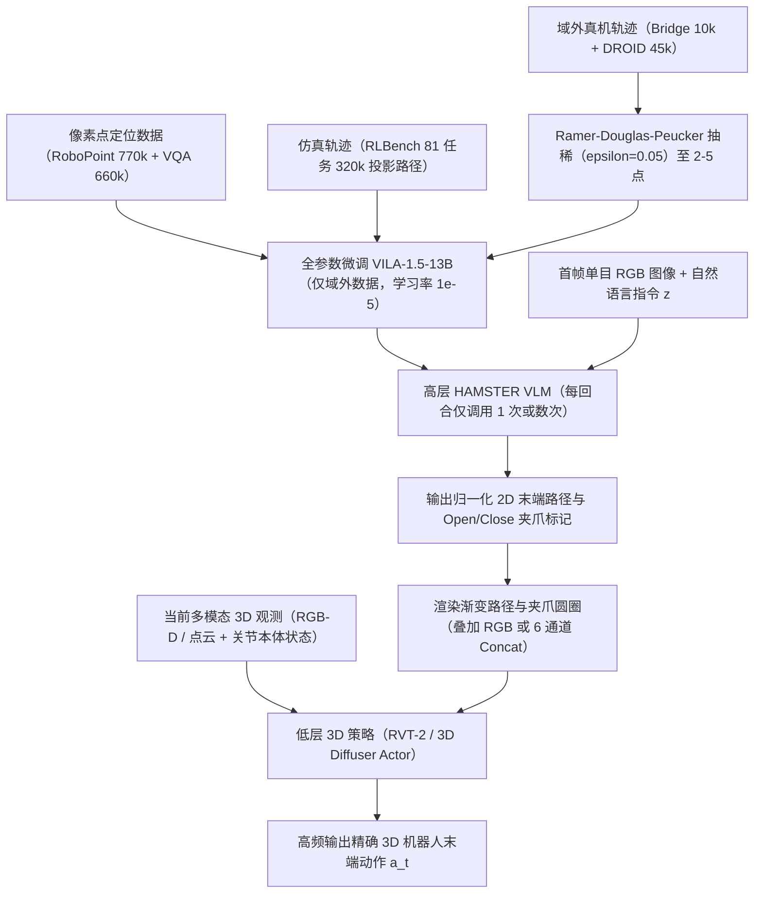

# HAMSTER: Hierarchical Action Models For Open-World Robot Manipulation

## 一句话定义

HAMSTER（Hierarchical Action Models with SeparaTEd Path Representations）是一种分层视觉-语言-动作（VLA）框架，通过以本体无关的“归一化 2D 末端执行器路径与夹爪开合标记”作为高层 VLM 与低层 3D 策略之间的桥梁，使高层 VLM 仅靠廉价域外仿真与视频数据微调即可跨外观、视角与语义显著泛化至真机操控。

## 英文缩写速查

| 缩写 | 英文全称 | 简要说明 |
|---|---|---|
| HAMSTER | Hierarchical Action Models with SeparaTEd Path Representations | 本文提出的以 2D 路径表征解耦高低层学习的层级 VLA 架构 |
| VLA | Vision-Language-Action Model | 视觉-语言-动作模型，本文将其区分为“单体 VLA”（如 OpenVLA）与“分层 VLA” |
| 3D-DA | 3D Diffuser Actor | 基于三维场景表征的扩散动作策略，文中用作低层 3D 策略骨干与无路径基线 |
| RVT-2 | Robotic View Transformer 2 | 基于多视角虚拟重投影的少样本 3D 操作策略，文中用作低层 3D 策略骨干 |
| RDP | Ramer-Douglas-Peucker Algorithm | 折线抽稀简化算法（容差 $\epsilon=0.05$），将百步末端轨迹压缩为 2–5 个关键航点 |
| VQA | Visual Question Answering | 视觉问答，HAMSTER 在微调阶段混入 660k VQA 数据以防大模型遗忘通用常识 |

## 核心信息

| 字段 | 内容 |
|---|---|
| 论文标题 | *HAMSTER: Hierarchical Action Models For Open-World Robot Manipulation* |
| 作者 | Yi Li⋆‡, Yuquan Deng⋆, Jesse Zhang⋆, Joel Jang, Marius Memmel, Raymond Yu, Caelan Garrett, Fabio Ramos, Dieter Fox, Anqi Li†, Abhishek Gupta†, Ankit Goyal† |
| 机构 | NVIDIA、University of Washington、University of Southern California |
| 预印本 | arXiv:2502.05485v4（2025-05-10） |
| 论文链接 | [arXiv:2502.05485](https://arxiv.org/abs/2502.05485) / [PDF](https://arxiv.org/pdf/2502.05485) |
| 项目主页 | [hamster-robot.github.io](https://hamster-robot.github.io/) |
| 清单分类 | `harness.layered_systems` |
| 来源条目 | `survey_ax_2502_05485` |
| 开源 / 验证范围 | 基于开源 VLM（VILA-1.5-13B）与开源 3D 策略（RVT-2、3D-DA）构建并在项目主页展示开放实现与视频结果；VLM 训练完全不使用真机部署环境数据，低层策略在 Colosseum 仿真（14 任务）与 Franka Panda 真机（320 条域内遥操作训练、74 项泛化任务共 222 次评测）完成定量验证 |

## 为什么重要

1. **破解“单体 VLA 吃域内真机数据、小 3D 策略缺乏开放泛化”的两难**：OpenVLA 等单体 VLA 直接输出动作 Token，无法有效吸收不同本体/视角/动作空间的仿真数据（将 OpenVLA 先在 81 个 RLBench 任务上微调后迁移真机，基础任务得分反从 0.58 略降至 0.54），且推理频率受限（RTX 4090 上 7B 模型仅约 6 Hz）；而纯 3D 策略虽精巧但面对换桌布、未见物体或比喻语言极易失效。
2. **证明“2D 像素路径”是极佳的跨域迁移中间接口**：2D 路径 $p=[(x_t, y_t, \text{gripper\_open}_t)]_t$ 仅依赖单目 RGB，与机器人自由度、动力学及真机相机内参弱耦合，从而可大规模复用 RoboPoint（770k）、RLBench 仿真（320k）以及 Bridge/DROID 域外轨迹（110k）来微调 VLM，实现低保真仿真到真实复杂场景的直接迁移。
3. **保留通用 VLM 常识并支持异步控制频率**：与将 VLM 过拟合为窄域动作头不同，HAMSTER 共训练通用 VQA 后在 14/15 个多模态基准上保持与原版 VILA-1.5-13B 相当甚至略优的性能，同时整回合只需查询 1 次（或数次）VLM，低层 3D 策略可高频局部闭环执行。

## 核心方法

HAMSTER 由“域外微调的高层 2D 路径预测 VLM”与“域内训练的路径引导低层 3D 策略”两部分解耦组成：

1. **高层 VLM（基于 VILA-1.5-13B 的 2D 路径生成器）**
   - **输出形式**：输入首帧单目 RGB 图像 `img` 与语言指令 $z$，输出 `<ans>` 包裹的归一化图像平面坐标序列（$x_t, y_t \in [0, 1]$）及 `<action>Open Gripper</action>` / `<action>Close Gripper</action>` 状态切换标记。
   - **四源域外联合微调数据 $\mathcal{D}_{\text{off}}$**（全部与真机测试环境零重叠，8×A100 全参数微调 30 小时，学习率 $1\times 10^{-5}$）：
     1. *像素点定位（770k）*：来自 RoboPoint 数据集（unordered 2D points / bounding boxes），培养空间关系与指代接地能力；
     2. *仿真机器人路径（~320k）*：从 RLBench 81 个前视可见任务各采 1,000 回合，利用正运动学与相机参数投影末端轨迹；
     3. *域外真机轨迹（~110k，Fig. 3）*：来自 Bridge（10k WidowX 轨迹，通过人工标定几帧夹爪中心 + PnP 估计外参投影）与 DROID（按深度-RGB 对齐度筛选出 ~45k 双视角轨迹）；
     4. *通用 VQA 保底（660k）*：与 LLaVA VQA 混合等权训练，保留世界常识（如理解“移动到 Jensen Huang / Taylor Swift”、“黄瓜颜色的按钮”）。
   - **RDP 路径抽稀（Ramer-Douglas-Peucker, $\epsilon=0.05$）**：将上百步原始轨迹压缩为约 2–5 个关键拐点与夹爪状态切换点，显著降低小模型（如 3B）与 13B 模型的预测复杂度。
2. **低层 3D 策略（`HAMSTER+RVT2` 与 `HAMSTER+3DDA`）**
   - **路径视觉注入方式**：主要采用将 VLM 生成的 2D 路径按时间颜色渐变绘制到观测图像上（蓝→红渐变线段 + 绿色闭合/蓝色开启圆圈）；针对 RVT-2，还测试了将“纯路径图”作为额外 3 通道与原 RGB 拼接成 6 通道的 `Concat` 变体，防止 RVT-2 的虚拟重投影步骤把画在原图上的细线打碎。
   - **训练与防过拟合配置**：在真机 320 条遥操作示教上利用本体投影生成真值 2D 路径并注入 $\mathcal{N}(0, 0.01)$ 坐标高斯噪声（模拟 VLM 预测误差）；同时移除或简化 RVT-2 / 3D-DA 真机训练时的语言指令输入（Colosseum 仿真则保留语言供 3D-DA 跨注意力使用），迫使低层策略专注局部 3D 点云与路径跟踪。

### 方法流程图

## 实验与评测

### 1. 真机 7 轴泛化与跨任务类型评测（Figure 4, Table 5 & Table 7）

在 Franka Panda 真机上共收集 320 条基础遥操作轨迹（220 条抓放 + 50 条推倒 + 50 条按钮），在 74 个测试任务（共 222 次真机试验）上跨越 7 大泛化轴（Basic、Object & Goal、Visual、Language、Spatial、Novel Object、Multiple）评估分步得分：

- **总体结论（Abstract & Sec 5.1）**：HAMSTER 在 7 个泛化维度上平均成功率较微调后的单体 VLA 基线 **OpenVLA** 高出 **20 个百分点（+20% 绝对提升，对应 50% 相对增益）**，是 OpenVLA 的 2 倍以上、非 VLM 3D 策略（RVT-2 / 3D-DA）的 3 倍以上。
- **按任务类型分组表现（Table 7）**：

| 任务类型 | RVT2 | 3DDA | OpenVLA（域内微调） | HAMSTER+RVT2 | HAMSTER+3DDA |
|---|---:|---:|---:|---:|---:|
| Pick and Place（抓放） | 0.28 | 0.19 | 0.46 | **0.79** | 0.78 |
| Press Button（按按钮） | 0.13 | 0.16 | 0.25 | 0.50 | **0.63** |
| Knock Down（非抓握推倒） | 0.17 | 0.03 | 0.41 | 0.47 | **0.66** |

- **新视角相机泛化评测（Table 2，10 次抓放试验）**：

| 方法 | 原训练视角（Success / Complete） | 新相机视角（Success / Complete） |
|---|---|---|
| OpenVLA | 0.60 / 0.30 | 0.23 / 0.00 |
| HAMSTER+RVT2（路径叠加） | 0.83 / 0.70 | 0.73 / 0.40 |
| **HAMSTER+RVT2 (Concat 6 通道)** | **1.00 / 1.00** | **0.98 / 0.90** |

### 2. Colosseum 仿真跨视觉变化与少样本效率（Table 1 & Table 3，5 种子）

在 Colosseum（基于 RLBench 的 14 项前视可见任务、每项变化 25 回合）上评测视觉干扰鲁棒性：
- **14 项任务全变化均值（Table 3）**：`3D-DA` 为 `0.35 ± 0.04`，**`HAMSTER (w/ 3D-DA)` 为 `0.46 ± 0.04`**（相对提升 **+31%**；其中无变化 `no var` `0.43 → 0.57`、操作物纹理 `man obj tex` `0.27 → 0.48`、桌面纹理 `tab tex` `0.23 → 0.35`、相机位姿 `cam pos` `0.35 → 0.39`）。
- **少样本效率（Table 1，5 任务子集）**：`3D-DA (100% 数据)` 为 `0.18 ± 0.10`，**`HAMSTER+3D-DA (仅 50% 数据)` 达 `0.36 ± 0.04`**（仅一半示教即达基线 2 倍），全量数据达 **`0.43 ± 0.05`**。

### 3. 高层 VLM 路径质量与通用 VQA 能力保持（Table 4 & Table 6）

- **48 张真实复杂指令图像的专家盲评排序（Table 6，1=最好，4=最差）**：
  - `HAMSTER (VILA + 全域外数据)` 平均排名 **`1.40`**（其中 RLBench 真实任务子集达 `1.28`）；
  - 去掉 RLBench 仿真数据（`HAMSTER Exc. Sim RLB`）排名退化至 `2.13`（证明低保真仿真数据确实显著增强了真机路径泛化）；
  - 零样本闭源基线 `RT-Trajectory (0-shot GPT-4o)` 为 `3.47`、`RT-Trajectory (CaP GPT-4o)` 为 `3.41`。
- **通用多模态 VQA 能力（Table 4，15 项基准）**：HAMSTER 在 VQAv2（`82.9` vs `82.8`）、GQA（`64.9` vs `64.3`）、MME（`1588.4` vs `1569.6`）、MMBench（`75.3` vs `74.9`）上与原生 `VILA1.5-13B` 持平甚至略高。

## 与现有工作的对比

| 维度 | OpenVLA (2024) | RT-Trajectory (2023) | RoboPoint (2024) | HAMSTER (本文) |
|---|---|---|---|---|
| 模型架构范式 | 单体 VLA（VLM 直接输出离散动作 Token） | 轨迹草图条件策略 + 人工/零样本 GPT-4o 画线 | VLM 预测 2D 可供性点 + 启发式运动 | **域外微调 VLM 预测 2D 路径 + 低层 3D 策略执行** |
| 域外仿真/跨本体数据利用率 | 低（RLBench 预训练迁移真机无正收益） | 未针对海量域外轨迹微调轨迹生成器 | 主要使用点定位数据，缺少完整路径序列 | **联合吸收点预测 + 81 仿真任务 + Bridge/DROID 轨迹** |
| 控制感知模态与推理频率 | 仅单目 2D RGB，每步调 7B VLM（~6 Hz） | 单目 2D 策略 | 依赖外接点云抓取与固定运动原语 | **高层 2D 语义（低频 1 次/回合）+ 低层 3D 点云与本体（高频）** |
| 多步非抓握与视角泛化 | 新视角完全失效（Complete 0.00） | 零样本 GPT-4o 路径精度有限（排名 3.41–3.47） | 较难表达推、按、旋转等长路径交互 | **新视角 Complete 达 0.90（Concat），支持推/按/长时程** |

## 常见误区或局限

1. **2D 路径接口存在三维歧义且“信息带宽受限”**：VLM 只预测 2D 图像平面 $(x, y)$ 坐标和二值夹爪开合，无法显式表达前后深度遮挡（例如某点在物体上方还是后方）、三维末端旋转姿态（Roll/Pitch/Yaw）以及接触力信息，复杂三维装配仍高度依赖低层 3D 策略自行补全。
2. **高层默认开环单次生成，无法应对执行中的动态场景突变**：若在机器人运动过程中目标物体被人类移动或掉落，首帧生成的静态 2D 路径不会自动更新重绘，进而导致失败（附录 E.1）。
3. **不同低层策略对 2D 路径的“遵循 vs. 执行”失效机制截然不同**：附录 E.2 失败归因显示，**`RVT-2` 中 72% 的失败来自未能遵循绘制路径**（因其虚拟视图重投影会打散叠加线，故 `Concat` 6 通道能大幅改善），而 **`3D-DA` 仅 10% 失败来自路径偏离、90% 源自抓握滑落等底层动作执行误差**。
4. **真机仍需 320 条域内遥操作训练低层策略**：HAMSTER 免除了 VLM 的域内微调，但低层 RVT-2 / 3D-DA 依然依赖本地收集 320 条真机示教学习动作空间与 3D 几何控制。

## 结论

**一句话总判：HAMSTER 验证了“用廉价域外多源数据微调 VLM 生成 2D 路径草图 + 用域内少量数据训练 3D 低层策略”的层级解耦范式，是当前比单体微调 VLA 更高效、更抗视角与语义漂移的真机泛化路径。**

1. **分层中间表征比端到端动作微调更能吃透跨本体/仿真数据**：将仿真与跨本体数据转化为统一的 2D 末端路径，使低保真 RLBench 数据也能稳定提升真机路径排名（`2.13 → 1.28`），而直接用来微调单体 OpenVLA 反而略微降分（`0.58 → 0.54`）。
2. **用 RDP 算法抽稀路径与共训练通用 VQA 是微调 VLM 的两大工程要点**：`epsilon=0.05` 抽稀（2–5 关键点）显著降低路径预测难度，混入 660k 通用 VQA 则确保大模型在“看懂物体指代与属性”时不退化。
3. **优先将 2D 路径作为独立通道输入低层网络而非直接画在 RGB 上**：`HAMSTER+RVT2 (Concat)` 在原视角与新视角上把任务完整成功率分别拉升至 `1.00` 和 `0.90`（叠加画线版仅 `0.70` 和 `0.40`），避免了重投影打碎路径线条。
4. **未来突破口在于“高维可学习/3D 中间接口 + 执行期重规划”**：若将单帧静态 2D 路径扩展为带深度/朝向的 3D 轨迹，并结合失败监测（如 CaM）触发按需重查 VLM，可同时补齐三维歧义与动态环境适应短板。

## 关联页面

- [Agentic Robots 综述](paper-towards-agentic-robots-survey.md)
- [全量项目节点清单](../overview/awesome-agentic-robots-node-index.md)
- [VLA 方法背景](../methods/vla.md)
- [模仿学习](../methods/imitation-learning.md)
- [OpenVLA 论文节点](paper-openvla.md)
- [RoboPoint 论文节点](paper-robopoint.md)
- [RoboDual 双系统 VLA 论文节点](paper-agentic-2410-08001.md)

- [机器人操作](../tasks/manipulation.md)：了解物体操作和抓取任务。

## 参考来源

- [官方 Awesome 快照归档](../../sources/repos/awesome-agentic-robots-survey-index.md)
- [arXiv:2502.05485v4 论文页面](https://arxiv.org/abs/2502.05485)（[PDF 原文](https://arxiv.org/pdf/2502.05485)）
- [HAMSTER 官方项目页](https://hamster-robot.github.io/)
