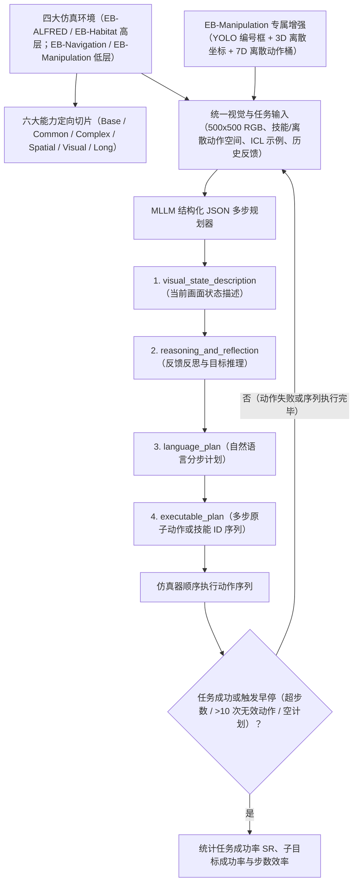

# EmbodiedBench: Comprehensive Benchmarking Multi-modal Large Language Models for Vision-Driven Embodied Agents

## 一句话定义

EmbodiedBench 是一个面向多模态大语言模型（MLLM）视觉驱动具身智能体的标准化综合评测基准与统一智能体框架，横跨高层家庭规划（EB-ALFRED、EB-Habitat）与低层原子导航/机械臂控制（EB-Navigation、EB-Manipulation）四大仿真环境共 1,128 个测试任务，并按六项核心能力进行细粒度诊断。

## 英文缩写速查

| 缩写 | 英文全称 | 简要说明 |
|---|---|---|
| MLLM | Multimodal Large Language Model | 多模态大语言模型，能够接收视觉图像与文本输入并推理决策的基座模型 |
| POMDP | Partially Observable Markov Decision Process | 部分可观测马尔可夫决策过程，本文用来形式化视觉驱动具身序贯决策问题 |
| ICL | In-Context Learning | 上下文学习，文中系统对比了纯文本 ICL 与带观测图像的 Visual ICL 效果 |
| PDDL | Planning Domain Definition Language | 规划领域定义语言，EB-ALFRED 与 EB-Habitat 用其判定任务与子目标成功率 |
| YOLO | You Only Look Once | 实时目标检测器，EB-Manipulation 中用于在图像上标注编号检测框辅助 3D 定位 |
| CH | Chat History | 多轮图文对话历史，EB-Navigation 消融证明保留对话历史显著影响导航表现 |

## 核心信息

| 字段 | 内容 |
|---|---|
| 论文标题 | *EmbodiedBench: Comprehensive Benchmarking Multi-modal Large Language Models for Vision-Driven Embodied Agents* |
| 作者 | Rui Yang*, Hanyang Chen*, Junyu Zhang*, Mark Zhao†*, Cheng Qian, Kangrui Wang, Qineng Wang, Teja Venkat Koripella, Marziyeh Movahedi†, Manling Li, Heng Ji, Huan Zhang, Tong Zhang |
| 机构 | UIUC、Northwestern University、University of Toronto、TTIC |
| 发表会议 / 预印本 | ICML 2025（PMLR 267）；arXiv:2502.09560v3（2025-06-05） |
| 论文链接 | [arXiv:2502.09560](https://arxiv.org/abs/2502.09560) / [PDF](https://arxiv.org/pdf/2502.09560) |
| 项目主页 | [embodiedbench.github.io](https://embodiedbench.github.io) |
| 清单分类 | `environment.benchmarking` |
| 来源条目 | `survey_ax_2502_09560` |
| 开源 / 验证范围 | 论文已在项目主页开源评测代码、1,128 项任务数据集与统一 MLLM 智能体流水线；所有实验均在 AI2-THOR、Habitat 2.0 与 CoppeliaSim（VLMBench）四套仿真器中完成，未包含真机实验 |

## 为什么重要

1. **同时覆盖高层语义技能与低层连续/离散原子控制**：既往多模态智能体基准（如 VisualAgentBench、ALFWorld、Lota-bench）几乎只测高层技能调用或纯文本环境，无法回答“视觉信号对不同控制层级究竟有多关键”；EmbodiedBench 通过同一套智能体管线贯穿高层家庭任务与低层导航/7-DoF 操作，首次量化了高层“重语言轻视觉”与低层“强依赖视觉”的本质分化。
2. **构建 6 维能力定向（Capability-Oriented）诊断切片**：不再只给单一总分，而是将每个环境拆分为 **Base（基础）**、**Common Sense（常识间接指代）**、**Complex Instruction（长上下文/条件干扰）**、**Spatial Awareness（空间相对位置）**、**Visual Appearance（颜色/形状外观）** 和 **Long Horizon（长时程规划）** 六个子集，精准暴露模型在具体能力轴上的短板。
3. **提供可直接复用的 MLLM 具身工程设计准则**：通过对 24 个前沿模型（8 闭源 + 16 开源 7B–90B）及分辨率、检测框、多步/多视角图像、Visual ICL 等消融，系统总结出结构化 JSON 多步规划（省 50%–80% API 调用）、`500×500` 中等分辨率优于极高分辨率、Visual ICL 暴涨 16.7%、以及当前 MLLM 普遍不擅长多帧/多视角融合等反直觉工程结论。

## 核心方法

EmbodiedBench 由“四环境分级测试套件”与“统一视觉驱动智能体流水线”组成：

1. **四类仿真环境与分层动作表示（共 1,128 任务）**
   - **EB-ALFRED（高层家庭，AI2-THOR，300 任务 / 6 子集各 50）**：修复了 Lota-Bench 无法处理同类别多实例与指令错误等缺陷（支持如 `Cabinet 2` 动态编号），合并冗余 `put down`，动态动作空间 171–298 个，最大 30 步。
   - **EB-Habitat（高层重排，Habitat 2.0 + Language Rearrangement，300 任务 / 6 子集各 50）**：包含 70 个静态高层技能（`navigation`、`pick`、`place`、`open`、`close`），且仅允许导航至容器/家具而非直接跳到小物体，最大 30 步。
   - **EB-Navigation（低层导航，AI2-THOR，300 任务 / 5 子集各 60，不含空间子集）**：提供 8 个物理可执行原子动作（前后左右移动 0.25m、左右转 90°、相机俯仰 30°），默认启用多轮图文对话历史，最大 20 步。
   - **EB-Manipulation（低层机械臂操作，CoppeliaSim / VLMBench，228 任务 / 4 子集各 48 + 外观子集 36，不含长时程子集）**：7-DoF Franka Panda 控制（抓放、堆叠、形状分拣、擦桌子）；为降低 MLLM 直接回归连续动作的难度，将 7D 动作 `[X, Y, Z, Roll, Pitch, Yaw, Gripper]` 离散化（位置 0–100 格、欧拉角 0–120 格每格 3°、夹爪二值），并叠加 YOLO 编号检测框及物体 3D 离散坐标，最大 15 步。
2. **统一视觉驱动智能体流水线（Unified Vision-Driven Agent）**
   - **标准化输入与截断规则**：图像统一 `500×500`，温度 `0`，最大生成 2048 tokens；除任务成功或步数耗尽外，单轨迹累计超过 10 次无效动作或输出空计划即提前终止。
   - **结构化 JSON 多步联合输出**：在每次规划迭代中，强制 MLLM 按 JSON Schema 依次输出四段内容：`visual_state_description`（视觉状态描述）→ `reasoning_and_reflection`（结合历史反馈自省与推理）→ `language_plan`（自然语言子步骤）→ `executable_plan`（一次生成多步可执行动作序列，仅当失败或遇到无效动作时才重新唤醒规划器，将模型调用次数削减 50%–80%）。

### 方法流程图

## 实验与评测

### 1. 24 个主流 MLLM 主基准对比（Table 2 & Table 3，全表摘要）

| 模型（类型） | EB-ALFRED (高层) Avg SR ↑ | EB-Habitat (高层) Avg SR ↑ | EB-Navigation (低层) Avg SR ↑ | EB-Manipulation (低层) Avg SR ↑ |
|---|---:|---:|---:|---:|
| **Claude-3.7-Sonnet**（闭源） | **67.7%** | 58.7% | 45.0% | 28.5% |
| **Claude-3.5-Sonnet**（闭源） | 64.0% | **68.0%** | 44.7% | 25.4% |
| **GPT-4o**（闭源） | 56.3% | 59.0% | **57.7%** | **28.9%** |
| Gemini-1.5-Pro（闭源） | 62.3% | 56.3% | 24.3% | 21.1% |
| Gemini-2.0-flash（闭源） | 52.3% | 42.3% | 48.7% | 16.7% |
| Qwen-VL-Max（闭源） | 41.3% | 45.3% | 39.7% | 18.0% |
| **InternVL3-78B**（开源） | 39.0% | **55.0%** | **53.7%** | 26.3% |
| **Qwen2.5-VL-72B-Ins**（开源） | **39.7%** | 37.7% | 40.0% | **26.8%** |
| InternVL3-38B（开源） | 38.0% | 43.3% | 50.7% | 22.6% |
| gemma-3-27b-it（开源） | 37.0% | 35.7% | 45.4% | 20.6% |
| **GPT-4o (Lang，盲测无视觉)** | 58.0% | 56.0% | **17.4%**（长时程 0.0%） | **16.2%** |

关键实验结论：
- **高层强、低层极弱**：闭源模型在高层 `EB-ALFRED` / `EB-Habitat` 最高达 `67.7% / 68.0%`，但在低层 `EB-Manipulation` 上即便是全库第一的 `GPT-4o` 也仅有 **`28.9%`**。
- **视觉在低层不可替代，在高层存在语言偏置**：屏蔽图像输入（`Lang`）后，`GPT-4o` 在 `EB-Navigation` 从 `57.7%` 暴跌至 `17.4%`（Long-horizon 归零），`EB-Manipulation` 从 `28.9%` 跌至 `16.2%`；而在 `EB-ALFRED` 上盲测甚至反超有视觉版（`58.0%` vs. `56.3%`）。
- **开源模型紧逼闭源**：`InternVL3-78B` 在 `EB-Navigation`（`53.7%`）和 `EB-Manipulation`（`26.3%`）已逼近 `GPT-4o`，但在高层规划与复杂推理（`EB-ALFRED` `39.0%`）上仍明显落后闭源第一梯队。
- **长时程与错误分析（Section 5.5 & Figure 6, 17）**：Long-horizon 普遍是最大瓶颈（如 `Claude-3.5-Sonnet` 在 EB-Habitat Base 达 `96%`，Long 降至 `58%`）。对 110 个 GPT-4o 失败样本归因：`EB-ALFRED` 主要错在规划（`55%`：漏步 23%、无效动作 22%）与推理（`41%`）；`EB-Manipulation` 主要错在规划精度（`44%`：动作位姿不准 42%）与视觉感知（`33%`：物体属性误识别 22%）；`EB-Navigation` 主要错在推理（`46%`：空间推理 23%、反思纠错 23%）与感知（`31%`）。

### 2. 视觉与语言设计消融发现（Section 5.3–5.4 & Appendix F–G）

- **环境反馈与文本示例（Fig. 4）**：去除执行后的文本环境反馈，EB-ALFRED Base 成功率在 GPT-4o 下降 `10%`、Claude-3.5-Sonnet 下降 `8%`；0-shot 则跌至约 `40%`。
- **相机分辨率（Fig. 7）**：高分辨率并非越高越好，在低层导航与操作上 **`500×500` 优于 `300×300` 和 `700×700`**（过高分辨率反而分散 MLLM 注意力）。
- **检测框策略（Fig. 8 & Table 9）**：检测框在 EB-Manipulation 带来近 `10%` 提升（去掉后 GPT-4o Base 从 `39.6% → 27.1%`、Claude-3.5-Sonnet 从 `37.5% → 29.2%`）；但多目标全框在 EB-Navigation 反而干扰路径判断（GPT-4o 从 `61.7% → 53.3%`），仅加单一目标框可提至 `68.3%`。
- **多步历史帧与多视角图像（Fig. 12 & Fig. 14）**：直接输入连续 3 帧或“前视+顶视/腕视”双视角反而导致当前 MLLM 表现下降（难以融合跨帧/跨视角几何关系）。
- **Visual In-Context Learning（Fig. 16）**：仅提供 2 个带图示例即显著战胜纯文本 ICL（如 Claude-3.5-Sonnet 在 EB-Manipulation 提升 **`+16.7%`**）。
- **多轮对话历史（Table 10）**：在 `EB-Navigation` 上，保留图文对话历史大幅助力闭源模型（`GPT-4o 45.3% → 57.7%`，Long 子集 `15.0% → 55.0%`），但开源模型偏好分化（InternVL / Llama-3.2 受益，而 `Qwen2-VL-72B` 不用历史更佳：`36.3%` vs. `21.2%`）。

## 与现有工作的对比

| 维度 | VisualAgentBench (2024) | Embodied Agent Interface (2024) | VLABench (2024) | EmbodiedBench (本文) |
|---|---|---|---|---|
| 支持模型类型 | MLLM | LLM（仅纯文本界面） | VLA / 视觉语言动作模型 | **统一框架评测 24 个 MLLM（含盲测对照）** |
| 任务动作层级 | 仅高层规划（Household/Minecraft 等 5 环境） | 仅高层规划 | 仅低层操作 | **同时覆盖高层（ALFRED/Habitat）与低层（Nav/Manip）** |
| 细粒度能力评估 | 无能力轴切片（仅总分，746 任务） | 有细粒度指标但无视觉输入 | 有能力维度但侧重 VLA | **6 大能力子集（Base/Common/Complex/Spatial/Visual/Long），1,128 任务** |
| 智能体工程消融 | 未系统验证视觉输入要素 | 聚焦接口形式化 | 聚焦动作模型训练 | **系统评测分辨率、检测框、多帧/多视角、Visual ICL 与反馈** |

## 常见误区或局限

1. **纯仿真评测，尚未在真机硬件上验证闭环效果**：四个环境均运行于理想或半理想仿真器（AI2-THOR、Habitat 2.0、CoppeliaSim），且 `EB-Manipulation` 借助了 YOLO 检测框、3D 离散坐标输入以及 ABS EE 运动规划器简化底层控制，真机部署仍需面对传感器噪声与动力学误差。
2. **高层基准存在明显的“语言捷径”**：`GPT-4o (Lang)` 在完全不看图像的情况下能在 EB-ALFRED 拿到 `58.0%`（高于带图版的 `56.3%`）、在 EB-Habitat 拿到 `56.0%`，说明单靠高层技能基准会低估 MLLM 的视觉感知缺陷，必须结合低层任务共同评测。
3. **现阶段 MLLM 直接做低层 6-DoF 操作依然非常吃力**：即使把连续动作空间离散成 100/120 整数桶并附上 YOLO 索引与 3D 坐标，最优模型的 `EB-Manipulation` 平均成功率仍不到 `30%`（GPT-4o `28.9%`），远不足以直接充当通用低层控制器。
4. **小参数开源模型受限于结构化 JSON 遵循能力**：Table 12 统计显示，7B–38B 开源模型在复杂轨迹下仍会频繁产出非法 JSON 格式错误（如 `InternVL2.5-8B` 在 EB-ALFRED 平均每轨迹达 `8.04` 次格式错误）。

## 结论

**一句话总判：EmbodiedBench 用 1,128 项横跨“高层语义规划—低层空间控制”的标准化测试揭示了一个关键事实：当前 MLLM 已能胜任近七成的高层任务分解，但在真正依赖三维视觉精度与长时程反馈纠错的低层控制上仍存在巨大鸿沟（操作最高仅 28.9%）。**

1. **评价具身 MLLM 不能只测高层家庭规划**：高层环境很容易被文本先验与环境文本反馈“绕过视觉”解决，只有纳入低层导航与操作才能真实暴露模型在 3D 空间定位与视角理解上的短板。
2. **用多步 JSON 输出（描述→反思→规划→动作序列）大幅降低推理开销**：一次生成多步可执行动作并将状态描述与反思显式写入 JSON Schema，可减少 50%–80% 的 MLLM 调用次数且有助于对齐上下文示例。
3. **谨慎堆叠多帧历史图、高分辨率或全屏检测框**：实证表明 `500×500` 中等分辨率、精简单目标提示框及少量图文并茂的 **Visual ICL（+16.7%）** 远比强行塞入多步历史帧或双视角图像更契合现有 MLLM 能力。
4. **“高层 MLLM 规划 + 专业低层 3D 策略/VLA”仍是当前务实路线**：在 MLLM 自身突破低层空间精度与多帧时序融合之前，直接用其输出 7-DoF 末端动作尚难堪大用，结合分层动作接口或专用运动策略更为可靠。

## 关联页面

- [具身大模型评测基准选型闭环](../queries/embodied-eval-benchmark-selection-loop.md)
- [Agentic Robots 综述](paper-towards-agentic-robots-survey.md)
- [全量项目节点清单](../overview/awesome-agentic-robots-node-index.md)
- [AI Agent 评估](../concepts/ai-agent-evaluation.md)
- [LLM 机器人控制接口](../concepts/llm-robotics-control-interfaces.md)
- [机器人操作任务](../tasks/manipulation.md)
- [视觉语言导航（VLN）](../tasks/vision-language-navigation.md)
- [PARTNR 论文节点](paper-agentic-2411-00081.md)

- [具身智能体评测方法](../methods/embodied-agent-benchmarking.md)：对照任务设置、接口与评估指标。

## 参考来源

- [官方 Awesome 快照归档](../../sources/repos/awesome-agentic-robots-survey-index.md)
- [arXiv:2502.09560v3 论文页面](https://arxiv.org/abs/2502.09560)（[PDF 原文](https://arxiv.org/pdf/2502.09560)）
- [EmbodiedBench 官方项目页](https://embodiedbench.github.io)
