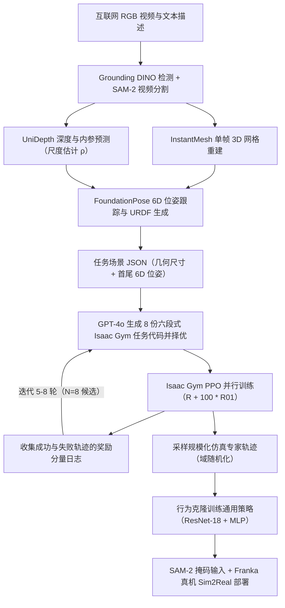

# Video2Policy: Scaling up Manipulation Tasks in Simulation through Internet Videos

## 一句话定义

Video2Policy 是一个从互联网 RGB 视频自动构建机器人仿真操作任务与策略的自动化框架，先从单视角视频重建物体网格、尺度与 6D 位姿轨迹，再由视觉语言模型（VLM）生成完整仿真任务代码并通过上下文奖励反思迭代训练强化学习（RL）策略，最终作为数据引擎蒸馏出可迁移至真机的通用模仿学习策略。

## 英文缩写速查

| 缩写 | 英文全称 | 简要说明 |
|---|---|---|
| VLM | Vision-Language Model | 视觉语言模型（本文使用 GPT-4o），用于理解视频语义并生成仿真任务与奖励代码 |
| SSv2 | Something-Something v2 | 包含丰富日常人手物体交互行为与语言描述的大规模视频数据集 |
| RL | Reinforcement Learning | 强化学习，本文在 Isaac Gym 中采用 PPO 算法自动求解生成的仿真操作任务 |
| BC | Behavior Cloning | 行为克隆，利用 RL 策略收集的多场景成功轨迹训练图像输入的通用操作策略 |
| CoT | Chain-of-Thought | 思维链提示方法，用于引导 VLM 分解任务目标并迭代分析训练日志以改进奖励函数 |
| EEF | End-Effector | 机械臂末端执行器，其状态与夹爪状态共同输入至 Sim2Real 通用策略 |

## 核心信息

| 字段 | 内容 |
|---|---|
| 论文标题 | *Video2Policy: Scaling up Manipulation Tasks in Simulation through Internet Videos* |
| 作者 | Weirui Ye, Fangchen Liu, Zheng Ding, Yang Gao, Oleh Rybkin, Pieter Abbeel |
| 机构 | Tsinghua University、Shanghai Qi Zhi Institute、Shanghai Artificial Intelligence Laboratory、UC Berkeley、UC San Diego（一作于 UC Berkeley 访问期间完成） |
| 发表时间 / 预印本 | arXiv:2502.09886v1（2025-02-14） |
| 论文链接 | [arXiv:2502.09886](https://arxiv.org/abs/2502.09886) |
| 项目主页 | [yewr.github.io/video2policy](https://yewr.github.io/video2policy) |
| 清单分类 | `data.collection`, `environment.reconstruction`, `environment.task_generation` |
| 来源条目 | `survey_ax_2502_09886` |
| 开源 / 验证范围 | 论文在 Isaac Gym 仿真（100+ 个 SSv2 视频覆盖 9 类任务 + 3 个自录高难度视频）及 Franka 真机上完成验证；正文给出项目网站，当前本地仓库未克隆或核查其代码发布状态 |

## 为什么重要

1. **用互联网人类视频替代纯文本想象与高成本数字孪生**：纯靠 LLM 凭空提出仿真任务（如 GenSim）容易出现物体资产与交互关系脱离真实分布的问题；而传统 Real2Sim 数字孪生高度依赖实景扫描与人工对齐，难以跨场景扩展。Video2Policy 直接从互联网 RGB 视频提取真实世界中的物体交互分布。
2. **摆脱对人工编写成功判据函数的依赖**：不同于 Eureka 依赖预先写好的真值任务代码与人工成功判据来迭代奖励，Video2Policy 利用视频首尾帧的 6D 位姿变化和视觉先验，让 GPT-4o 端到端生成包含重置、观测、成功判据与奖励在内的全部可执行任务代码。
3. **打通“视频 → 仿真 RL 数据引擎 → 通用视觉策略 → 真机”闭环**：单个仿真任务学会后可大规模采样专家轨迹，用于行为克隆（BC）训练跨物体/新类别泛化的通用策略，并结合分割掩码表征与域随机化迁移回真实 Franka 机械臂。

## 核心方法

Video2Policy 由三大阶段构成：

1. **阶段一：基于单视角 RGB 视频的场景重建（Scene Reconstruction）**
   - **目标定位与视频分割**：利用 SSv2 的文本描述（或自录视频的人工标注物体名）驱动 Grounding DINO 在首帧检测操作对象边界框，再在掩码内选取 5 个正样本点输入 SAM-2 进行全视频分割。
   - **单图网格重建与相对尺度估计**：选取首帧（若严重遮挡则改用末帧）通过 InstantMesh 重建 3D 网格；同时用 UniDepth 预测相机内参 $K$ 与深度图 $d_{i,j}$，在掩码像素区域内反投影计算真实最大跨度 $D_{\text{image}}$，结合网格顶点最大跨度 $D_{\text{mesh}}$ 得到缩放比例 $\rho = D_{\text{image}} / D_{\text{mesh}}$，自动生成物体 URDF。
   - **6D 位姿跟踪**：基于重建网格、相机内参与逐帧深度，使用基于模型的 FoundationPose 跟踪各物体在视频中的 6D 位姿序列，汇总生成任务 JSON 文件。
2. **阶段二：任务代码生成与上下文奖励迭代（Task Code Generation & RL）**
   - **六段式任务代码生成**：将任务 JSON、首尾帧 6D 位姿及其差值、视频描述与课程学习示例输入 GPT-4o，单次查询生成可在 Isaac Gym 运行的六部分代码：场景信息、`reset_objects_states`、`compute_success`、`compute_observation_key`、`get_observation_space` 与 `reward_function`。每次采样 8 份候选代码并由 GPT-4o 复核挑选最合理且可运行的一份作为基础候选。
   - **强化学习与奖励迭代**：以 PPO（`rl-games`，8192 并行环境，horizon=300）训练策略，训练奖励定义为 $\hat{R} + \lambda R_{0|1}$（$\lambda = 100$）。每轮采样 $N=8$ 个奖励函数训练并收集成功与失败轨迹的奖励分量日志，结合 CoT 示例提示 GPT-4o 反思调参（SSv2 任务迭代 5 轮，高难度自录视频迭代 8 轮）。
3. **阶段三：通用模仿学习策略与 Sim2Real 迁移**
   - 从学会的 RL 策略中批量采集成功轨迹（如每个任务 100 或 200 条 $256\times 256$ 图像与 7 维动作），使用 ResNet-18（堆叠 2 帧）+ 3 层 512 维 MLP 策略头做行为克隆。
   - 为缩小 Sim2Real 视觉与动力学差距，真机部署输入采用 SAM-2 分割掩码图像配合机械臂末端位姿（EEF）与夹爪状态（经 MLP 映射至 256 维特征），旋转动作缩放 0.2，并在仿真采样时加入动作噪声（0.02）、随机延迟（0.01–0.02 s）以及物体尺寸和质量随机化。

### 方法流程图

## 实验与评测

### 1. 仿真单任务策略学习对比（Table 1，Isaac Gym，3 个随机种子均值±标准差）

| 任务类别 | 任务名称 | Code-as-Policies | RoboGen | Eureka | Video2Policy（本文） |
|---|---|---|---|---|---|
| 单物体（SSv2） | Push sth. left | 0.17±0.13 | 0.93±0.05 | 1.00±0.00 | **1.00±0.00** |
| 单物体（SSv2） | Push sth. right | 0.75±0.12 | 1.00±0.00 | 1.00±0.00 | **1.00±0.00** |
| 单物体（SSv2） | Lift up sth. | 0.33±0.21 | 0.28±0.09 | 0.83±0.13 | **0.93±0.05** |
| 单物体（SSv2） | Tip sth. over | 1.00±0.00 | 0.97±0.05 | 0.67±0.47 | **1.00±0.00** |
| 多物体（SSv2） | Cover sth. with sth. | 0.00±0.00 | 0.00±0.00 | 0.00±0.00 | **0.07±0.05** |
| 多物体（SSv2） | Uncover sth. from sth. | 0.10±0.08 | 0.67±0.26 | 0.63±0.38 | **0.97±0.05** |
| 多物体（SSv2） | Push sth. with sth. | 0.03±0.05 | 0.03±0.05 | **0.47±0.38** | 0.43±0.40 |
| 多物体（SSv2） | Push sth. next to sth. | 0.80±0.16 | 0.23±0.05 | 0.83±0.12 | **1.00±0.00** |
| 多物体（SSv2） | Drop sth. in front of sth. | 0.53±0.31 | 0.37±0.09 | 0.87±0.17 | **0.93±0.05** |
| 自录高难度动作 | Insert Fork into Container | 0.07±0.05 | 0.27±0.38 | 0.57±0.40 | **0.93±0.05** |
| 自录高难度动作 | Sliding Remoter to Mouse | 0.00±0.00 | 0.53±0.12 | 0.87±0.05 | **0.97±0.05** |
| 自录高难度动作 | Throw Garlic into Bowl | 0.00±0.00 | 0.03±0.05 | 0.37±0.29 | **0.70±0.36** |
| **全 12 任务均值** | **Average** | 0.34 | 0.45 | 0.71 | **0.88** |

### 2. 跨视频泛化与规模扩展性（Sec. 4.2）

- **100 个 SSv2 抓取举起任务训练 → 10 个未见视频测试（5 个新形状/纹理 + 5 个未见类别）**：基于 V2P 数据的 `BC-V2P` 平均成功率达 **75%**，显著超越基于状态的 `CoP`（32%）和 `BC-CoP`（26%）。
- **任务规模扩展曲线（Fig. 6）**：训练视频任务数 $N$ 从 10 增至 100 时，10 个新任务平均成功率单调提升（0.13 → 0.39 → 0.45 → 0.55 → 0.60 → 0.64 → 0.65 → 0.69 → 0.74 → **0.75**）。

### 3. Sim2Real 真机迁移（Table 2，Franka + Robotiq + Stereolabs）

在 100 个举起任务各采集 200 条轨迹训练通用策略（仿真 10 个新物体平均成功率 **72%**），真机测试 3 类物体（含仿真未见且柔软的面包），物体位置在 10 cm 范围内随机变化：
- **Mouse**：0.50 | **Cup**：0.40 | **Bread（未见柔软物体）**：0.50 | **真机平均成功率**：**0.47**（47%）。

### 4. 关键消融实验（Table 3, 4, 7, 8）

- **代码与奖励组件消融（Table 3，Lifting / Uncover / Throw 均值）**：完整 V2P **0.87**；去掉视觉信息仅用标题 0.75；去掉 8 选 1 成功判据筛选 0.57；去掉迭代奖励反思 0.48；每轮仅采样 1 个奖励函数 0.51。
- **6D 位姿跟踪信息消融（Table 7）**：完整 V2P **0.87** → 去掉 FoundationPose 跟踪降至 0.75（Eureka 为 0.61）。
- **GPT-4o 代码筛选抑幻觉（Table 8）**：无筛选幻觉率（不可运行 + 零分）0.40（不可运行 0.25、可运行零分 0.15）→ 筛选后降至 **0.19**（0.13 / 0.07）。
- **视觉前端模块失效率（Table 4，20 条 SSv2 视频）**：SAM-2 失效率最低（0.15），InstantMesh（0.35），FoundationPose（0.55），Grounding DINO（0.60），平均失效率 0.42。

## 与现有工作的对比

| 维度 | Code-as-Policies (2023) | RoboGen (2023) | Eureka (2023) | Video2Policy (本文) |
|---|---|---|---|---|
| 任务与场景来源 | 依赖人工搭建仿真/真机环境 | LLM 纯文本提议 + 资产生成 | 人工预写完整仿真任务代码 | **直接从互联网 RGB 视频重建物体与场景** |
| 成功判据生成 | 无需 RL 判据（脚本控制） | 无显式迭代成功判据校验 | 依赖人工预先编写真值成功函数 | **VLM 结合视频首尾帧 6D 位姿自动生成并择优** |
| 动态/复杂接触任务 | 难以控制速度，投掷等任务 0.00 | 多物体与投掷任务明显退化（0.03–0.37） | 缺乏视频视觉先验，方差较大 | **可自动生成速度与接触奖励，12 任务均值 0.88** |
| 通用策略数据引擎 | 未构建跨场景图像 BC 数据引擎 | 以单任务技能生成为主 | 聚焦单任务奖励搜索 | **百级视频规模化生成轨迹并验证 Sim2Real 迁移** |

## 常见误区或局限

1. **视觉重建管线累计失效率高**：附录 Table 4 显示在 20 条 SSv2 抽样视频中，Grounding DINO（0.60）与 FoundationPose（0.55）失效率较高，整体视觉前端平均失效率达 42%；对于严重遮挡的视频还需人工挑选首帧或末帧用于网格重建。
2. **仅向 VLM 提供首尾两帧位姿对复杂中间过程表达有限**：为适配随机初始化，提示仅输入第一帧和最后一帧的 6D 位姿及差值，对于强依赖中间轨迹形态的动作仍高度依赖文本描述补充，覆盖任务（如 `Cover sth. with sth.` 成功率仅 0.07）依然困难。
3. **生成的成功判据存在过度乐观偏差**：Fig. 10 表明虽然加入视觉信息使生成成功判据与真值判据相关系数从 0.557 提高到 0.834，但散点多位于 $y=x$ 下方，即自动判据往往比真实人工判据更宽松。
4. **真机部署依赖第一帧人工点选提示**：真机闭环使用 SAM-2 分割掩码来跨越视觉域差距，需要在第一帧人工提供目标物体的像素点提示；光滑表面（如杯子，真机成功率 40%）仍是抓取瓶颈。

## 结论

**一句话总判：Video2Policy 证实了利用互联网日常操作视频自动重建仿真场景并驱动 VLM-RL 联合演化，是突破机器人仿真任务多样性与人工奖励工程瓶颈的可行数据引擎路径。**

1. **视频视觉先验显著优于纯文本提议**：结合首尾帧 6D 位姿与图像语义，使 VLM 生成任务代码在 12 项基准上达到 0.88 平均成功率，大幅领先纯文本的 RoboGen（0.45）与无视觉信息的 Eureka（0.71）。
2. **迭代奖励反思 + 多候选采样不可替代**：消融实验显示，去掉迭代奖励反思（0.87 → 0.48）与单样本生成（0.87 → 0.51）是导致 RL 学习崩塌的最大因素，算力预算应优先分配给迭代反馈而非单轮盲采。
3. **用分割掩码作观测桥梁加速 Sim2Real**：将 RGB 观测替换为 SAM-2 分割掩码，使策略在仿真未见过的柔软物体（面包）上也能取得 50% 真机零样本迁移表现，适合纹理差异大的桌面抓取任务借鉴。
4. **工程落地须强化前端检测与位姿容错**：当前管线最大瓶颈在 Grounding DINO 与 FoundationPose 的 55%–60% 失败率，后续引入更强开放词汇检测或跳过显式 6D 跟踪直接以密集点追踪替代将进一步提升自动吞吐量。

## 关联页面

- [Agentic Robots 综述](paper-towards-agentic-robots-survey.md)
- [全量项目节点清单](../overview/awesome-agentic-robots-node-index.md)
- [Eureka: LLM 奖励函数自动设计](paper-eureka-llm-reward-design.md)
- [Code as Policies 论文节点](paper-pai-2209-07753-codeaspolicies.md)
- [Video-as-Simulation 概念页](../concepts/video-as-simulation.md)
- [Sim2Real 迁移基础](../concepts/sim2real.md)

## 参考来源

- [官方 Awesome 快照归档](../../sources/repos/awesome-agentic-robots-survey-index.md)
- [arXiv:2502.09886v1 论文页面](https://arxiv.org/abs/2502.09886)
- [Video2Policy 官方项目页](https://yewr.github.io/video2policy)
