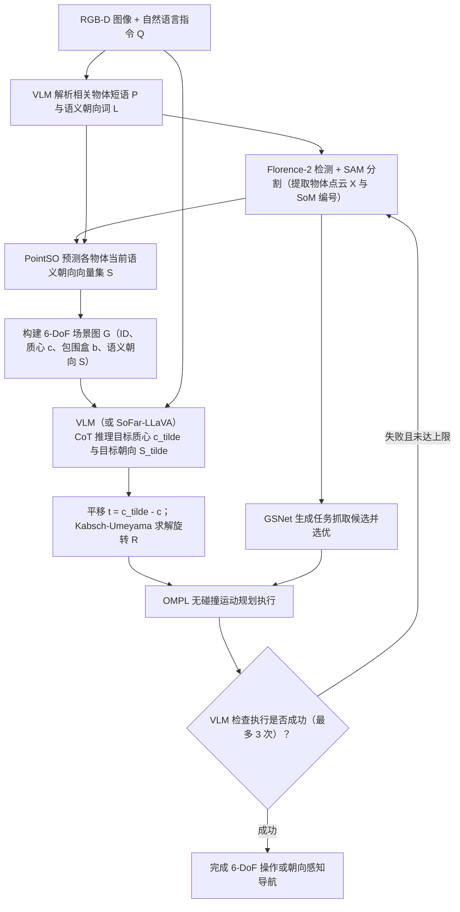

# SoFar: Language-Grounded Orientation Bridges Spatial Reasoning and Object Manipulation

## 一句话定义

SoFar 是一套面向开放世界 6-DoF 机器人操作与空间推理的框架，通过提出无参考系限制的语言接地“语义朝向（Semantic Orientation）”表征、构建大规模 3D 朝向数据集 `OrienText300K` 并训练跨模态点云模型 `PointSO`，将物体的位置与语言语义朝向统一编码进 6-DoF 场景图，赋能 VLM 零样本生成精准 6-DoF 操作变换与导航目标。

## 英文缩写速查

| 缩写 | 英文全称 | 简要说明 |
|---|---|---|
| SO | Semantic Orientation | 语义朝向，对应给定自然语言描述（部位或交互动作）的物体三维单位方向向量 |
| 6-DoF | Six Degrees of Freedom | 六自由度（3 维平移 + 3 维旋转），完整描述刚体在三维空间中的位姿变化 |
| VLM | Vision-Language Model | 视觉语言模型，在 SoFar 中负责任务物体/朝向短语解析与 6-DoF 思维链空间推理 |
| FPS | Farthest Point Sampling | 最远点采样，用于在 PointSO 中对物体点云下采样提取中心种子点 |
| SoM | Set-of-Mark | 视觉标记提示技术，为场景中分割出的每个物体分配唯一编号以便 VLM 引用 |
| VQA | Visual Question Answering | 视觉问答，本文中指用于评测方向与空间理解的 6-DoF SpatialBench 等任务 |

## 核心信息

| 字段 | 内容 |
|---|---|
| 论文标题 | *SoFar: Language-Grounded Orientation Bridges Spatial Reasoning and Object Manipulation* |
| 作者 | Zekun Qi, Wenyao Zhang, Yufei Ding, Runpei Dong, Xinqiang Yu, Jingwen Li, Lingyun Xu, Baoyu Li, Xialin He, Guofan Fan, Jiazhao Zhang, Jiawei He, Jiayuan Gu, Xin Jin, Kaisheng Ma, Zhizheng Zhang, He Wang, Li Yi |
| 机构 | Tsinghua University、Shanghai Jiao Tong University、Galbot、Peking University、UIUC、ShanghaiTech University、Eastern Institute of Technology、Shanghai Qi Zhi Institute |
| 发表时间 / 预印本 | NeurIPS 2025；arXiv:2502.13143v2（2025-09-24） |
| 论文链接 | [arXiv:2502.13143](https://arxiv.org/abs/2502.13143) |
| 官方代码 / 发布入口 | [github.com/qizekun/SoFar](https://github.com/qizekun/SoFar) |
| 清单分类 | `model.perception` |
| 来源条目 | `survey_ax_2502_13143` |
| 开源 / 验证范围 | 论文发布项目主页、GitHub 仓库、HuggingFace 资源与两个新基准（Open6DOR V2、6-DoF SpatialBench），完成仿真与多种真机平台验证；当前本地仓库未克隆或运行验证该外部代码库 |

## 为什么重要

1. **补齐具身空间推理缺失的“朝向（Orientation）”维度**：现有空间理解 VLM（如 SpatialVLM、SpatialRGPT、RoboPoint）和可供性方法主要回答“物体在哪里（3-DoF 位置）”，却忽略“物体朝哪边”，无法胜任倒水、扶正酒杯、插拔接口、按特定方向摆刀柄等 6-DoF 任务。
2. **用自然语言替代刚性模板与局部坐标系**：传统 6D 位姿估计依赖类别级 CAD 模板或人为约定的局部轴，面对开放世界未见物体时难以对齐指令语义；语义朝向 $s_\ell^X \in S(2)$ 直接将“把手方向”“刀刃方向”“插头方向”等局部功能方向映射到单位矢量。
3. **纯互联网 3D 资产即可规模化训练且跨本体零样本泛化**：`OrienText300K` 利用 Objaverse 与 GPT-4o 自动标注，完全不依赖昂贵真机遥操作数据；输出的对象级 6-DoF 变换与机械臂本体解耦，可无缝部署于平行夹爪（Franka / WidowX / Google Robot）、灵巧手（UR5e + LeapHand）、吸盘（Flexiv）及四足机器人导航（Unitree GO2）。

## 核心方法

1. **语义朝向定义与 OrienText300K 数据集构建**
   - 对物体 $X$ 与开放词汇短语 $\ell$（通用方位、物体部件如 `handle`/`cap`，或交互动作如 `pour out`/`plug-in`），定义语义朝向为单位向量 $s_\ell^X = F(X, \ell) \in S(2)$。
   - 从 ~800K Objaverse 模型出发，用 GPT-4o 按 6 条标准（正交对齐、无地面、有意义、高质量、视图可区分、非场景）筛选出 350K+ 干净物体（208 样本人工验证筛选准确率 88.3%），Blender 渲染 800 万+张多视角图像，再由 GPT-4o 在 6 个正交视图中标注语义短语-视角索引对（人工验证准确率 97.1%）。
2. **PointSO 跨模态 3D 方向预测模型**
   - **点云与文本编码**：输入 10,000 点三维点云，经 FPS + KNN 划分为 512 个点块（每块 32 点）并由轻量 PointNet 提取局部几何特征，加上 `[CLS]` 令牌；语言短语 $\ell$ 经冻结的 CLIP ViT-B/32 文本编码器提取全局特征。
   - **跨模态融合与损失**：在 12 层 3D Transformer 的每一层通过**逐令牌相加（Addition）**将文本特征注入点云令牌（消融证明优于交叉注意力、乘法和拼接），最后由 MLP 头将 `[CLS]` 映射为单位方向向量，以负余弦相似度损失 $L_{\cos}(v, k) = 1 - \frac{v \cdot k}{\|v\|\|k\|}$ 优化（提供 Small 11.4M、Base 19.0M、Large 43.6M 三档规模）。
3. **SoFar 集成推理与 6-DoF 执行系统**
   - **任务解析与 6-DoF 场景图构建**：给定 RGB-D 图像与指令 $Q$，VLM 解析相关物体短语 $P$，由 Florence-2 + SAM 分割出物体点云 $X_i$ 并附加 SoM 标记；VLM 生成每个物体所需的朝向描述 $L_i$，调用 PointSO 预测当前语义朝向集 $S_i$，构成节点包含 `{短语与ID, 质心 c_i, 3D 包围盒 b_i, 语义朝向集 S_i}` 的 6-DoF 场景图 $G=(V,E)$。
   - **CoT 空间推理与位姿解算**：将文本化的 6-DoF 场景图、RGB 原图与指令输入 VLM（或微调的 `SoFar-LLaVA`），通过三步思维链输出目标质心 $\tilde{c}_i$ 与目标语义朝向集 $\tilde{S}_i$；据此直接计算平移 $t_i = \tilde{c}_i - c_i$，并用 Kabsch-Umeyama 算法由 $(S_i, \tilde{S}_i)$ 求解旋转矩阵 $R_i$。
   - **底层抓取、运动规划与闭环重试**：基于 Florence-2 + SAM 局部掩码调用 GSNet 生成抓取候选并结合启发式挑选最优抓取姿态，通过 OMPL 规划无碰撞轨迹；支持双系统 VLM 检验执行结果并在失败时最多重试 3 次以实现近似闭环纠错。

### 方法流程图

## 实验与评测

### 1. Open6DOR 6-DoF 重排基准评测（Table 1）

在 Isaac Sim（Open6DOR V1 感知任务）与新建的 robosuite/LIBERO 闭环执行基准 **Open6DOR V2**（4,535 个任务）上评测：

| 评测设置 | 方法 | Position Overall | Rotation Overall | 6-DoF Position | 6-DoF Rotation | 6-DoF Overall | 单次耗时 |
|---|---|---:|---:|---:|---:|---:|---:|
| Open6DOR V1（感知） | GPT-4V | 45.2% | — | — | — | — | — |
| Open6DOR V1（感知） | Dream2Real | 15.9% | 9.2% | — | — | — | — |
| Open6DOR V1（感知） | VoxPoser | 32.6% | 31.3% | 26.2% | 18.7% | 13.5% | 358.3 s |
| Open6DOR V1（感知） | Open6DOR-GPT | 74.9% | 41.1% | 84.8% | 40.0% | 35.6% | 126.3 s |
| Open6DOR V1（感知） | SoFar-LLaVA | 78.7% | 48.6% | 83.0% | 48.2% | 40.3% | 9.6 s |
| Open6DOR V1（感知） | **SoFar** | **93.0%** | **57.0%** | **92.7%** | **52.7%** | **48.7%** | **8.5 s** |
| Open6DOR V2（执行） | Octo | 47.2% | 8.0% | — | — | 17.2% | — |
| Open6DOR V2（执行） | OpenVLA | 47.6% | 8.2% | — | — | 17.6% | — |
| Open6DOR V2（执行） | **SoFar** | **67.0%** | **25.6%** | **63.7%** | **34.7%** | **25.7%** | 40 s |

### 2. SIMPLER-Env 零样本仿真操作对比（Table 4 & Table 5）

- **Google Robot（Table 4，SoFar 为纯 Zero-Shot，基线均在 OXE 上训练）**：
  - *Variant Aggregation* 总均值：SoFar **`0.676`** vs RT-2-X `0.661`、OpenVLA `0.411`、RT-1-X `0.397`、Octo-Base `0.012`。
  - *Visual Matching* 总均值：SoFar **`0.749`** vs RT-2-X `0.606`、RT-1-X `0.534`、OpenVLA `0.277`、Octo-Base `0.168`。
- **WidowX + Bridge（Table 5，SoFar 为 Zero-Shot）**：
  - 4 任务最终成功率均值：SoFar **`0.583`**（Put Spoon `0.583`、Put Carrot `0.667`、Stack Block `0.708`、Put Eggplant `0.375`），全面超越在 Bridge 上域内微调的 SpatialVLA（`0.427`）、RoboVLM（`0.313`）及 OXE 模型（Octo-Small `0.300`、OpenVLA `0.010`）。

### 3. 语义朝向预测与空间 VQA 评测（Table 2, 3, 6, 8）

- **OrienText300K 验证集（128 个人工标注物体，Table 2）**：`PointSO-L` 在 45° / 30° / 15° / 5° 阈值下准确率分别为 **81.25% / 78.13% / 72.66% / 65.63%**（均值 **74.42%**），`PointSO-B` 均值为 72.46%，`PointSO-S` 均值为 70.12%。
- **鲁棒性测试（Table 3，45° 阈值）**：`PointSO-L` 在单视角遮挡点云（76.56%）、高斯噪声（81.25%）、随机 $SO(3)$ 旋转（77.34%）及三者叠加（74.22%）下保持稳定。
- **6-DoF SpatialBench（223 个人工标注 VQA 样本，Table 6）**：SoFar 总分 **`43.9%`**（位置相对/绝对 `59.6% / 33.8%`，朝向相对/绝对 `54.6% / 31.3%`），优于 GPT-4o（`36.2%`）、RoboPoint（`33.5%`）、SpatialBot（`32.7%`）。
- **EmbSpatial-Bench（Table 8）**：SoFar **`70.88%`** vs Qwen-VL-Max（`49.11%`）、GPT-4V（`36.07%`）。

### 4. 真机零样本实验与消融（Table 9–13 & Sec. B.8）

- **60 项真机桌面重排任务（100+ 物体，每项重复 3 次，Table 13）**：
  - 位置赛道（25 任务）：SoFar **`85.3%`**、SoFar-LLaVA `81.3%` vs CoPa `74.7%`、ReKep-Auto `72.0%`；
  - 朝向赛道（20 任务）：SoFar **`43.3%`**、SoFar-LLaVA `35.0%` vs ReKep-Auto `23.3%`、CoPa `21.7%`；
  - 综合与 6-DoF 赛道（15 任务）：SoFar **`48.9%`**、SoFar-LLaVA `33.3%` vs ReKep-Auto `26.7%`、CoPa `20.0%`。
- **模块与数据规模消融（Table 9 & 10）**：去掉语义朝向仅保留 CoT 时，Open6DOR 6-DoF 总成功率从 **48.7%** 暴跌至 **13.7%**；`PointSO-B` 训练数据从 15K 扩增至 350K，平均朝向准确率从 42.58% 稳步升至 72.46%。
- **真机失败归因分布（Sec. B.8）**：31% 来自抓取问题（物体过小或抓取滑落），23% 来自语义朝向误差（如扶正/倒置需 `<5°` 精度），20% 来自 Florence-2 / Grounding DINO 开放词汇目标检测失误，其余为运动规划未建模手臂工作空间碰撞及复杂角度 VLM 推理错误。

## 与现有工作的对比

| 维度 | CoPa (2024) | ReKep (2024) | Orient Anything (2024) | OpenVLA / Octo 等端到端 VLA | SoFar (本文) |
|---|---|---|---|---|---|
| 朝向与几何表征 | 部件空间约束 | 3D 关键点约束（难完整表达刚体 6-DoF 姿态） | 仅支持 `front`/`top` 等基础通用朝向 | 隐式动作令牌，无显式 6-DoF 场景图 | **开放词汇语言接地语义朝向 $s_\ell^X \in S(2)$** |
| 零样本与提示工程 | 需部件定位模块 | 推理时常需针对任务定制复杂提示与超参 | 偏向感知分类，未闭环规划 | 依赖大规模机器人轨迹微调，跨场景易退化 | **无需任务定制提示，单目 RGB-D 零样本泛化多本体** |
| 6-DoF 推理与闭环 | 局部几何规划 | 支持多阶段关键点，但要求首帧所有点可见 | 无场景级 VLM 任务规划 | 端到端闭环高频但长程/朝向泛化受限 | **6-DoF 场景图 + VLM CoT + 最长 3 次失败重规划** |

## 常见误区或局限

1. **模块化串联带来的级联误差**：论文统计表明真机失败中 31% 源于底层 GSNet 抓取不稳定或滑动，20% 源于开放词汇检测错检或漏检，10%+ 来自底层规划未充分建模机械臂工作空间碰撞与操作物自身碰撞，导致物体虽推理正确却在抓放过程中发生旋转偏移。
2. **高精度朝向任务（<5°）仍有 23% 误差来源**：如“完全扶正/倒置瓶子”等对角度误差极敏感的任务，PointSO 在 5° 阈值下验证精度为 65.63%（Table 2），在部分对称或细长物体上仍可能出现偏差。
3. **重度依赖上游闭源/大型 VLM 与单帧深度精度**：虽然提出了 `SoFar-LLaVA` 开源微调版本，但在复杂 6-DoF 组合任务上仍与闭源 VLM（48.7% vs 40.3%；真机综合赛道 48.9% vs 33.3%）存在明显差距。
4. **Open6DOR V2 上闭环执行绝对成功率仍偏低**：尽管显著超越 Octo 与 OpenVLA（25.7% vs 17.2% / 17.6%），但 25.7% 的总体成功率反映出仅靠“单步重抓取+开环放置”在复杂障碍与难抓物体上仍有较大提升空间。

## 结论

**一句话总判：SoFar 通过语言接地的“语义朝向”弥补了具身多模态模型从 3-DoF 定位迈向 6-DoF 精准操作的最后一公里，在不依赖机器人动作微调的前提下实现了显著优于端到端 VLA 的零样本 6-DoF 泛化性能。**

1. **在 6-DoF 场景图中显式注入朝向信息是性能跃升的关键**：消融实验显示去掉语义朝向仅留 CoT 会使 Open6DOR 6-DoF 成功率从 48.7% 跌至 13.7%，说明位置关系无法替代朝向表征。
2. **PointSO 跨模态融合宜简不宜繁**：将短文本特征以逐层相加（Addition）注入点云令牌（72.46%），效果显著优于交叉注意力（66.21%）与拼接（55.86%），同时数据规模遵循明显的 Scaling Law（15K→350K 带来近 +30% 提升）。
3. **单目腕部 RGB-D 即可低成本复现**：相比多相机标定方案，SoFar 仅用单颗 RealSense D415 即可提取点云并跨机械臂、灵巧手、吸盘与四足机器人复用，工程部署门槛较低。
4. **落地时需重点加固抓取与碰撞约束**：近半数真机失败源自下游抓取滑脱（31%）和碰撞/死锁，建议在工程中配合更稳健的局部力控/自适应重抓取与完整的碰撞体建模。

## 关联页面

- [机器人视觉感知栈选型闭环](../queries/robot-perception-stack-selection-loop.md)
- [Agentic Robots 综述](paper-towards-agentic-robots-survey.md)
- [全量项目节点清单](../overview/awesome-agentic-robots-node-index.md)
- [3D 空间视觉问答（3D Spatial VQA）](../concepts/3d-spatial-vqa.md)
- [具身感知的六种空间表征](../concepts/embodied-perception-six-spatial-representations.md)
- [ReKep：基于关系关键点约束的时空推理](paper-aff-2409-01652-rekep-spatio-temporal-reasoning-of-relational-keypoint-c.md)
- [RoboPoint 论文节点](paper-robopoint.md)

- [机器人操作](../tasks/manipulation.md)：了解物体操作和抓取任务。

## 参考来源

- [官方 Awesome 快照归档](../../sources/repos/awesome-agentic-robots-survey-index.md)
- [arXiv:2502.13143v2 论文页面](https://arxiv.org/abs/2502.13143)
- [SoFar 官方 GitHub 仓库](https://github.com/qizekun/SoFar)
