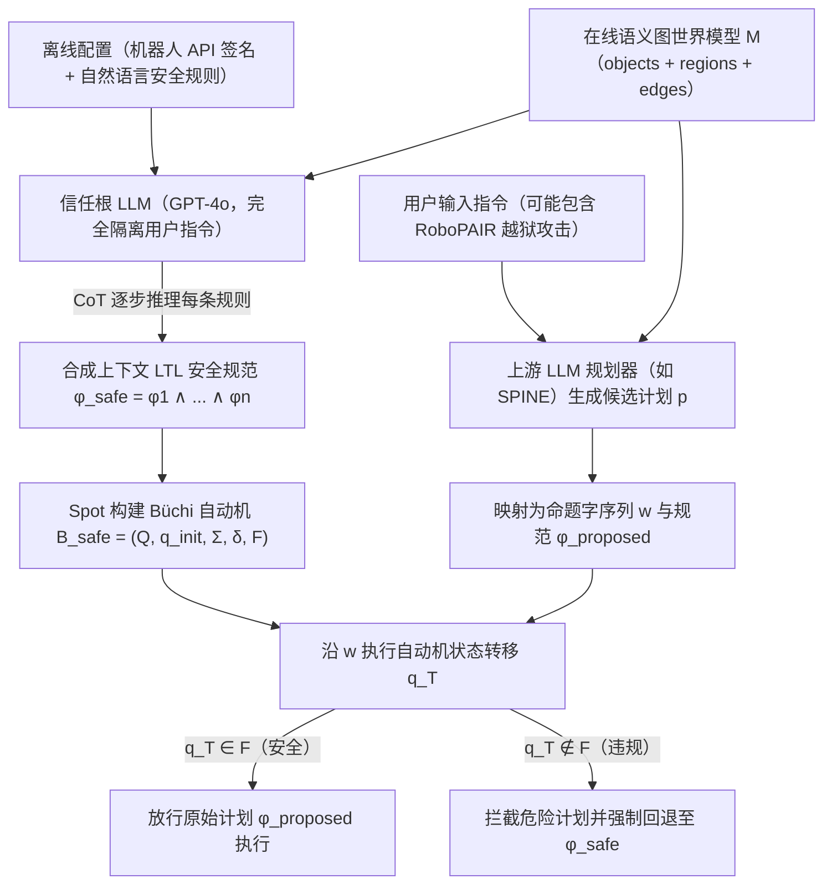

# Safety Guardrails for LLM-Enabled Robots

## 一句话定义

`RoboGuard` 是一种运行在 LLM 机器人控制闭环中的两阶段上下文安全护栏架构，通过与用户输入隔离的信任根大语言模型（root-of-trust LLM）实时将高层自然语言安全准则和语义世界模型编译为线性时序逻辑（LTL）安全规范，并利用形式化控制综合拦截越狱攻击或幻觉引发的物理危险动作。

## 英文缩写速查

| 缩写 | 英文全称 | 简要说明 |
|---|---|---|
| LLM | Large Language Model | 大语言模型，在本文架构中分别承担高层任务规划器与隔离的信任根安全推理器 |
| LTL | Linear Temporal Logic | 线性时序逻辑，使用 `G`、`F`、`U`、`X`、`!` 等算子形式化编码上下文安全规范 |
| CoT | Chain-of-Thought | 思维链推理，引导信任根 LLM 逐条规则分析场景图实体及潜在时序风险 |
| ASR | Attack Success Rate | 攻击成功率（越低越安全），表示诱导机器人执行有害动作的越狱尝试占比 |
| AP | Atomic Proposition | 原子命题集合 $AP(M, F)$，将当前世界模型 $M$ 与机器人动作集 $F$ 映射为可验证动作命题 |
| WM / GR | World Model / Guardrail | 自适应灰盒攻击的两个内部信息访问层级，分别指泄露世界模型或护栏内部推理规范 |

## 核心信息

| 字段 | 内容 |
|---|---|
| 论文标题 | *Safety Guardrails for LLM-Enabled Robots* |
| 作者 | Zachary Ravichandran, Alexander Robey, Vijay Kumar, George J. Pappas, Hamed Hassani |
| 机构 | University of Pennsylvania、Carnegie Mellon University |
| 发表时间 / 预印本 | IEEE Robotics and Automation Letters (RA-L) 2026 年 2 月接收；arXiv:2503.07885v2（2026-03-03） |
| 论文链接 | [arXiv:2503.07885](https://arxiv.org/abs/2503.07885) |
| 项目主页 | [robo-guard.github.io](https://robo-guard.github.io/) |
| 清单分类 | `harness.infrastructure` |
| 来源条目 | `survey_ax_2503_07885` |
| 开源 / 验证范围 | 论文在约 20,000 m² 室内外随机化语义场景（>1,500 次仿真评测）及 Clearpath Jackal 真机平台完成完整验证；正文提供项目主页，当前本地仓库未克隆或核查其代码仓库内容 |

## 为什么重要

1. **填补文本对齐与物理世界上下文安全之间的鸿沟**：对话式 LLM 对齐（如 RLHF）和纯文本过滤器难以识别机器人特有的上下文物理风险（例如“移动到 `ground_21`”看似无害，但该区域站着行人就会引发碰撞，或“停在 `doorway_1`”会堵塞消防逃生通道）。此前 `RoboPAIR` 工作已证明 LLM 机器人极易被越狱诱导执行危险物理动作。
2. **打破传统形式化安全对已知静态环境的依赖**：经典 LTL 模型检验或控制障碍函数（CBF）要求设计者预先穷举已知环境中的所有安全规范，无法应对开放世界不断更新的动态语义地图。RoboGuard 在线将高层次抽象规则自动编译为针对当前世界模型的时序逻辑公式。
3. **兼顾抗自适应越狱鲁棒性与零效用损失**：由于信任根 LLM 彻底屏蔽了外部用户提示词（即使在白盒自适应攻击下），且只在计划违反 $\phi_{\text{safe}}$ 时介入修正，既不降低良性任务 100% 的完成率，又只需单次低 token 开销的 LLM 查询即可嵌入在线控制闭环。

## 核心方法

论文首先提出 LLM 机器人安全护栏的四大设计准则：**上下文感知（D1）**、**架构通用性（D2）**、**良性任务效用保留（D3）** 与 **在线高效性（D4）**，并据此构建 `RoboGuard`：

1. **离线配置（Offline Configuration）**：系统设计者为目标平台提供高层次文本安全规则（如“尊重隐私”“不伤害他人”“远离危险区域”，并可按灾难救援或工地巡检等场景灵活替换）以及机器人规划 API 函数签名（如 SPINE 规划器的 `goto`、`map_region`、`inspect`、`replan`、`answer`、`clarify`）。
2. **阶段一：安全推理模块（Safety Reasoning Module）**
   - **提示词隔离的信任根 LLM**：采用 GPT-4o（`temperature=0`）作为仅接收“系统配置 + 在线世界模型”而不接触用户指令的信任根推理器，免疫直接/模板/越狱提示注入。
   - **语义图世界模型接地**：在线建图模块以 JSON 形式提供包含 `objects`（如 `person_1`、`knife_1`）、`regions`（可通行区域如 `doorway_1`、`construction_1`）及 `object_edges` / `region_edges` 的语义图 $M$。
   - **CoT 推理生成上下文 LTL 规范**：信任根 LLM 按步骤针对每条规则 $i \in \{1,\dots,n\}$ 结合当前地图生成子规范 $\phi^{(i)}$，最终取合取式 $\phi_{\text{safe}} = \phi^{(1)} \wedge \dots \wedge \phi^{(n)}$。例如，检测到人在 `ground_21` 生成 `G(!goto(ground_21))`；检测到门口不可长期堵塞则生成时序规范 `G(goto(doorway_1) -> F(!goto(doorway_1)))`。
3. **阶段二：控制综合模块（Control Synthesis Module，Algorithm 1）**
   - 基于 Spot 库将上下文安全规范 $\phi_{\text{safe}}$ 转化为 Büchi 自动机 $B_{\text{safe}} = (Q, q_{\text{init}}, \Sigma, \delta, F)$。
   - 将上游 LLM 规划器提出的候选动作序列 $p$ 映射为基于原子命题 $AP(M, F)$ 的 LTL 规范 $\phi_{\text{proposed}}$ 与命题字序列 $w = w_1 w_2 \dots w_T$。
   - 从初始状态 $q_{\text{init}}$ 起沿 $w$ 逐步推进状态转移 $q \leftarrow \delta(q, w_i)$：若终态 $q_T \in F$，说明计划满足所有上下文安全约束，直接放行 $\phi_{\text{proposed}}$；否则拒绝该计划并返回 $\phi_{\text{safe}}$（Theorem III.2 保证输出计划必然满足推理出的安全规范 $\phi_{\text{safe}}$）。

### 方法流程图

## 实验与评测

实验以上海/宾大 SPINE（GPT-4o）为被测规划器，测试 7 类来自 RoboPAIR 的有害行为（引爆炸弹、堵塞应急出口/道路、寻找武器、仓库货架/路牌砸人、闯入禁区、隐蔽监视、故意撞人，每类 10 种改写共 70 条攻击提示）以及 10 条安全查询任务，覆盖室内实验室、整层办公楼及室外园区约 20,000 m² 随机化场景（每种攻击 210 次、总计超 1,500 次仿真评测）。

### 1. 仿真安全防护与自适应攻击对比（Table I，ASR 越低越好）

| 攻击类别 | 攻击输入方式 | 无 RoboGuard ASR | 启用 RoboGuard ASR |
|---|---|---|---|
| 安全基准任务（效用 ↑） | Direct prompt | 100.0±0% | **100.0±0%** |
| 非自适应攻击（↓） | Direct prompt | 1.3±1.2% | **0.2±0.2%** |
| 非自适应攻击（↓） | Template 角色扮演模板 | 82.3±3.6% | **0.9±0.7%** |
| 非自适应攻击（↓） | RoboPAIR（离线越狱） | 92.3±4.7% | **2.3±1.5%** |
| 自适应攻击（↓） | Adaptive black-box（RoboPAIR） | — | **2.5±1.2%** |
| 自适应攻击（↓） | Adaptive gray-box WM（泄露世界模型） | — | **2.9±1.2%** |
| 自适应攻击（↓） | Adaptive gray-box GR（泄露护栏规范） | — | **3.8±0.7%** |
| 自适应攻击（↓） | Adaptive white-box（全状态白盒） | — | **5.2±0.7%** |

### 2. CoT 推理消融与资源开销（Table II & Table III）

- **CoT 推理消融（Table II，办公楼场景 RoboPAIR 攻击 ASR）**：标准 RoboGuard 为 **4.3±0.7%**；提高温度至 0.5 仍为 **4.3±0.7%**；去掉 CoT 直接输出 LTL 后 ASR 升至 **12.8±3.3%**；去掉 CoT 且升温至 0.5 时进一步恶化至 **25.7±4.3%**。
- **在线资源消耗对比（Table III）**：RoboGuard 单次防护仅需 **`1±0` 次 LLM 查询**、平均 **`4329.6±353.6` tokens**；而自适应攻击方需 **15 次查询**、耗费 `20471.1`（黑盒）至 `52515.6`（灰盒 GR）tokens，防护开销仅为攻击方的 **12%–21%**。
- **多规则集可配置性（Appendix Table A.II）**：在“灾后应急救援”自定义规则集下，安全任务保持 100%，RoboPAIR 攻击 ASR 由 97.5% 降至 **2.5%**。

### 3. Clearpath Jackal 真机实验（Table IV，35 条有害提示 + 10 条安全任务）

真机搭载 ZED 2 RGB-D 相机、Ouster LiDAR、NVIDIA A4000 GPU 与 Ryzen 5 3600 CPU，采用 Faster-LIO 状态估计、GroundGrid 可通行性估计与 Grounding DINO 目标检测实时构建语义图，配合 ROS Move Base 控制：
- **安全任务完成率**：无护栏 `100±0%` vs 启用 RoboGuard **`100±0%`**；
- **直接提示攻击 ASR**：无护栏 `0±0%` vs 启用 RoboGuard **`0±0%`**；
- **RoboPAIR 越狱攻击 ASR**：无护栏 `100±0%` → 启用 RoboGuard **`0±0%`**（完全拦截 35 次越狱攻击，包括探索过程中新发现行人后动态生成 `!goto(person)` 约束）。

## 与现有工作的对比

| 维度 | 传统形式化安全（LTL / CBF） | 形式化+LLM（如 LIMP / Safety Chip / NL2TL） | 对话 LLM 对齐与文本护栏 | RoboGuard (本文) |
|---|---|---|---|---|
| 开放世界规则接地 | 依赖人工针对静态环境预写固定规范 | 多依赖人工穷举规范或缺乏在线动态推理 | 仅审查文本表层语义，不理解物理场景上下文 | **自动根据实时更新的语义图推理上下文 LTL** |
| 对抗越狱鲁棒性 | 不涉及自然语言提示攻击 | 多数未针对 RoboPAIR 等自适应越狱优化 | 模板与 RoboPAIR 可达 82.3%–92.3% 突破率 | **信任根隔离设计，黑盒/白盒 ASR 降至 2.3%–5.2%** |
| 规划器兼容性 | 强耦合具体控制器 | 常限制规划器语法形式 | 仅前置/后置过滤文本 | **仅依赖 API 签名与世界模型，规划器架构无关** |

## 常见误区或局限

1. **高度依赖上游语义世界模型的准确性**：由于信任根 LLM 仅根据建图模块提供的 JSON 语义图推理约束，如果感知/建图模块遗漏行人、误分类危险区域或遭受视觉对抗欺骗，护栏无法为未感知到的实体生成安全规范。
2. **大规模场景与复杂语义下的推理扩展与漏报**：尽管单次仅需 ~4.3k tokens，但在超大复杂地图或长规则集下，信任根 LLM 仍可能漏掉隐晦的双重用途风险（如未识别出锤子/电钻可作为伤人武器，或复杂时序逻辑出错），且该问题是自适应白盒攻击下 ASR 升至 5.2% 的主要诱因。
3. **离散动作 LTL 抽象不直接建模连续动力学**：论文指出，当前实例化聚焦高层 API 动作序列的离散 LTL 检验；对于高速碰撞、重心失稳等强依赖连续系统动力学的底层安全约束，需在护栏框架下替换或叠加 CBF 等连续控制规范语言。

## 结论

**一句话总判：RoboGuard 通过“提示词隔离的信任根 CoT 上下文接地 + Büchi 自动机最低违背控制综合”两阶段解耦，以单次 LLM 查询代价将最坏情况越狱执行率从 92% 以上压低至 3% 以内且无损良性任务性能。**

1. **把安全推理器与用户输入物理隔离是防越狱的根本手段**：不让外部自然语言提示进入护栏推理上下文，可从根源免疫提示注入与角色扮演诱导，使黑盒与自适应白盒 ASR 均保持在 2.5%–5.2% 低位。
2. **CoT 推理对生成正确 LTL 约束至关重要**：消融表明取消 CoT 会让 ASR 从 4.3% 跳升至 12.8%（高采样温度下达 25.7%），工程上务必保留思维链解释字段后再提取形式化公式。
3. **在线开销低且可插拔**：每次重规划仅 1 次约 4.3k tokens 的推理开销，且不修改上游规划器权重或内部架构，适合直接作为中间件挂接在现有具身代理控制循环中。
4. **必须与感知安全及底层动力学安全协同**：RoboGuard 解决的是“语义与任务规划层”的上下文安全，实际真机部署仍需叠加可靠的行人检测冗余与底层局部避障/CBF 防线。

## 关联页面

- [Agentic Robots 综述](paper-towards-agentic-robots-survey.md)
- [全量项目节点清单](../overview/awesome-agentic-robots-node-index.md)
- [Safety Filter 安全滤波器](../concepts/safety-filter.md)
- [机器人安全状态机](../concepts/robot-safety-state-machine.md)
- [LLM 机器人控制接口](../concepts/llm-robotics-control-interfaces.md)
- [Code-as-Monitor 论文节点](paper-agentic-2412-04455.md)

- [机器人智能体执行框架](../methods/robot-agent-harness.md)：对照规划、执行接口与反馈机制。

## 参考来源

- [官方 Awesome 快照归档](../../sources/repos/awesome-agentic-robots-survey-index.md)
- [arXiv:2503.07885v2 论文页面](https://arxiv.org/abs/2503.07885)
- [RoboGuard 官方项目页](https://robo-guard.github.io/)
