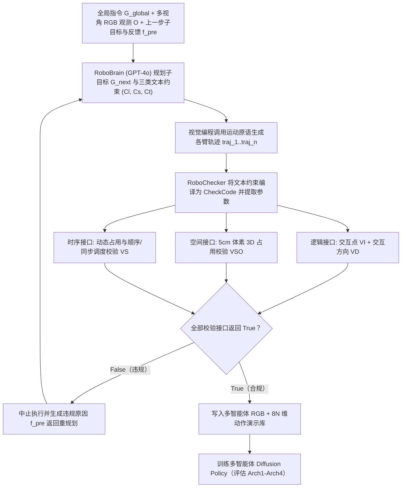

# RoboFactory: Exploring Embodied Agent Collaboration with Compositional Constraints

## 一句话定义

`RoboFactory` 是一个基于组合约束（Compositional Constraints）的多具身智能体协同操作数据自动生成框架与基准平台，由视觉语言规划器 `RoboBrain` 生成子目标、无约束运动原语轨迹及三类文本约束，再经 `RoboChecker` 将文本约束编译为可感知物理世界的校验接口（交互点/方向、3D 体素占用、动态时序调度），自动产出安全高效的多臂协同训练数据。

## 英文缩写速查

| 缩写 | 英文全称 | 简要说明 |
|---|---|---|
| VLM | Vision-Language Model | 视觉语言模型（本文使用 GPT-4o），负责理解多视角图像并生成子目标、约束与检查代码 |
| DP | Diffusion Policy | 扩散策略，本文在 RoboFactory 基准上评测的主要模仿学习基线方法 |
| IL | Imitation Learning | 模仿学习，通过采集的专家演示训练单臂或多臂控制策略 |
| ACT | Action Chunking with Transformers | 结合条件变分自编码器与 Transformer 的动作分块模仿学习方法 |
| DoF | Degrees of Freedom | 自由度，基准采用 7-DoF Franka Emika Panda 机械臂加 1 维夹爪（单臂 8 维动作） |
| VSO / VS | Validate Spatial Occupancy / Validate Scheduling | RoboChecker 中的空间占用校验与轨迹调度校验接口函数 |

## 核心信息

| 字段 | 内容 |
|---|---|
| 论文标题 | *RoboFactory: Exploring Embodied Agent Collaboration with Compositional Constraints* |
| 作者 | Yiran Qin, Li Kang, Xiufeng Song, Zhenfei Yin, Xiaohong Liu, Xihui Liu, Ruimao Zhang, Lei Bai |
| 机构 | The Chinese University of Hong Kong (Shenzhen)、Shanghai Artificial Intelligence Laboratory、Oxford、HKU、Sun Yat-sen University、Tongji University、Shanghai Jiao Tong University |
| 发表时间 / 预印本 | arXiv:2503.16408v1（2025-03-20） |
| 论文链接 | [arXiv:2503.16408](https://arxiv.org/abs/2503.16408) |
| 项目主页 | [iranqin.github.io/robofactory](https://iranqin.github.io/robofactory/) |
| 清单分类 | `data.collection` |
| 来源条目 | `survey_ax_2503_16408` |
| 开源 / 验证范围 | 论文基于 ManiSkill 与 PartNet-Mobility 资产构建 11 个 1–4 臂任务（每任务预采集 150 条演示）并完成 Diffusion Policy 评测与消融；正文提供项目主页，当前本地仓库未克隆或核查其代码发布状态 |

## 为什么重要

1. **解决多具身协同训练数据极度稀缺且遥操作难以扩展的痛点**：单臂数据可通过单人遥操作或 LLM 运动原语自动采集，但多臂协同需要多人同步遥操作，且简单沿用单臂 LLM 规划极易出现抓错部位、臂间碰撞或无效死等，导致数据采集成功率极低。
2. **提出将抽象语言约束落地到物理校验的“组合约束接口”**：VLM 生成的文本约束无法直接约束连续关节轨迹；RoboFactory 将协同约束系统化拆解为**逻辑、空间、时序**三类，并用可计算的物理表征（交互点/法向、5 cm 离散体素占用、时序动态占用）实时拦截违规轨迹并触发重规划。
3. **填补“高层次多智能体协同规划 + 底层控制”基准空白，并给出多臂模仿学习架构实证规律**：系统对比了全局/局部视角与共享/独立策略四种组合，定量揭示现有扩散策略随智能体数量增至 3–4 个时成功率断崖下跌（49% → 10%）以及长程交接任务（`Long Pipeline Delivery` 0%）的瓶颈。

## 核心方法

1. **三类组合约束（Compositional Constraints）形式化**
   - **逻辑约束（$C_l$）**：规定合法的交互对象、接触点及夹爪朝向（如夹爪垂直于牛排、双臂分别抓相机左右手柄并保持水平高度一致）。
   - **空间约束（$C_s$）**：界定物理工作边界与多臂/环境碰撞规避规则（如防止智能体间在共享区域发生交叉碰撞）。
   - **时序约束（$C_t$）**：协调并行同步与先后依赖（如抬起长栏杆需双臂同步；先掀开锅盖再放食物；`Agent_2` 与 `Agent_4` 按时间错峰共享同一空间以提高效率）。
2. **RoboBrain 与 RoboChecker 双模块闭环数据生成**
   - **`RoboBrain`（GPT-4o）**：接收全局任务指令 $G_{\text{global}}$、全局视角与各臂第一视角 RGB 图像 $\mathcal{O}=\{o_{\text{global}}, o_1, \dots, o_n\}$、上一阶段子目标 $\mathcal{G}^{\text{pre}}$ 及违规反馈 $f^{\text{pre}}$，输出下一阶段各臂子目标 $\mathcal{G}^{\text{next}}$ 与结构化文本约束 $\mathcal{C}=\{C_l, C_s, C_t\}$，并利用视觉编程调用预定义运动原语生成无约束轨迹。
   - **`RoboChecker`（GPT-4o + 四类约束接口）**：将每条文本约束映射并提取参数为 `CheckCode`，绑定四大物理校验函数实时检测多臂轨迹：
     1. *交互方向校验*（`Validate_Direction` / `VD`）：核对抓取或按压姿态是否满足 3D 资产标注的交互方向；
     2. *交互接触点校验*（`Validate_Interaction` / `VI`）：核对交互是否作用于 3D 资产标注的合法接触部位（如手柄 vs 镜头、快门）；
     3. *3D 空间占用校验*（`Validate_Spatial_Occupancy` / `VSO`）：结合深度估计与机械臂关节绝对坐标，按 $5\text{ cm}\times 5\text{ cm}\times 5\text{ cm}$ 离散体素构建场景占用网格以检测碰撞；
     4. *动态占用与调度校验*（`Validate_Scheduling` / `VS`）：建模多臂沿时间步的动态空间占用，校验 `Sequential`（顺序）或 `Simultaneous`（同步）调度合理性。
   - 一旦任意校验返回 `False`，立即中止执行并将具体违规原因作为反馈 $f^{\text{pre}}$ 传回 `RoboBrain` 重规划；全校验通过的轨迹及 $320\times 240$ RGB 图像与 8 维关节动作存入数据集。
3. **RoboFactory 基准与四种多智能体模仿学习架构**
   - 基于 ManiSkill（SAPIEN + PartNet-Mobility 资产）搭建 11 个 1–4 臂 Franka Panda 协同任务，每任务预采集 150 条演示。
   - 测试 CNN 版 Diffusion Policy（预测时域 8、观测步 3、动作步 6），系统评估 4 种架构：`Arch1`（全局视角+共享策略，输出 $8N$ 维联合动作）、`Arch2`（局部视角+共享策略）、`Arch3`（全局视角+独立策略）与 `Arch4`（局部 egocentric 视角+独立策略）。

### 方法流程图

## 实验与评测

### 1. RoboFactory 基准 Diffusion Policy 主实验（Table 2，100 个随机化测试场景成功率）

默认采用表现最优的 `Arch4`（Local View + Separate Policy），分别用 50、100、150 条演示训练 300 epochs：

| 智能体数量 | 任务名称 | 50 Demo | 100 Demo | 150 Demo |
|---|---|---:|---:|---:|
| 1-Agent | Pick Meat / Stack Cube / Strike Cube（均值） | 32% / 17% / 26% (**25%**) | 61% / 38% / 42% (**47%**) | 58% / 44% / 45% (**49%**) |
| 2-Agent | Pass Shoe / Place Food / Lift Barrier / Two Robots Stack Cube（均值） | 9% / 5% / 24% / 14% (**13%**) | 20% / 23% / 60% / 27% (**32.5%**) | 12% / 20% / 58% / 20% (**27.5%**) |
| 3-Agent | Camera Alignment / Three Robots Stack Cube（均值） | 7% / 8% (**7.5%**) | 10% / 2% (**6%**) | 19% / 22% (**20.5%**) |
| 4-Agent | Take Photo / Long Pipeline Delivery（均值） | 5% / 0% (**2.5%**) | 8% / 0% (**4%**) | 20% / 0% (**10%**) |

关键发现：随着协作智能体数从 1 增至 4，最优平均成功率从 **49%** 依次下降至 **32.5%**（100 demo）/ **27.5%**（150 demo）→ **20.5%** → **10%**；需长程交接的 4 臂任务 `Long Pipeline Delivery` 在各数据量下均为 **0%**。

### 2. 四种多智能体模仿学习架构对比（Table 3，150 条演示）

| 架构编号 | 策略共享方式 | 观测视角范围 | Lift Barrier（双臂同步） | Place Food（异构分工） |
|---|---|---|---:|---:|
| Arch1 | Shared（共享参数） | Global（全局视角） | 49% | 5% |
| Arch2 | Shared（共享参数） | Local（第一视角） | 4% | 0% |
| Arch3 | Separate（独立策略） | Global（全局视角） | 26% | 17% |
| **Arch4** | **Separate（独立策略）** | **Local（第一视角）** | **58%** | **20%** |

- 共享策略配第一视角（Arch2）几乎完全失效（4% / 0%），因为模型无法仅凭局部视野区分当前身份与分工；
- 异构协同任务（如 `Place Food` 需一臂掀盖、一臂放食物）上，独立策略明显优于共享策略（17%–20% vs 0%–5%）；
- 第一视角在细节操作上普遍优于全局视角（26%→58%，17%→20%）。

### 3. 组合约束消融实验（Table 4 & Table 5，有效数据生成成功率 ↑ 与平均回合长度 ↓）

| Logical | Spatial | Temporal | Lift Barrier 成功率 / 步长 | Three Robots Stack Cube 成功率 / 步长 | Take Photo 成功率 / 步长 |
|---|---|---|---:|---:|---:|
| ✓ | ✗ | ✗ | 80.2% / 123 | 62.5% / 685 | 37.1% / 407 |
| ✓ | ✗ | ✓ | 85.4% / 92.8 | 84.2% / 452 | 62.2% / 238 |
| ✓ | ✓ | ✗ | 95.2% / 115 | 92.7% / 652 | 53.8% / 325 |
| **✓** | **✓** | **✓** | **97.5% / 80.7** | **98.9% / 424** | **88.2% / 204** |

加入空间与时序约束不仅将 4 臂复杂任务 `Take Photo` 的数据生成成功率从 37.1% 提升至 **88.2%**，还通过并行调度将平均回合长度压缩约一半（407 → 204 步、685 → 424 步）。

## 与现有工作的对比

| 维度 | RoboCasa / EgoPlan-Bench / MMWorld | RoboTwin (2024) | Code-as-Monitor (2024) | RoboFactory (本文) |
|---|---|---|---|---|
| 智能体规模 | 单智能体为主 | 支持单臂及双臂 | 单智能体监控 | **支持 1–4 具身智能体协同操作（11 项基准任务）** |
| 任务层级 | 偏规划或单臂技能 | 规划与控制 | 故障检测监控 | **高层协同规划 + 运动原语数据生成 + IL 策略评测** |
| 约束机制 | 依赖固定脚本或手工环境 | 数字孪生与代码生成 | 单臂关键点/约束监控 | **逻辑+空间（5 cm 体素）+时序（动态占用调度）三维组合约束** |

## 常见误区或局限

1. **多臂模仿学习基线仍未解决“分散感知-独立决策”的协同瓶颈**：基准测试的 Arch4 为每台机械臂单独训练独立策略且完全不交换其他臂的状态或动作，导致跨臂时序协调困难（4 臂均分仅 10%，`Long Pipeline Delivery` 为 0%）。
2. **基于 5 cm 离散体素的约束难以建模精细物理现象**：论文明确指出，当前组合约束接口无法精确刻画复杂接触力学、弹性形变、滑移或精细插配等物理现象，限制了其在高精接触操作中的适用性。
3. **依赖资产先验标注与运动原语**：逻辑约束接口需要对 3D 资产预先标注交互位置（`handle1`、`shutter`）和交互方向；同时双臂任务在 150 条数据下相对 100 条略微下降（32.5% → 27.5%），论文分析可能与简单任务过拟合有关。

## 结论

**一句话总判：RoboFactory 通过“逻辑-空间-时序”组合约束与物理校验接口把多臂协同数据生成成功率推升至 88%–99%，同时其基准测试清晰暴露出当前单视图独立扩散策略在 3–4 臂长程协同上的显著短板。**

1. **多臂自动采集必须同时约束空间占用与时序调度**：缺空间约束易碰撞、缺时序约束易死等或乱序，三约束齐备时 `Take Photo` 采集成功率从 37.1% 翻倍至 88.2% 且轨迹长度减半。
2. **异构多臂模仿学习应优先采用独立策略参数**：对比实验证明在需不同技能分工的任务上，共享参数（0%–5%）远逊于独立策略（17%–20%），局部第一视角配合独立策略（Arch4）是目前最强基线配置。
3. **跨智能体显式通信与长程记忆是下一代多臂 VLA 突破口**：4 臂流水线传递任务 0% 的成功率表明，必须让策略具备全局/跨臂信息共享或联合条件建模能力，而非各臂盲目独立执行。

## 关联页面

- [Agentic Robots 综述](paper-towards-agentic-robots-survey.md)
- [全量项目节点清单](../overview/awesome-agentic-robots-node-index.md)
- [Diffusion Policy 扩散策略](../methods/diffusion-policy.md)
- [模仿学习基础](../methods/imitation-learning.md)
- [双臂协同操作任务](../tasks/bimanual-manipulation.md)
- [人形与多机器人协同](../concepts/humanoid-multi-robot-coordination.md)
- [ManiSkill3 GPU 并行仿真平台](paper-notebook-maniskill3-gpu-parallelized-robotics-simulation.md)
- [Code-as-Monitor 论文节点](paper-agentic-2412-04455.md)

## 参考来源

- [官方 Awesome 快照归档](../../sources/repos/awesome-agentic-robots-survey-index.md)
- [arXiv:2503.16408v1 论文页面](https://arxiv.org/abs/2503.16408)
- [RoboFactory 官方项目页](https://iranqin.github.io/robofactory/)
