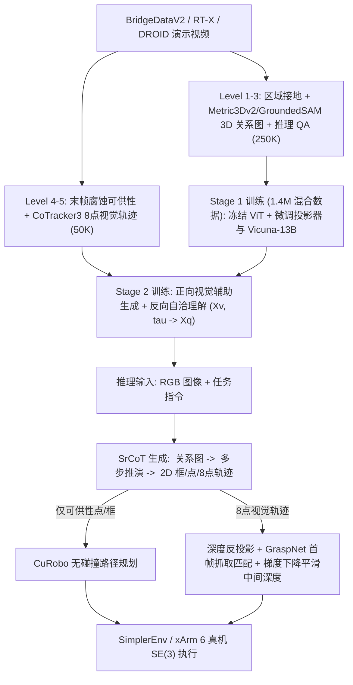

# From Seeing to Doing: Bridging Reasoning and Decision for Robotic Manipulation

## 一句话定义

`FSD`（From Seeing to Doing）是一个连接视觉空间推理与机器人零样本操作决策的视觉语言模型框架（13B），通过以空间关系图为锚点的视觉思维链（`SrCoT`）、五级弱到强具身数据管线以及正反向自洽坐标对齐，预测本体无关的 2D 空间可供性（框/点）与物体中心视觉轨迹（Visual Trace），再结合深度反投影与运动规划器完成跨本体零样本操控。

## 英文缩写速查

| 缩写 | 英文全称 | 简要说明 |
|---|---|---|
| FSD | From Seeing to Doing | 本文提出的 13B 空间推理与视觉辅助信号生成模型名称 |
| SrCoT | Spatial Relationship-Focused Visual Chain-of-Thought | 面向空间关系的视觉思维链，先建 `<Description>` 空间图再逐步推理坐标 |
| VLA | Vision-Language-Action | 视觉-语言-动作模型，本文旨在以中间视觉辅助表征克服端到端 VLA 泛化瓶颈 |
| VABench | Visual Aids Generation Benchmark | 本文人工标注的 300 题视觉辅助信号生成基准（含 Point 与 VisualTrace 两子集） |
| MAE / RMSE | Mean Absolute Error / Root Mean Squared Error | 平均绝对误差与均方根误差，用于评测归一化 $[0,1000]$ 空间下 8 点轨迹精度 |
| SFT | Supervised Fine-Tuning | 监督微调，本文分两阶段在 1.4M 混合通用问答与具身空间数据上微调模型 |

## 核心信息

| 字段 | 内容 |
|---|---|
| 论文标题 | *From Seeing to Doing: Bridging Reasoning and Decision for Robotic Manipulation* |
| 作者 | Yifu Yuan, Haiqin Cui, Yibin Chen, Zibin Dong, Fei Ni, Longxin Kou, Jinyi Liu, Pengyi Li, Yan Zheng, Jianye Hao |
| 机构 | Tianjin University |
| 发表时间 / 预印本 | ICLR 2026；arXiv:2505.08548v3（2026-04-05） |
| 论文链接 | [arXiv:2505.08548](https://arxiv.org/abs/2505.08548) |
| 项目主页 / 代码 | [embodied-fsd.github.io](https://embodied-fsd.github.io/) / [github.com/pickxiguapi/Embodied-FSD](https://github.com/pickxiguapi/Embodied-FSD) |
| 清单分类 | `data.annotation` |
| 来源条目 | `survey_ax_2505_08548` |
| 开源 / 验证范围 | 论文宣布公开代码、数据集与模型权重，并在 5 项通用空间推理、2 项指代基准、自建 VABench、SimplerEnv（WidowX）与 xArm 6 真机 8 任务上验证；当前本地仓库未克隆或运行核查外部代码与权重 |

## 为什么重要

1. **破解具身数据稀缺与本体异构对端到端 VLA 的限制**：不同机器人的动作空间与相机视角差异巨大，直接端到端监督学习从图像到关节/末端动作在未见背景与指令下极易崩塌（如 OpenVLA 在 SimplerEnv 零样本场景仅 5.2%）。FSD 改用**物体中心（object-centric）的 2D 视觉辅助表征**作为中间接口，彻底剥离机械臂本体形态差异。
2. **把坐标点预测转化为有锚点的多步空间关系推理**：单纯 SFT 直接监督坐标容易过拟合且难理解坐标物理含义。FSD 先构建显式绑定 `<ref>`、`<box>` 与 `<pred>` 的空间关系图，再推演起点、避障中间点与终点，并引入反向任务 $(X_v, \tau) \to X_q$ 强制对齐像素坐标与语言语义。
3. **兼具零样本高泛化与低延迟单次推理**：相比需要多模块串联的 MOKA（28 s / 18 s）或微调后步步推理的 OpenVLA（23 s / 12 s），FSD 单模型单次前向即可输出整条 8 点视觉轨迹（14 s / 10 s），并在真机折叠毛巾等复杂接触任务中实现零样本成功。

## 核心方法

1. **三类标准化 2D 视觉辅助表征（统一归一化至 `[0, 999]` 整数文本坐标）**
   - **空间可供性框（$\mathcal{B}=[x_1,y_1,x_2,y_2]$）**：定位未标记自由放置区域；
   - **空间可供性点（$\mathcal{P}=\{(x_i,y_i)\}$）**：从目标区域精细采样操作点；
   - **物体中心视觉轨迹（$\tau=\{x_t \mid t=1,\dots,T\}$，固定预测 8 个有序路标点）**：刻画抓起、绕障到放下的完整对象运动路径（即使图像中无机械臂也可生成）。
2. **空间关系聚焦视觉思维链（SrCoT）**
   - **`<Description>` 阶段**：输出带坐标绑定的物体描述与相对方位关系（如 `<ref>broccoli</ref><box>...</box>` 位于 `<ref>silver pot</ref>` 左侧），建立任务相关的空间关系图；
   - **`<Reasoning>` 阶段**：以关系图节点坐标为锚点，逐步推导起始抓取点、抬升避障弧线中间点与终点区域；
   - **`<Answer>` 阶段**：输出标准化 `<box>` 与 `<point>` 序列。
3. **五级弱到强自动数据构建与两阶段自洽训练（基于 BridgeDataV2、RT-X、DROID 筛选构建 300K FSD 数据 + 通用 VQA 组成 1.4M 混合集）**
   - **Level 1 区域接地（145k）**：GPT-4o + Grounding DINO 生成任务相关区域图文对齐；
   - **Level 2 空间关系（86k）**：GroundedSAM + Metric3Dv2 + WildCamera + PerspectiveFields 重建伪 3D 场景图（筛选相对深度差 >20% 的物体对）；
   - **Level 3 空间推理问答（19k）**：基于场景图模板与 GPT-4o 生成多跳推理 QA；
   - **Level 4 空间可供性（24k）**：由成功演示末帧掩码腐蚀后均匀采样 8 点反投影回首帧；
   - **Level 5 视觉轨迹（26k）**：提取操作物体首帧 3 个关键点，用 CoTracker3 追踪全视频取最长轨迹并三次样条平滑后等距采样 8 点（每批抽检 100 例需 >95% 准确率方通过过滤）。
   - **两阶段训练（基于 ASMv2 / LLaVA-1.5 架构：冻结 CLIP-ViT-L-336px + 训练两层线性投影器与 Vicuna-13B，8×A100 40G）**：Stage 1（1 epoch，72 小时）混合 838k GeneralQA + 295k 通用空间推理 + 250k FSD L1–L3 强化空间推理；Stage 2（3 epochs，8 小时）利用 FSD L4–L5 联合训练正向生成 $(X_v, X_q)\to\tau$ 与反向理解 $(X_v, \tau)\to X_q$ 自洽对齐。
4. **下游零样本动作执行**
   - 仅使用可供性框/点时调用 `CuRobo` 生成无碰撞规划路径；
   - 使用视觉轨迹时，利用深度图与针孔相机模型将 2D 路标点反投影至 3D，起点 $x_1$ 匹配 `GraspNet` 最近抓取姿态 $G^*$，并固定首尾深度 $d_1, d_T$、用梯度下降优化中间点深度 $d_{2:T-1}$ 以最小化三维路径总欧氏距离 $\sum d(P_i, P_{i+1})$，生成 $SE(3)$ 空间平滑运动轨迹。

### 方法流程图

## 实验与评测

### 1. 通用空间推理与自由空间指代基准（Table 1 & Table 2）

- **5 大通用空间推理基准（15 个子任务，Table 1）**：FSD-13B 综合平均排名 **`1.3`**（显著领先 RoboPoint-13B `2.8`、SAT-Dynamic-13B `2.8`、ASMv2-13B `3.1`、LLaVA-1.5-13B `4.8`），其中 CVBench 均值 `75.2`、CRPE 均值 `76.2`、BLINK 均值 `63.8`、EmbSpatial Test `62.4`。
- **物体与自由空间指代（Table 2）**：`RoboRefIt` 准确率 **`56.7%`**（超越 RoboPoint-13B `49.8%`、ASMv2-13B `48.4%`、GPT-4o `15.3%`）；`Where2Place` 达 `45.8%`（与 RoboPoint `46.0%` 持平，大幅领先 GPT-4o `29.1%`）。

### 2. VABench 视觉辅助生成基准与消融（Table 3）

| 模型 / 消融变体 | VABench-Point 准确率 ↑ | VABench-VisualTrace RMSE ↓ | VABench-VisualTrace MAE ↓ | GPT-Score (1-10) ↑ |
|---|---:|---:|---:|---:|
| GPT-4o | 9.30% | 136.13 | 113.53 | 4.37 |
| DINOv2 Predictor（同数据端到端训练） | — | 128.32 | 117.49 | 4.01 |
| RoboPoint | 19.09% | — | — | — |
| RoboBrain | 7.00% | 121.6 | 103.8 | 4.5 |
| ASMv2 | 10.07% | — | — | — |
| **FSD（完整模型）** | **61.82%** | **78.26** | **63.44** | **6.21** |
| FSD w/o SrCoT | 26.21% | 99.53 | 80.06 | 5.07 |
| FSD w/o Self-Consistency Alignment | 55.92% | 80.48 | 66.80 | 5.92 |

### 3. 零样本机械臂操作与真机耗时评测（Table 4 & Table 5 & Sec. 6.2）

- **SimplerEnv WidowX 仿真（Table 4，每项 24 回合，FSD 为 Zero-Shot）**：
  - FSD 四任务平均成功率 **`40.6%`**（Put Spoon on Towel `41.6%`、Put Carrot on Plate `50.0%`、Stack Green Block `33.3%`、Put Eggplant `37.5%`），远超零样本对比基线 RoboPoint（`17.7%`）及 MOKA（`33.3%`），并显著高于同在 BridgeData 训练的 Octo（`26.7%`）、$\pi_0$（`27.1%`）与 OpenVLA（`5.2%`），接近 OpenVLA-OFT（`41.8%`）与 $\pi_0$-fast（`48.3%`）。
- **xArm 6 真机零样本 8 项桌面任务（RealSense L515 单目 RGB-D + 末端力矩柔顺控制）**：FSD 平均成功率达 **`72%`**，超越最强对比基线（GPT-4o、MOKA、RoboPoint）**30% 以上**，并成功零样本完成擦白板、拉抽屉与折叠毛巾等任务。
- **真机执行总耗时对比（Table 5）**：在 Sponge / Cucumber 任务上，FSD 仅需 **`14s / 10s`**，快于逐步自回归微调的 OpenVLA(FT)（`23s / 12s`）以及多模块串联的 MOKA（`28s / 18s`）。

## 与现有工作的对比

| 维度 | 端到端 VLA (OpenVLA / $\pi_0$ / Octo) | 模块化/可供性 VLM (MOKA / RoboPoint) | 视觉轨迹模型 (RoboBrain / LLaRVA) | FSD (本文) |
|---|---|---|---|---|
| 动作中间表示 | 直接预测离散或连续动作块 | 关键点/标记或局部可供性点 | 多为机器人中心轨迹或无显式 CoT | **物体中心 2D 可供性 + 8 点视觉轨迹** |
| 推理机制 | 直接映射或基础文本 CoT | 依赖手工提示或直接 SFT 坐标回归 | 直接回归，未构建空间关系图锚点 | **SrCoT 空间关系图锚定推理 + 正反自洽对齐** |
| 零样本泛化与耗时 | 背景/指令变化时易大幅跌落（OpenVLA 5.2%） | MOKA 多模块串行耗时高（28 s / 18 s） | LLaRVA 未微调新任务泛化受限 | **SimplerEnv 40.6% / 真机 72%（14 s / 10 s）** |

## 常见误区或局限

1. **主要工作在开环静态视角下，缺少动态闭环视觉重规划**：论文明确指出，当前执行流程先从单帧生成整条 2D 视觉轨迹再走训练无关运动规划，在极端动态或强干扰场景下缺乏高频视觉闭环反馈，成功率为上游规划所限制。
2. **限于 2D 图像空间投影与明确原子级指令**：目前预测坐标在 2D 图像平面 $[0, 1000]^2$ 内完成，复杂遮挡或大纵深旋转动作仍依赖单目深度及启发式中间深度平滑；面对模糊或超长程多步骤指令时，尚需进一步的任务拆解模块将其分解为原子视觉辅助序列。
3. **数据集自动构建高度依赖前沿视觉模型质量**：Level 1–5 管线串联了 GPT-4o、Grounding DINO、GroundedSAM、Metric3Dv2 与 CoTracker3，尽管经过阈值过滤与人工抽检（>95%），上游跟踪或深度噪声仍限制数据规模与上限。

## 结论

**一句话总判：FSD 证明了“物体中心 2D 视觉辅助表征 + 空间关系思维链（SrCoT）+ 正反自洽坐标对齐”能够有效释放通用 VLM 的空间常识，成为跨越具身数据匮乏与本体异构的一条高性价比零样本操控路线。**

1. **用关系图思维链替代黑盒坐标 SFT**：VABench-Point 消融显示去掉 SrCoT 会导致精度从 61.82% 暴跌至 26.21%，证明让模型先显式描述 `<ref>` 与 `<pred>` 空间关系是坐标精准定位的核心。
2. **“生成+理解”双向自洽训练以低成本提升空间精度**：Stage 2 仅用约 50K 样本训练 8 小时，加入逆向轨迹理解对齐即可把 VABench-Point 从 55.92% 推高至 61.82%、VisualTrace MAE 从 66.80 降至 63.44。
3. **物体中心表征比机器人中心轨迹更具跨本体潜力**：由于不预设画面里必须出现特定机械臂，FSD 能复用纯人类视频与跨平台数据，并作为显式条件信号喂给下游闭环 VLA 进一步演化。

## 关联页面

- [Agentic Robots 综述](paper-towards-agentic-robots-survey.md)
- [全量项目节点清单](../overview/awesome-agentic-robots-node-index.md)
- [VLA 方法背景](../methods/vla.md)
- [RoboPoint 论文节点](paper-robopoint.md)
- [OpenVLA 论文节点](paper-openvla.md)
- [π0 论文节点](paper-pi0.md)
- [具身感知的六种空间表征](../concepts/embodied-perception-six-spatial-representations.md)
- [3D 空间视觉问答（3D Spatial VQA）](../concepts/3d-spatial-vqa.md)

- [机器人操作](../tasks/manipulation.md)：了解物体操作和抓取任务。

## 参考来源

- [官方 Awesome 快照归档](../../sources/repos/awesome-agentic-robots-survey-index.md)
- [arXiv:2505.08548v3 论文页面](https://arxiv.org/abs/2505.08548)
- [FSD 官方项目页](https://embodied-fsd.github.io/)
- [Embodied-FSD GitHub 仓库](https://github.com/pickxiguapi/Embodied-FSD)
