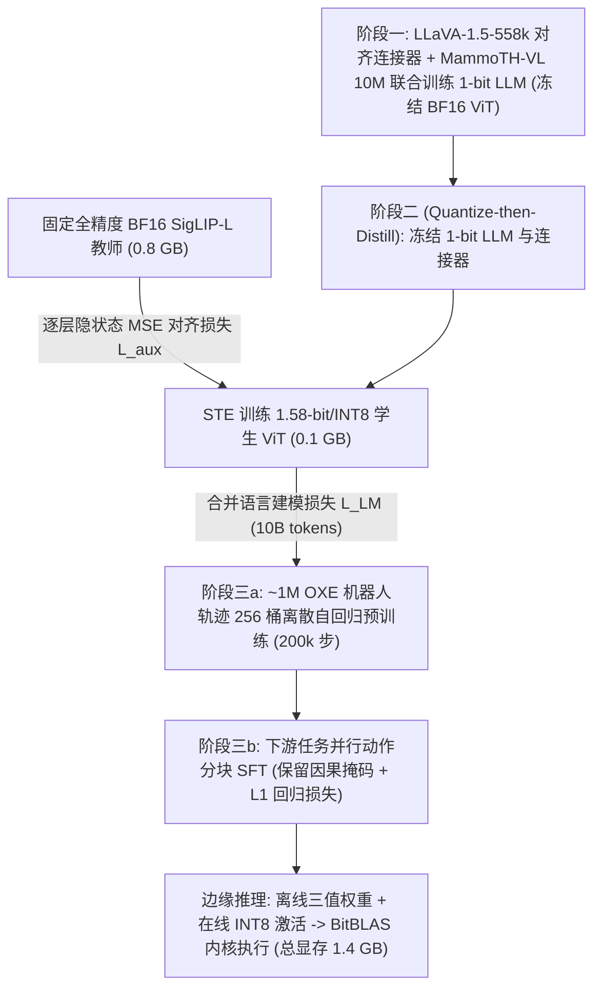

# BitVLA: 1-bit Vision-Language-Action Models for Robotics Manipulation

## 一句话定义

`BitVLA` 是面向边缘机器人部署的**首个全原生 1-bit（三值权重 `{-1, 0, 1}`）视觉-语言-动作（VLA）模型**（总参数约 3.0B），以 `BitNet b1.58 2B4T` 为语言骨干并通过提出的 `Quantize-then-Distill` 策略将 `SigLIP-L` 视觉编码器一并压缩至 1.58-bit 权重与 INT8 激活，在仅占用 **1.4 GB** 显存的条件下于 LIBERO 基准与真机任务上取得比肩 7.7B 全精度 OpenVLA-OFT 的操作精度并带来 **4.4 倍**推理加速。

## 英文缩写速查

| 缩写 | 英文全称 | 简要说明 |
|---|---|---|
| VLA | Vision-Language-Action | 视觉-语言-动作模型，将多模态感知和语言指令直接映射为机器人控制动作 |
| QAT | Quantization-Aware Training | 量化感知训练，在训练过程中直接模拟低比特量化约束以减少精度塌缩 |
| PTQ | Post-Training Quantization | 训练后量化（如 `bitsandbytes` INT8/INT4），无需重训但在极低比特下易掉点 |
| STE | Straight-Through Estimator | 直通估计器，用于在不可微的 `RoundClip` 三值量化操作中近似反向传播梯度 |
| OFT | Optimized Fine-Tuning (Action Chunking Parallel Decoding) | 并行动作分块解码范式，一次前向输出长度为 $K$ 的动作序列并配合 L1 回归损失 |
| OOD | Out-of-Distribution | 分布外泛化测试（如更换未见物体或加入桌布背景干扰） |

## 核心信息

| 字段 | 内容 |
|---|---|
| 论文标题 | *BitVLA: 1-bit Vision-Language-Action Models for Robotics Manipulation* |
| 作者 | Hongyu Wang, Chuyan Xiong, Ruiping Wang, Xilin Chen |
| 机构 | Key Laboratory of AI Safety, Institute of Computing Technology, Chinese Academy of Sciences；University of Chinese Academy of Sciences |
| 发表时间 / 预印本 | arXiv:2506.07530v2（2026-03-01） |
| 论文链接 | [arXiv:2506.07530](https://arxiv.org/abs/2506.07530) |
| 官方代码 / 权重 | [github.com/ustcwhy/BitVLA](https://github.com/ustcwhy/BitVLA) / [huggingface.co/lxsy/bitvla-bf16](https://huggingface.co/lxsy/bitvla-bf16) |
| 清单分类 | `harness.infrastructure` |
| 来源条目 | `survey_ax_2506_07530` |
| 开源 / 验证范围 | 论文公布代码仓库与模型权重，在 5 个多模态 VQA 基准、LIBERO 4 套仿真基准、NVIDIA A100 吞吐评测及 7-DoF Franka Emika 真机上完成验证；当前本地仓库未克隆或运行核查该外部代码库 |

## 为什么重要

1. **从“训后打补丁压缩”转向“训练时原生 1-bit 协同设计”**：现有主力 VLA（如 7B+ 的 OpenVLA-OFT 占 15.4 GB 显存）难以部署在端侧算力受限的移动/嵌入式机器人平台；而直接对全精度模型做 4-bit 训练后量化在复杂操作上仍占 4.4–4.7 GB 显存且 OpenVLA 会出现明显掉点。BitVLA 在训练期即引入原生 1.58-bit 约束，将端到端显存压降至 **1.4 GB**（可在 RTX 3050 Ti 4 GB 笔记本 GPU 上运行）。
2. **攻克“1-bit 视觉编码器表征漂移”难题**：如果只用 1-bit LLM 而保留 BF16 ViT，视觉编码器仍占 0.8 GB；但直接把 ViT 量化到 1.58-bit 会使多模态对齐崩塌（VQA 平均分跌至 42.4%）。提出的 `Quantize-then-Distill` 以全精度教师中间层隐状态 MSE 对齐损失，仅用 10B 令牌便将 ViT 压至 **0.1 GB** 且多模态精度仅掉 1.5%。
3. **把计算主体从浮点乘加转为整数加减**：三值权重 `{-1, 0, 1}` 与对称 INT8 激活使线性层核心内积主要转化为整数加减（且可跳过零权重），配合 `BitBLAS` 定制算子不仅在现有 GPU 上提速 4.4 倍（341.1 Hz），还为专用低功耗端侧 VLA 加速芯片指明了路径。

## 核心方法

1. **全三值骨干架构与量化算子**
   - **模型组成**：语言骨干采用原生 1-bit LLM `BitNet b1.58 2B4T`，视觉编码器采用 `SigLIP-L`（$224\times 224$ 分辨率，输出 256 个视觉令牌），通过轻量的全精度两层 GeLU MLP 连接器映射到语言空间；本体感知状态 $q_t$ 经 MLP 映射为单个状态令牌拼接在图像令牌后。除输入/输出嵌入层、连接器与动作头外，LLM 与 ViT 中全部线性层权重均量化为三值 `{-1, 0, 1}`。
   - **量化公式与推理算子**：权重使用 `absmean` 量化 $Q_w(W)=\text{RoundClip}(W/\alpha, -1, 1)$（$\alpha=\frac{1}{nm}\|W\|_1$）；激活使用逐令牌 `absmax` 对称 INT8 量化 $Q_a(x)=\text{RoundClip}(127x/\beta, -128, 127)$（$\beta=\|x\|_\infty$）；线性层前向输出为 $Y=\frac{127\alpha}{\beta}Q_w(W)Q_a(x)$，推理时调用 `BitBLAS` 内核执行三值×INT8 矩阵乘法。
   - **保留因果注意力掩码**：作者发现若像 OpenVLA-OFT 那样将 BitNet b1.58 的因果注意力替换为双向注意力掩码会导致真机性能明显下降，因此保留原版因果掩码并兼容 `Flash-Attention`。
2. **三阶段训练范式（Three-Stage Pipeline）**
   - **阶段一（Multimodal Training）**：沿用 LLaVA 范式，先在 `LLaVA-1.5-558k` 上仅训练连接器（25k 步）对齐特征空间，再冻结全精度 `SigLIP-L`，联合训练 1-bit LLM 与连接器（`MammoTH-VL` 10M 单图子集，40k 步）。
   - **阶段二（Quantize-then-Distill）**：复制全精度 ViT 作为固定教师 $h_{\text{bf16}}^l$，以 STE 训练 1.58-bit 学生 ViT $h_{1.58}^l$（冻结 1-bit LLM 与连接器，5M 样本 / 10B tokens，20k 步）。总损失 $\mathcal{L}_{\text{total}} = \mathcal{L}_{\text{LM}} + \lambda \mathcal{L}_{\text{aux}}$，其中中间层特征对齐损失 $\mathcal{L}_{\text{aux}}=\frac{1}{L}\sum_{l=1}^L \frac{1}{n}\|h_{\text{bf16}}^l - h_{1.58}^l\|_2^2$（权重 $\gamma=0.1$）。VLM 阶段总计在 8×H800 (80GB) 上耗时 7 天。
   - **阶段三（Robotics Training & OFT SFT）**：先在 ~1M 条 Open X-Embodiment 轨迹上以 256 桶离散化下一动作交叉熵预训练 200k 步（batch size 2048，16×H800 上耗时 14 天）；下游微调时采用 OpenVLA-OFT 风格并行动作分块解码（LIBERO $K=8$，真机 $K=10$，吞吐测试 $K=25$）并以 L1 回归损失 $\sum_{k=0}^h \|\hat{a}_{t+k}-a_{t+k}\|_1$ 优化。

### 方法流程图

## 实验与评测

### 1. LIBERO 仿真基准主对比（Table I，4 个套件共 40 任务）

| 规模分组 | 模型 | 参数量 | 显存占用 ↓ | Spatial | Object | Goal | Long | Average |
|---|---|---|---|---:|---:|---:|---:|---:|
| 大模型 | OpenVLA | 7.5B | 15.1 GB (10.79×) | 84.7% | 88.4% | 79.2% | 53.7% | 76.5% |
| 大模型 | CoT-VLA | 8.0B | 16.2 GB (11.57×) | 87.5% | 91.6% | 87.6% | 69.0% | 81.1% |
| 大模型 | UniVLA | 8.5B | 17.0 GB (12.14×) | 96.5% | 96.8% | 95.6% | 92.0% | 95.2% |
| 大模型 | UnifiedVLA | 8.5B | 17.0 GB (12.14×) | 95.4% | 98.8% | 93.6% | 94.0% | 95.5% |
| 大模型 | OpenVLA-OFT | 7.7B | 15.4 GB (11.00×) | 97.6% | 98.4% | 97.9% | 94.5% | **97.1%** |
| 中小模型 | SpatialVLA | 4.2B | 8.5 GB (6.07×) | 88.2% | 89.9% | 78.6% | 55.5% | 78.1% |
| 中小模型 | NORA-Long | 3.8B | 7.5 GB (5.36×) | 92.2% | 95.4% | 89.4% | 74.6% | 87.9% |
| 中小模型 | SmolVLA | 2.3B | 4.6 GB (3.29×) | 93.0% | 94.0% | 91.0% | 77.0% | 88.8% |
| 中小模型 | GR00T-N1 | 2.2B | 4.4 GB (3.14×) | 94.4% | 97.6% | 93.0% | 90.6% | 93.9% |
| 中小模型 | $\pi_0$ | 3.5B | 7.0 GB (5.00×) | 96.8% | 98.8% | 95.8% | 85.2% | 94.2% |
| 中小模型 | BitVLA（w/o pre-training） | 3.0B | **1.4 GB (1.00×)** | 97.4% | **99.6%** | 94.4% | 87.6% | 94.8% |
| **原生 1-bit** | **BitVLA（完整版）** | **3.0B** | **1.4 GB (1.00×)** | **96.6%** | **99.0%** | **95.4%** | **92.8%** | **96.0%** |

- 与 7.7B OpenVLA-OFT 相比，BitVLA 仅差 **1.1%** 绝对成功率，显存缩小 **11.0 倍**（15.4 GB → 1.4 GB）；
- 在长程套件 `LIBERO-Long` 上超越 $\pi_0$ **7.6%**（92.8% vs 85.2%），且机器人预训练带来 +5.2% 长程提升（87.6% → 92.8%）。

### 2. 训练后量化（PTQ）对比与推理效率（Table II & Fig. 6）

- **与 `bitsandbytes` PTQ 对比（Table II，LIBERO 均值）**：
  - INT8 量化：OpenVLA（7.4 GB）`76.9%`、OpenVLA-OFT（7.7 GB）`96.7%`；
  - INT4 量化：OpenVLA（4.4 GB）掉至 `72.7%`、OpenVLA-OFT（4.7 GB，仍超过 BitVLA 显存 3 倍）`96.9%`；
  - BitVLA 仅用 **1.4 GB**（不足 INT4 OpenVLA-OFT 三分之一）即取得 **96.0%**。
- **推理延迟与吞吐量（Fig. 6，NVIDIA A100，3×224×224 图像 + 14 维状态，$K=25$）**：
  - **BitVLA**：**`73 ms` 延迟 / `341.1 Hz` 吞吐**；
  - 对比基线：$\pi_0$（86 ms / 291.6 Hz）、Diffusion Policy（90 ms / 267.4 Hz）、RDT-1B（297 ms / 84.1 Hz）、OpenVLA-OFT+（321 ms / 77.9 Hz，BitVLA 实现 **4.4× 加速**）。

### 3. Quantize-then-Distill 多模态 VQA 消融（Table III）

| 权重 / 激活精度 | ViT 显存 ↓ | Stage 令牌数 | $\mathcal{L}_{\text{aux}}$ 对齐 | SeedBench2+ | SeedBench | MMMU | MMStar | AI2D | 均值 |
|---|---|---:|---|---:|---:|---:|---:|---:|---:|
| BF16 / BF16 | 0.8 GB (8.00×) | — | — | 37.4 | 70.6 | 45.0 | 43.6 | 68.6 | 53.0 |
| **1.58-bit / INT8** | **0.1 GB (1.00×)** | 10B | ✓ | 35.4 | 69.3 | 43.7 | 41.5 | 67.6 | **51.5** |
| 1.58-bit / INT8 | 0.1 GB (1.00×) | 5B | ✓ | 33.3 | 69.1 | 43.3 | 41.4 | 66.4 | 50.8 |
| 1.58-bit / INT8 | 0.1 GB (1.00×) | 5B | ✗ | 32.4 | 52.9 | 38.8 | 30.7 | 57.5 | 42.4 |

### 4. 真机 7-DoF Franka Emika 操作与 OOD 泛化（Sec. IV-C，Fig. 4 & Fig. 5）

采用单一第三人称 RealSense D435i 相机，在 3 个基础任务（抓取玩具西瓜、面包放进篮子、扶正倒下的铃铛，各收集 50 条遥操作演示并在 $4\times 5$ 网格位姿评测）与 3 个零样本 OOD 变体（未见物体“抓海绵”“西瓜放篮子”以及增加桌布背景干扰“扶正铃铛”）上测试：BitVLA 在全部三项基础任务上均超越 3B 级基线 $\pi_0$，与 7B OpenVLA-OFT 保持同一水平并在 OOD 干扰下未发生显著退化；而未经 ~1M 轨迹机器人预训练的 `BitVLA (w/o pre-training)` 在大部分真机任务上近乎失效（接近 0%），凸显大规模机器人预训练对真机落地的决定性作用。

## 与现有工作的对比

| 维度 | OpenVLA-OFT (7.7B) | $\pi_0$ (3.5B) / SmolVLA (2.3B) | PTQ 量化 VLA (INT4/INT8) | BitVLA (本文，3.0B) |
|---|---|---|---|---|
| 权重数值域 | BF16 全精度 | BF16 全精度 | 事后量化为 INT4 / INT8 | **原生三值 `{-1, 0, 1}` + INT8 激活** |
| 推理显存占用 | 15.4 GB（11.0×） | 7.0 GB / 4.6 GB | 4.4–7.7 GB（OpenVLA 系列） | **1.4 GB（可在 4 GB 笔记本 GPU 部署）** |
| 视觉编码器处理 | 全精度 ViT | 全精度 ViT | 事后直接量化易损对齐 | **`Quantize-then-Distill` 压至 0.1 GB 且表征几乎不失真** |
| LIBERO 精度与速度 | 97.1% / 321 ms (77.9 Hz) | 94.2% (86 ms) / 88.8% | 72.7% (OpenVLA INT4) / 96.9% (OFT INT4) | **96.0% / 73 ms (341.1 Hz)** |

## 常见误区或局限

1. **并非“即插即用的任意全精度模型事后转换配方”**：论文明确指出，BitVLA 依赖训练期量化感知优化（基于原生 1.58-bit 语言骨干 + 三阶段课程训练），其参数与激活分布不同于全精度模型；若直接把 1-bit 训练后量化套用在现成全精度 LLM/VLA 上，仍会出现严重性能退化。
2. **输入输出嵌入层、连接器与动作头仍保持全精度**：虽然主体线性层为 1.58-bit，但嵌入层、2 层 MLP 连接器以及 OFT 动作头因占比较小且对连续控制敏感而保留高精度，不能误以为整张计算图零浮点开销。
3. **预训练算力门槛较高且仅覆盖 1M 轨迹**：VLM 三阶段耗时 7 天（8×H800）、OXE ~1M 预训练耗时 14 天（16×H800）；论文坦承受资源限制 1M 规模尚不足以实现极广泛的跨本体零样本泛化，真机实验仍需每项任务采集 50 条遥操作演示微调。

## 结论

**一句话总判：BitVLA 证明了通过“原生 1.58-bit 语言骨干 + Quantize-then-Distill 视觉编码器 + 大规模机器人轨迹预训练”的训练期软硬协同设计，可以在 1.4 GB 极致显存下复现 7B 级全精度 VLA 的操作精度并获得 4.4 倍推理速度。**

1. **训练期 1.58-bit 协同设计远胜事后极低比特压缩**：BitVLA 在不到 INT4 训练后量化 OpenVLA-OFT 三分之一的显存（1.4 GB vs 4.7 GB）下维持 96.0% LIBERO 成功率，端侧价值突出。
2. **视觉编码器必须配合教师中间层蒸馏才能压到 1-bit**：缺少逐层表征对齐损失 $\mathcal{L}_{\text{aux}}$ 会导致 1.58-bit ViT 的多模态 VQA 均分从 50.8% 骤降至 42.4%；加入蒸馏后 t-SNE 分布随网络加深高度贴近 BF16 教师。
3. **保留因果掩码与大规模机器人预训练是真机成功的两大工程细节**：改用双向注意力或跳过 ~1M OXE 预训练均会严重伤害真机部署稳定性（后者直接使真机成功率跌至近零）。

## 关联页面

- [Agentic Robots 综述](paper-towards-agentic-robots-survey.md)
- [全量项目节点清单](../overview/awesome-agentic-robots-node-index.md)
- [VLA 方法背景](../methods/vla.md)
- [Action Chunking 动作分块](../methods/action-chunking.md)
- [OpenVLA 论文节点](paper-openvla.md)
- [π0 论文节点](paper-pi0.md)
- [SpatialVLA 论文节点](paper-spatialvla.md)
- [VLA 加速 25 种方法横评](../comparisons/vla-acceleration-25-methods-2026.md)

- [机器人操作](../tasks/manipulation.md)：了解物体操作和抓取任务。

## 参考来源

- [官方 Awesome 快照归档](../../sources/repos/awesome-agentic-robots-survey-index.md)
- [arXiv:2506.07530v2 论文页面](https://arxiv.org/abs/2506.07530)
- [BitVLA 官方 GitHub 仓库](https://github.com/ustcwhy/BitVLA)
- [BitVLA HuggingFace 模型权重](https://huggingface.co/lxsy/bitvla-bf16)
