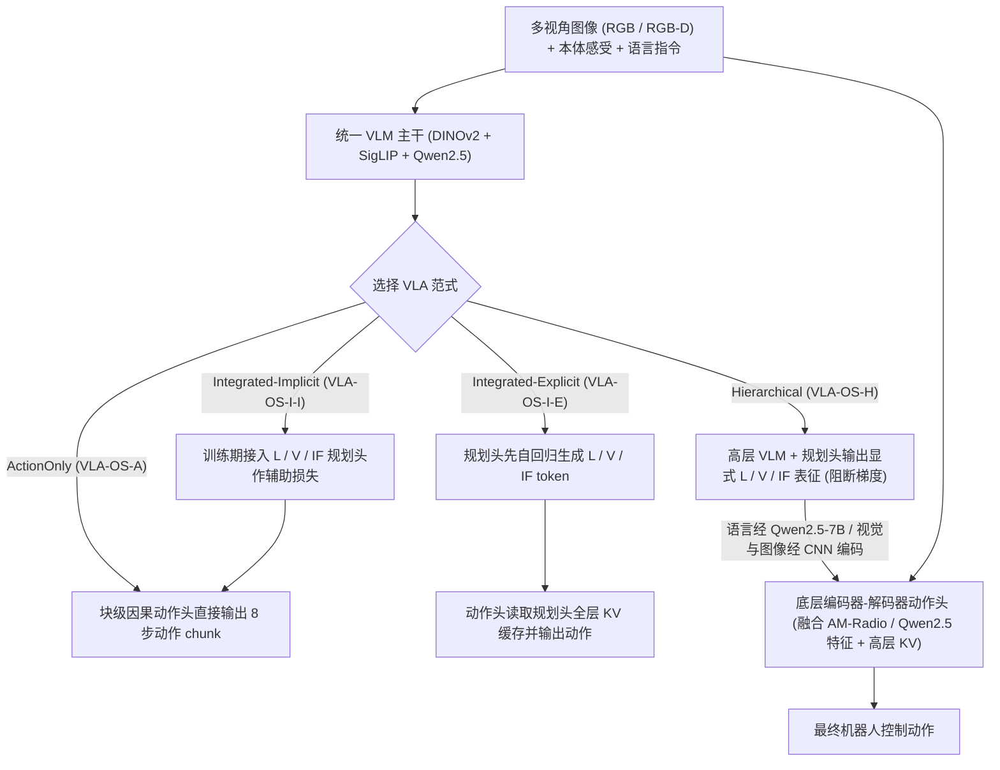

# VLA-OS: Structuring and Dissecting Planning Representations and Paradigms in Vision-Language-Action Models

## 一句话定义

VLA-OS 是一个统一且可组合的视觉-语言-动作（VLA）模型家族，通过在相同 VLM 主干（Qwen2.5 + DINOv2/SigLIP）与动作头受控条件下对比 ActionOnly、Integrated（隐式/显式）和 Hierarchical 三种范式及三种规划表征，系统厘清了 VLA 中任务规划的真正增益来源与性能瓶颈。

## 英文缩写速查

| 缩写 | 英文全称 | 简要说明 |
|---|---|---|
| VLA | Vision-Language-Action Model | 视觉-语言-动作模型，融合视觉语言感知与机器人控制动作输出 |
| VLM | Vision-Language Model | 视觉语言模型，本文中以 DINOv2+SigLIP 编码器接 Qwen2.5 构建 |
| L | Language Planning | 语言推理规划表征，含 Task、Plan、Subtask 等 8 个文本/坐标字段 |
| V | Visual Planning | 视觉推理规划表征，以 `<loc_i>` 位置 token 表示边界框、末端轨迹与可供性 |
| IF | Image Foresight Planning | 图像前瞻规划表征，自回归生成第 K 步第三人称未来目标图像 |
| DCS | Decomposition Score | 任务分解得分，用于单独评估高层任务规划模块的子任务正确率 |
| IFS | Instruction Following Score | 指令遵循得分，在给定真值规划下单独评估底层动作头的子任务执行成功率 |
| FWT / NBT | Forward Transfer / Negative Backward Transfer | 持续学习中的前向迁移与负向后向遗忘指标 |

## 核心信息

| 字段 | 内容 |
|---|---|
| 论文标题 | *VLA-OS: Structuring and Dissecting Planning Representations and Paradigms in Vision-Language-Action Models* |
| 作者 | Chongkai Gao, Zixuan Liu, Zhenghao Chi, Yiwen Hou, Yuxuan Zhang, Yudi Lin, Junshan Huang, Zhirui Fang, Xin Fei, Zeyu Jiang, Lin Shao |
| 机构 | 新加坡国立大学（NUS）、复旦大学、清华大学、南洋理工大学（NTU） |
| 发表时间 / 预印本 | arXiv:2506.17561v1（2025-06-21） |
| 论文链接 | [arXiv:2506.17561](https://arxiv.org/abs/2506.17561) / [PDF](https://arxiv.org/pdf/2506.17561) |
| 官方代码 / 视频页 | [GitHub: HeegerGao/VLA-OS](https://github.com/HeegerGao/VLA-OS) / [项目视频页](https://nus-lins-lab.github.io/vlaos/) |
| 清单分类 | `harness.layered_systems` |
| 来源条目 | `survey_ax_2506_17561` |
| 开源 / 验证范围 | 论文基于 8× NVIDIA A100 80G 完成训练与评测，覆盖 LIBERO、The COLOSSEUM、FurnitureBench、DexArt、PerAct2 五大仿真基准及真机 X-Arm 可变形物体/刚体操作 |

## 为什么重要

1. **剥离架构与数据混淆变量**：此前带规划的 VLA 工作（如 ECoT、CoT-VLA、RT-H、Hi Robot、Diffusion-VLA 等）各自采用不同主干网络、数据规模与训练配方，难以判断性能提升究竟来自网络结构、训练数据还是规划机制本身；VLA-OS 首次在统一 VLM 主干与 ~5% 参数量约束的可插拔头下实现严格受控对照。
2. **回答 VLA 规划设计的五大核心争议**：系统回答了规划表征选择（语言 vs. 视觉 vs. 未来图像）、架构范式（端到端 vs. 单模型集成 vs. 双模型分层）、系统瓶颈（规划 vs. 策略学习）、扩展性与预训练收益（数据/模型缩放）、以及泛化与持续学习权衡。
3. **揭示“大模型盲目缩放”陷阱**：在约 4,500–5,000 条示范轨迹从头训练时，将 LLM 主干从 0.5B 扩增到 1.5B/3B/7B 反而无益甚至受限，证明当前数据体量下架构与表征设计仍比单纯增大参数更关键。

## 核心方法

VLA-OS 将带规划的 VLA 统一拆解为可组合的视觉语言主干、三类规划头与 2D/3D 动作头，对应三种主流范式（排除无法在给定动作数据集上协同训练的 PlanningOnly-VLA）：

1. **统一主干与动作头（`VLA-OS-A` / ActionOnly-VLA）**：
   - **视觉编码器集成**：采用 `DINOv2` + `SigLIP` 双编码器处理 224×224 多视角图像（历史长度 2），并通过 MLP 投影到语言空间；LLM 主干选用 `Qwen2.5`（0.5B `-S`、1.5B `-B`、3B `-M`、7B `-L`），先在 LLaVA v1.5 的 558K 图文子集上微调为 VLM（支持 HuggingFace 任意 LLM 替换）。
   - **块级因果注意力动作头**：与 LLM 同层数（24/28/36/28 层，hidden 512，8 头，GELU）的 Transformer 解码器；本体感受 token 可关注 LLM 与自身 KV，动作 chunk（长度 8）可关注 LLM、本体感受与自身，以 L1 或 Flow Matching 损失训练。3D 任务中融合多视角 RGB-D 点云与 CLIP 特征并经最远点采样（FPS）作为额外 token 输入。
2. **集成规划范式（`VLA-OS-I` / Integrated-VLA）**：
   - 在 `VLA-OS-A` 之上挂载三类与 LLM 同层数的规划头（参数量均限制在 VLM 的 ~5%）：
     - **语言规划（L）**：以 LLM 分词器自回归预测 8 个结构化字段（Task、Plan、Subtask、Subtask Reason、Move、Move Reason、Gripper Position、Object Bounding Boxes），标注经 Prismatic-7B 描述 + Gemini 1.5 生成及一致性过滤精修。
     - **视觉推理规划（V）**：将 224×224 图像划分为 32×32（每格 7×7 像素）离散网格，扩展 `<loc_i>` 词表表示目标边界框、末端执行器轨迹流与 SAM2+高斯热图可供性区域。
     - **图像前瞻规划（IF）**：基于 Infinity/VAR 的从粗到细按位自回归图像生成器（含 Bitwise Self-Correction 抑制曝光偏差），生成第 K 步第三人称未来目标帧。
   - 分为两种使用模式：**隐式规划（`VLA-OS-I-I`）**仅在训练时以规划头作辅助损失、推理时跳过规划头；**显式规划（`VLA-OS-I-E`）**要求推理时先生成全部规划 token 再由动作头关注规划头各层 KV 缓存。
3. **分层规划范式（`VLA-OS-H` / Hierarchical-VLA）**：
   - 将高层的 VLM+规划头与底层编码器-解码器动作头解耦（底层编码器/解码器层数减半以对齐总参数），二者之间不回传梯度。
   - 底层策略同时接收原始视觉（含冻结 `AM-Radio` 特征）、指令（`Qwen2.5` 特征）、高层 LLM KV 缓存以及显式规划输出（语言规划经冻结 Qwen2.5-7B 编码，视觉/前瞻图像经独立 CNN 编码），将规划累积误差限制在显式表征层而不污染底层隐状态。

### 方法流程图

## 实验与评测

全部实验在 8× NVIDIA A100 80G GPU 上完成，LIBERO 评测取 top-3 检查点各 20 次 rollout 均值：

### 1. 基础架构对齐检验（LIBERO 四套件成功率 %，Table 1）

| 模型 | LIBERO-Spatial | LIBERO-Object | LIBERO-Goal | LIBERO-Long | 平均 |
|---|---:|---:|---:|---:|---:|
| Diffusion Policy（从头训练） | 78.3 | 92.5 | 68.3 | 50.5 | 72.4 |
| OpenVLA（微调） | 84.7 | 88.4 | 79.2 | 53.7 | 76.5 |
| CoT-VLA（微调） | 87.5 | 91.6 | 87.6 | 69.0 | 81.1 |
| DiT Policy（微调） | 84.2 | 96.3 | 85.4 | 63.8 | 82.4 |
| $\pi_0$-FAST（微调） | 96.4 | 96.8 | 88.6 | 60.2 | 85.5 |
| **VLA-OS-A-S（0.5B 从头训练，本文）** | **87.0** | **96.5** | **92.7** | **66.0** | **85.6** |
| $\pi_0$（微调 SOTA） | 96.8 | 98.8 | 95.8 | 85.2 | 94.2 |

### 2. 规划表征与范式对比（LIBERO-Long 成功率 %，Table 2，括号为相对 VLA-OS-A 66.0 变化）

| 范式 | L | V | IF | L+V | L+IF | V+IF | L+V+IF |
|---|---:|---:|---:|---:|---:|---:|---:|
| **VLA-OS-I-I（隐式集成）** | 68.0 (+2.0) | 71.0 (+5.0) | 72.5 (+6.5) | 66.7 (+0.7) | **73.3 (+7.3)** | 71.0 (+5.0) | 71.7 (+5.7) |
| **VLA-OS-I-E（显式集成）** | 60.5 (-5.5) | 52.5 (-13.5) | 67.5 (+1.5) | 42.7 (-23.3) | 56.7 (-9.3) | 56.7 (-9.3) | 50.7 (-15.3) |
| **VLA-OS-H（分层）** | 63.5 (-2.5) | 69.0 (+3.0) | 71.7 (+5.7) | 71.5 (+5.5) | 72.0 (+6.0) | 73.7 (+7.7) | **74.2 (+8.2)** |

- **显式集成退化机理**：规划 token 长度远超动作 token（约 2000 vs. 8），导致严重的自回归累积误差；且 `VLA-OS-I-E` 动作头不直接接收原始图像/语言而完全依赖规划头隐状态，缺乏纠错能力。

### 3. 六大基准、泛化与预训练（Figure 6a）

| 评测维度 / 基准 | VLA-OS-A | VLA-OS-I | VLA-OS-H |
|---|---:|---:|---:|
| LIBERO-LONG（2D 刚体长程） | 66.0 | 73.3 (+7.3) | **74.2 (+8.2)** |
| The COLOSSEUM（3D 无扰动） | 34.4 | **35.7 (+1.3)** | 35.3 (+0.9) |
| 真机 X-Arm 可变形物体（折巾/展裤/理绳，均值 214 步） | 28.5 | **35.4 (+6.9)** | 33.6 (+5.1) |
| FurnitureBench（复杂装配） | 11.0 | **14.0 (+3.0)** | **14.0 (+3.0)** |
| DexArt（Sapien 灵巧操作） | 45.0 | **49.0 (+4.0)** | 48.0 (+3.0) |
| PerAct2（3D 双臂 22 维，未用 IF） | 21.0 | 28.0 (+7.0) | **29.0 (+8.0)** |
| 视觉/物理泛化（COLOSSEUM 无扰动→全扰动） | 6.1 | 6.2 (+0.1) | **7.4 (+1.3)** |
| 规划头预训练（LIBERO-90 预训练→LIBERO-LONG） | — | 79.1 (+5.8) | **79.8 (+5.6)** |

### 4. 模块拆解与持续学习（Table 3, 4, 5）

- **规划 vs. 策略瓶颈（Table 3，LIBERO-Long）**：`VLA-OS-I-I` 的 DCS 为 L 0.79 / V 0.83 / IF 0.92；`VLA-OS-H` 的 DCS 为 L 0.81 / V 0.86 / IF **0.94**，给定真值规划时的 IFS 为 L 0.84 / V **0.93** / IF 0.90。结合完整任务成功率（63.5–74.2%），说明**底层策略学习比高层任务规划更具瓶颈**，且视觉规划（V）与前瞻图像（IF）比纯语言更易被底层策略跟随。
- **持续学习（Table 4 & 5，LIBERO-Long 顺序微调 SEQL）**：
  - 范式对比：`VLA-OS-H` 前向迁移 `FWT=0.80`、`AUC=0.32` 最优（vs. `VLA-OS-I` 0.75/0.29、`VLA-OS-A` 0.71/0.25），但带规划模型遗忘更快（`NBT`：A 0.32 < I 0.43 < H 0.45）。
  - 表征对比（`VLA-OS-I`）：视觉落地表征在前向迁移与抗遗忘上均优于语言规划（IF `FWT=0.75, NBT=0.39`；V `0.74, 0.40, AUC=0.28`；L `0.72, 0.47, 0.26`）。

## 与现有工作的对比

| 维度 | ActionOnly VLA（如 OpenVLA / $\pi_0$） | 单模型显式 CoT VLA（如 ECoT / CoT-VLA） | 分层 VLA（如 RT-H / HAMSTER） | VLA-OS（本文受控系列） |
|---|---|---|---|---|
| 架构可控性 | 各自绑定特定 VLM 与动作头 | 主干与推理格式绑定，难横向归因 | 高低层网络异构，参数量不对齐 | **统一 DINOv2+SigLIP+Qwen2.5 与 ~5% 轻量头** |
| 规划表征支持 | 无显式任务规划 | 单一语言 CoT 或单一图像目标 | 语言原语或 2D 轨迹草图 | **同时支持 L、V（`<loc_i>`）、IF（VAR 图像）及组合** |
| 误差传播特性 | 无规划累积误差 | 规划 token 累积误差污染动作隐状态 | 梯度隔离，但此前缺乏受控对比 | **证实 I-I（隐式辅助）与 H（梯度隔离）显著优于 I-E** |
| 灵活性 | $\pi_0$ 绑定 PaliGemma | 特定分词扩展 | 需定制桥接接口 | **支持 HuggingFace 任意 LLM 与 2D/3D 动作头** |

## 常见误区或局限

1. **未涵盖所有新兴规划表征**：论文明确指出 VLA-OS 尚未纳入基于隐动作（latent actions）的视频/图像生成方案、完整视频生成规划（video generation）以及 3D 场景流（scene flow）规划。
2. **未研究跨本体、Sim2Real 与 2D→3D 迁移**：实验集中在同构环境下的 2D/3D 操作与持续学习，未探索跨机械臂形态迁移或仿真到真机的域迁移机制。
3. **训练数据规模上限不足 1 万条轨迹**：所有受控实验基于低于 10,000 条轨迹的数据集（如 LIBERO-90 仅 4,500 条示范），因此“0.5B LLM 优于更大模型”的缩放结论适用于中小规模从头训练场景，尚未在 OXE 等超大规模预训练语料上复验。
4. **未包含 PlanningOnly-VLA 对照**：作者在引言说明未评测 PlanningOnly-VLA，因其预训练子技能与 VLM 通常无法在标准示范数据集上联合端到端微调。

## 结论

**一句话总判：在 VLA 中引入任务规划时，应优先选用视觉落地表征（关键点/边界框/可供性或未来目标帧）并采用“隐式辅助训练”或“梯度隔离的分层架构”，而非在单模型中做冗长的显式语言自回归规划。**

1. **优先视觉表征而非纯语言规划**：视觉推理（V）与图像前瞻（IF）在成功率、推理速度、训练成本、底层指令跟随（IFS 0.90–0.93 vs. 0.84）与抗遗忘（NBT 0.39–0.40 vs. 0.47）上全面优于纯语言规划（L）。
2. **单模型用隐式损失，双模型才做显式分层**：单模型强行显式生成长规划 token 再预测动作（`VLA-OS-I-E`）会因 ~2000 token 累积误差导致 LIBERO-Long 大幅掉点（最高 -23.3%）；显式规划必须配独立接收原始观测的底层动作头（`VLA-OS-H`）。
3. **小规模数据从头训练勿盲目堆大 LLM**：在 ~5,000 条示范规模下，将 LLM 主干控制在 0.5B（整机 <1B）即可发挥最佳性价比，架构与表征收益大于参数扩张。
4. **工程优化重心应放在底层策略与规划并行化**：DCS（0.81–0.94）已高于端到端任务成功率，当前主要瓶颈仍是底层控制跟随精度及分层规划头的推理延迟。

## 关联页面

- [Agentic Robots 综述](paper-towards-agentic-robots-survey.md)
- [全量项目节点清单](../overview/awesome-agentic-robots-node-index.md)
- [VLA 方法背景](../methods/vla.md)
- [LIBERO 基准节点](libero-benchmark.md)
- [pi0 论文节点](paper-pi0.md)
- [OpenVLA 论文节点](paper-openvla.md)
- [HAMSTER 分层操作模型](paper-agentic-2502-05485.md)

- [机器人智能体执行框架](../methods/robot-agent-harness.md)：对照规划、执行接口与反馈机制。

## 参考来源

- [官方 Awesome 快照归档](../../sources/repos/awesome-agentic-robots-survey-index.md)
- [arXiv:2506.17561v1 论文页面](https://arxiv.org/abs/2506.17561)（[PDF 原文](https://arxiv.org/pdf/2506.17561)）
- [官方代码仓库：HeegerGao/VLA-OS](https://github.com/HeegerGao/VLA-OS)
