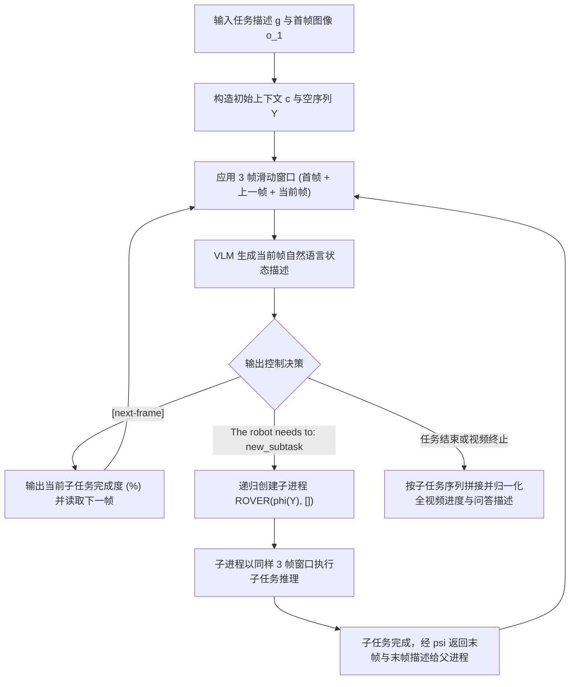

# ROVER: Recursive Reasoning Over Videos with Vision-Language Models for Embodied Tasks

## 一句话定义

ROVER 是一个面向具身长程视频的递归推理框架，通过让视觉语言模型（VLM）动态将任务视频递归分解为更短的子任务并配合 3 帧滑动上下文窗口，在不丢失全局任务语境的前提下实现线性复杂度的高精度逐帧状态描述与任务进度估计。

## 英文缩写速查

| 缩写 | 英文全称 | 简要说明 |
|---|---|---|
| ROVER | Reasoning Over VidEo Recursively | 本文提出的具身视频递归子任务分解推理框架 |
| VLM | Vision-Language Model | 视觉语言模型，本文中以 Gemini-1.5-Pro 为主干并在 Gemini-2.5-Pro/GPT-4o/Qwen2.5-VL-32B 验证 |
| GVL | Generative Value Learning | 现有基于上下文内帧乱序拼接的 VLM 进度估计基线方法 |
| OXE | Open X-Embodiment | 包含 50 个真实机器人数据集、20 种构型的开源具身数据集集合 |
| POMDP | Partially Observed Markov Decision Process | 部分可观测马尔可夫决策过程，本文用于形式化具身任务进度值函数 |
| QA | Question Answering | 视频问答评测任务，检验事件发生判断与时间戳定位精度 |

## 核心信息

| 字段 | 内容 |
|---|---|
| 论文标题 | *ROVER: Recursive Reasoning Over Videos with Vision-Language Models for Embodied Tasks* |
| 作者 | Philip Schroeder, Ondrej Biza, Thomas Weng, Hongyin Luo, James Glass |
| 机构 | MIT CSAIL、RAI Institute |
| 发表时间 / 预印本 | NeurIPS 2025（arXiv:2508.01943v2，2025-11-27） |
| 论文链接 | [arXiv:2508.01943](https://arxiv.org/abs/2508.01943) / [PDF](https://arxiv.org/pdf/2508.01943) |
| 项目主页 | [rover-vlm.github.io](https://rover-vlm.github.io) |
| 清单分类 | `data.annotation` |
| 来源条目 | `survey_ax_2508_01943` |
| 开源 / 验证范围 | 项目页发布演示、代码与基于 RoboCasa 构造的 543 条含扰动轨迹视频数据集，并在 1,000 条真实 OXE 视频上评测 |

## 为什么重要

1. **打破“局部窗口缺全局”与“全视频拼接易幻觉”两难**：此前 VLM 视频推理要么只看极少数关键帧从而丢失全局任务上下文，要么把全视频帧拼进上下文（如 GVL），不仅推理计算随帧数呈平方级膨胀，且在包含失误、停顿的非专家轨迹中极易受时间先验误导而幻觉进度单调上升。
2. **定位长上下文感知退化阈值**：作者通过精细错误分析发现，GVL 在真实视频中有 47% 存在感知幻觉，且 **83% 的感知错误出现在上下文超过 10 帧之后**；将单次上下文严控在 3 帧以内可系统性抑制此类幻觉。
3. **提供带稠密真值进度的非专家评测基准**：现有数据集多偏重成功专家演示，难以评测模型在失败或偏离态下的鲁棒性；本文通过向 RoboCasa 专家轨迹注入随机偏离与插值恢复，构建了含 543 条不同熟练度视频与几何真值进度的评测集。

## 核心方法

ROVER 通过无训练的上下文内学习（In-Context Learning）实现递归视频推理与线性上下文控制，主要包含三部分设计：

1. **递归子任务推理流程 `ROVER(c, Y)`**：
   - 输入初始上下文 $c$（任务描述与首帧）及当前子任务已生成的图文 token 序列 $Y$。
   - 在每个时间步，VLM 先生成当前帧的自然语言描述，再输出两种控制信号之一：
     - **`[next-frame]`**：留在当前子任务，读取下一帧 $o_{\text{next}}$ 并预测当前子任务完成百分比（可为负值，代表倒退）。
     - **`The robot needs to: {new_subtask}`**：认为当前子任务需进一步分解或已进入新子任务，调用子进程 `ROVER(ϕ(Y), [])`。其中 $\phi(Y)$ 将新子任务描述与父进程最后一帧传给子进程；子进程完成后由 $\psi$ 返回末帧与末帧描述回父进程。
   - 聚合全局进度时，将每个子任务内部的预测进度按总子任务数缩放并累加到上一子任务的终值之上。
2. **子任务级 3 帧滑动上下文窗口 `Window(Y + o_next)`**：
   - 每次追加新帧时，窗口仅保留 **3 帧**：（1）当前推理分支的起始第 1 帧（及描述）、（2）紧邻上一帧（及描述与进度）、（3）当前待推理新帧。
   - 该机制将单步上下文固定为仅含 3 帧的有限窗口（单步计算长度不随视频总帧数 $T$ 扩张），从而使整段视频推理的总 token 开销与时间复杂度降为 **线性级 $O(T)$**，显著优于全量拼接基线的平方级 $O(T^2)$ 增长。
3. **非专家轨迹合成与几何真值值函数**：
   - 基于 RoboCasa 27 项厨房任务的专家演示（以对象为中心的子任务分段），在选定分支点 $q$ 插入 $w$ 步均匀随机动作偏离（$a_{q,j} \sim U(\mathcal{A})$），随后或终止或经 $n_{\text{interp}}$ 步线性插值恢复至下游专家状态 $s_{q+h}^E$。
   - 构建真值进度值函数 $v_t \in [0, 1]$：结合**目标距离** $y_t = (1-\beta) y_t^{r,e} + \beta y_t^{e,f}$（夹爪接触点距目标对象接触点距离 + 目标对象距目标位姿距离）与**轨迹关键点距离** $u_t = \|s_{t,j,z}^N - s_{k_{\text{next}}}^E\|_2$（防抄近道穿障）。

### 方法流程图

## 实验与评测

主实验使用 Gemini-1.5-Pro 并在 Gemini-2.5-Pro-Preview、GPT-4o 与 Qwen-2.5-VL-32B-Instruct 上验证跨主干一致性，评测覆盖 RoboCasa 543 条视频（原子任务下采样至 30 帧、复合任务 60 帧，27 类任务分 9 组，均使用腕部视角为主）与 1,000 条真实 OXE 视频：

### 1. 扩展基线总览（Appendix 17 Tables 7, 8, 9）

| 方法 | 进度相关度（OXE 真实视频） | 进度相关度（RoboCasa 仿真） | 逐帧推理错误率（↓） | 视频问答 Video QA 准确率（↑） |
|---|---:|---:|---:|---:|
| **ROVER（本文）** | **0.62** | **0.56** | **45%** | **77%** |
| GVL | 0.31 | 0.35 | 59% | 51% |
| TemporalConcat | 0.43 | 0.17 | 67% | 28% |
| LocalConcat（仅最近 3 帧） | 0.46 | 0.18 | 62% | 25% |
| LIV（对比值学习） | 0.12 | 0.09 | — | — |
| VideoGemini | 0.46 | 0.29 | 62% | 68% |
| VideoLlama3 | 0.34 | 0.21 | 71% | 62% |
| VideoLLaVA | 0.19 | 0.14 | 76% | 58% |

- 逐帧自然语言推理评测采用 `gpt-4.5-2025-02-27` 与仿真真值比对（200 例人工复核一致率达 97.5%）。在 Video QA 中，GVL/TemporalConcat/LocalConcat 普遍呈现高召回（接近 100%）但极低精确率（20–50%），常在事件未发生前过早“脑补”已完成。

### 2. 人工错误分析（100 真实视频 + 100 仿真视频，Table 1）

| 错误类型 | 真实视频 GVL | 真实视频 ROVER | 仿真视频 GVL | 仿真视频 ROVER |
|---|---:|---:|---:|---:|
| 错误子任务（Incorrect subtasks） | NA | 9% | NA | 7% |
| 冗余子任务（Redundant subtasks） | NA | 3% | NA | 4% |
| 感知错误（Perception error） | 47% | **7%** | 32% | **5%** |
| 推理错误（Reasoning error） | 14% | **4%** | 14% | **4%** |
| 其他（Other） | 15% | **3%** | 11% | **3%** |
| **总错误率（Total）** | **76%** | **26%** | **57%** | **23%** |

### 3. 推理成本线性缩放（Tables 5 & 6）与窗口消融（Tables 12 & 13）

| 指标 / 设定 | ROVER | GVL | TemporalConcat |
|---|---:|---:|---:|
| 30 帧视频平均 Token 数 / 调用次数 | **47,650** / 36 次 | 140,307 / 30 次 | 134,855 / 30 次 |
| 60 帧视频平均 Token 数 / 调用次数 | **95,404** / 68 次 | 539,102 / 60 次 | 527,572 / 60 次 |

- **Token 节省**：30 帧节省约 3 倍，60 帧节省超 5 倍；视频长度翻倍时 ROVER Token 消耗仅从 47k 增至 95k（线性增长），而 GVL/TemporalConcat 从 ~135–140k 暴增至 ~528–539k（平方级增长）。
- **滑动窗口大小消融（Tables 12 & 13）**：窗口从 3 帧扩至 6 / 9 / 12 帧时，进度相关度从 **0.56** 依次跌至 0.52 / 0.50 / 0.44，感知错误率从 **5%** 升至 10% / 12% / 19%，总错误率从 **23%** 升至 25% / 31% / 40%。

## 与现有工作的对比

| 维度 | LocalConcat（纯局部 3 帧） | TemporalConcat（全序拼接） | GVL（全帧乱序拼接） | ROVER（本文） |
|---|---|---|---|---|
| 全局上下文保留 | 无（易丢失初始状态与子目标） | 有（全历史） | 有（全局参考帧+全帧） | **递归子任务栈保留子目标与首帧锚点** |
| 非专家失误抗幻觉 | 弱（仿真相关度仅 0.18） | 极弱（常单调递增幻觉，0.17） | 中等（靠乱序打断时序先验，0.35） | **强（3 帧聚焦+子任务锚点，0.56）** |
| 计算复杂度 | $O(T)$ | $O(T^2)$ | $O(T^2)$ | **$O(T)$（虽调用次数略多 ~1.13–1.2×，总 Token 少 3–5×）** |
| 鲁棒性维度 | 对帧率/长度敏感 | 超过 10 帧后感知严重退化 | 240 帧高帧率下性能大幅滑坡 | **在 30–240 帧率与多视角下保持稳定优势** |

## 常见误区或局限

1. **引入子任务分解错误风险**：虽然感知错误大幅降低（47%→7%），但递归机制引入了 7–9% 的“错误子任务”和 3–4% 的“冗余子任务”分解误差；若分解错误，后续推理会围绕错误子目标碎片化。
2. **VLM 调用次数略高于批处理基线**：30 帧需 36 次调用（GVL 为 30 次）、60 帧需 68 次调用（GVL 为 60 次），且因上下文逐帧滑动依赖递归状态，串行推理往返次数多于一次性全帧输入。
3. **目前仅验证免训练（In-Context Learning）形态**：论文尚未对 ROVER 进行针对性的有监督微调（SFT）或强化学习微调，分解与进度预测上限受限于底座 VLM 零样本提示遵循能力。
4. **外视角遮挡仍影响绝对精度**：腕部视角（eye-in-hand）表现最优，固定左/右第三人称视角因机械臂或物体遮挡导致所有方法精度均有下降（尽管 ROVER 仍领先基线）。

## 结论

**一句话总判：让 VLM 在具身长程视频中减少幻觉、看懂“失败与偏离”的关键，不是塞入更多历史帧，而是用递归子任务分解把每一步视觉上下文严格压缩到 3 帧以内。**

1. **严控单次推理帧数在 10 帧以下（理想为 3 帧）**：实验显示 GVL 83% 的感知幻觉发生在上下文超过 10 帧之后，窗口从 3 扩到 12 帧会让 ROVER 感知错误率从 5% 飙升至 19%。
2. **用“子任务栈”代替“乱序帧”破解时序先验幻觉**：乱序帧（GVL）虽能打断单调进度幻觉，却牺牲了局部动作连贯性与 $O(T^2)$ 开销；递归子任务 + 3 帧有序滑动窗口同时保住了时序语义与线性复杂度。
3. **优先作为非专家轨迹标注器与密集奖励/失败检测器**：ROVER 在含失误、倒退的轨迹上仍能识别负向进度与事件真实发生时刻（Video QA 77% vs. GVL 51%），适合用于离线数据清洗、策略评估与后训练奖励标注。

## 关联页面

- [Agentic Robots 综述](paper-towards-agentic-robots-survey.md)
- [全量项目节点清单](../overview/awesome-agentic-robots-node-index.md)
- [VLA 方法背景](../methods/vla.md)
- [RoboCasa 仿真平台](robocasa.md)
- [RoboCasa 论文精读笔记](paper-notebook-robocasa-large-scale-simulation-of-everyday-task.md)
- [EmbodiedBench 具身评测基准](paper-agentic-2502-09560.md)

## 参考来源

- [官方 Awesome 快照归档](../../sources/repos/awesome-agentic-robots-survey-index.md)
- [arXiv:2508.01943v2 论文页面](https://arxiv.org/abs/2508.01943)（[PDF 原文](https://arxiv.org/pdf/2508.01943)）
- [ROVER 官方项目页](https://rover-vlm.github.io)
