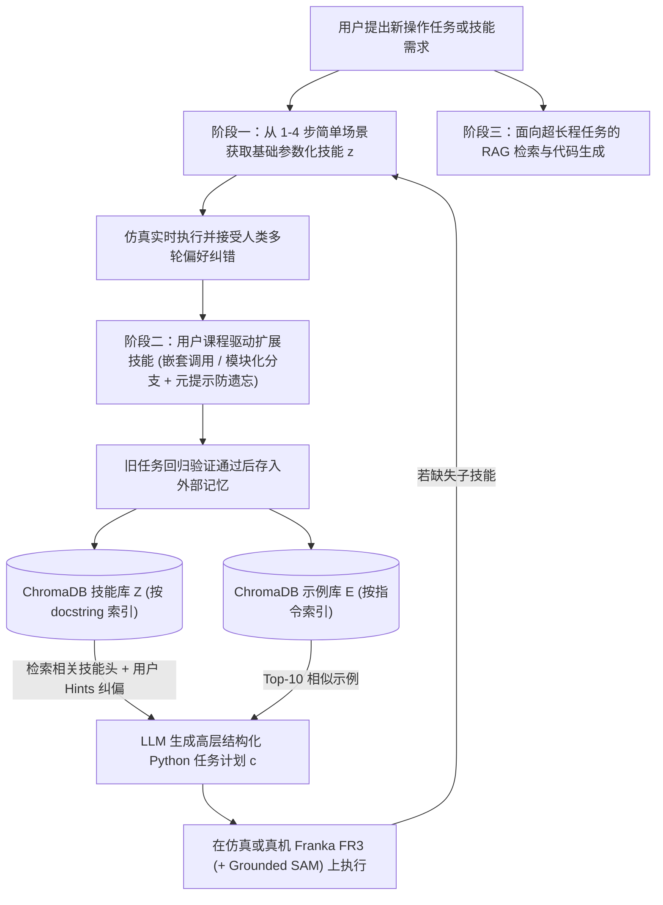

# Robotic Ultra-Long-Horizon Manipulation Skills via Human-guided Lifelong Code Generation

## 一句话定义

LYRA 是一个人类引导的机器人终身技能学习与代码生成框架，通过三阶段人机协同流程将人类反馈固化为可继承扩展的参数化 Python 技能库，并依托外部向量记忆库检索（RAG）与人工提示机制实现超长程（20+ 原语、12 分钟以上）操作任务的可靠规划与跨本体部署。

## 英文缩写速查

| 缩写 | 英文全称 | 简要说明 |
|---|---|---|
| LYRA | Lifelong learning code sYnthesis framework for Robotic long-horizon skill Acquisition | 本文提出的人类引导终身机器人技能代码生成框架 |
| CaP | Code as Policies | 经典开环 LLM 机器人控制代码生成基线，缺少持久反馈复用 |
| RAG | Retrieval-Augmented Generation | 检索增强生成，本文用 ChromaDB 检索历史成功示例与技能签名 |
| HITL | Human-in-the-Loop | 人在回路机制，由人类评估微调技能参数与对齐空间/美学偏好 |
| NoC | Number of Corrections | 完成任务所需的平均交互纠错轮次，越低代表反馈效率越高 |
| SR | Success Rate | 任务执行成功率 |
| LMP | Language Model Program | 语言模型程序，将自然语言指令映射为可执行控制代码 |

## 核心信息

| 字段 | 内容 |
|---|---|
| 论文标题 | *Robotic Ultra-Long-Horizon Manipulation Skills via Human-guided Lifelong Code Generation* |
| 作者 | Yuan Meng, Zhenguo Sun, Max Fest, Xiangtong Yao, Xukun Li, Zhenshan Bing, Alois Knoll |
| 机构 | 慕尼黑工业大学（TUM）、北京智源人工智能研究院（BAAI）、XYZ Embodied AI、南京大学 |
| 发表时间 / 预印本 | IEEE RA-L（2026-09 录用，arXiv:2509.18597v3，2026-10-07） |
| 论文链接 | [arXiv:2509.18597](https://arxiv.org/abs/2509.18597) / [PDF](https://arxiv.org/pdf/2509.18597) |
| 官方代码 / 项目页 | [GitHub: Ghiara/LYRA](https://github.com/Ghiara/LYRA) / [ghiara.github.io/LYRA](https://ghiara.github.io/LYRA/) |
| 清单分类 | `harness.skills` |
| 来源条目 | `survey_ax_2509_18597` |
| 开源 / 验证范围 | 论文公布项目主页与代码入口，实验覆盖 Ravens 定制超长程任务、Franka Kitchen、MetaWorld（MT20）、LIBERO-long 及真机 Franka FR3（配合 Grounded SAM 视觉感知） |

## 为什么重要

1. **解决“LLM 闭环纠错遗忘与假阳性”痛点**：纯 LLM 自动反馈（如 DAHLIA、Voyager 迁移）在长程操作中常无法察觉空间姿态偏差或错误抓取，甚至将未对齐的错误堆叠误判为成功；且若直接把纠错写进 prompt，随着任务增多会发生上下文溢出与灾难性遗忘。
2. **用“参数化技能函数”固化人类偏好**：将人类多轮纠正（如角对角堆叠、固定间距排列、45° 旋转对齐）封装为带参数的 Python 技能函数 $z \in Z$，把几小时的模型微调周期压缩到秒级仿真/真机交互验证。
3. **补足端到端 VLA 的超长程空白**：对比实验表明，OpenVLA 与 $\pi_0$ 在 LIBERO-long 仅达 0.65 / 0.60，而在“搭积木房子”“搭 Jenga 塔”“4×4×3 金字塔”等需 20+ 原语组合的超高复杂度任务上成功率均为 **0.00**；LYRA 则可稳定完成此类任务。

## 核心方法

LYRA 将技能定义为可执行的参数化函数 $b = \text{Exec}(z, s)$（区别于单次扁平任务代码 $c$），构建了一个可回溯的三阶段终身学习流水线：

1. **阶段一：偏好对齐的技能获取（Preference-aligned Skill Acquisition）**：
   - 从简单的 1–4 步基础原语任务出发（避免一上来超过 6–8 步导致失败）。
   - 用户描述需求后，LLM 调用 `skill parse` API 生成带参数建议的 Python 函数头（如 `def stack_blocks(blocks, start_pose):`），并在仿真中实时部署运行。
   - 用户通过多轮自由文本反馈精修旋转角度、对齐基准或位置参数，直到生成稳定且符合偏好的技能函数 $z$。
2. **阶段二：面向终身学习的能力扩展（Lifelong Learning-oriented Capability Extension）**：
   - 用户设计由简入繁的课程（如从固定位置堆 4 个木块扩展到按颜色/尺寸堆双塔、构建 $\{i \times j \times k\}$ 金字塔或环形排列）。
   - 系统向 LLM 注入保留先验功能的元提示（meta-prompt），引导模型通过**嵌套调用已有技能**或**模块化分支（`if-else` / `match-case`）**扩展能力而不覆写旧行为；每次扩展后需在先验任务上复测以确认无灾难性遗忘。
3. **阶段三：面向特定任务的检索与规划（Task-specific Retrieval and Planning）**：
   - **双向量数据库外部记忆**：使用 ChromaDB 与 OpenAI `text-embeddings-3` 维护两套索引——按指令检索少样本成功范例 $(l, c) \in E$（取余弦相似度 Top-$K=10$），以及按 docstring 检索任务无关技能头 $z \in Z$。
   - **用户提示（Hints）引导**：由于技能库自底向上构建而新任务需自顶向下分解，当自动相似度检索遗漏关键技能或受无关历史干扰时，用户通过简短自由文本 hint 直接指明应调用的已有技能（若发现缺失底层技能则回退至阶段一/二补学）。

### 方法流程图

## 实验与评测

### 1. Ravens 超长程任务与变体消融（Fig. 3a，每任务 20 次尝试，最多 5 轮反馈）

- **LYRA（完整版）**：平均成功率 **0.93**，相对消融及基线最高提升 **27%**。
- **LYRA w/ LLM feedback**（用 RGB-D 前后帧喂给 LLM 替代人工反馈，保留完整记忆库）：平均 SR 降至 **0.77**（因 LLM 推理受限容易在超长程规划中卡死或产生假阳性验收）。
- **LYRA w/o memory**（随机采样 25/49 技能与 25/86 示例塞满 prompt）：平均 SR 降至 **0.66**（无关信息干扰推理）。
- **CaP（开环 Code as Policies）**：在提示未覆盖的新结构（如 5 项未见结构搭建中的 3 项）泛化失败，平均 SR 仅 **0.45**。

### 2. 与端到端 VLA 模型对比（Table I，LIBERO-long 与 Ravens 超长程任务）

| 模型 / 框架 | LIBERO-long | 搭 Jenga 塔（Build a Jenga tower） | 搭 4×4×3 金字塔 | 搭房子（Build a House，12 技能 / 20+ 原语） |
|---|---:|---:|---:|---:|
| OpenVLA（微调 30+ 轨迹） | 0.65 | 0.00 | 0.00 | 0.00 |
| $\pi_0$（微调 30+ 轨迹） | 0.60 | 0.00 | 0.00 | 0.00 |
| **LYRA（本文）** | **0.95** | **0.95** | **0.85** | **0.80** |

### 3. 反馈交互效率对比（Table II，平均纠错轮次 NoC ↓）

| 框架 | Franka Kitchen（4 任务） | MetaWorld（MT20） |
|---|---:|---:|
| DAHLIA（GPT-4o 闭环） | 4.75 | > 10（如锤子抓落无法修复） |
| LYRA w/o memory | 5.00 | 4.15 |
| **LYRA（本文）** | **2.75** | **2.55** |

- **交互效率收益**：LYRA 在两项基准上平均减少 **42%** 的纠错轮次（NoC）。
- **单轮反馈耗时对比（90 次 Ravens 试验统计）**：人类平均 27.6 s/轮（决策推理仅 **7.5 s** + 文本输入 20.1 s），LLM 平均 17.6 s/轮（决策推理 14.2 s + 文本生成 3.4 s）——人类判断速度接近 LLM 的两倍且无假阳性误判。

### 4. 真机 Franka FR3 验证（10 次重复试验，Fig. 6）

在真机机械臂上通过 Grounded SAM 获取开放世界物体位姿，并对齐仿真底层 API 名称实现跨本体零微调迁移（单次任务持续超 **12 分钟**）：
- **搭房子（build house）**：**7/10**（0.7 SR）
- **搭 Jenga 塔（jenga tower）**：**7/10**（0.7 SR）
- **拼人脸图案（human face）**：**9/10**（0.9 SR）
- **搭神庙（build temple，未见泛化任务，5 轮 NoC 内完成技能组合）**：**6/10**（0.6 SR）

## 与现有工作的对比

| 维度 | CaP / CaP-X | Voyager / DAHLIA（全自动 LLM 反馈） | 提示书 / 经验蒸馏（Promptbook / ExpeL） | LYRA（本文） |
|---|---|---|---|---|
| 反馈存储形式 | 无持久反馈（开环） | 仅存扁平任务代码或临时反思 | 直接追加/修改全局 prompt | **参数化 Python 技能函数 + 双 ChromaDB 记忆** |
| 防遗忘机制 | 不适用 | 扁平代码反复改写易引入退化 | Prompt 膨胀导致灾难性遗忘 | **元提示保护 + 模块化扩展 + 旧任务回归测试** |
| 校验可靠性 | 无闭环 | LLM 易将歪斜/未完成状态误标为成功 | 依赖外部或 LLM 校验 | **人在回路（HITL）实时对齐空间与审美偏好** |
| 超长程组合能力 | 仅限提示内任务（SR 0.45） | 易在底层抓取失败或长程卡死 | 受限于固定上下文窗口 | **支持 20+ 原语级联（搭房子 SR 0.80 / 真机 0.70）** |

## 常见误区或局限

1. **并非全自动自进化系统**：LYRA 明确依赖人类在关键节点提供课程设计、偏好评判与 `hints` 引导；作者在结论与实验对比中论证“在长程与偏好敏感任务上，人在回路比纯 LLM 裁判更可靠”，因此它定位为高效人机共学而非无人监督系统。
2. **依赖稳定的底层控制原语与视觉位姿 API**：当前工作聚焦于准静态桌面操作原语（pick/place、对齐、按压等），对高度动态、接触丰富（contact-rich）的连续力控任务支持有限，真机仍依赖外部开放词汇检测分割（Grounded SAM）与标定 API。
3. **检索策略仅基于文本余弦相似度**：目前使用 `text-embeddings-3` 对指令和 docstring 做纯文本相似度检索，尚未利用多模态视觉特征或显式技能依赖图检索，因此仍需人工 `hints` 兜底。
4. **人类打字输入成为交互耗时瓶颈**：虽然人类决策仅需 7.5 s，但键盘输入反馈耗时 20.1 s，整体单轮比纯 LLM 慢 10 s（后续可通过语音或多模态手势交互提速）。

## 结论

**一句话总判：面对超过 20 个步骤、强调几何精度与人类偏好的超长程桌面操作，将人类纠错沉淀为“参数化技能函数 + 外部向量记忆”比端到端微调 VLA 或依赖 LLM 自我纠错更可靠且更省成本。**

1. **用“参数化函数”而非“扁平文本/prompt 补丁”保存反馈**：直接修改 prompt 随任务增加会引发干扰与遗忘（`LYRA w/o memory` 从 0.93 跌至 0.66），封装成带参技能才能实现组合复用。
2. **不要迷信纯 LLM 闭环评估器**：在 Jenga、锤子等需空间几何精确对齐的任务上，LLM 评价器会出现假阳性误判（把同向错叠的积木标为成功），关键技能入库阶段引入人类快速把关收益极高。
3. **小步课程（1–4 原语起步）+ 回归测试是防遗忘铁律**：新技能先在简单场景对齐偏好，再通过嵌套或 `if-else` 扩展边界并复测旧用例，才能构建出稳定的 12 节点级联技能树。
4. **检索失败时用轻量 `hint` 代替全量上下文**：保持提示窗口精简（Top-10 示例），当向量检索遗漏跨任务技能时由用户一句提示显式唤醒，可将纠错轮次平均压缩 42%。

## 关联页面

- [Agentic Robots 综述](paper-towards-agentic-robots-survey.md)
- [全量项目节点清单](../overview/awesome-agentic-robots-node-index.md)
- [VLA 方法背景](../methods/vla.md)
- [Code as Policies 论文节点](paper-pai-2209-07753-codeaspolicies.md)
- [Voyager 终身代码智能体](paper-agentic-2305-16291.md)
- [ProgPrompt 程序化提示](paper-agentic-2209-11302.md)
- [Agentic Coding for Manipulation](paper-agentic-coding-manipulation.md)
- [LIBERO 基准节点](libero-benchmark.md)
- [pi0 论文节点](paper-pi0.md)
- [OpenVLA 论文节点](paper-openvla.md)

- [智能体机器人操作策略](../methods/agentic-manipulation-policies.md)：对照智能体、机器人接口与执行反馈。

## 参考来源

- [官方 Awesome 快照归档](../../sources/repos/awesome-agentic-robots-survey-index.md)
- [arXiv:2509.18597v3 论文页面](https://arxiv.org/abs/2509.18597)（[PDF 原文](https://arxiv.org/pdf/2509.18597)）
- [官方代码仓库：Ghiara/LYRA](https://github.com/Ghiara/LYRA)
