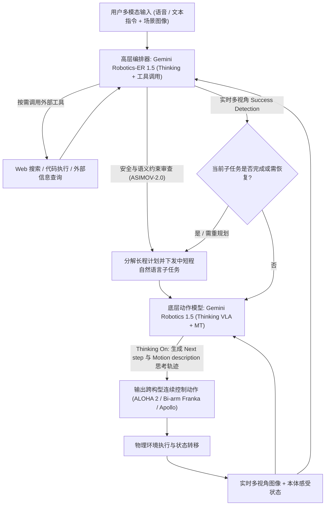

# Gemini Robotics 1.5: Pushing the Frontier of Generalist Robots with Advanced Embodied Reasoning, Thinking, and Motion Transfer

## 一句话定义

Gemini Robotics 1.5（GR 1.5）是 Google DeepMind 推出的新一代具身基础模型家族与物理智能体系统，由面向高阶规划、工具调用与空间时序理解的视觉语言编排模型 **Gemini Robotics-ER 1.5**，以及支持跨构型 **Motion Transfer** 与动作前“具身思考（Thinking）”的多构型 VLA 模型 **Gemini Robotics 1.5** 协同组成。

## 英文缩写速查

| 缩写 | 英文全称 | 简要说明 |
|---|---|---|
| GR 1.5 | Gemini Robotics 1.5 | 本文提出的多构型视觉-语言-动作（VLA）模型，支持 Thinking 模式 |
| GR-ER 1.5 | Gemini Robotics-ER 1.5 | 具身推理（Embodied Reasoning）VLM，担任智能体高层编排器 |
| GRoD | Gemini Robotics On-Device | 前代端侧单构型视觉-语言-动作基线模型 |
| MT | Motion Transfer | 动作迁移架构与训练配方，实现跨异构机器人本体的统一运动理解与零样本迁移 |
| VLA | Vision-Language-Action Model | 视觉-语言-动作模型，直接输出连续机器人控制动作 |
| SD | Success Detection | 成功检测任务，评估模型在多视角/单视角及实时/离线下的子任务完成判断 |
| ART | Auto-Red-Teaming | 自动红队对抗测试框架（由 Attacker、Target、AutoRater 三模型博弈） |

## 核心信息

| 字段 | 内容 |
|---|---|
| 论文标题 | *Gemini Robotics 1.5: Pushing the Frontier of Generalist Robots with Advanced Embodied Reasoning, Thinking, and Motion Transfer* |
| 作者 / 团队 | Gemini Robotics Team, Google DeepMind |
| 发表时间 / 预印本 | arXiv:2510.03342v3（2025-11-28） |
| 论文链接 | [arXiv:2510.03342](https://arxiv.org/abs/2510.03342) / [PDF](https://arxiv.org/pdf/2510.03342) |
| 项目页 / 官方发布入口 | 论文未单列独立代码/项目主页 URL（联系邮箱 `gemini-robotics-report@google.com`） |
| 清单分类 | `model.planning`, `harness.layered_systems` |
| 来源条目 | `survey_ax_2510_03342` |
| 开源 / 验证范围 | 闭源技术报告（基于 JAX、ML Pathways 与 TPU v4/v5p/v6e 训练）；实验覆盖 230 项实机/仿真任务（90%+ 开发迭代在对齐排序一致性的 MuJoCo 仿真中完成），并配套升级 ASIMOV-2.0 安全基准 |

## 为什么重要

1. **打破多构型数据孤岛并验证零样本跨本体迁移**：此前多构型混合训练多停留于提升泛化基线，较少实现“仅在机器人 A 见过的技能直接在机器人 B 零样本执行”。GR 1.5 凭借 Motion Transfer 使单一检查点无需针对性微调即可同时控制 ALOHA 2、Bi-arm Franka 与 Apptronik Apollo 人形机器人，并完成跨构型技能迁移（如桌面操作到竖直背板挂取、抽屉拉合到人形控制）。
2. **确立“编排器 VLM + 思考型 VLA”分层物理智能体范式**：实验证明单靠 Thinking VLA 在长程复杂任务中进度得分上限约 44%，而将通用 Frontier VLM（如 Gemini 2.5 Flash）直接拼在 VLA 上层也会因缺乏具身空间推理导致 44.5% 的子任务失败率；必须由专精具身推理的 GR-ER 1.5 承担编排与成功检测，才能将长程进度推近 80%。
3. **验证具身推理的测试时计算缩放（Inference-time Compute Scaling）**：GR-ER 1.5 证明思考 token 预算不仅在数学与编程有效，在开放世界空间指点（Complex Pointing）、进度估计、多视角成功检测与物理安全约束推理上同样具备清晰的计算缩放收益。

## 核心方法

Gemini Robotics 1.5 采用双层“具身思考（Embodied Thinking）”与双模型物理智能体架构：

1. **高层编排器：`Gemini Robotics-ER 1.5`（GR-ER 1.5）**：
   - 继承 Gemini 2.5 的多模态世界知识与原生工具调用能力（网页搜索、代码执行、函数调用、语音/文本对话），并针对 2D 指点、轨迹点序列预测、状态估计、分割掩码、目标检测、任务进度估计与帧乱序恢复（Frame Unshuffling）做专项强化。
   - 根据任务复杂度自动调节推理期思考 token 数量（指点任务消耗最少，视频问答消耗最多），输出结构化自然语言计划、子任务指令以及子任务完成判断（Success Detection）。
2. **底层动作模型：`Gemini Robotics 1.5`（GR 1.5 / Thinking VLA）**：
   - **Motion Transfer（MT）与跨构型共训**：结合互联网图文视频与 ALOHA 2、Bi-arm Franka、Apollo 人形机器人的数千项多构型操作轨迹联合预训练，不显式对齐动作空间即可提取共性物理与运动规律。
   - **Thinking 模式（Think Before Acting）**：在输出连续动作前，VLA 先向自身上下文窗口生成多层级自然语言思考轨迹（先将高层指令拆解为数秒级子步骤如 `Next step`，再细化为 `Motion description` 空间内省原语），从而自然实现隐式子任务完成感知与失败自恢复（例如水瓶滑落左手旁时自动切换左手拾取）。
3. **协同评测与多维安全体系**：
   - **Sim-Real 排序一致性评测**：实机采用同工位交错 A/B/n 测试；研发期超过 90% 的评测 episode 在视觉与物理参数对齐的 MuJoCo 仿真中运行，实测与真机成功率具有强排序一致性（Fig. 21）。
   - **安全与红队体系**：升级 `ASIMOV-2.0`（覆盖 NEISS 真实伤害文本、构型安全约束指点、Veo 生成视频介入时刻预测），并引入由 `Attacker`（提示/场景/环境扰动攻击）、`Target` 与 `AutoRater` 构成的三模型自动红队（ART）持续挖掘并缓解幻觉与安全漏洞。

### 方法流程图

## 实验与评测

全套基准共包含 230 项任务；短程与多步操作同时汇报连续进度分（Progress Score）与成功率（Success Rate），具身推理覆盖 15 项学术基准、真实测试者场景及长程智能体测试。

### 1. 具身推理与通用能力帕累托前沿（Tables 19, 20, 21）

| 模型（Thinking 状态） | Spatial 平均（4 项指点） | QA 平均（11 项理解/推理） | ER Score（50% 空间 + 50% QA） | 15 项总平均 | 通用基准平均（MMMU / GPQA / Aider） |
|---|---:|---:|---:|---:|---:|
| **GR-ER 1.5（Yes）** | **52.6** | 66.5 | **59.6** | **62.8** | 73.8（80.7 / 83.3 / 57.3） |
| GR-ER 1.5（No） | 47.1 | 60.2 | 53.7 | 56.7 | 68.3（79.3 / 81.3 / 44.4） |
| GR-ER（No，前代） | 49.1 | 56.1 | 52.6 | 54.2 | 47.5（67.0 / 59.6 / 16.0） |
| Gemini 2.5 Pro（Yes） | 35.4 | 68.0 | 51.7 | 59.3 | 83.5（82.0 / 86.4 / 82.2） |
| Gemini 2.5 Flash（Yes） | 39.7 | 62.7 | 51.2 | 56.5 | 73.1（79.7 / 82.8 / 56.7） |
| GPT-5（Yes，2025-09 API） | 30.8 | **71.4** | 51.1 | 60.6 | **83.9**（82.0 / 88.4 / 81.3） |
| GPT-5-mini（Yes，2025-09 API） | 27.1 | 68.2 | 47.7 | 57.3 | 74.3（78.0 / 78.3 / 66.7） |

- **复杂指点细分亮点（Table 21）**：GR-ER 1.5（Thinking Yes）在 `Point-Bench-Steerable` 达 **67.8**（vs. GR-ER 65.8、Gemini 2.5 Flash 61.3、GPT-5 38.0）、`Where2Place` 达 **59.0**（vs. GR-ER 41.0、GPT-5 37.0）、`PixMo Count` 达 **80.0**（vs. GPT-5-mini 77.0、Gemini 2.5 Pro 76.0）。
- **真实机器人用户测试场景（Fig. 14b）**：GR-ER 1.5 综合得分 **41.0**，领先 GR-ER（35.0）、Gemini 2.5 Pro（32.0）、Gemini 2.5 Flash（31.0）、GPT-5-mini（24.0）与 GPT-5（23.0）。

### 2. 多构型泛化、Motion Transfer 与 Thinking 消融（Section 3）

- **跨代泛化提升（Fig. 3 & Fig. 35）**：在 ALOHA 平台上，GR 1.5 在分布内、指令、动作、视觉与新任务五类泛化上全面超越前代 Gemini Robotics 与 GRoD；在 Bi-arm Franka（含高精密 NIST Assembly Board 2 皮带装配与插拔线缆）与 Apollo 人形平台上显著超越单构型专家 GRoD。
- **Motion Transfer 消融（Fig. 4 & Fig. 5）**：相较单构型训练及不含 MT 的多构型混合训练，MT 配方显著放大了跨本体正向迁移——在数据最丰富的 ALOHA 上靠对齐共性放大增益，在数据中等的 Bi-arm Franka 与数据稀缺的 Apollo 人形机器人上直接解锁单构型训练从未见过的零样本技能（如 ALOHA 学习 Franka 背板挂取工具、Franka 学习 ALOHA 抽屉/梨形盒操作、Apollo 学习 ALOHA 推门/叠衣等），不过在形体差异极大的人形平台上 MT 的对齐放大效应相对减弱。
- **Thinking VLA 多步任务增益（Fig. 6 & Fig. 37）**：开启 Thinking 后，VLA 在 ALOHA、Bi-arm Franka 与 Apollo 人形多步基准上的进度分与成功率均明显上升（在自由度最高的 Apollo 人形平台上，推理思考对长序列任务提升尤为悬殊）。

### 3. 长程物理智能体评测与失败归因（Section 5, Table 1, Fig. 17 & 41）

在横跨 ALOHA（Blocks in Drawer 9 步、Desk Organization、Sort Trash、Pack Suitcase）与 Bi-arm Franka（Top shelf to the table、Nut allergy、Swap、Mushroom risotto，含网络搜索与记忆恢复）的 8 项长程挑战任务中：

| 智能体配置 | 规划失败率（Planning ↓） | 成功检测失败率（SD ↓） | 动作失败率（Action ↓） | 总子任务失败率（Total ↓） |
|---|---:|---:|---:|---:|
| Agent（Gemini 2.5 Flash 编排 + GR 1.5） | 25.5% | 6% | 13% | 44.5% |
| **Agent（GR-ER 1.5 编排 + GR 1.5）** | **9%** | **4%** | **9%** | **22%** |

- 仅用底层 `GR 1.5 (Thinking on)` 独立执行此类需外部知识检索或全局记忆的复杂任务，进度分上限仅 **44%**；而 `GR-ER 1.5 + GR 1.5` 完整物理智能体在多数组装/分拣/记忆任务中进度分达 **80% 附近**，在复杂任务上接近使用通用 VLM 编排基线（Gemini 2.5 Flash）的**两倍**。

## 与现有工作的对比

| 维度 | Gemini Robotics 1.0 / GRoD | 通用前沿 VLM + VLA 拼接 | 单层端到端 Thinking VLA（如 ECoT） | Gemini Robotics 1.5 系统（本文） |
|---|---|---|---|---|
| 跨构型统一性 | ALOHA 泛化强，Franka/Apollo 需专精微调或单模型单机 | 取决于底层 VLA | 通常限于单构型或少量桌面构型 | **单检查点开箱控制 ALOHA 2 / Bi-arm Franka / Apollo，支持零样本 MT 迁移** |
| 高层世界知识与工具 | GR-ER 侧重感知，通用性弱（MMMU/GPQA/Aider 均值 47.5） | 通用能力强但空间与时序成功检测弱（ER 51.2） | 缺乏联网搜索、代码执行与长程记忆 | **GR-ER 1.5 兼具前沿通用性（73.8）与 SOTA 具身推理（59.6）** |
| 长程失败率 | 不支持原生双层工具编排 | 子任务总失败率 44.5%（规划错占 25.5%） | 依赖单模型容量，复杂任务进度上限 ~44% | **总失败率降至 22%（规划错仅 9%），复杂任务进度近 80%** |
| 安全与评估体系 | ASIMOV 1.0 | 缺少物理安全专项基准 | 较少系统性物理安全评测 | **ASIMOV-2.0（含 Veo 视频）+ 三模型 Auto-Red-Teaming** |

## 常见误区或局限

1. **人形平台跨构型对齐仍有鸿沟**：作者明确指出，当本体形态差异极大时（如双臂桌面臂 vs. 全身多指人形机器人 Apollo），Motion Transfer 带来的跨本体对齐增益不如机械臂之间显著，目前数据稀缺条件下人形主要仍受益于外部数据补充而非完美动作对齐。
2. **灵巧度（Dexterity）未显著超越前代**：论文在讨论部分坦承，GR 1.5 在泛化、跨本体迁移与长程规划上实现了代际跃升，但其精细灵巧操作能力整体与上一代 Gemini Robotics 持平，未来需结合强化学习（RL）进一步提升精细操作而不牺牲通用性。
3. **尚未大规模吸收无动作标注人类/合成视频**：尽管 GR 1.5 的新架构在设计上已支持从无动作标注视频中学习，但本报告的训练仍以遥操作机器人动作数据为主，利用海量公开低质量人类视频仍是下一步工作。
4. **完全闭源且未披露具体参数量与推理延迟细节**：报告未公布 GR 1.5 与 GR-ER 1.5 的具体参数规模、训练步数或单步控制延迟数值，外部研究者无法直接本地复现模型权重。

## 结论

**一句话总判：通往通用物理智能体的可行路径不是把一个模型无限做大，而是“专精具身空间推理与工具调用的高层 VLM 编排器 + 支持跨构型运动迁移与动作前轻量思考的底层 VLA”。**

1. **不要用普通通用 VLM 替代具身推理编排器**：对比表明，即便强如 Gemini 2.5 Flash（73.1 通用均分），直接担任机器人编排器时的规划失败率也高达 25.5%（总失败率 44.5%），而经过空间指点与多视角成功检测强化的 GR-ER 1.5 将规划失败率压低到 9%。
2. **让 VLA “轻量思考”解决局部恢复，把“重推理”留给上层**：VLA 内置思考轨迹（Thinking on）可显式拆解短程步骤并在物体滑落时自发切换手臂恢复，但不应替代高层做需要联网搜索或长时记忆的规划。
3. **跨构型数据协同需配合专门的运动迁移机制（MT）**：单纯混合多机器人数据在数据充足的平台（ALOHA）收益有限，必须通过 Motion Transfer 对齐运动表征才能释放零样本跨本体技能复用。
4. **将高排序一致性的物理仿真作为主力迭代引擎**：在对齐视觉与物理参数后，把 90%+ 的架构与消融评测放到 MuJoCo 仿真、实机只做关键 A/B/n 终审，是大规模研发通用 VLA 的关键工程杠杆。

## 关联页面

- [Gemini Robotics 1.0 实体节点](gemini-robotics.md)
- [Agentic Robots 综述](paper-towards-agentic-robots-survey.md)
- [全量项目节点清单](../overview/awesome-agentic-robots-node-index.md)
- [VLA 方法背景](../methods/vla.md)
- [pi0.5 开放世界 VLA](paper-pi05-open-world-vla.md)
- [Embodied CoT 论文节点](paper-ecot.md)
- [SayCan 论文节点](paper-saycan.md)
- [HAMSTER 分层操作模型](paper-agentic-2502-05485.md)

## 参考来源

- [官方 Awesome 快照归档](../../sources/repos/awesome-agentic-robots-survey-index.md)
- [arXiv:2510.03342v3 论文页面](https://arxiv.org/abs/2510.03342)（[PDF 原文](https://arxiv.org/pdf/2510.03342)）
