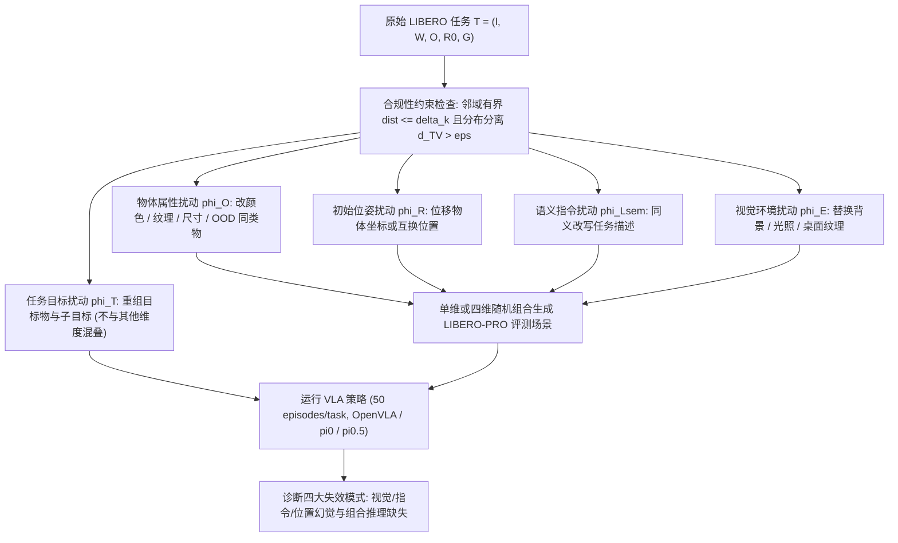

# LIBERO-PRO: Towards Robust and Fair Evaluation of Vision-Language-Action Models Beyond Memorization

## 一句话定义

LIBERO-PRO 是面向视觉-语言-动作（VLA）模型的即插即用鲁棒性评测套件，通过在物体属性、初始空间配置、语义指令、任务目标与环境背景五个维度施加受控且可执行的分布外扰动，拆穿了标准 LIBERO 基准上超过 90% 成功率背后的“轨迹死记硬背（rote memorization）”假象。

## 英文缩写速查

| 缩写 | 英文全称 | 简要说明 |
|---|---|---|
| VLA | Vision-Language-Action Model | 视觉-语言-动作模型，融合视觉观测与自然语言指令输出动作 |
| LIBERO | Lifelong Robot Learning Benchmark | 终身机器人学习仿真基准，当前 VLA 领域事实上的“通用货币”评测集 |
| OOD | Out-of-Distribution | 分布外场景，用于检验模型脱离训练集窄邻域后的真实泛化能力 |
| TV Distance ($d_{\text{TV}}$) | Total Variation Distance | 全变分距离，本文用于约束扰动任务与原任务在分布上具备非平凡分离 |
| SR | Success Rate | 任务成功率，每项任务按原 LIBERO 协议评测 50 个 episode |

## 核心信息

| 字段 | 内容 |
|---|---|
| 论文标题 | *LIBERO-PRO: Towards Robust and Fair Evaluation of Vision-Language-Action Models Beyond Memorization* |
| 作者 | Xueyang Zhou, Yangming Xu, Guiyao Tie, Yongchao Chen, Guowen Zhang, Duanfeng Chu, Pan Zhou, Lichao Sun |
| 机构 | 华中科技大学（HUST）、清华大学 AI 学院、武汉理工大学、Lehigh University |
| 发表时间 / 预印本 | arXiv:2510.03827v2（2026-05-25） |
| 论文链接 | [arXiv:2510.03827](https://arxiv.org/abs/2510.03827) / [PDF](https://arxiv.org/pdf/2510.03827) |
| 官方代码仓库 | [GitHub: Zxy-MLlab/LIBERO-PRO](https://github.com/Zxy-MLlab/LIBERO-PRO) |
| 清单分类 | `environment.benchmarking` |
| 来源条目 | `survey_ax_2510_03827` |
| 开源 / 验证范围 | 已开源即插即用评测代码；基于每任务 50 次 rollout 对 OpenVLA、$\pi_0$、$\pi_{0.5}$ 官方检查点完成五大扰动维度及组合评测 |

## 为什么重要

1. **暴露“通用评估货币”的系统性虚高**：在原 LIBERO 协议中，测试任务与训练任务保持指令 $l'=l$、场景 $W'=W$、物体集 $O'=O$ 和目标谓词 $G'=G$ 完全一致，仅在初始位姿 $R_0'$ 上做肉眼几乎不可察觉的微扰，导致靠过拟合记忆轨迹的模型也能刷出 90%–95%+ 高分，误导社区对模型真实具身智能水平的判断。
2. **诊断当前 VLA 的四大本质性幻觉缺陷**：定性诊断揭示当前主流 VLA 模型并非真正把语言绑定到视觉实体上，而是依赖场景布局与起始坐标的“捷径相关性（shortcut correlations）”回放动作序列——甚至在目标被移走时“抓空气”、面对乱码指令 `"fdsgfdsgsd"` 照常执行原动作。
3. **揭示标准分数掩盖下的模型真实差异**：在标准 LIBERO 均分极高的 OpenVLA、$\pi_0$ 与 $\pi_{0.5}$ 之间，LIBERO-PRO 精准分离出模型能力梯度（例如位置扰动下 $\pi_{0.5}$ 在 `libero-goal` 仍保持 0.38 成功率，而 OpenVLA 与 $\pi_0$ 已归零）。

## 核心方法

作者首先形式化 VLA 任务为 $T = (l, e, G)$，其中环境实例 $e = (W, O, R_0)$ 分别表示视觉环境上下文 $W$、可交互物体集 $O$ 与初始空间配置 $R_0$。在此基础上，LIBERO-PRO 定义了受控扰动算子 $T^{(k)} = \phi_k(T)$，确保所有扰动满足两个数学约束：
- **有界邻域约束**：$\text{dist}_k(x, x^{(k)}) \le \delta_k$，保证物理可执行且语义合理；
- **非平凡分离约束**：$d_{\text{TV}}(T, T^{(k)}) > \epsilon$，确保任务确实偏离原记忆轨道。

具体覆盖五大正交扰动维度（4 大核心维度拆分出 5 类评测轴）：

1. **物体属性扰动（Object Attribute, $k=O$）**：替换非本质视觉属性（颜色、纹理、尺度）或 OOD 同类物体，语义保持等价。
2. **初始空间配置扰动（Initial Position / Configuration, $k=R$）**：改变物体的绝对坐标或互换物体相对位置（如互换番茄酱与篮子位置），保持物理合法性。
3. **语义指令扰动（Semantic Instruction, $k=L_{\text{sem}}$）**：对原指令做等价同义改写（Paraphrasing），检验语言接地而非关键词/固定句式记忆。
4. **任务目标扰动（Task, $k=T$）**：在训练分布已有物体与技能库内重新组合目标对象或动作（例如将放沙拉酱改为放烧烤酱，或从单步改为多步组合）。为保证任务物理可行，任务级扰动不与其他扰动交叉叠加。
5. **环境视觉扰动（Environment, $k=E$）**：替换背景、光照与桌面纹理（例如切换至 `"living room table"`）。除任务扰动外，其余四类扰动支持单维评测与多维自由随机组合评测。

### 方法流程图

## 实验与评测

作者遵循 LIBERO 原协议，以每项任务 **50 个 episode** 对 **OpenVLA**（分别评测 4 个对应套件的官方微调检查点）、**$\pi_0$** 与 **$\pi_{0.5}$**（单官方检查点）展开系统定性与定量评测：

### 1. 四大定性过拟合失效模式（Section 2）

| 失效模式 | 测试干预方式 | 观察到的典型模型行为 |
|---|---|---|
| **视觉感知幻觉**（Sec 2.1） | 将目标物（沙拉酱）完全移除，或替换为无关物体（字母汤罐头） | 物体移除时仍朝原记忆坐标“抓空气”；替换成字母汤时仍按原任务抓取无关物体，证明策略未做在线视觉核验与实体绑定 |
| **指令理解幻觉**（Sec 2.2） | 将指令替换为无意义乱码（`"fdsgfdsgsd"` 或 `"xxx"`） | 仍毫不犹豫地复现与原指令几乎一致的抓取放置轨迹，说明指令输入对决策贡献极微 |
| **位置感知幻觉**（Sec 2.3 & Fig. 4） | 沿 X 轴逐步平移目标物初始坐标 | **OpenVLA 与 $\pi_0$ 在位移超过 `0.2 units` 后成功率骤降至 0**；架构更大且预训练更广的 **$\pi_{0.5}$ 也仅能维持到约 `0.4 units`**，随后同样归零 |
| **缺乏组合任务理解**（Sec 2.4 & Fig. 5） | 单独测试“拿碗放炉上”与“开炉灶”均成功，再将两步合为一条复合指令 | 模型在复合指令下持续失败，回放碎片化或伪轨迹，缺乏子任务间的时序因果组合能力 |

### 2. LIBERO-PRO 主定量结果与核心发现（Section 5, Fig. 1 & Fig. 7）

- **总体崩塌现象**：尽管五大家族 VLA（自回归、连续输出、Flow/Diffusion、混合、Adapter 类）在标准 LIBERO 上普遍超过 **70%–90%**，在 LIBERO-PRO 的广义扰动（尤其是**初始位置偏移**与**任务目标变更**）下，模型成功率**几乎全线崩溃（甚至跌至 0.0%）**。
- **物体与语义指令下的“虚假鲁棒性”**：即便部分模型在局部物体外观或轻度同义改写下保留一定分数，对照第 2 节无意义乱码/替换物体的干预实验可知，这种“稳定”很大程度源自忽略指令与物体细节、直接靠桌面全局布局记忆回放轨迹。
- **被标准基准掩盖的能力梯度（Section 5.2）**：在 `libero-goal` 套件的位置扰动（Position changes）评测中，**$\pi_{0.5}$ 取得了 `0.38` 的成功率，而 OpenVLA 与 $\pi_0$ 均为 `0`**——这说明更强的跨分布预训练与模型规模确实带来了微弱但真实的空间泛化优势，但在标准 LIBERO 全员 90%+ 的天花板效应下完全无法体现。

## 与现有工作的对比

| 维度 | 原版 LIBERO | 通用多任务基准（RLBench / CALVIN / RoboCasa） | 对抗/不确定性零散压力测试 | LIBERO-PRO（本文） |
|---|---|---|---|---|
| 训练-测试分布差距 | 极小（仅 $R_0$ 极微扰动，同指令同物体同场景） | 各自独立任务集，但社区采用度不及 LIBERO | 多为单一维度探针，缺少统一标准套件 | **直接在 LIBERO 生态上构建五大正交受控扰动轴** |
| 记忆捷径识别能力 | 无法区分真理解与轨迹背诵 | 部分支持新组合，但难以定位具体捷径轴 | 局部暴露问题，不易横向复现对比 | **通过乱码/移物/互换位姿等干预精准剥离死记硬背** |
| 工程接入成本 | 现有代码基线默认支持 | 需重建训练与评测管线 | 脚本分散 | **即插即用兼容现有 LIBERO 模型与检查点** |

## 常见误区或局限

1. **不可将标准 LIBERO 分数当作泛化能力证明**：LIBERO 超过 90% 的成功率主要反映“训练分布窄邻域插值与记忆回放”能力，既不代表语言接地有效，也不代表能应对真实桌面物体位置变化。
2. **物体属性或单维语义扰动高分不等于真鲁棒**：若只看“同义改写指令”或“轻微换色”仍能成功，可能只是模型根本没看语言或细节、单纯在背固定桌面坐标的轨迹（需配合乱码指令与位置偏移联合验证）。
3. **任务级扰动（Task perturbation）不可与其他维度叠加**：论文明确说明为避免构造出物理上不可执行的任务，Task 维度与其他四维组合保持隔离，其余四维（物体、位置、语义、环境）方可自由组合。
4. **当前主体评测模型聚焦代表性检查点**：主实验重点评测了 OpenVLA、$\pi_0$ 与 $\pi_{0.5}$ 三大代表模型；虽然引言 Fig. 1 按动作解码范式归纳了五大类方法在 LIBERO 与 LIBERO-PRO 间的普遍落差，但不同后训练/推理期思考策略（如带显式视觉/空间接地或强化学习微调模型）在 LIBERO-PRO 上的系统上限仍有待后续社区刷榜补全。

## 结论

**一句话总判：标准 LIBERO 已经成为 VLA 评估中的“记忆过拟合陷阱”，任何声称具备语言理解与泛化能力的 VLA 模型都必须接受位置偏移、物体替换、乱码负对照与跨维度组合扰动的检验。**

1. **在评测链路中把“位置偏移 + 乱码指令负对照”设为必检项**：只需把目标物平移超 0.2–0.4 单位或将指令替换为随机字符，就能立刻检验模型是在“看图听话控制”还是“闭眼背轨迹”。
2. **用位置扰动区分强弱模型，告别 90%+ 饱和区内卷**：$\pi_{0.5}$ 在 `libero-goal` 位置变化下仍保住 0.38 成功率（vs. $\pi_0$/OpenVLA 为 0），证明泛化评测基准必须具备足够的动态区分度。
3. **训练数据与策略设计需打破固定视角-坐标捷径**：减少固定场景/固定初始位姿下的单调演示过拟合，引入位置随机化、多视角/以物体为中心的空间表征及显式视觉接地监督，是从根源上攻克 LIBERO-PRO 的方向。

## 关联页面

- [具身大模型评测基准选型闭环](../queries/embodied-eval-benchmark-selection-loop.md)
- [LIBERO 基准节点](libero-benchmark.md)
- [VLA 评测体系](vla-evaluation-harness.md)
- [Agentic Robots 综述](paper-towards-agentic-robots-survey.md)
- [全量项目节点清单](../overview/awesome-agentic-robots-node-index.md)
- [VLA 方法背景](../methods/vla.md)
- [pi0 论文节点](paper-pi0.md)
- [pi0.5 开放世界 VLA](paper-pi05-open-world-vla.md)
- [OpenVLA 论文节点](paper-openvla.md)
- [EmbodiedBench 具身评测基准](paper-agentic-2502-09560.md)

## 参考来源

- [官方 Awesome 快照归档](../../sources/repos/awesome-agentic-robots-survey-index.md)
- [arXiv:2510.03827v2 论文页面](https://arxiv.org/abs/2510.03827)（[PDF 原文](https://arxiv.org/pdf/2510.03827)）
- [官方代码仓库：Zxy-MLlab/LIBERO-PRO](https://github.com/Zxy-MLlab/LIBERO-PRO)
