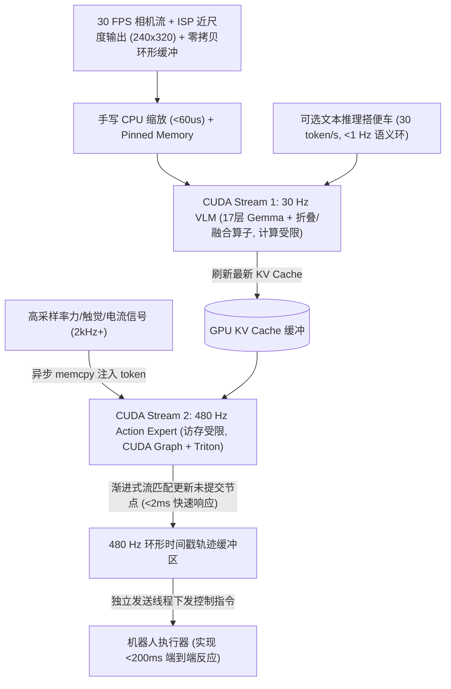

# Running VLAs at Real-time Speed

## 一句话定义

*Running VLAs at Real-time Speed* 针对十亿参数级 VLA 模型（以 $\pi_0$ 为代表）在动态控制中的高延迟瓶颈，提出了一套面向单张消费级 GPU（RTX 4090）的系统级推理优化栈与“全流式推理（Full Streaming Inference）”三闭环架构，将双视角推理压至 **27.3 ms（>30 FPS）**、动作专家频率最高推至 **480 Hz**，并在真机“接下落马克笔”高动态测试中取得 **100%** 成功率。

## 英文缩写速查

| 缩写 | 英文全称 | 简要说明 |
|---|---|---|
| VLA | Vision-Language-Action Model | 视觉-语言-动作模型，本文以 3B PaliGemma + 300M AE 的 $\pi_0$ 为优化对象 |
| AE | Action Expert | 动作专家模块，本文为 300M 参数、10 步去噪、63 步 chunk 的流匹配网络 |
| GEMM | General Matrix Multiply | 通用矩阵乘法，构成 ViT、LLM 与 AE 推理计算的主体 |
| SM | Streaming Multiprocessor | GPU 流式多处理器，RTX 4090 具备 128 个 SM |
| CUDA Graph | Compute Unified Device Architecture Graph | GPU 静态执行图机制，用于消除 Python 驱动千余次 kernel 启动的 CPU 开销 |
| ISP | Image Signal Processor | 相机图像信号处理器，用于调节输出分辨率接近 224×224 以压缩缩放耗时 |

## 核心信息

| 字段 | 内容 |
|---|---|
| 论文标题 | *Running VLAs at Real-time Speed* |
| 作者 | Yunchao Ma, Yizhuang Zhou, Yunhuan Yang, Tiancai Wang, Haoqiang Fan |
| 机构 | Dexmal、StepFun |
| 发表时间 / 预印本 | arXiv:2510.26742v1（2025-10-30） |
| 论文链接 | [arXiv:2510.26742](https://arxiv.org/abs/2510.26742) / [PDF](https://arxiv.org/pdf/2510.26742) |
| 官方代码仓库 | [GitHub: Dexmal/realtime-vla](https://github.com/Dexmal/realtime-vla) |
| 清单分类 | `harness.infrastructure` |
| 来源条目 | `survey_ax_2510_26742` |
| 开源 / 验证范围 | 已开源推理优化代码；硬件实测基于单张 RTX 4090（BF16），并搭建真机双夹爪接落笔实验完成 10 次连续闭环验证 |

## 为什么重要

1. **跨过 30 FPS（33.3 ms）硬实时门槛**：常规 VLA 单次前向动辄上百毫秒（哪怕超过 34 ms 都会持续丢帧并增加整帧突发延迟）；本文证明 3B+ 级别 VLA 无需裁剪模型精度，仅靠纯系统与算子工程即可在单张消费级 RTX 4090 上稳定全帧率处理 30 FPS 双视角视频流（27.3 ms）。
2. **给出算子级 Roofline 理论下界**：基于 RTX 4090 实测算力（91.4 TMAC/s @ 2.79 GHz，1.01 TB/s 显存带宽）与 1,378 次 matmul 同步开销建模，明确得出单/双/三视角理论极限为 13.7 / 20.6 / 27.6 ms，证明当前实现距离物理极限仅剩 ≤30% 空间，避免盲目调优。
3. **重塑 VLA 在控制层级中的位置**：通过“算力受限的 VLM”与“访存带宽受限的 AE”双流并行执行，提出 **480 Hz 高频力/触觉回路 + 30 Hz 视觉回路 + <1 Hz 文本推理回路** 的全流式架构，使 VLA 得以触及传统力矩控制频段。

## 核心方法

以 $\pi_0$（PaliGemma 3B [SigLIP 400M + Gemma 2.6B] + 300M 流匹配 Action Expert，10 步去噪，chunk 长度 63）为基准，优化与架构设计分四层推进：

1. **消除 CPU 与系统侧开销（Sec 3.1 & 3.3）**：
   - **CUDA Graph 录制回放**：$\pi_0$ 单步推理需启动超 1,000 个 CUDA kernel，Python 调度成为主要瓶颈；因 Transformer 块无动态分支，录制静态 CUDA Graph 直接带来约 2 倍提速（双视角 106.5 ms → 43.5 ms）。
   - **相机与主机内存工程**：配置相机 ISP 直接输出接近 224×224 的分辨率（如 240×320）配合手写 CPU 缩放（<60 µs，规避 JAX 缩放慢的问题），采用锁页内存（pinned memory）、静态 CPU 缓冲区与零拷贝帧缓冲消除抖动。
2. **等价计算图简化（Sec 3.2，双视角再省 7–8 ms → 35.7 ms）**：
   - **RMSNorm 仿射权重吸收**：利用结合律将 RMSNorm 仿射参数折叠进后续线性层权重。
   - **Action-Time 编码器折叠与查表**：无非线性分隔的动作投影双线性层合并为一层；推理仅使用 10 个固定去噪时间步，预先将时间编码线性输出查表固化至 SiLU 前偏置。
   - **QKV 矩阵合并与 RoPE 预计算融合**：合并 Q/K/V 权重为单一大型 GEMM 并预计算旋转位置编码（RoPE）权重融入矩阵乘；此外 LLM 仅需传递 KV Cache 给 AE，最后一层（第 18 层）无需执行，仅跑 17 层再省约 0.7 ms。
3. **Triton 深度算子优化（Sec 4，双视角再省 → 27.3 ms）**：
   - **GEMM 分块（Tile）定制调优**：对 cuBLAS 未达最优的 24 类 GEMM 尺寸定制 Triton 分块策略（Table 2），净省 ~1.5 ms。
   - **门控线性层融合**：将 `FC1(x, w1) * GELU(FC2(x, w2))` 合并为单 kernel 复用输入分块加载与结果写回，省 **1.7 ms**。
   - **Partial Split-k**：针对 `512×1152×1152`（64×64 分块得 144 块，无法整除 RTX 4090 的 128 SM），在单 kernel 内拆分为 `512×1152×1024`（64×64 均匀占满 SM）与 `512×1152×128`（32×32 split-2），额外微省 <0.1 ms。
   - **标量算子融合**：将 bias、残差连接、激活与 token 级 RMSNorm 缩放统计量融入 GEMM（余下 ~4 ms 收益）。
4. **全流式推理框架（Full Streaming Inference, Sec 6）**：
   - 利用 **VLM 计算密集（compute-bound）** 与 **AE 访存密集（IO-bound）** 的硬件互补性，双 CUDA 流并行执行（AE 读最新可用 KV Cache）：10 步并发耗时降至 **26.3 ms**，扩展到 **16 次 AE 运行耗时 32.7 ms**（仍 <33.3 ms），对应 **30 Hz VLM + 480 Hz AE**。
   - 构建三层异步闭环：（1）**480 Hz 力控/触觉环**（<2 ms 响应，独立 memcpy 注入 2 kHz+ 力传感器/电机电流 token 至渐进式未提交轨迹缓冲区）；（2）**30 Hz 视觉环**（VLM 持续刷新 KV Cache）；（3）**<1 Hz 文本环**（在 VLM 视觉前向加载权重时搭便车生成 30 token/s 思维/对话文本，超越人类 ~3.3 token/s 语速）。

### 方法流程图

## 实验与评测

所有推理基准均在单张 **NVIDIA RTX 4090**（BF16，空文本提示，chunk 长度 63）下测得：

### 1. 推理延迟与 Roofline 下界对比（Table 1, Fig. 2 & Sec 5）

| 实现方案 / 理论界 | 1 视角（ms） | 2 视角（ms） | 3 视角（ms） |
|---|---:|---:|---:|
| Naive PyTorch `nn.Module` | 105.0 | 106.5 | 113.9 |
| 官方 `openpi`（JAX） | 43.8 | 53.7 | 67.6 |
| + CUDA Graph | 35.2 | 43.5 | 53.9 |
| + 简化计算图（折叠/合并） | 28.2 | 35.7 | 45.8 |
| **+ 优化算子（Triton/融合，本文最终）** | **20.0** | **27.3** | **36.8**（Fig.2 为 36.9） |
| Roofline 下界（仅 GEMM） | 12.8 | 19.7 | 26.7 |
| Roofline + 软件屏障同步下界（+0.86 ms） | 13.7 | 20.6 | 27.6 |

- **同步开销拆解（Table 3，1,378 次操作实测）**：无同步融合 Triton 核为 0.89 ms；加软件全局屏障 1.75 ms（+0.86 ms）；CUDA Graph 2.61 ms（+1.72 ms）；Naive PyTorch 高达 13.81 ms（+12.92 ms）。
- **并发流重叠实测（Sec 6.1，双视角）**：顺序 `VLM + 10 AE` 耗时 27.3 ms；双流并发 `VLM + 10 AE` 降至 **26.3 ms**；双流并发 `VLM + 16 AE` 为 **32.7 ms**（仍满足 30 Hz 帧周期）。

### 2. 真机“接住下落马克笔”验证（Section 7）

- **实验装置**：上下双垂直对准自定义夹爪（闭合时间 60 ms，约 2 帧），笔自由落体约 30 cm（人类反应的常见极限距离下界），上方松开后 200 ms 下方闭合。选用 30 FPS 720P USB 相机（测得延迟约 2 帧 ≈ 66 ms；论文指出常见 RealSense 相机延迟超 **100 ms** 故未采用）。
- **训练与线程**：将当前帧与上一帧作为双视角输入以隐式提示下落速度，基于 `openpi` 采集 600 条演示微调（空文本 prompt）；推理端采用相机采集线程、推理线程、输出线程三线程环形缓冲异步解耦，并在 GPU 预热稳定时钟后再释放笔。
- **实测结果**：连续 10 次独立下落接笔试验 **10/10（100% 成功率）**，系统端到端反应时间 **<200 ms**（66 ms 相机读出 + <33 ms 推理 + 60 ms 夹爪闭合），达到与普通人类相当的反应速度。

## 与现有工作的对比

| 维度 | 官方 `openpi` (JAX / XLA) | 通用编译器（TVM / TensorRT） | Superoptimizer（Mirage / Neptune） | 本文 `realtime-vla` |
|---|---|---|---|---|
| 2 视角单 RTX 4090 延迟 | 53.7 ms（~18.6 FPS，无法跑满 30 Hz） | 通用意向调度，仍留 FFN/标量/跨层同步损失 | 搜索耗时极长或加速比受限（Mirage 仅统计等价校验） | **27.3 ms（36.6 FPS，超越 30 Hz 门槛）** |
| 系统瓶颈定位 | 未给出算子级 Roofline 与 SM 分布拆解 | 黑盒编译 | 偏局部子图搜索 | **明确 VLM 计算受限 vs AE 带宽受限 + 精确下界** |
| 闭环控制频率上限 | 随chunk整体开环/低频刷新（~18 Hz） | 单流同步推理 | 单流推理 | **提出双流并发 30 Hz 视觉 + 480 Hz 力控三环架构** |
| 外设与系统协同 | 默认 JAX resize 偏慢 | 聚焦 GPU 端 | 聚焦内核级 | **覆盖 ISP 近分辨率、手写 <60µs resize 与低延迟相机选型** |

## 常见误区或局限

1. **Full Streaming Inference（480 Hz 三闭环）目前仅为架构蓝图**：论文在第 6.4 节与第 1 节明确说明，文中仅给出了全流式推理架构的草图以及并发 kernel 的概念验证测速（Concurrent VLM + 16 AE = 32.7 ms），包括高频轨迹缓冲区融合规则、Persistent Megakernel 与 480 Hz 真实力传感接入等完整实现细节留待后续工作（真机只验证了 30 FPS 接笔）。
2. **27.3 ms 基准测试基于“空文本提示”**：Table 1 与 Table 2 均明确标注测量条件为 `empty prompt text` 与固定 `chunk=63`；若输入较长自然语言指令或并发生成大量自回归文本 token，VLM 编码侧算力负载会相应增加。
3. **3 视角尚无法在单张 RTX 4090 上稳定跑进 33.3 ms**：3 视角优化后为 **36.8 ms**（理论极限 27.6 ms），在 30 FPS 相机流下仍会偶尔掉帧，论文建议未来通过 INT8 量化、动态视角选择或更高带宽卡（如 RTX 5090）突破。
4. **端到端系统延迟受传感器传输链路掣肘**：论文实测常用 RealSense 深度相机存在 **>100 ms** 固有延迟，若外设链路不优化，即便 GPU 推理压缩到 27 ms 也无法完成高速动态抓取。

## 结论

**一句话总判：3B 级 VLA 跑不满 30 Hz 并非模型天生太慢，而是被上千次 Python kernel 启动、冗余线性/归一化层与低效传感器前处理拖垮；通过系统工程即可释放 4 倍推理加速并解锁百赫兹级高频控制可能。**

1. **优先上 CUDA Graph + 静态计算图折叠再写自定义 Kernel**：仅 CUDA Graph 就砍掉一半以上延迟（106.5 → 43.5 ms），再做 RMSNorm 吸收、10 步时间编码查表与 QKV 合并降到 35.7 ms，这 70 ms 的收益几乎零模型精度损失且工程性价比较手写算子更高。
2. **用硬件并发互补性（VLM 算力密集 + AE 带宽密集）换高频控制**：不要等 VLM 算完再串行跑 AE；双流复用最新 KV Cache 并发运行可在 33 ms 帧周期内塞进 16 次 AE，把高频信号响应压到 2 ms 量级。
3. **实时真机部署必须把相机延迟纳入预算**：优先选择低延迟 USB/ISP 近端输出（避免 RealSense >100 ms 链路延迟），并用锁页内存与环形缓冲隔离开采集、推理与下发线程。
4. **3 视角或 7B 规模需转向低比特量化与动态视角剪枝**：在 RTX 4090 BF16 下 3 视角 36.8 ms 已逼近 27.6 ms 理论极值，纯算子微调边际收益见顶，下一步需依赖 FP8/INT8 量化或视角 token 稀疏化。

## 关联页面

- [Agentic Robots 综述](paper-towards-agentic-robots-survey.md)
- [全量项目节点清单](../overview/awesome-agentic-robots-node-index.md)
- [VLA 方法背景](../methods/vla.md)
- [VLA 推理加速 25 种方法对比](../comparisons/vla-acceleration-25-methods-2026.md)
- [pi0 论文节点](paper-pi0.md)
- [WAM 实时异步推理](paper-wam-realtime-async.md)
- [FutureRTC 实时分块执行](paper-futurertc.md)
- [RTCF 实时控制框架](paper-rtcf.md)

- [AI 模型推理与服务部署](../methods/ai-model-serving-inference.md)：对照相关方法与适用场景。

## 参考来源

- [官方 Awesome 快照归档](../../sources/repos/awesome-agentic-robots-survey-index.md)
- [arXiv:2510.26742v1 论文页面](https://arxiv.org/abs/2510.26742)（[PDF 原文](https://arxiv.org/pdf/2510.26742)）
- [官方代码仓库：Dexmal/realtime-vla](https://github.com/Dexmal/realtime-vla)
