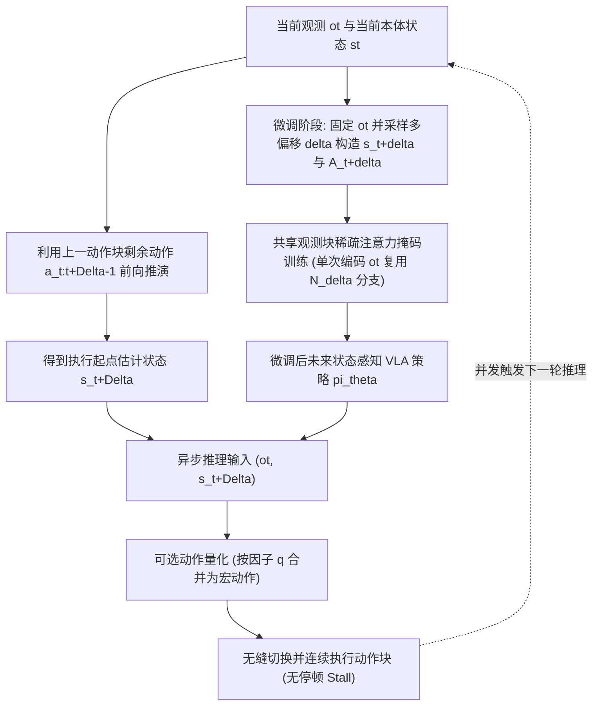

# VLASH: Real-Time VLAs via Future-State-Aware Asynchronous Inference

## 一句话定义

**VLASH**（[arXiv:2512.01031](https://arxiv.org/abs/2512.01031)，[官方代码](https://github.com/mit-han-lab/vlash)）是由 MIT、NVIDIA、清华大学等提出面向视觉-语言-动作模型（VLA）的未来状态感知异步推理框架，通过基于已下发动作块前向推演执行时刻的机器人状态、结合共享观测时序偏移微调与动作量化，在不引入额外推理延迟或结构改动的情况下消除异步控制中的预测-执行时序错位。

## 英文缩写速查

| 缩写 | 英文全称 | 简要说明 |
|---|---|---|
| VLA | Vision-Language-Action | 视觉-语言-动作模型，融合视觉观测、语言指令与本体状态预测机器人动作块 |
| VLASH | Vision-Language-Action via Future-State-Aware Asynchronous Inference | 本文提出的未来状态感知异步推理与微调框架 |
| RTC | Realtime Chunking | 实时动作分块基线方法，通过冻结必执行动作并对剩余段做 inpainting 缓解错位 |
| SR | Success Rate | 任务成功率（%），仿真与真机实验中的核心任务完成率指标 |
| DDP | Distributed Data Parallel | 分布式数据并行训练方式，用于多卡微调吞吐评测 |

## 核心信息

| 字段 | 内容或状态 |
|---|---|
| 论文标题 | *VLASH: Real-Time VLAs via Future-State-Aware Asynchronous Inference* |
| 作者 | Jiaming Tang*, Yufei Sun*, Yilong Zhao, Shang Yang, Yujun Lin, Zhuoyang Zhang, James Hou, Yao Lu, Zhijian Liu, Song Han |
| 机构 | MIT、NVIDIA、Tsinghua University、UC Berkeley、UCSD、Caltech |
| 预印本版本 | `arXiv:2512.01031v2 [cs.RO]`（2026-07-26） |
| 论文链接 | [arXiv:2512.01031](https://arxiv.org/abs/2512.01031) |
| 官方代码仓库 | [mit-han-lab/vlash](https://github.com/mit-han-lab/vlash) |
| 清单分类 / 来源条目 | `harness.infrastructure` / `survey_ax_2512_01031` |
| 支持模型与硬件验证 | 评测覆盖 $\pi_{0.5}$、GR00T N1.6、SmolVLA；真机验证于 Galaxea R1 Lite（双臂 7-DOF）与 LeRobot SO-101（6-DOF） |

## 为什么重要

1. **解决同步推理的“动作停顿”与高反应延迟**：传统同步 VLA 部署中，机器人必须等待完整动作块执行完毕并重新完成一次前向推理才能响应环境变化，最坏反应延迟高达 $D + 2L$（Chunk 执行时长加两倍单步推理耗时），导致明显卡顿且无法应对动态交互。
2. **直击异步推理的预测-执行区间错位（Misalignment）**：在异步推理中，推理期间（延迟 $\Delta > 0$ 步）机器人仍在执行上一动作块，导致新动作块在 $t$ 时刻基于 $(o_t, s_t)$ 预测、却在 $[t+\Delta, t+\Delta+K)$ 执行，产生控制抖动与精度退化。
3. **零运行时额外开销与模型无关兼容**：相比推理期 RTC（inpainting 显著增大推理延迟 $L$）或 A2C2（需新增修正头并改动模型结构），VLASH 仅在推理输入端替换前向推演状态，不增加单次推理耗时，并可无缝嵌入现有标准微调流程。
4. **解锁高动态真机交互**：配合动作量化（Action Quantization），首次使 $\pi_{0.5}$ 等大型 VLA 能够完成人类发球乒乓球对打与打地鼠等高实时性、高精度真机任务。

## 核心方法

设策略 $\pi_\theta(A_t \mid o_t, s_t)$ 在时刻 $t$ 输出长度为 $H$ 的动作块 $A_t = [a_t, \dots, a_{t+H-1}]$，实际执行前 $K \le H$ 步；推理延迟为 $\Delta > 0$ 个控制步，使得预测区间 $[t, t+K)$ 漂移为执行区间 $[t+\Delta, t+\Delta+K)$。VLASH 由四个核心设计组成：

1. **未来状态感知前向推演（Future-State-Awareness）**：
   - 虽然未知未来环境图像，但推理延迟期间仍将执行的上一块剩余动作 $a_{t:t+\Delta-1}$ 是已知的。
   - 因此可直接将当前状态 $s_t$ 前向推演至执行起点状态 $s_{t+\Delta}$：对增量动作（delta actions）采用累加 $s_{t+\Delta} = s_t + \sum_{i=t}^{t+\Delta-1} a_i$（如示例中 $s_3 = s_1 + a_1 + a_2$）；对绝对动作（absolute actions）直接取该区间最后一个动作作为估计状态。推理时向 VLA 输入 $(o_t, s_{t+\Delta})$。
2. **状态与动作联合时序偏移微调（Temporal-Offset Augmentation）**：
   - 论文发现现成 VLA 常过度依赖视觉特征而忽略本体状态，直接喂入 $s_{t+\Delta}$ 在测试时往往失效（此外 $\pi_{0.5}$ 默认将数值状态转为文本 token，作者也验证了可选的零初始化轻量级线性状态投影层以提升平滑性）。
   - 微调时对每条轨迹固定观测 $o_t$，随机采样偏移 $\delta \in \{0, \dots, \Delta_{\max}\}$，构造训练样本 $(o_t, s_{t+\delta}) \to A_{t+\delta} = a_{(t+\delta):(t+\delta+H-1)}$。迫使模型学会依据本体状态区分同一图像对应的未来动作，并兼容不同算力硬件下的不同延迟 $\Delta$（部署时选取大于实测 $\Delta$ 的最小 $\delta$）。
3. **共享观测的高效打包微调（Shared Observation Packing）**：
   - 将单个观测 $o_t$ 与多个偏移分支打包为同一序列 $[o_t, (s_t, A_t), (s_{t+1}, A_{t+1}), \dots, (s_{t+\Delta_{\max}}, A_{t+\Delta_{\max}})]$，并设计块稀疏自注意力掩码：观测 token 之间互相可见；各偏移分支可注意全部观测 token 与本分支内部 token，但禁止跨偏移分支互相注意，且位置编码统一起始于观测长度处。
   - 在 $\pi_{0.5}$ 上（观测约 600 tokens，单个状态-动作块约 50 tokens），打包 $N_\delta = 5$ 个偏移分支仅使总序列长度增加约 31%（650 → 850 tokens），却等效将训练样本数放大 5 倍。
4. **动作量化加速执行（Action Quantization）**：
   - 异步推理隐藏了推理延迟后，物理执行速率成为瓶颈。将连续 $q$ 步细粒度动作合并为宏动作（如增量动作下 $\hat{a}_i = a_{iq} + \dots + a_{(i+1)q-1}$，非整数 $q$ 通过线性插值重采样），实现可调的“速度-精度”权衡。

### 方法流程图

## 实验与评测

### 1. 仿真基准：Kinetix 与 LIBERO

- **Kinetix 动态操作基准（12 任务，每点 1,024 次 rollout，$H=8$，4 层 MLP-Mixer，训练 32 epochs，推理延迟 $\Delta \in [0, 4]$ 步）**：
  - VLASH 随执行时域 $K$ 与延迟 $\Delta$ 增大仍紧贴同步上界（Sync, $\Delta=0$），而 Naive Async 迅速崩塌、RTC 随延迟增大明显退化。
  - 在推理延迟 $\Delta = 4$ 步时，VLASH 取得 **81.7%** 平均成功率，对比 Naive Async 的 **51.2%** 提升 **+30.5%**。
- **LIBERO 慢变操作基准（4 个子集各 10 任务，微调 30K 步，batch size=32，执行时域 $K=5$，Table I）**：

| 模型 | 方法 | Delay | Spatial (%) | Object (%) | Goal (%) | Long (%) | Avg. SR (%) |
|---|---|---:|---:|---:|---:|---:|---:|
| $\pi_{0.5}$ | Sync | 0 | 97.3 | 99.6 | 96.7 | 93.5 | 96.8 |
| $\pi_{0.5}$ | VLASH (Async) | 1 | 98.8 | 99.2 | 96.7 | 94.4 | **97.2** |
| $\pi_{0.5}$ | VLASH (Async) | 2 | 97.5 | 99.2 | 97.3 | 94.6 | **97.1** |
| $\pi_{0.5}$ | VLASH (Async) | 3 | 94.4 | 98.8 | 93.3 | 91.9 | 94.6 |
| SmolVLA | Sync | 0 | 81.3 | 92.9 | 85.8 | 55.8 | 79.0 |
| SmolVLA | VLASH (Async) | 1 | 80.0 | 92.9 | 82.3 | 53.1 | 77.1 |
| SmolVLA | VLASH (Async) | 2 | 78.5 | 92.1 | 86.9 | 55.0 | 78.1 |
| SmolVLA | VLASH (Async) | 3 | 79.8 | 94.2 | 87.5 | 54.8 | **79.1** |

### 2. 真机操作、反应延迟与动态交互（Table II & III）

- **真机常规操作（Galaxea R1 Lite & LeRobot SO-101，RTX 5090 笔记本，30 Hz，$K=24$，延迟 2 步，每任务 20 rollouts × 最多 3 次尝试）**：在 Pick and Place、Stacking、Sorting 上，VLASH（$\pi_{0.5}$ 与 GR00T N1.6）在所有量化因子 $q$ 下均优于 Sync、Naive Async 与 RTC；在 Pick&Place 与 Sorting 上 $q=2$ 仍追平或超越 Sync（$q=1$），Stacking 上 $q=1.5$ 保持与 Sync（$q=1$）相当精度，实现 **1.5–2.0×** 任务完成提速。
- **跨 GPU 最大反应延迟对比（$\pi_{0.5}$，单视角图像，$K=25$ @ 50 Hz，执行时长 $D=500$ ms，启用 `torch.compile`、CUDA Graphs 与算子融合，Table II）**：

| GPU | Sync 推理 $L$ / 最大延迟 (ms) | RTC 推理 $L$ / 最大延迟 (ms) | VLASH 推理 $L$ / 最大延迟 (ms) | VLASH vs. Sync 提速 | VLASH vs. RTC 提速 |
|---|---|---|---|---:|---:|
| H100 | 23.2 / 546.4 | 48.4 / 96.8 | **23.2 / 46.4** | **11.8×** | **2.1×** |
| RTX 5090 | 29.4 / 558.8 | 49.6 / 99.2 | **29.4 / 58.8** | **9.5×** | **1.7×** |
| RTX 4090 | 32.3 / 564.6 | 54.2 / 108.4 | **32.3 / 64.6** | **8.7×** | **1.7×** |

- **真机高动态交互任务（$\pi_{0.5}$，RTX 5090 笔记本，$q=2$，Table III）**：

| 方法 | Ping-Pong 单回合击球率（20 次发球） | Whack-a-Mole 平均得分（5 轮，每轮 30s 或 3 次失误） |
|---|---:|---:|
| Sync | 0/20 (0%) | 3.2 |
| Naive Async | 0/20 (0%) | 8.6 |
| RTC | 0/20 (0%) | 11.0 |
| **VLASH (ours)** | **11/20 (55%)** | **28.8** |

### 3. 微调吞吐效率（4×H100 DDP，LIBERO，$\pi_{0.5}$，Table IV）

在保持全局有效 batch size 64（每卡 16）且 $\Delta_{\max}=3$（物理 batch size 4）下，VLASH 单步耗时从 **420.99 ms** 降至 **129.29 ms**（**3.26×** 单步提速）；在 10K / 20K / 30K 步同步推理评测中，LIBERO 平均分数分别为 Original `94.1 / 97.1 / 96.8` vs VLASH `87.1 / 94.4 / 96.6`，最终收敛精度与原微调持平且不损伤同步推理性能。

## 与现有工作的对比

| 路线 / 代表方法 | 解决异步错位机制 | 运行时额外开销 | 是否改模型结构 | 与 VLASH 差异 |
|---|---|---|---|---|
| 同步推理（Sync） | 不做并发，等待推理完成再动 | 无额外算法开销，但存在停顿 | 否 | 反应延迟 $D+2L$，高动态任务（乒乓球 0%）完全失效 |
| 朴素异步（SmolVLA Naive Async） | 直接并发推理并硬切新动作块 | 零 | 否 | 预测与执行状态错位严重，动作跳变、延迟 4 步时 Kinetix 跌至 51.2% |
| 推理期 RTC | 冻结必执行前置动作 + inpainting 补全 | **显著增加**（$\pi_{0.5}$ 上 $L$ 翻倍至 48–54 ms） | 否 | inpainting 拉长推理时延并放大观测陈旧度，高动态场景精度受限 |
| 训练期 RTC / A2C2 | 训练时联合两时间步去噪 / 外加修正头 | A2C2 需额外修正头开销 | 是（A2C2） | VLASH 仅靠输入侧未来状态推演与数据偏移增强即可零开销实现 |
| 轻量化高频 VLA（RDT-2 / DynamicVLA） | 缩小模型尺寸直接提高推理频率 | 无，但依赖小模型 | 是 | 小模型可能牺牲多任务泛化能力；VLASH 模型无关，直接赋能大模型 |

## 常见误区或局限

1. **只改推理输入而不做偏移微调往往无效**：现成 VLA 普遍对本体状态利用不足（甚至过度拟合视觉图像），必须结合时序偏移微调（或对 $\pi_{0.5}$ 这类文本化状态模型补充轻量级状态投影层）才能稳定响应前向推演状态 $s_{t+\Delta}$。
2. **仅推演了机器人本体状态，未预测未来环境观测**：VLASH 的异步前向输入 $(o_t, s_{t+\Delta})$ 仍使用推理发起时刻的视觉观测 $o_t$；当环境本身变化速度远超 $2L$ 且高度不可预测时，仍受视觉观测陈旧度约束。
3. **动作量化因子 $q$ 存在任务精度权衡**：虽然 $q \in [1.5, 2]$ 可在多数任务上实现 1.5–2.0× 加速，但在 GR00T N1.6 真机评测中（Fig. 8 说明），更高的量化因子会导致所有方法成功率大幅受限，因此需按任务精度需求选择 $q$。
4. **未消除微调初期收敛略慢现象**：在同有效 batch size 下，10K 步时 VLASH 分数（87.1%）低于标准微调（94.1%），需训练至 30K 步才追平（96.6% vs 96.8%），好在单步快 3.26× 弥补了总墙钟时间。

## 结论

**一句话总判：VLASH 用“已知动作块前向推演本体状态 + 共享观测时序偏移微调”以零推理额外开销解决了异步 VLA 的状态-动作错位难题，是目前工程落地实时高频 VLA 最简洁且模型无关的加速范式之一。**

1. **优先用未来状态前向推演替代推理期动作修补**：将延迟期间必执行的动作累加至当前状态 $s_{t+\Delta}$，即可避免 RTC 类 inpainting 带来的 2× 推理延迟膨胀。
2. **微调阶段务必启用随机时间偏移 $\delta \in [0, \Delta_{\max}]$**：这不仅强迫模型真正利用本体状态输入，还能让单一权重适配不同算力平台上的波动推理延迟。
3. **采用共享观测打包与块稀疏掩码降低训练成本**：在双图+语言输入约 600 token 的 VLA 上打包 5 个偏移分支仅增 31% 序列长度，却换来 3.26× 单步微调提速。
4. **对依赖文本化状态编码的 VLA 补零初始化状态投影层**：如 $\pi_{0.5}$ 将数值状态转为文本 token 会破坏数值连续性，补充轻量级连续投影层可进一步提升动态动作平滑性。
5. **在动作执行侧按任务精度调优量化因子 $q$**：异步消除了推理等待后，用 $q \in [1.5, 2]$ 合并宏动作可释放物理运动带宽，但对高精插拔/堆叠类任务及特定架构（如 GR00T N1.6）须严格验证精度下界。

## 关联页面

- [Agentic Robots 综述](paper-towards-agentic-robots-survey.md)
- [全量项目节点清单](../overview/awesome-agentic-robots-node-index.md)
- [VLA 方法背景](../methods/vla.md)
- [Action Chunking 动作分块](../methods/action-chunking.md)
- [Realtime Chunking (RTC)](paper-real-time-chunking.md)
- [Training-Time RTC](paper-training-time-real-time-chunking.md)
- [FutureRTC](paper-futurertc.md)
- [Running VLAs at Real-time Speed](paper-agentic-2510-26742.md)
- [π0.5 论文节点](paper-pi05-open-world-vla.md)
- [控制与推理频率解耦](../concepts/control-inference-frequency-decoupling.md)

## 参考来源

- [官方 Awesome 快照归档](../../sources/repos/awesome-agentic-robots-survey-index.md)
- [arXiv:2512.01031v2 论文原文](https://arxiv.org/abs/2512.01031)
- [VLASH 官方代码仓库](https://github.com/mit-han-lab/vlash)
