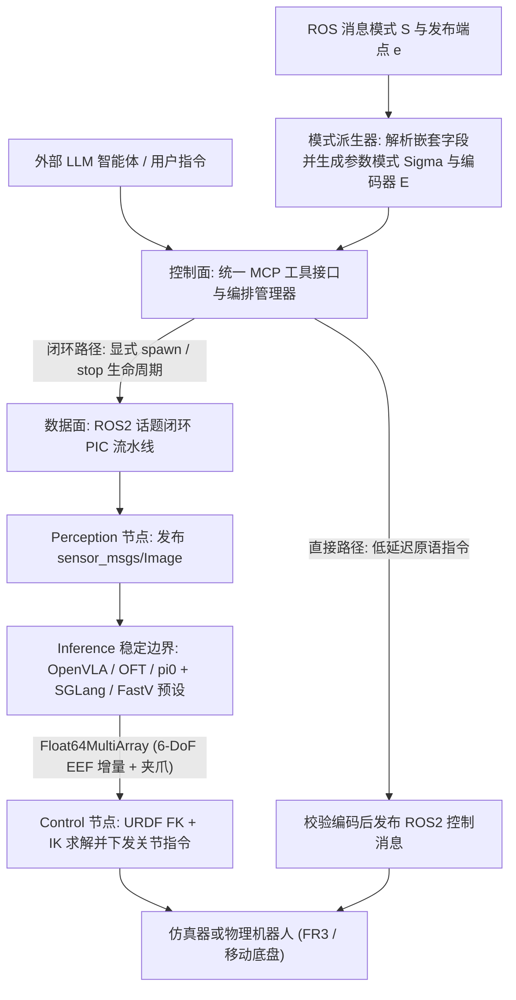

# RoboNeuron: A Middle-Layer Infrastructure for Agent-Driven Orchestration in Embodied AI

## 一句话定义

**RoboNeuron**（[arXiv:2512.10394](https://arxiv.org/abs/2512.10394)，[官方代码](https://github.com/guanweifan/RoboNeuron)）是由中国科学院自动化研究所等提出面向具身智能体部署的中间层基础设施，通过控制面/数据面分离将模型上下文协议（MCP）工具调用与 ROS2 流式总线桥接，支持从 ROS 消息自动派生工具模式、统一编排直接控制与闭环感知-推理-控制（PIC）路径，并在稳定推理边界内实现拓扑不变的 VLA 后端与加速预设切换。

## 英文缩写速查

| 缩写 | 英文全称 | 简要说明 |
|---|---|---|
| MCP | Model Context Protocol | 模型上下文协议，LLM 智能体侧统一的结构化工具发现与调用协议 |
| ROS2 | Robot Operating System 2 | 机器人中间件与数据面通信总线，本文通过话题流承载图像与控制指令 |
| PIC | Perception-Inference-Control | 感知-推理-控制三模块闭环执行契约 |
| VLA | Vision-Language-Action | 视觉-语言-动作模型，部署于 RoboNeuron 稳定推理边界内部 |
| URDF | Unified Robot Description Format | 统一机器人描述格式，控制模块据此构建运动学链并求解逆运动学（IK） |

## 核心信息

| 字段 | 内容或状态 |
|---|---|
| 论文标题 | *RoboNeuron: A Middle-Layer Infrastructure for Agent-Driven Orchestration in Embodied AI* |
| 作者 | Weifan Guan, Qinghao Hu†, Huasen Xi, Chenxiao Zhang, Aosheng Li, Jian Cheng† |
| 机构 | Institute of Automation, Chinese Academy of Sciences (CASIA)、University of Chinese Academy of Sciences (UCAS)、AiRiA、MAICRO |
| 预印本版本 | `arXiv:2512.10394v2 [cs.RO]`（2026-04-01） |
| 论文链接 | [arXiv:2512.10394](https://arxiv.org/abs/2512.10394) |
| 官方代码仓库 | [guanweifan/RoboNeuron](https://github.com/guanweifan/RoboNeuron) |
| 清单分类 / 来源条目 | `harness.infrastructure` / `survey_ax_2512_10394` |
| 集成后端与实验平台 | 推理后端覆盖 OpenVLA、OpenVLA-OFT、$\pi_0$（及 SGLang 服务与 FastV 剪枝预设）；实验覆盖仿真移动底盘/单臂、FR3 真机与 LIBERO 基准 |

## 为什么重要

1. **消除智能体工具接口与机器人中间件之间的“接口漂移”**：LLM 智能体以结构化 MCP 工具调用为中心，而机器人硬件栈以 ROS2 话题与流式 I/O 为中心；手工编写适配胶水代码会在消息字段变更或新增硬件时迅速失效。
2. **统一“单次原语指令”与“长时程闭环策略”的生命周期管理**：现有 ROS2-MCP 桥接多只做简单消息转发，缺乏对长时程 VLA 闭环节点的显式进程隔离（`spawn`）、状态监控与受控停止语义。
3. **实现可控且公平的 VLA 后端与加速对比**：不同 VLA（OpenVLA、$\pi_0$ 等）部署代码和推理引擎各异，以往换模型几乎等于重写整套部署管线；RoboNeuron 将所有模型及加速变化锁定在单一推理模块边界内，使算法对比不被外部拓扑改动混淆。

## 核心方法

RoboNeuron 采用**语义与传输解耦的双平面架构**：**控制面**负责 MCP 工具暴露、生命周期编排与 VLA 推理配置；**数据面**完全基于 ROS2 话题承载连续观测与动作流。自身不内置任务规划器，而是作为运行时底座供外部 LLM 智能体调度。

1. **基于模式的自动工具派生（Schema-Based Tool Derivation，Algorithm 1）**：
   - 自动解析 ROS 消息定义（含嵌套结构体与数组），生成带类型校验的工具参数模式 $\Sigma$ 与编码器 $E: \Sigma \to \text{message}$，并绑定至指定话题发布器 $P$ 注册到工具表。
   - 智能体调用时自动校验并编码为确定性 ROS2 消息发布，同时支持带步长的短指令序列发布，消除了手工包装层随 API 演进产生的维护漂移。
2. **双执行路径与显式进程隔离**：
   - **直接路径（Direct Path）**：绕过 VLA 推理，直接通过派生工具发布低延迟单次指令（如底盘速度、离散触发、末端增量或定时脚本序列）。
   - **闭环 PIC 路径（Algorithm 2）**：由外部智能体显式启停 **Perception**（采集相机或仿真图像发布 `sensor_msgs/Image`）、**Inference**（订阅图像与指令，按固定语义契约输出 6-DoF 末端位姿增量 + 夹爪指令并压平为 `std_msgs/Float64MultiArray`）与 **Control**（解析简化 URDF 构建运动学链，订阅动作流与关节状态，经 FK 计算目标末端位姿再以当前关节状态为初值求解 IK，下发关节轨迹或目标状态）。
   - 每个长时程 ROS2 节点通过 `spawn` 在独立操作系统进程中启动（规避 `rclpy` fork 安全隐患），并由专用 `stop` 工具在有界等待后强制清理，确保无悬空后台进程。
3. **拓扑不变的推理后端与加速预设切换**：
   - 所有 VLA 权重封装（OpenVLA、OpenVLA-OFT、$\pi_0$）、服务运行时（如 SGLang）与视觉 token 剪枝预设（如 FastV）均注入推理模块内部注册表。
   - 切换后端或加速预设 $(b, p) \to (b', p')$ 时，仅需重启推理节点并复用同一组 $(t_{\text{img}}, t_{\text{act}})$ 话题，感知与控制节点保持运行、全系统通信拓扑零改动。

### 方法流程图

## 实验与评测

### 1. 机制验证案例（Cases I–III）

- **Case I（仿真多平台底盘直接控制）**：同一套基于模式派生的结构化速度指令 MCP 工具可直接绑定到不同移动底盘控制器，无需针对不同平台重写工具包装。
- **Case II（仿真单臂执行栈适配）**：通过控制节点运行时解析 URDF 运动学链并执行 IK 转换，使统一高层末端工具接口透明适配单臂关节空间执行。
- **Case III（FR3 真机闭环抓取）**：在物理 Franka Research 3（FR3）机械臂上部署视觉引导抓取任务，重点验证了闭环 PIC 流水线通过显式启动、监督与终止工具进行生命周期管理的运行时语义。

### 2. 拓扑不变的后端加速与推理切换（Case IV）

- **Study IV-a：LIBERO 基准上 OpenVLA-OFT 搭配 FastV 剪枝预设（4 个套件各 10 任务 × 50 回合，Table I）**：在不改变感知、控制与话题绑定的前提下，仅替换推理模块内部剪枝比例（P25/P50/P75）：

| 方法配置 | 归一化剪枝加速比 (×) | Spatial (%) | Object (%) | Goal (%) | Long (%) |
|---|---:|---:|---:|---:|---:|
| OpenVLA-OFT（基线） | 1.00 | 98.6 | 97.6 | 97.2 | 95.8 |
| RoboNeuron + P25 | 1.03 | 98.8 (+0.2) | 98.0 (+0.4) | **97.6 (+0.4)** | 94.4 (-1.4) |
| RoboNeuron + P50 | 1.17 | **99.2 (+0.6)** | **98.4 (+0.8)** | 96.8 (-0.4) | 94.4 (-1.4) |
| RoboNeuron + P75 | **1.58** | 98.4 (-0.2) | 89.8 (-7.8) | 96.6 (-0.6) | 89.2 (-6.6) |

- **Study IV-b：RTX 4090 上 OpenVLA 运行时与剪枝单步延迟（Fig. 6）**：在同一外部契约下对比原始 OpenVLA、RoboNeuron 集成开销（RN）、SGLang 服务运行时（S）及 50% 剪枝（P50）配置的单步推理延迟与归一化加速比，验证了在不改动外部管道的情况下可独立观测到运行栈与剪枝策略带来的推理效率趋势。

## 与现有工作的对比

| 维度 / 对比对象 | 代表系统 | 核心局限或定位差异 | RoboNeuron 的设计定位 |
|---|---|---|---|
| 具身 LLM 规划与技能框架 | SayCan、Code as Policies、ProgPrompt、AutoRT、Inner Monologue | 侧重高层规划逻辑或提示结构，机器人 I/O 常依赖项目内定制胶水代码 | 位于规划层下方，提供可复用的 ROS2-MCP 运行时与生命周期底座 |
| 传统 ROS2 生态工具 | MoveIt、Nav2、Behavior Trees、OpenRTM | 面向人类开发者模块化编程，而非面向智能体的可发现/可校验工具接口 | 将 ROS2 消息能力自动派生为智能体可直接调用的 MCP 工具 |
| 基础 ROS2-MCP 桥接 | `ros2-mcp-server`、`ros2_mcp` | 主要停留在协议连通层面，缺少规模化模式派生与长时程节点生命周期治理 | 补齐结构化模式派生、双路径统一编排与独立进程 `spawn/stop` 管理 |
| 平台级云边机器人 OS | RynnRCP、RoboOS | 面向更宏观的多机/云端操作系统范围与技能体系 | 聚焦轻量级中间层：只做工具暴露、PIC 编排与稳定推理边界 |

## 常见误区或局限

1. **它不是任务规划器或新控制器**：论文明确指出 RoboNeuron 是中间层运行时基础设施，自身不内置高层任务规划逻辑，也不替代底层 ROS2 控制器（如 MoveIt / 关节伺服），而是依赖外部 LLM 智能体通过 MCP 工具编排执行。
2. **真机实验侧重机制可行性而非大样本统计指标**：FR3 真机实验验证了闭环 PIC 的显式启停与运行语义，并未报告大规模真机任务成功率统计表。
3. **当前接口暴露与动作契约覆盖范围受限**：当前原型主要支持基于 ROS2 **话题（Topic）** 的消息级暴露（尚未扩展到 ROS Service / Action 等更丰富接口），且 PIC 推理边界采用固定的 6-DoF 末端增量 + 夹爪的 `Float64MultiArray` 向量契约，多臂或全身灵巧手构型需扩展该契约。

## 结论

**一句话总判：RoboNeuron 用“控制/数据双平面分离 + ROS 模式自动派生 MCP + 稳定 PIC 推理边界”把具身智能体的工具调用与 VLA 闭环工程化部署解耦，是降低多模型真机集成与横向对比成本的实用中间层模板。**

1. **用模式派生替代手写 ROS-MCP 胶水代码**：直接解析 ROS 消息定义生成校验模式与发布绑定，可避免机器人消息演进时的接口漂移。
2. **以进程隔离 + 显式 `stop` 管理长时程闭环节点**：使用 `spawn` 独立进程运行 ROS2 节点并配合有界停止机制，能避免 `rclpy` fork 风险与失控后台进程。
3. **固定 PIC 话题契约以隔离 VLA 异构性**：只要将视觉输入（`sensor_msgs/Image`）和动作输出（`Float64MultiArray`）固定下来，就可以在不重连拓扑的情况下自由热切换 OpenVLA、$\pi_0$、SGLang 与 FastV 预设。
4. **注意 50% vs 75% 剪枝的精度拐点**：在 LIBERO 上 `P50` 以 1.17× 加速维持甚至微升 Spatial/Object 成功率，而 `P75`（1.58×）在 Object（-7.8%）和 Long（-6.6%）上明显掉点，上线前应在固定拓扑内做套件级回归。

## 关联页面

- [Agentic Robots 综述](paper-towards-agentic-robots-survey.md)
- [全量项目节点清单](../overview/awesome-agentic-robots-node-index.md)
- [Model Context Protocol (MCP)](../concepts/model-context-protocol.md)
- [ROS2 基础概念](../concepts/ros2-basics.md)
- [LLM 与机器人控制接口](../concepts/llm-robotics-control-interfaces.md)
- [行为树与 VLA 编排](../concepts/behavior-tree-vla-orchestration.md)
- [VLA 方法背景](../methods/vla.md)
- [OpenVLA 论文节点](paper-openvla.md)

- [机器人智能体执行框架](../methods/robot-agent-harness.md)：对照规划、工具调用与反馈的系统边界。

## 参考来源

- [官方 Awesome 快照归档](../../sources/repos/awesome-agentic-robots-survey-index.md)
- [arXiv:2512.10394v2 论文原文](https://arxiv.org/abs/2512.10394)
- [RoboNeuron 官方代码仓库](https://github.com/guanweifan/RoboNeuron)
