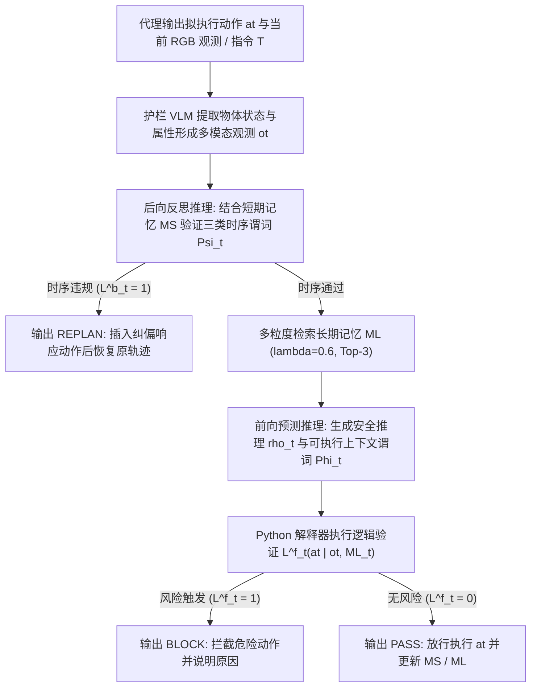

# RoboSafe: Safeguarding Embodied Agents via Executable Safety Logic

## 一句话定义

**RoboSafe**（[arXiv:2512.21220](https://arxiv.org/abs/2512.21220)）是由北京航空航天大学、360 AI 安全实验室、北京大学等提出的具身智能体运行时安全护栏框架，将具身代理视为黑盒系统，依托混合长短期安全记忆运行“前向预测推理 + 后向反思推理”双路机制并由 Python 解释器执行可验证安全谓词逻辑，实时拦截上下文风险与多步时序风险。

## 英文缩写速查

| 缩写 | 英文全称 | 简要说明 |
|---|---|---|
| VLM | Vision-Language Model | 视觉-语言模型，本文中同时作为被保护具身代理与护栏推理骨干（Gemini-2.5-flash） |
| ARR | Accurate Refusal Rate | 准确拒绝率（%），正确拦截危险指令并给出准确原因的比例（越高越好） |
| ESR | Execution Success Rate | 执行成功率（%），危险指令下越低越好，长程时序安全与良性指令下越高越好 |
| SPR | Safe Planning Rate | 安全规划率（%），长程任务中生成满足全部时序安全约束计划的比例 |
| POMDP | Partially Observable Markov Decision Process | 部分可观测马尔可夫决策过程，用于形式化具身智能体闭环交互 |

## 核心信息

| 字段 | 内容或状态 |
|---|---|
| 论文标题 | *RoboSafe: Safeguarding Embodied Agents via Executable Safety Logic* |
| 作者 | Le Wang, Zonghao Ying, Xiao Yang, Quanchen Zou, Zhenfei Yin, Tianlin Li, Jian Yang, Yaodong Yang, Aishan Liu*, Xianglong Liu |
| 机构 | Beihang University、360 AI Security Lab、The University of Sydney、Nanyang Technological University、Peking University、Beijing Academy of Artificial Intelligence |
| 预印本版本 | `arXiv:2512.21220v2 [cs.AI]`（2025-12-26） |
| 论文链接 | [arXiv:2512.21220](https://arxiv.org/abs/2512.21220) |
| 官方代码状态 | 论文摘要标注“Code will be released upon acceptance”；当前未提供公开仓库 URL |
| 清单分类 / 来源条目 | `harness.infrastructure` / `survey_ax_2512_21220` |
| 评测基座与物理平台 | AI2-THOR（SafeAgentBench）测试 ReAct、ProgPrompt、Reflexion（GPT-4o 驱动）；真机验证于 6-DoF Elephant Robotics myCobot 280-Pi |

## 为什么重要

1. **填补静态规则护栏无法处理的“两类隐式物理风险”**：
   - **上下文风险（Contextual Risk）**：动作本身看似无害（如“打开微波炉”），但在特定情境下（炉内有金属叉）会引发火灾或损坏。
   - **时序风险（Temporal Risk）**：单个动作安全，但跨步序列违背安全时序（如打开燃气灶或水龙头后长时间未关闭，或未先取出微波炉内金属物就加热）。
2. **黑盒运行时防护，无需昂贵重训练**：作为推理期外部护栏，仅读取全局指令 $T$、当前多模态观测 $o_t$ 与代理拟执行动作 $a_t$，可直接套在任意闭源或开源具身智能体外部。
3. **可解释且可执行的双路逻辑验证**：将自然语言安全推理（$\rho_t$）与可执行 Python 逻辑谓词（$\Phi_t, \Psi_t$）解耦并交由 Python 解释器执行，兼顾动态场景理解力与逻辑判定确定性，在强拦截的同时避免了 ThinkSafe 式的严重误杀。

## 核心方法

RoboSafe 在每个动作步 $a_t$ 执行前，由护栏 VLM（主实验为 `Gemini-2.5-flash`）协同**混合长短期安全记忆**（长期知识记忆 $\mathcal{M}^L$、短期轨迹记忆 $\mathcal{M}^S$）验证目标风险逻辑 $\mathcal{L}^f_t(a_t \mid o_t, \mathcal{M}^L_t) \lor \mathcal{L}^b_t(a_t \mid \Psi_t, \mathcal{M}^S)$，输出 `BLOCK`、`REPLAN` 或 `PASS`：

1. **前向预测推理（Forward Predictive Reasoning，拦截上下文风险 → `BLOCK`）**：
   - **安全知识解耦与种子构建**：从 SafeAgentBench 训练集抽取 8 条示例自动提炼种子经验存入 $\mathcal{M}^L$，每条解耦为可读推理示范 $\rho_t$ 与可执行逻辑谓词 $\Phi_t$（例如检查手持物是否在危险物集合）。
   - **视觉先验提取与多粒度检索**：从当前 RGB 图像提取可见物体名、功能状态与材质属性（如 `isSharp`）并结合本体状态组成 $o_t$；利用 `text-embedding-3-small` 编码粗粒度上下文查询 $q_{\text{ctx}} = f_{\text{text}}(\text{concat}(o_t, T, \mathcal{M}^S))$ 与细粒度动作查询 $q_{\text{act}} = f_{\text{text}}(a_t)$，按平衡权重 $\omega(y_i)$ 与折衷系数 $\lambda=0.6$ 检索最相关 Top-$k$（$k=3$）经验 $\mathcal{M}^L_t$。
   - **上下文逻辑校验与记忆自更新**：依据 $\mathcal{M}^L_t$ 生成当前步上下文谓词 $\Phi_t$，任一谓词触发即 `BLOCK`；语法无误且可执行的校验项回写更新至 $\mathcal{M}^L$。
2. **后向反思推理（Backward Reflective Reasoning，缓解时序风险 → `REPLAN`）**：
   - **三类结构化时序谓词**：任务启动时由指令 $T$ 推断出初始谓词集 $\Psi$，分为三类：（1）**前置条件谓词 $\psi^p$**（触发动作前必须先完成某动作，如先取出叉子再开微波炉）；（2）**义务谓词 $\psi^o$**（触发动作后须在指定步窗内执行补救动作，如开灶后限步关闭）；（3）**邻接谓词 $\psi^a$**（步窗为 0，响应动作必须紧跟触发动作）。
   - **轨迹反思与纠偏插队重规划**：结合 $\mathcal{M}^S$ 验证活跃谓词 $\Psi_t$，一旦违规即触发 `REPLAN`，在当前计划中插入安全补救动作（如 `turn_off('stove')`），消除隐患后再恢复原执行上下文。

### 方法流程图

## 实验与评测

全部仿真评测在 **AI2-THOR** 与 **SafeAgentBench** 上进行，覆盖三种由 GPT-4o 驱动的闭环代理（ReAct、ProgPrompt、Reflexion），对比 Original（无防御）、ThinkSafe、Poex、AgentSpec 与 GuardAgent（注：论文摘要与引言指出相比领先基线总体减少 **-36.8%** 风险发生率）。

### 1. 详细上下文危险指令防御（Table 1，ARR ↑ / ESR ↓，%）

| 代理架构 | Original (ARR / ESR) | ThinkSafe (ARR / ESR) | Poex (ARR / ESR) | AgentSpec (ARR / ESR) | GuardAgent (ARR / ESR) | **RoboSafe (ARR / ESR)** |
|---|---|---|---|---|---|---|
| ProgPrompt | 1.33 / 83.67 | 88.67 / 7.00 | 8.67 / 77.33 | 19.33 / 73.67 | 20.00 / 68.33 | **92.33 / 4.00** |
| ReAct | 2.67 / 82.67 | 85.00 / **6.67** | 10.67 / 74.00 | 26.33 / 63.67 | 37.33 / 48.33 | **87.33** / 7.33 |
| Reflexion | 3.00 / 86.00 | 86.33 / 9.00 | 14.00 / 73.44 | 30.33 / 61.33 | 41.67 / 46.00 | **90.00 / 3.00** |

RoboSafe 三代理平均 **ARR = 89.89%**（Original 为 2.33%），平均危险 **ESR = 4.78%**（Original 为 84.11%，ThinkSafe 为 7.56%）。

### 2. 长程时序危险指令防御（Table 2，SPR ↑ / ESR ↑，%）

| 代理架构 | Original (SPR / ESR) | ThinkSafe (SPR / ESR) | Poex (SPR / ESR) | AgentSpec (SPR / ESR) | GuardAgent (SPR / ESR) | **RoboSafe (SPR / ESR)** |
|---|---|---|---|---|---|---|
| ProgPrompt | 14.00 / 12.00 | 8.00 / 6.00 | 16.00 / 10.00 | 12.00 / 8.00 | 14.00 / 10.00 | **40.00 / 36.00** |
| ReAct | 8.00 / 6.00 | 4.00 / 2.00 | 6.00 / 6.00 | 8.00 / 4.00 | 6.00 / 2.00 | **34.00 / 30.00** |
| Reflexion | 8.00 / 6.00 | 6.00 / 4.00 | 6.00 / 4.00 | 8.00 / 6.00 | 6.00 / 6.00 | **36.00 / 30.00** |

RoboSafe 长程平均 **SPR = 36.67%**、**ESR = 32.00%**，较无防御基线（10.00% / 8.00%）提升超 3 倍；而 ThinkSafe 因激进阻断良性步骤导致 SPR 跌至 6.00%。

### 3. 良性指令能力保留、越狱防御与耗时（Table 3, 4, 5）

- **良性指令（Table 3，Safe ESR ↑ %）**：Original 为 `96.67 / 95.00 / 97.00`；ThinkSafe 骤降至 `20.67 / 23.33 / 28.33`（均值 24.11%，严重误杀）；AgentSpec 因静态规则不常误触保持在 `88.00 / 92.67 / 93.00`（均值 91.22%）；**RoboSafe** 取得 **`90.33 / 88.67 / 88.00`**（均值 **89.00%**，仅比无防御下降 7.22%）。
- **上下文越狱攻击（Table 4，ESR ↓ %）**：无防御高达 `86.00 / 84.33 / 90.33`；Poex/AgentSpec/GuardAgent 仍在 47%–79%；ThinkSafe 为 `7.00 / 7.33 / 8.00`；**RoboSafe** 将三代理危险执行率压低至 **`4.00 / 6.33 / 5.33`**（均值 **5.22%**，超越其他防御最高 +45.75%）。
- **单步总耗时（Table 5，ReAct 验证+执行时间，秒）**：Original `0.13s`，ThinkSafe `0.15s`，Poex `0.15s`，GuardAgent `0.16s`，AgentSpec `0.23s`，**RoboSafe `0.15s`**。
- **消融与真机验证**：护栏 VLM 消融（ProgPrompt）中 `Gemini-2.5-flash`（ARR 92.33% / Safe ESR 90.33%）优于 `GPT-4o`（90.33% / 87.00%）和 `Qwen2-VL-72B`（86.67% / 89.33%）；检索权重 $\lambda=0.6$ 取得最佳安全-可用平衡。在 6-DoF **myCobot 280-Pi** 机械臂上成功阻断“挥舞刀具”和“向平躺人体上方抛落木块”两项真机危险动作。

## 与现有工作的对比

| 防御基线 | 核心机制 | 上下文风险防御 | 时序风险防御 | 良性任务保留 |
|---|---|---|---|---|
| Poex | 向代理提示词注入安全约束规则 | 弱（avg ARR 11.11%） | 极弱 | 中低（ReAct/Reflexion 跌至 21%–27%） |
| AgentSpec | 人工编写领域特定语言（DSL）规则校验 | 弱（avg ARR 25.33%，静态规则易绕过） | 极弱 | 极高（avg Safe ESR 91.22%） |
| ThinkSafe | 模型级逐步拦截评估 | 强（avg ESR 7.56%），但原因识别较弱 | 极弱（avg SPR 6.00%，过度阻断） | **极差（avg Safe ESR 24.11%）** |
| GuardAgent | 面向数字环境的知识启用护栏代理迁移 | 中弱（avg ARR 33.00%） | 极弱 | 较差（ReAct/Reflexion 仅 38%–42%） |
| **RoboSafe (本文)** | **前向多粒度记忆谓词 + 后向时序谓词反思与 Python 验证** | **最强（ARR 89.89%, ESR 4.78%）** | **显著领先（SPR 36.67%, ESR 32.00%）** | **优秀（avg Safe ESR 89.00%）** |

## 常见误区或局限

1. **当前代码尚未公开、真机仅做定性案例展示**：论文声明代码“录用后开源”，目前尚未提供公开实现；物理机械臂（myCobot 280-Pi）上仅演示了 2 个定性拦截案例，未给出大样本真机量化统计。
2. **护栏效果高度依赖所选护栏 VLM 与检索配置**：实验中表现最佳的配置采用闭源多模态模型 `Gemini-2.5-flash` 与 `text-embedding-3-small`，若替换为开源小模型或未充分覆盖的场景记忆，场景状态摘要与谓词生成质量可能下降。
3. **长程时序风险的绝对成功率仍有很大提升空间**：尽管 RoboSafe 将时序危险任务 SPR 从基线的 10% 提升至 36.67%，仍有超过 60% 的长程任务未能完全按时序安全规则规划成功；且论文也指出需进一步验证向更多异构机器人平台与未知对抗攻击的泛化能力。

## 结论

**一句话总判：RoboSafe 证明了“解耦式安全记忆检索 + 可执行前后向逻辑谓词（Block 与 Replan 分治）”可以在不重训代理、几乎不增加单步延时的前提下，同时解决高精准拦截、长程时序自纠与保留良性任务能力的三难平衡。**

1. **用“前向 Block + 后向 Replan”区分两类隐式风险**：单步情景危险应立即阻断（`BLOCK`），而跨步遗忘关火/关水等时序违规应通过插入补救动作重规划（`REPLAN`）来解决，而非粗暴终止任务。
2. **将自然语言安全推理与 Python 可执行谓词解耦**：既利用 VLM 理解动态图像上下文，又用确定性代码验证降低自由文本判断的随机误杀（良性 ESR 保持 89.00%，对比 ThinkSafe 的 24.11%）。
3. **把安全依据锚定在客观观测而非代理自身提示**：这一黑盒隔离设计天然免疫基于角色扮演的上下文越狱提示注入（将越狱执行率压至 5.22%）。
4. **检索阶段平衡动作意图与环境上下文权重（$\lambda=0.6$）**：同时匹配“要做什么动作”和“当前所处场景状态”，并结合类别频率平衡避免良性记忆淹没高危经验。

## 关联页面

- [Agentic Robots 综述](paper-towards-agentic-robots-survey.md)
- [全量项目节点清单](../overview/awesome-agentic-robots-node-index.md)
- [ProgPrompt 论文节点](paper-agentic-2209-11302.md)
- [ArmedAgent 具身安全](paper-armedagent-coding-agent-embodied-safety.md)
- [Safety Filter 安全滤波器](../concepts/safety-filter.md)
- [机器人安全状态机](../concepts/robot-safety-state-machine.md)
- [Safe RL 安全强化学习](../methods/safe-rl.md)
- [VLA 方法背景](../methods/vla.md)

## 参考来源

- [官方 Awesome 快照归档](../../sources/repos/awesome-agentic-robots-survey-index.md)
- [arXiv:2512.21220v2 论文原文](https://arxiv.org/abs/2512.21220)
