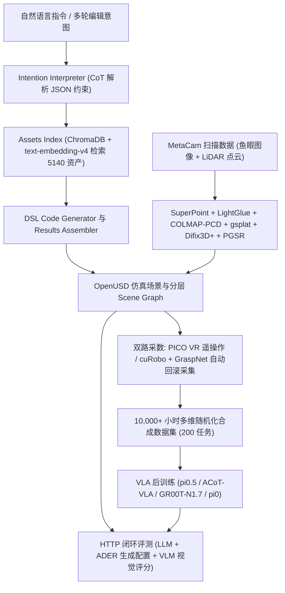

# Genie Sim 3.0 : A High-Fidelity Comprehensive Simulation Platform for Humanoid Robot

## 一句话定义

**Genie Sim 3.0**（[arXiv:2601.02078](https://arxiv.org/abs/2601.02078)，[官方代码](https://github.com/AgibotTech/genie_sim)）是智元机器人（Agibot）开源的高保真人形机器人全流程仿真平台，集成自然语言场景生成（Genie Sim Generator）、真实环境三维重建、遥操作与自动化双路合成数据采集（10,000+ 小时 / 200 任务）及基于 LLM-VLM 的大规模闭环自动化评测基准（100,000+ 场景）。

## 英文缩写速查

| 缩写 | 英文全称 | 简要说明 |
|---|---|---|
| VLA | Vision-Language-Action | 视觉-语言-动作模型，本文评测 $\pi_{0.5}$、ACoT-VLA、GR00T-N1.7 与 $\pi_0$ |
| 3DGS | 3D Gaussian Splatting | 三维高斯泼溅神经渲染技术，结合 Difix3D+ 与 PGSR 用于高保真交互环境重建 |
| RAG | Retrieval-Augmented Generation | 检索增强生成，本文中基于 ChromaDB 对 5,140 仿真资产做语义检索 |
| DSL | Domain-Specific Language | 领域特定语言，扩展自 The Scene Language 以编译 Isaac Sim 场景图与 OpenUSD |
| ADER | Action Domain Evaluation Rule | 动作域评估规则系统，与 LLM 结合自动生成可执行评测配置文件 |

## 核心信息

| 字段 | 内容或状态 |
|---|---|
| 论文标题 | *Genie Sim 3.0 : A High-Fidelity Comprehensive Simulation Platform for Humanoid Robot* |
| 作者 | Chenghao Yin*, Da Huang*, Di Yang*, Jichao Wang*, Nanshu Zhao*, Chen Xu*, Wenjun Sun, Linjie Hou, Zhijun Li, Junhui Wu, Zhaobo Liu, Zhen Xiao, Sheng Zhang, Lei Bao, Rui Feng, Zhenquan Pang, Jiayu Li, Qian Wang, Maoqing Yao |
| 机构 | Agibot（智元机器人） |
| 预印本版本 | `arXiv:2601.02078v4 [cs.RO]`（2026-08-14） |
| 论文链接 | [arXiv:2601.02078](https://arxiv.org/abs/2601.02078) |
| 官方代码与数据入口 | [AgibotTech/genie_sim](https://github.com/AgibotTech/genie_sim) |
| 清单分类 / 来源条目 | `environment.reconstruction` / `survey_ax_2601_02078` |
| 开源资产与评测规模 | 5,140 个可用三维物体资产（353 类）、10,000+ 小时合成交互数据（200 任务，Agibot G1/G2）、100,000+ 闭环评测场景 |

## 为什么重要

1. **打通“场景生成—资产检索—双路采数—自动评测”全周期**：传统仿真基准往往存在人工 3D 建模成本高、程序化生成缺乏细粒度可控性、仅靠手工成功率指标难评估细微完成质量三大瓶颈。
2. **用实证确立仿真对真机的可预测性（Sim2Real Predictivity）**：在 32 组跨任务数据缩放与 8 任务跨域迁移实验中，仿真与真机分数呈强线性相关（$R^2 = 0.931$，斜率 $\approx 1.023$），且大规模合成数据（1500 episodes）在零样本真机测试上可超越 500 episodes 真机微调基线。
3. **首创 LLM-VLM 协同的自动化多维评测流水线**：将评测从单一成功率扩展为指令跟随、扰动鲁棒性、灵巧操作、空间推理与 Sim2Real 迁移五维能力画像。

## 核心方法

Genie Sim 3.0 由五大模块构成：

1. **Genie Sim Generator（自然语言驱动场景生成与多维泛化）**：
   - **Assets Index**：将 5,140 个 Isaac Sim 就绪资产按外观、几何与用途提炼语义描述，经 `QWEN: text-embedding-v4` 编码为 2048 维向量存入 ChromaDB；运行时 200 ms 内返回 Top-$k$ 资产的 USD 路径、碰撞体、质量与纹理变体。
   - **四阶段对话式 Scene Generator**：同一对话上下文依次执行（1）*Intention Interpreter*（CoT 解析自然语言并生成物体约束与空间关系 JSON Schema）；（2）*Assets Retrieve*；（3）*DSL Code Generator*（扩展 The Scene Language 生成双精度浮点控制的可微调代码，支持货架等复杂布局）；（4）*Results Assembler*（实例化随机化并输出含节点属性与空间关系边的分层 Scene Graph 及 OpenUSD 文件，可在数分钟内围绕单场景泛化出数千个变体）。
2. **LLM-VLM 自动化评测生成（Evaluation Generation）**：
   - LLM 结合 **ADER** 系统自动扩写多样化任务指令并生成可执行评测配置；VLM 读取形式化任务规范与执行过程视觉观测序列，自动判定任务是否完成并给出基于视觉证据的理由。
3. **真实环境高保真三维重建（Environment Reconstruction）**：
   - 使用 SkylandX MetaCam 手持 3D 激光扫描仪采集鱼眼图像、位姿与稠密点云；用 `SuperPoint + LightGlue` 替换 `COLMAP-PCD` 中的 `DSP-SIFT` 并联合 LiDAR 先验位姿做光束平差（BA）优化，提升弱纹理精度；采用 `gsplat` 训练 3DGS，结合扩散视图外推模型 `Difix3D+` 补全稀疏视角，最终由 `PGSR` 重建高精度交互网格。
4. **双路数据采集（Data Generation）**：
   - **VR 遥操作**：通过 PICO VR 头显将人类末端位姿映射至物理仿真中的虚拟机器人，采集长时程拟人操作轨迹。
   - **全自动采集**：基于 `GraspNet` 预标注抓取位姿与 GPU 运动规划器 `cuRobo` 生成多候选关键路径点序列，经可达性、碰撞与拟人化筛选后仿真执行；失败则执行状态回滚并换用备选序列，且初始化时保留完整杂乱场景几何（经网格简化加速），避免仅保留目标物体导致真机碰撞。
5. **HTTP 解耦闭环评测（Closed-loop Evaluation）**：
   - 仿真器与策略推理服务通过 HTTP 解耦通信，原生支持 $\pi_{0.5}$、GO1、GR00T、UniVLA、RDT、X-VLA，适配 Agibot G1/G2 及多种末端执行器（omnipicker、omnihands、INSPIRE skillhands、zhixing gripper）。

### 方法流程图

## 实验与评测

### 1. GenieSim-Sim2Real：数据缩放与双向迁移（Agibot G1，每配置 50 次真机/仿真试次）

- **合成数据规模缩放（4 任务 × 4 数据配置，共 32 组实验，$\pi_{0.5}$，Table I）**：
  - *Select Color*：200 真机 / 500 真机 / 500 合成 / 1500 合成 → 仿真 `(0.45 / 0.75 / 0.53 / 0.86)`，真机 `(0.53 / 0.73 / 0.60 / 0.85)`
  - *Recognize Size*：仿真 `(0.50 / 0.75 / 0.50 / 0.93)`，真机 `(0.56 / 0.75 / 0.63 / 0.94)`
  - *Grasp Targets*：仿真 `(0.34 / 0.54 / 0.29 / 0.72)`，真机 `(0.39 / 0.58 / 0.33 / 0.71)`
  - *Organize Objects*：仿真 `(0.25 / 0.45 / 0.39 / 0.48)`，真机 `(0.30 / 0.40 / 0.35 / 0.60)`
  - 等量（500 条）时真机数据略优；但将合成数据扩展至 **1500 条**后，零样本真机测试在全部 4 项任务上均超越 500 条真机数据基线；16 组配置仿真与真机分数线性相关性达 **$R^2 = 0.931$**（斜率 $\approx 1.023$）。
- **8 任务 Sim2Real 与 Real2Sim 双向迁移（500–1500 合成 vs 500 真机，$\pi_{0.5}$，Table II）**：

| 任务 | Sim Data (sim-to-sim) | Real Data (real-to-sim) | Sim Data (sim-to-real) | Real Data (real-to-real) |
|---|---:|---:|---:|---:|
| Select Color | 0.86 | 0.75 | 0.85 | 0.73 |
| Recognize Size | 0.93 | 0.75 | 0.94 | 0.75 |
| Grasp Targets | 0.72 | 0.54 | 0.71 | 0.58 |
| Organize Items | 0.48 | 0.45 | 0.60 | 0.40 |
| Pack in Supermarket | 0.94 | 1.00 | 0.95 | 0.95 |
| Sort Fruit | 0.90 | 0.90 | 1.00 | 1.00 |
| Place Block into Drawer | 0.80 | 0.90 | 0.85 | 0.90 |
| Bimanual Chip Handover | 0.80 | 0.70 | 0.73 | 0.71 |
| **平均分 (Avg.)** | **0.80** | **0.75** | **0.83** | **0.75** |

### 2. 四大能力基准横向评测（Agibot G2，Table III–VI）

在 `GenieSim-Instruction`（10 任务）、`GenieSim-Robust`（5 类扰动）、`GenieSim-Manipulation`（10 复杂操作）与 `GenieSim-Spatial`（8 空间推理）上对比 4 个主流 VLA 模型：

| 评测套件 | $\pi_{0.5}$ | ACoT-VLA | GR00T-N1.7 | $\pi_0$ | 关键发现 |
|---|---:|---:|---:|---:|---|
| **Instruction**（10 任务均值） | 0.75 | **0.76** | 0.65 | 0.37 | 语义属性强模型占优；常识（`pick_common_sense` 最高 0.68）与抽象形状仍难 |
| **Robust**（5 扰动均值 / $\Delta$） | 0.613 (-0.137) | **0.622** (-0.138) | 0.538 (-0.112) | 0.313 (-0.057) | 语言/背景扰动影响小（至多 -0.061），**机器人初始位姿与相机位置扰动导致最大掉点（最高约 -0.26）** |
| **Manipulation**（10 任务均值） | **0.58** | 0.48 | 0.44 | 0.35 | `Clean the Desktop`（最高 0.02）与 `Sorting Packages Continuous`（最高 0.10）近乎未解 |
| **Spatial**（8 任务均值） | 0.36 | **0.40** | 0.25 | 0.13 | 空间指代（最高 0.81）与顺序空间构造（`Sort Cubes by Size` / `Sort Number` / 堆叠，均 $\le 0.30$）呈明显断层 |

## 与现有工作的对比

| 平台 / 数据集 | 规模与场景覆盖 | 物理/视觉保真与生成方式 | 与 Genie Sim 3.0 的核心差异 |
|---|---|---|---|
| 真机数据集（DROID / Open X-Embodiment / Agibot World） | 7 万至数百万条真机轨迹 | 真实物理采集，但成本极高、跨场景泛化受限 | Genie Sim 3.0 提供低成本、高可控随机化合成数据，并在 1500 eps 下超越 500 eps 真机基线 |
| 既有合成数据（RoboCasa / DexGraspNet 2.0 / RoboTwin 2.0） | 十万至数亿样本 | 多局限于厨房、纯抓取或双臂特定场景，物理/渲染保真有限 | Genie Sim 3.0 融合 3DGS+PGSR 重建与 5,140 全类型资产，覆盖通用人形双手操作 |
| 传统基准（BEHAVIOR-1K / HumanoidBench / BiGym / VLABench） | 20–1000 任务不等 | 人工固化指令与手工成功判定，新增任务边际成本高 | Genie Sim 3.0 首创 LLM+ADER 大规模生成 100,000+ 场景并由 VLM 自动评分验证 |

## 常见误区或局限

1. **合成数据并非“等量替代真机数据”**：在相同 500 条数据量下，合成数据（0.29–0.60）仍普遍低于真机数据（0.45–0.75）；只有当合成数据放量至约 3 倍（1500 条）时，依靠广泛域随机化才实现零样本反超。
2. **几何/视点扰动仍是当前 VLA 的主要脆弱点**：`GenieSim-Robust` 表明语言改写和背景切换几乎不掉点，但机器人初始位姿与相机机位变化可造成高达约 0.26 的性能跌幅；且长程连续整理任务与空间构造任务在所有模型上均处于 $\le 0.30$ 区间。
3. **Sim2Real 强相关性仍受接触动力学复杂度边界约束**：$R^2 = 0.931$ 是在选定 4 项操作任务与 $\pi_{0.5}$ 模型上验证的结果，论文明确提及仿真接触动力学不完美与真实随机扰动仍会带来轻微偏差。

## 结论

**一句话总判：Genie Sim 3.0 通过“对话式资产组合 + 3DGS/PGSR 高保真重建 + cuRobo 自动化采数 + LLM-VLM 闭环评测”，验证了规模化合成数据可作为真机数据的有效替代品，并确立了高置信度的 Sim2Real 评测预测性（$R^2 = 0.931$）。**

1. **用 3 倍合成数据量弥补单条仿真物理保真差距**：在预算受限时，优先通过域随机化扩大仿真轨迹规模（如 1500 eps 对齐并超越 500 eps 真机），而非在单一仿真场景内反复采集。
2. **将“杂乱环境完整碰撞保留 + 失败回滚重试”作为自动采数标配**：规划时保留非目标背景物体并用简化碰撞网格加速，配合 `cuRobo` 多候选路径点回滚，可大幅减少真机迁移时的意外碰撞。
3. **模型迭代优先补强机位/初始位姿鲁棒性与长程构造能力**：在 Genie Sim Benchmark 上，语言与背景泛化已趋于成熟，真正的性能瓶颈集中在相机外参变化、连续桌面清理及多步空间搭积木任务。
4. **结合仓库双运行栈文档推进落地**：工程接入可对照 [Genie Sim 3.0 平台实码笔记](genie-sim-3.md) 核查容器版本与两套运行栈边界。

## 关联页面

- [具身大模型评测基准选型闭环](../queries/embodied-eval-benchmark-selection-loop.md)
- [Agentic Robots 综述](paper-towards-agentic-robots-survey.md)
- [全量项目节点清单](../overview/awesome-agentic-robots-node-index.md)
- [Genie Sim 3.0 平台工程实码节点](genie-sim-3.md)
- [Domain Randomization 域随机化](../concepts/domain-randomization.md)
- [Sim2Real 迁移](../concepts/sim2real.md)
- [物理保真度与 Sim2Real 鸿沟](../concepts/physics-fidelity-sim2real-gap.md)
- [VLA 方法背景](../methods/vla.md)
- [π0.5 论文节点](paper-pi05-open-world-vla.md)

## 参考来源

- [官方 Awesome 快照归档](../../sources/repos/awesome-agentic-robots-survey-index.md)
- [arXiv:2601.02078v4 论文原文](https://arxiv.org/abs/2601.02078)
- [Genie Sim 官方开源仓库](https://github.com/AgibotTech/genie_sim)
