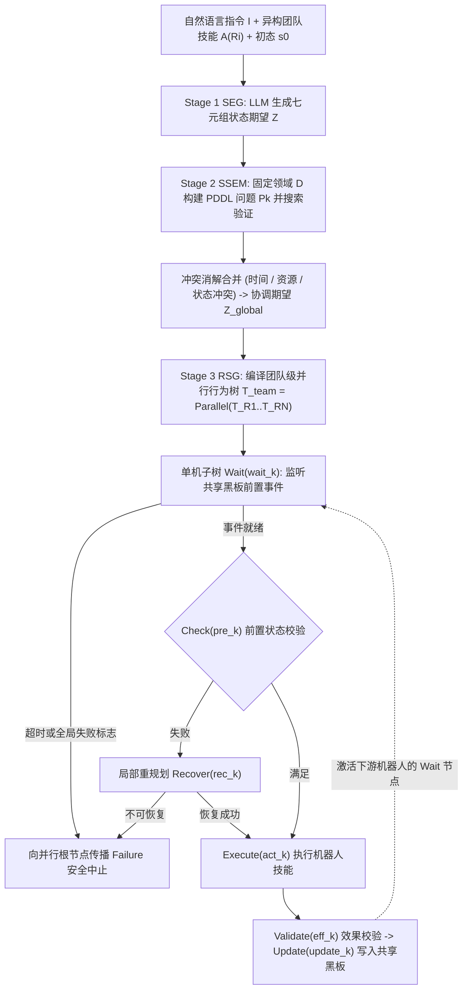

# EmboTeam: Asymmetric State Grounding for Heterogeneous Multi-Robot Collaboration

## 一句话定义

**EmboTeam**（[arXiv:2601.11063](https://arxiv.org/abs/2601.11063)）是由中国科学院软件研究所等提出的异构多机器人长程协同神经符号框架，将高维全局符号规划（LLM 结构化状态期望 + PDDL 符号验证合并）与低层动态执行（带运行时校验、局部恢复与共享黑板同步的团队级并行行为树）解耦为非对称状态落地（Asymmetric State Grounding）体系。

## 英文缩写速查

| 缩写 | 英文全称 | 简要说明 |
|---|---|---|
| PDDL | Planning Domain Definition Language | 规划领域定义语言，本文中用于在固定领域 $\mathcal{D}$ 下验证各期望可达性并消解冲突 |
| BT | Behavior Tree | 行为树，本文用于将全局协调后的状态期望编译为团队并行反应式执行子树 |
| SEG | State Expectation Generation | 状态期望生成模块，由 LLM 基于预定义词表产出结构化七元组期望 $z_k$ |
| SSEM | Symbolic Search and Expectation Merging | 符号搜索与期望合并模块，负责 PDDL 可达性验证与时间/资源/状态冲突消解 |
| RSG | Reactive State Grounding | 反应式状态落地模块，将期望编译为含 `Wait/Check/Recover/Execute/Validate/Update` 的行为树 |
| ESC | Execution-to-Success Conversion | 执行到成功转化率，衡量可物理执行的轨迹最终转化为完整任务成功的比率 |

## 核心信息

| 字段 | 内容或状态 |
|---|---|
| 论文标题 | *EmboTeam: Asymmetric State Grounding for Heterogeneous Multi-Robot Collaboration*（早期预印本/清单曾用题名 *EmboTeam: Grounding LLM Reasoning into Reactive Behavior Trees via PDDL for Embodied Multi-Robot Collaboration*） |
| 作者 | Haishan Zeng, Mengna Wang, Peng Li★ |
| 机构 | Institute of Software, Chinese Academy of Sciences (ISCAS)、University of Chinese Academy of Sciences (UCAS)、Nanjing Institute of Software Technology |
| 预印本版本 | `arXiv:2601.11063v3 [cs.RO]`（2026-11-05） |
| 论文链接 | [arXiv:2601.11063](https://arxiv.org/abs/2601.11063) |
| 官方代码状态 | 论文全文未提供公开代码仓库 URL |
| 清单分类 / 来源条目 | `model.planning` / `survey_ax_2601_11063` |
| 评测平台与基准 | AI2-THOR 上新建 **MACE-THOR** 基准（42 个异构多机任务，8 种室内布局，2–4 台机器人） |

## 为什么重要

1. **破除“全局符号空间 vs 局部动态执行空间”的结构性失配**：传统 LLM+PDDL 多机规划把高层规划结果当作刚性开环动作序列下发，只要现场出现一次动作失败、状态延迟更新或资源占用，整条长程计划便崩溃；而若把所有底层异常直接塞入全局规划空间，又会引发状态空间爆炸。
2. **用行为树黑板显式锚定跨机中间状态**：异构协同中，上游机器人切片完成或腾出餐具后才能触发下游机器人装盘与收纳；EmboTeam 将跨机依赖显式编码为黑板上的 `wait`/`update` 事件与超时全局中止机制，兼顾并行效率与零死锁。
3. **提供专门针对强时序依赖的 MACE-THOR 基准**：现有 SMART-LLM、MAT-THOR 依赖深度较浅（平均 4.28–4.94）；MACE-THOR 将平均子任务数提升至 14.60、依赖深度提升至 12.19（时序依赖子集达 16.67），有效区分“能动（Exec 高）”与“能成事（SR/ESC 高）”。

## 核心方法

EmboTeam 将异构多机团队 $R = \{R_1, \dots, R_N\}$（各自拥有技能集 $\mathcal{A}(R_i)$）的协同拆分为**全局信念空间 $\mathcal{B}$** 与**反应式落地空间 $\mathcal{E}$**，通过三阶段“预测-验证”流水线运行：

1. **阶段一：状态期望生成（SEG）**：
   - LLM 不直接输出无约束动作序列，而是基于固定 PDDL 谓词词表、机器人技能词表与黑板事件词表生成一组结构化状态期望 $Z = \{z_1, \dots, z_M\}$，每项为七元组：
     $z_k = \langle r_k, pre_k, act_k, eff_k, wait_k, update_k, rec_k \rangle$
     其中 $r_k$ 为指派机器人，$pre_k / eff_k$ 为符号前置/预期效果谓词，$act_k \in \mathcal{A}(r_k)$ 为技能，$wait_k / update_k$ 为黑板同步事件，$rec_k$ 为预定义局部恢复策略。
2. **阶段二：符号搜索与期望合并（SSEM）**：
   - 在固定 PDDL 领域 $\mathcal{D}$ 上为每个 $z_k$ 构建局部问题 $\mathcal{P}_k$ 并调用经典规划器 $\pi_k = \text{Planner}(\mathcal{D}, \mathcal{P}_k)$ 验证可达性（注意 $\pi_k$ 仅作可行性与依赖证据，不直接当脚本执行）。
   - 执行冲突感知合并 $Z_{\text{global}} = \text{Merge}(\{(z_k, \pi_k)\}_{k=1}^M)$，显式消解三类冲突：**时间冲突**（先于上游事件调度）、**资源冲突**（多机争抢同一物体或区域）与**状态冲突**（动作效果破坏后续前置条件），输出带偏序同步关系的协调期望 $Z_{\text{global}}$。
3. **阶段三：基于团队级行为树的反应式落地与黑板同步（RSG）**：
   - 顶层编译为并行树 $T_{\text{team}} = \text{Parallel}(T_{R_1}, \dots, T_{R_N})$，每项 $z_k$ 实例化为标准反应式子树：
     $T(z_k) = \text{Seq}(\text{Wait}(wait_k), \text{Fallback}(\text{Check}(pre_k), \text{Recover}(rec_k)), \text{Execute}(act_k), \text{Validate}(eff_k), \text{Update}(update_k))$。
   - **局部恢复与防死锁广播**：若 `Check(pre_k)` 失败，先在单机子树内调用局部重规划 `Recover(rec_k)` 修复，避免惊动全局重规划；若局部修复失败或等待 `wait_k` 超时，则向共享黑板写入全局失败标志，使所有下游 `Wait` 节点安全中止并由团队并行节点收尾，防止死锁。

### 方法流程图

## 实验与评测

### 1. MACE-THOR 基准统计（Table 1）

基于 AI2-THOR 构建 42 个异构多机家庭任务（8 种室内布局，2–4 台机器人），均分为 21 个 **Parallel-Independent (PI)** 并行独立任务（6 布局、2–3 机、平均 10.19 子任务、依赖深度 7.71）与 21 个 **Temporal-Dependent (TD)** 强时序依赖任务（8 布局、2–4 机、平均 19.00 子任务、依赖深度 16.67；全集平均目标数 2.76、平均子任务 14.60、平均依赖深度 12.19）。

### 2. 主对比结果（Table 2，SR / GCR / Exec / ESC，↑）

| 方法 (骨干模型) | PI: SR | PI: GCR | PI: Exec | PI: ESC | TD: SR | TD: GCR | TD: Exec | TD: ESC |
|---|---:|---:|---:|---:|---:|---:|---:|---:|
| CoT (GPT-4o) | 0.05 | 0.10 | 0.68 | 0.07 | 0.00 | 0.00 | 0.00 | 0.00 |
| SMART-LLM (GPT-4o) | 0.10 | 0.18 | **0.83** | 0.12 | 0.00 | 0.00 | 0.00 | 0.00 |
| LaMMA-P (GPT-4o) | 0.14 | 0.40 | 0.81 | 0.17 | 0.10 | 0.26 | **0.83** | 0.12 |
| EmboTeam (Llama-3.1) | 0.52 | 0.60 | 0.82 | 0.63 | **0.38** | 0.50 | 0.76 | 0.50 |
| EmboTeam (Claude-3.5) | 0.57 | 0.70 | 0.77 | 0.74 | 0.33 | 0.55 | 0.57 | **0.58** |
| **EmboTeam (GPT-4o)** | **0.71** | **0.88** | 0.76 | **0.93** | **0.38** | **0.62** | 0.71 | 0.54 |

论文指出，综合全部任务，EmboTeam（GPT-4o）相比最强基线 **LaMMA-P** 将任务成功率（SR）从 **12% 提升至 55%**，目标条件召回率（GCR）从 **32% 提升至 75%**；同时 CoT 与 SMART-LLM 在强时序依赖（TD）任务上全部为 **0.00**。值得注意：基线 LaMMA-P 的物理可执行率（Exec = 0.81 / 0.83）很高，但 ESC 仅 `0.17 / 0.12`，证明“开环能执行不等于能完成跨机协作目标”。

### 3. 消融实验（Table 3，GPT-4o）

| 消融配置 | PI: SR | PI: GCR | PI: Exec | PI: ESC | TD: SR | TD: GCR | TD: Exec | TD: ESC |
|---|---:|---:|---:|---:|---:|---:|---:|---:|
| Ours (w/o SEG & SSEM) | 0.43 | 0.65 | 0.55 | 0.78 | 0.14 | 0.41 | 0.53 | 0.26 |
| Ours (w/o SSEM) | 0.43 | 0.65 | 0.82 | 0.52 | 0.19 | 0.22 | 0.51 | 0.37 |
| Ours (w/o RSG) | 0.14 | 0.40 | 0.81 | 0.17 | 0.10 | 0.26 | 0.83 | 0.12 |
| Ours (w/o sync) | 0.48 | 0.68 | 0.83 | 0.58 | 0.10 | 0.21 | 0.56 | 0.18 |
| Ours (w/o recovery) | 0.33 | 0.43 | **0.97** | 0.34 | 0.19 | 0.31 | **0.95** | 0.20 |
| **Ours (完整)** | **0.71** | **0.88** | 0.76 | **0.93** | **0.38** | **0.62** | 0.71 | **0.54** |

去掉 RSG 后 PI/TD 的 SR 分别暴跌至 `0.14 / 0.10`（退化至接近 LaMMA-P 水平）；去掉黑板同步（`w/o sync`）使 TD 成功率跌至 `0.10`；去掉局部恢复（`w/o recovery`）虽使动作可执行率（Exec）升高至 `0.97 / 0.95`，但成功率与 ESC 分别骤降至 `0.33 / 0.19` 与 `0.34 / 0.20`。

## 与现有工作的对比

| 代表工作 | 规划与执行表征 | 跨机协同与同步机制 | 运行时局部失配处理 |
|---|---|---|---|
| SMART-LLM | LLM 分解并分配角色为脚本化计划 | 隐式语言顺序协调 | 无运行时校验与恢复，TD 任务 SR 0.00 |
| LaMMA-P | LLM + PDDL 生成联合符号计划 | PDDL 规划级分配，开环顺序执行 | 缺少执行期前置/效果检查，TD 任务 SR 0.10 |
| RoCo | 多 LLM 智能体轮流对话协商 + 集中式 RRT | 对话轮次协商，无行为树黑板事件流 | 依赖轮次间提示重规划，无子树级局部恢复 |
| CABTO / LLM+BT 既有方法 | 将规划直接编译为单机静态 BT | 侧重单机技能逻辑，缺少跨机状态依赖 | 无全局 PDDL 期望合并与黑板防死锁广播 |
| **EmboTeam (本文)** | **LLM 七元组期望 + PDDL 验证合并 + 并行 BT** | **共享黑板 `Wait/Update` + 超时全局中止** | **单机子树 `Check/Recover/Validate` 局部闭环修复** |

## 常见误区或局限

1. **高度依赖预定义固定 PDDL 领域与恢复策略词表**：论文明确说明 PDDL 领域 $\mathcal{D}$ 与机器人技能/谓词词表在全部实验中固定不变且不由 LLM 修改，新环境或新技能接入仍需专家定义 PDDL 算子语义与预置恢复策略 $rec_k$。
2. **仅在 AI2-THOR 仿真离散高层原语上验证，尚未接入视觉感知与真机连续控制**：当前 MACE-THOR 评测假设仿真环境状态/技能接口可用；论文未来工作指出需进一步对接学习型视觉 grounding、VLA 底层控制器与物理多机真机系统。
3. **强时序依赖任务仍有较大失败余量**：即便启用 GPT-4o，EmboTeam 在强时序依赖（TD）子集上的 SR 仍为 0.38（ESC 为 0.54），说明长依赖链上的跨机状态误差累积与重规划边界仍是难点。

## 结论

**一句话总判：EmboTeam 证明了“PDDL 管全局可行性与冲突消解、并行行为树+共享黑板管运行时校验与局部恢复”的非对称状态落地架构，是突破长程异构多机器人协同脆弱性的关键工程范式。**

1. **不要直接让 LLM 或 PDDL 输出刚性开环动作脚本**：用结构化七元组状态期望 $z_k$ 作为中间契约，把“应该达到什么状态”和“局部怎么重试补救”解耦，能把 ESC 从 0.17 提升到 0.93（PI）和 0.54（TD）。
2. **评测多机协同务必同时看 SR 与 ESC，不能只看 Exec**：消融中去掉局部恢复反而让 `Exec` 虚高至 0.97，因为机器人机械地执行完错误后续步骤却根本没完成任务目标。
3. **强时序依赖多机任务必须配备显式事件等待与超时中止机制**：黑板 `Wait/Update` 加上全局失败标志可同时解决前置未就绪抢跑与上游失败导致的无限死锁。
4. **跨 LLM 骨干迁移稳健**：即使切换至开源 `Llama-3.1` 或 `Claude-3.5`，EmboTeam 在 PI（0.52 / 0.57）和 TD（0.38 / 0.33）上依然显著压过基于 GPT-4o 的全部传统基线。

## 关联页面

- [Agentic Robots 综述](paper-towards-agentic-robots-survey.md)
- [全量项目节点清单](../overview/awesome-agentic-robots-node-index.md)
- [RoCo 多机对话协同](paper-agentic-2307-04738.md)
- [行为树与 VLA 编排](../concepts/behavior-tree-vla-orchestration.md)
- [人形与多机器人协同](../concepts/humanoid-multi-robot-coordination.md)
- [LLM 与机器人控制接口](../concepts/llm-robotics-control-interfaces.md)
- [VLA 方法背景](../methods/vla.md)

## 参考来源

- [官方 Awesome 快照归档](../../sources/repos/awesome-agentic-robots-survey-index.md)
- [arXiv:2601.11063v3 论文原文](https://arxiv.org/abs/2601.11063)
