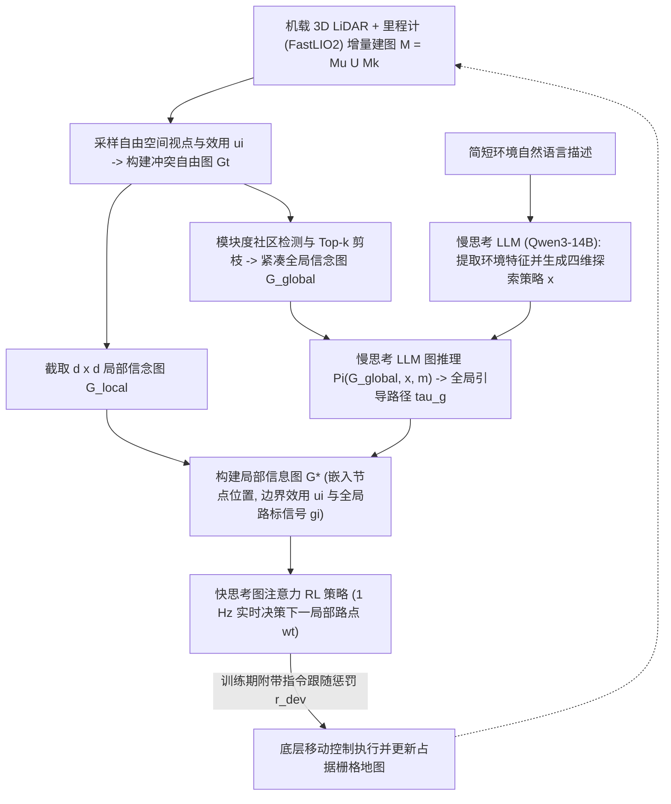

# FARE: Fast-Slow Agentic Robotic Exploration

## 一句话定义

**FARE**（[arXiv:2601.14681](https://arxiv.org/abs/2601.14681)）是由北京航空航天大学与新加坡国立大学提出的“快-慢思考”分层自主探索框架，由慢思考大语言模型（LLM）基于环境语义生成策略并在模块度剪枝后的稀疏全局信念图上规划长程引导路径，由快思考图注意力强化学习（RL）策略响应局部传感器边界实时决策并经指令跟随奖励与全局引导对齐。

## 英文缩写速查

| 缩写 | 英文全称 | 简要说明 |
|---|---|---|
| FARE | Fast-Slow Agentic Robotic Exploration | 本文提出的快-慢双系统具身机器人自主探索框架 |
| LLM | Large Language Model | 大语言模型（本文使用 Qwen3-14B），承担慢思考环境策略生成与全局图路径推理 |
| RL | Reinforcement Learning | 强化学习，本文用于训练快思考局部图注意力视点选择策略 |
| LiDAR | Light Detection and Ranging | 激光雷达，用于未知环境增量建图（如 FastLIO2）与局部自由空间采样 |
| ROS | Robot Operating System | 机器人操作系统，本文仿真与实机验证均集成于 ROS 运行栈 |

## 核心信息

| 字段 | 内容或状态 |
|---|---|
| 论文标题 | *FARE: Fast-Slow Agentic Robotic Exploration* |
| 作者 | Shuhao Liao, Xuxin Lv, Jeric Lew, Shizhe Zhang, Jingsong Liang, Peizhuo Li, Yuhong Cao, Wenjun Wu, Guillaume Sartoretti |
| 机构 | Beihang University、National University of Singapore (NUS) |
| 预印本版本 | `arXiv:2601.14681v1 [cs.RO]`（2026-01-21） |
| 论文链接 | [arXiv:2601.14681](https://arxiv.org/abs/2601.14681) |
| 官方代码状态 | 论文全文与入口清单均未提供公开代码仓库 URL |
| 清单分类 / 来源条目 | `model.perception` / `survey_ax_2601_14681` |
| 仿真与硬件平台 | Gazebo 仿真（16 线 3D LiDAR 差速车，最高 2 m/s）；真机 Agilex Scout-mini + 机载 Jetson AGX Orin（运行 Qwen3-14B）+ Ouster OS0-32 LiDAR + FastLIO2 |

## 为什么重要

1. **破解传统与纯 RL 探索器“短视与缺乏环境自适应”的双重困境**：传统探索器（TARE、DSVP）依赖固定启发式超参，难以在开阔办公室、不规则森林与狭窄仓库货架间自适应切换策略；而纯 RL 方法（ARiADNE、HEADER）受限于稀疏的回合末覆盖奖励，依赖局部信息增益密集奖励后容易忽视远距结构线索并产生频繁折返（backtracking）。
2. **用模块度社区剪枝压缩演进中的环境拓扑供 LLM 推理**：机器人探索过程中构图规模不断膨胀，直接序列化整张路标图会超出或干扰 LLM 推理；通过社区检测与模块度贡献 Top-$k$ 剪枝构造紧凑全局图，保留主干连通结构的同时大幅降低推理复杂度。
3. **机载大模型真机闭环验证（Onboard LLM）**：在 Jetson AGX Orin 机载部署 Qwen3-14B，在 200 m × 130 m 真实校园教学楼内无人工干预完成全楼自主探索，验证了“慢推理与快控制时间尺度解耦”的工程可行性。

## 核心方法

FARE 构建在**分层机器人信念图（Hierarchical Robot Belief Graph）**之上，将语义推理与几何反应控制解耦到不同时间与空间尺度：

1. **分层信念图与模块度剪枝（§IV-A）**：
   - **局部信念图 $G_{\text{local}}$**：在当前自由空间 $M_f$ 采样候选视点并做碰撞检测与 $k$ 近邻连边得到 $G_t = (V_t, E_t)$，计算每个节点传感器视距 $d_s$ 内可观测边界数效用 $u_i = |F_{o,i}|$，并以当前位置 $v_{\text{cur}}$ 为中心截取 $d \times d$ 滑动窗口构建局部图。
   - **全局信念图 $G_{\text{global}}$**：在 $G_t$ 上执行基于模块度 $Q$ 的社区检测，按各社区的模块度贡献 $Q(c) = \sum_{\text{in}} - \frac{(\sum_{\text{tot}})^2}{2m}$ 排序并仅保留 Top-$k$ 个最具结构信息量的社区 $C' := \arg\text{topk}_{c \subseteq C} Q(c)$ 抽象为全局节点，依据社区间连通性构建紧凑全局图。
2. **慢思考模块（Slow-Thinking LLM，§IV-B）**：
   - **环境条件化策略生成**：根据简短的自然语言环境描述，LLM 按预定义模式从三方面提取环境特征（空间特征、障碍特征、探索挑战），再实例化包含四条轴线（空间策略、效率策略、安全策略、任务策略）的可解释文本探索策略 $x$（例如在低连通窄通道场景提高折返容忍度并保持逃生路径意识）。
   - **全局图路径推理**：以剪枝后的全局图 $G_{\text{global}}$、策略提示 $x$ 与历史情景记忆 $m$ 为输入，LLM 迭代推理生成通往未探索区域的长程引导路径 $\tau_g = \Pi(G_{\text{global}}, x, m) = [v_{\text{cur}}, v_1, \dots, v_m]$。
3. **快思考模块（Fast-Thinking Graph Attention RL，§IV-C）**：
   - **信息图构建与图注意力策略**：局部图每个节点扩充为 $v'_i = (x_i, y_i, u_i, g_i)$，其中 $g_i \in \{0, 1\}$ 为指示该节点是否位于全局路径 $\tau_t$ 上的路标（guidepost）信号；编码器-解码器采用邻接掩码约束的缩放点积图注意力选择下一邻接路点 $w_t \in N(v_{\text{cur}})$。
   - **指令跟随奖励塑造**：定义局部选定路点 $w_t$ 与全局引导下一路点 $w_t^*$ 间的归一化偏离度 $d_t = \frac{\|w_t - w_t^*\|}{\sqrt{4 \Delta_{\text{node}}^2}}$，构造平滑指数惩罚奖励 $r_t^{\text{dev}} = -\frac{e^{d_t}-1}{e-1} \in [-1, 0]$，使 RL 策略在响应局部精细几何边界的同时遵循长程全局引导。

### 方法流程图

## 实验与评测

### 1. Gazebo 仿真对比实验（Table I）

在 Gazebo 中针对**室内办公楼（Indoor）**、**室外森林（Forest）**与**密集货架仓库（Warehouse）**三类环境，采用 16 线 3D LiDAR 差速车（最大速度 2 m/s，慢思考模块均为 Qwen3-14B，FARE 仅调整节点分辨率 $\Delta_{\text{node}} \in [1.2, 2.8]$ m，基线则针对环境调优多组参数），每方法每环境运行 **10 次**，报告总探索距离（m，↓）与耗时（s，↓）：

| 方法 | Indoor 距离 (m) | Indoor 耗时 (s) | Forest 距离 (m) | Forest 耗时 (s) | Warehouse 距离 (m) | Warehouse 耗时 (s) |
|---|---:|---:|---:|---:|---:|---:|
| DSVP | 1511 (±75) | 931 (±61) | 2058 (±92) | 1083 (±60) | 869 (±42) | 582 (±32) |
| TARE | 1209 (±42) | 658 (±23) | 1363 (±43) | 711 (±21) | 652 (±31) | 366 (±22) |
| ARiADNE | 1053 (±63) | 610 (±24) | 1320 (±81) | 790 (±62) | 521 (±16) | 362 (±40) |
| HEADER | **1030 (±40)** | **576 (±26)** | 1230 (±72) | 725 (±36) | 492 (±17) | 286 (±16) |
| **FARE (本文)** | 1048 (±13) | 590 (±10) | **1090 (±21)** | **680 (±10)** | **441 (±15)** | **252 (±8)** |

结果要点：
- 在结构紧凑、缺乏显著全局分层差异的 Indoor 场景中，FARE 与最强学习型基线 HEADER 持平且方差最低（±13 m / ±10 s）。
- 在具备清晰全局障碍分布或长窄通道拓扑的 **Forest** 与 **Warehouse** 场景中，FARE 取得所有方法中最短路径（1090 m / 441 m）与最快完成时间（680 s / 252 s）；轨迹定性分析表明 FARE 能更早清扫边缘与角落区域，避免基线常见的“先略过再长距折返”。

### 2. 真实校园大型建筑实机部署（§V-B）

- **硬件与参数**：Agilex Scout-mini 轮式机器人 + 机载 **Jetson AGX Orin**（本地运行 Qwen3-14B）+ Ouster OS0-32 LiDAR + FastLIO2 建图与里程计；限速 1 m/s，传感距离 8 m，快思考策略重规划频率 **1 Hz**，$\Delta_{\text{map}} = 0.4$ m，$\Delta_{\text{node}} = 0.8$ m。
- **验证成果**：在一栋 **200 m × 130 m** 的多走廊、房间与交叉口大型室内教学楼内，FARE 在无人工干预条件下稳定完成整栋楼自主探索。

## 与现有工作的对比

| 探索路线 | 代表方法 | 全局引导与环境适应机制 | 与 FARE 的核心差异 |
|---|---|---|---|
| 传统几何分层探索 | DSVP、TARE | 粗细两级采样与 TSP/边界启发式，依赖固定超参 | 难以随环境类型自动调整探索优先级，在非结构森林与窄通道仓库易多走弯路 |
| 纯局部图注意力 RL | ARiADNE | 在局部视点图上用注意力网络选择高边界效用邻接点 | 缺乏全局长程结构引导，容易受短视信息增益诱导而遗漏边角并折返 |
| 分层专家引导 RL | HEADER | 基于社区划分全局图并配专家引导奖励 | 全局决策仍依赖固定算法策略，缺乏针对语义环境描述的战略自适应能力 |
| 静态图 LLM 推理 | GPT4Graph、Think-on-Graph | 面向静态离线知识图谱的指令微调或剪枝遍历 | 未面向动态增量构图、部分可观测及高频实时运动控制闭环 |
| **FARE (本文)** | **慢思考 LLM + 快思考图 RL** | **模块度剪枝全局图 + 四维自然语言策略 + 指数指令跟随奖励** | **将全局语义战略推理（低频）与局部传感器反应控制（1 Hz）分层解耦并机载部署** |

## 常见误区或局限

1. **环境类型描述仍需人工预先简短输入**：慢思考模块的策略生成依赖部署前对场景的“简短自然语言描述”；目前系统尚无在线视觉语义感知来自动检测环境类型突变（如从室内大厅突然进入室外林地），这也是作者列出的首要未来工作。
2. **当前限于二维占据栅格与平面动作空间**：问题形式化（$E \subset \mathbb{R}^2$）及实验均针对地面轮式机器人二维平面探索；面向无人机等三维复杂空间探索需扩展表征与 3D 动作空间。
3. **单机探索且缺少独立开源仓库**：当前框架面向单机器人自主探索（多机显式协同留待后续），且论文未给出公开代码地址，工程复现需依据论文算法与 TARE/HEADER 图框架自行实现。

## 结论

**一句话总判：FARE 证明了“模块度剪枝压缩拓扑 + LLM 环境策略推理提供稀疏全局路标 + 图注意力 RL 负责 1 Hz 局部实时决策”是兼顾长程结构最优性与高频安全避障的有效具身探索范式，且已在机载 Jetson AGX Orin 上跑通百米级真实建筑闭环。**

1. **用模块度 Top-$k$ 社区剪枝解决大地图输入 LLM 的扩展性问题**：不要把稠密视点图直接喂给大模型，只提取高模块度贡献的连通社区作为全局节点即可保留主干拓扑。
2. **将“指令跟随指数惩罚 $r_t^{\text{dev}}$”加入快思考 RL 训练**：既能让局部策略积极贴合慢思考给出的全局方向减少折返，又保留了对局部未知障碍与实时边界的灵活绕行权。
3. **机载部署采用跨时间尺度解耦**：将 Qwen3-14B 等大模型放在慢速全局层异步更新路标，由轻量图注意力 RL 以 1 Hz 驱动底层控制，可在 Jetson AGX Orin 上实现无云端依赖的 200 m × 130 m 实机自主探索。
4. **注意场景适应边界**：当机器人需要跨越截然不同的室内外混合区域时，需额外接入 VLM/视觉分类器在线刷新环境描述，以防慢思考策略滞后。

## 关联页面

- [Agentic Robots 综述](paper-towards-agentic-robots-survey.md)
- [全量项目节点清单](../overview/awesome-agentic-robots-node-index.md)
- [自主探索任务背景](../tasks/autonomous-exploration.md)
- [Reinforcement Learning 强化学习](../methods/reinforcement-learning.md)
- [Graph Neural Network 图神经网络](../concepts/graph-neural-network.md)
- [具身语义与认知地图](../concepts/embodied-semantic-cognitive-map.md)
- [VLA 方法背景](../methods/vla.md)

- [机器人自主探索](../tasks/autonomous-exploration.md)：对照相关方法与适用场景。

## 参考来源

- [官方 Awesome 快照归档](../../sources/repos/awesome-agentic-robots-survey-index.md)
- [arXiv:2601.14681v1 论文原文](https://arxiv.org/abs/2601.14681)
