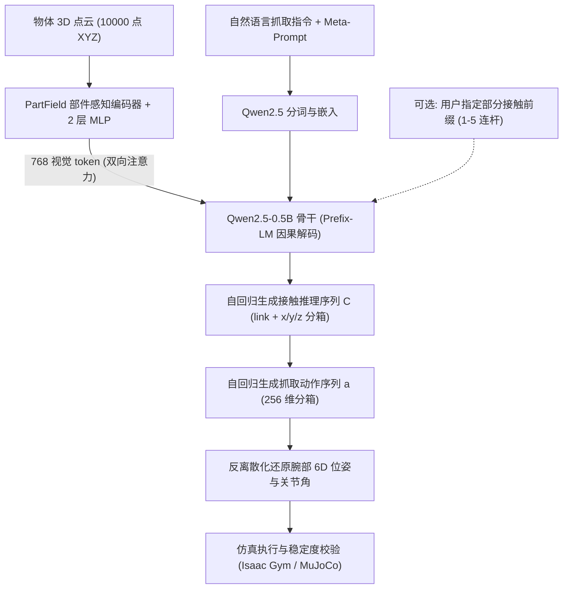

# DextER: Language-driven Dexterous Grasp Generation with Embodied Reasoning

## 一句话定义

DextER（Dexterous Grasp Generation with Embodied Reasoning）是一种基于视觉-语言模型的语言驱动灵巧抓取生成框架，通过先自回归预测“哪些手指连杆接触物体表面何处”的具身接触推理（ECoT）token，再条件生成 Shadow Hand 抓取位姿与关节角，将任务语义与多指物理接触约束统一到单阶段自回归序列生成中。

## 英文缩写速查

| 缩写 | 英文全称 | 简要说明 |
|---|---|---|
| ECoT | Embodied Chain-of-Thought | 具身思维链推理，本文中指先预测接触连杆与 3D 接触位置再生成抓取动作的中间过程 |
| VLM | Vision-Language Model | 视觉-语言模型，融合 3D 点云特征与自然语言指令以自回归输出 token 序列 |
| VLA | Vision-Language-Action | 视觉-语言-动作模型，将视觉与语言直接映射到机器人动作空间的统一策略范式 |
| P-FID | Point-cloud Fréchet Inception Distance | 基于点云特征分布的 Fréchet 距离，用于衡量生成抓取分布与真值分布的语义意图一致性 |
| CD | Chamfer Distance | 倒角距离，衡量生成手部网格与参考手部网格之间的空间几何最近邻偏差 |
| FK | Forward Kinematics | 正向运动学，用于从手爪关节角反推实际接触位置并在 MuJoCo 中验证接触精度 |

## 核心信息

| 字段 | 内容 |
|---|---|
| 论文标题 | *DextER: Language-driven Dexterous Grasp Generation with Embodied Reasoning* |
| 作者 | Junha Lee, Eunha Park, Minsu Cho |
| 机构 | Pohang University of Science and Technology (POSTECH)、RLWRLD |
| 发表时间 / 预印本 | arXiv:2601.16046v2（2026-04-26） |
| 论文链接 | [arXiv:2601.16046](https://arxiv.org/abs/2601.16046) / [PDF](https://arxiv.org/pdf/2601.16046) |
| 项目主页 | [junha-l.github.io/dexter](https://junha-l.github.io/dexter/) |
| 清单分类 | `data.annotation` |
| 来源条目 | `survey_ax_2601_16046` |
| 开源 / 验证范围 | 论文基于 MuJoCo（DexGraspBench）与 Isaac Gym（DexGYS/DexGraspNet）完成全量仿真评测、部分点云鲁棒性测试及可控抓取实验；项目页已上线，代码与真机物理部署未在论文正文中提供验证 |

## 为什么重要

1. **填补端到端灵巧抓取“缺失物理交互推理”的空白**：现有语言条件灵巧抓取模型要么采用两阶段分离管线（先预测 affordance 再抓取），导致语义理解与物理合成无法联合优化；要么采用端到端直接回归抓取参数，缺少对多指接触分布的显式结构化建模。
2. **提出本体感知的中间推理表示（Link-Position 接触对）**：不同于常规移动操作中使用的 2D 边界框或文本规划，20+ 自由度灵巧手的核心物理约束在于手部连杆与物体表面部件的接触拓扑。预测 `{(link, 3D position)}` 序列直接桥接高层功能意图（如按压扳机、握持手柄）与底层几何接触。
3. **原生支持部分接触约束的可控生成（Steerable Generation）**：由于接触与动作统一在同一自回归词表内，用户或上游系统只需在推理前缀填入 1–5 个指定手指连杆及其 3D 表面接触坐标，模型即可自动补全其余手指接触与完整手部姿态，提供细粒度的交互式控制接口。

## 核心方法

DextER 将给定目标点云 $P \in \mathbb{R}^{N \times 3}$ 与自然语言指令 $T$ 下的灵巧抓取位姿 $a \in \mathbb{R}^D$ 预测分解为先预测接触模式 $C$、再生成抓取动作的条件概率分解：

$$p(a, C \mid P, T) = p(C \mid P, T) \cdot p(a \mid C, P, T)$$

1. **部件感知 3D 编码与词表离散化**：
   - 采用预训练部件级 3D 编码器 **PartField**（在 Objaverse 上经 SAM2 掩码对比学习预训练）处理采样至 $10{,}000$ 点的 XYZ 点云，在瓶颈处对三平面（triplane）特征图下采样得到 $3 \times 16 \times 16 = 768$ 个视觉 token，经两层 MLP 投影至语言模型嵌入空间。
   - **动作离散化**：将 6D 手腕位姿与 Shadow Hand 手指关节角按训练集第 1 至第 99 百分位做分位数归一化到 $[-1, 1]$，再均匀离散为 $N_a = 256$ 个动作分箱 token（`<|action_start|> ... <|action_end|>`）。
   - **接触序列表示**：将 Shadow Hand 连杆名注册为专用 token（如 `<rh_ffdistal>`、`<rh_thdistal>`、`<rh_palm>`），并将训练集包围盒归一化后的 3D 表面接触坐标均匀离散为每维 $N_{\text{pos}} = 256$ 个位置分箱 token，每个接触以 `<li > <pix> <piy> <piz>` 四元组编码并由 `<|contact_start|>` / `<|contact_end|>` 包裹。
2. **混合注意力与接触位置 Dropout 训练**：
   - 语言骨干初始化自 **Qwen2.5-0.5B**，采用 ChatML 对话模板与**前缀混合注意力掩码（Prefix-LM）**：点云 token 间使用双向注意力捕获全局 3D 几何上下文，而提示文本、接触 token 与动作 token 使用因果自回归注意力。
   - 训练时引入**接触位置 Dropout（$p_{\text{drop}} = 0.5$）**：以 50% 概率丢弃具体坐标 `<pix><piy><piz>` 而仅保留接触连杆 token `<li >`，防止模型对固定坐标模式过拟合，并增强对不同粒度接触条件提示的泛化能力。
   - 使用 8 张 NVIDIA A6000（48GB）训练 100K 步（batch size 64，AdamW `lr=1e-4` 余弦衰减 + 1,000 步线性预热，bfloat16，约 48 小时）。
3. **物理仿真接触标注与 VLM 指令构建管线**：
   - **MuJoCo 物理接触标注**：将 DexGYS 与 Dexonomy 数据集中的手爪与物体模型导入 MuJoCo，执行正向运动学并用碰撞查询提取精确的手指连杆接触集合及物体表面 3D 接触点。
   - **Dexonomy 语言指令自动标注**：使用多视图渲染（5 视角）结合已知接触连杆集合输入 **Gemma-3**，先识别物体类别与被接触功能部件，再生成底层物理抓握指令与高层功能指令（Dexonomy 实验统一采用物理抓握指令，训练集共 182,061 条）。

### 方法流程图

## 实验与评测

### 1. DexGYS 语言条件灵巧抓取主实验（Table 1，Isaac Gym）

在 DexGYS 未见物体（unseen objects）验证集上，DextER 相比两阶段基线与直接生成方法取得更低的意图偏差（P-FID 相比 DexGYSNet 降低 96.4%）与更高的仿真抓取成功率（提升 3.83 个百分点），同时动作空间多样性（$\delta_q$）翻倍以上：

| 方法 | P-FID ↓ | CD ($\times 10^{-1}$) ↓ | Con. ↓ | Success (%) ↑ | $Q_1$ ($\times 10^{-1}$) ↑ | Pen. ↓ | $\delta_t$ ↑ | $\delta_r$ ↑ | $\delta_q$ ↑ |
|---|---:|---:|---:|---:|---:|---:|---:|---:|---:|
| GraspCVAE | 29.02 | 3.14 | 0.96 | 29.12 | 0.54 | 0.55 | 0.18 | 1.76 | 0.18 |
| GraspTTA | 33.15 | 12.19 | 1.11 | 43.46 | 0.71 | 0.19 | 2.11 | 6.15 | 3.87 |
| SceneDiffusers | 7.93 | 1.68 | 0.45 | 62.24 | 0.83 | 0.25 | 0.35 | 3.46 | 0.39 |
| DGTR | 15.77 | 2.90 | 0.78 | 51.91 | 0.78 | **0.16** | 2.05 | 14.01 | 4.30 |
| DexGYSNet | 5.60 | **1.20** | 0.36 | 63.31 | 0.83 | 0.22 | 6.12 | 55.68 | 6.12 |
| DextER (w/o ER) | 0.30 | 1.95 | 0.40 | 62.37 | 0.66 | 0.44 | 8.78 | 77.13 | **13.77** |
| **DextER（完整版）** | **0.20** | 1.46 | **0.34** | **67.14** | **0.89** | 0.37 | **8.84** | **77.98** | 13.63 |

### 2. 关键消融实验与推理效率（Table 2 & Table 5 & Table 8）

- **ECoT 接触推理（Table 2）**：移除 ECoT（w/o ER）使 P-FID 从 `0.20` 恶化至 `0.30`（+50%），Success 从 `67.14%` 降至 `62.37%`，$Q_1$ 从 `0.89` 降至 `0.66`，穿透深度从 `0.37` 增至 `0.44`。
- **3D 编码器与离散粒度**：PartField 显著优于全局对象编码器 Uni3D（Success `67.14%` vs `59.07%`，P-FID `0.20` vs `0.52`）；动作与位置分箱均在 `256` 档达到最优（$N_a=512$ 因词表过大导致 P-FID 升至 `0.26`、Success 降至 `65.24%`）。
- **接触位置 Dropout 与 LLM 规模**：$p_{\text{drop}}=0.5$ 为最优平衡（$p_{\text{drop}}=0.0$ 时 Success `65.68%`，$p_{\text{drop}}=1.0$ 时退化至 `63.33%`）；将 LLM 扩大至 3 倍参数量的 Qwen2.5-1.5B 仅带来微弱提升（Success `67.55%` vs `67.14%`），而更小的 SmolLM2-360M 仍可达到 `64.87%`。
- **接触预测精度（Table 4）**：在 DexGYS 验证集上，接触连杆预测达到 `IoU = 0.42`、`Precision = 0.59`、`Recall = 0.63`、`F1 = 0.57`，预测位置与 FK 实际位置误差 $< 1\text{ cm}$ 的准确率（Pos. Acc.）达到 **`0.79`**。
- **部分点云与噪声零样本鲁棒性（Table 8）**：用 HPR 模拟双视角（腕部+第三视角）遮挡仅保留约 35% 点云并叠加深度高斯噪声（$\sigma_d=4\text{ mm}, \sigma_l=1\text{ mm}$）后，未重训练直接测试仅带来轻微下降：Success `67.14% → 65.77%`，P-FID `0.20 → 0.21`，CD `1.46 → 1.50`。
- **推理速度（Table 5，单张 A6000）**：DexGYSNet 为 `1.134 s`，DextER w/o ER 为 `1.105 s`，DextER 为 `1.458 s`。

### 3. Dexonomy 零样本泛化与可控生成（Table 3，DexGraspBench MuJoCo）

| 测试划分 / 引导强度 | Seen Obj.&Grasp (P-FID / Success) | Unseen Obj. (P-FID / Success) | Unseen Grasp (P-FID / Success) | Unseen Both (P-FID / Success) |
|---|---|---|---|---|
| DexGYS 基线 | 1.89 / 0.97% | 2.55 / 0.93% | 2.87 / 0.99% | 3.04 / 1.16% |
| **DextER（无前缀约束）** | 0.44 / 12.24% | 1.44 / 10.86% | 1.04 / 9.10% | 1.23 / 8.41% |
| DextER + 1 link 引导 | 0.43 / 10.40% | 0.41 / 10.19% | 1.06 / 7.08% | 1.03 / 7.23% |
| DextER + 3 links 引导 | 0.18 / 17.84% | 0.19 / 17.32% | 0.93 / 8.33% | 0.87 / 8.36% |
| **DextER + 5 links 引导** | **0.12 / 21.35%** | **0.14 / 20.26%** | **0.83 / 9.10%** | **0.78 / 8.31%** |

## 与现有工作的对比

| 维度 | 两阶段管线（如 DexGYSNet） | 无推理端到端生成（如 SemGrasp / w/o ER） | DextER（本文） |
|---|---|---|---|
| 中间表示 | 显式 affordance/接触图与抓取生成器解耦训练 | 无中间接触表征，直接映射特征到姿态 | **统一词表内的自回归 Link-Position 接触序列** |
| 语义与物理耦合 | 两阶段分离，无法相互反馈优化 | 隐式耦合，失败原因不可解释 | **基于 Prefix-LM 的端到端联合训练与显式中间监督** |
| 可控性与人机交互 | 难以直接按特定手指坐标施加硬约束 | 仅支持文本级粗粒度引导 | **支持 1–5 个连杆的局部接触前缀可控补全** |
| 分布覆盖多样性 | 易受阶段误差或坍缩影响（$\delta_q=6.12$） | 较稳定但意图一致性较弱 | **高模态覆盖与意图对齐（P-FID 0.20，$\delta_q=13.63$）** |

## 常见误区或局限

1. **量化离散化导致的穿透失败（14.7%）**：由于论文刻意关闭了基线常用的几何后处理优化以纯粹检验自回归推理效果，连续参数与坐标的 256 档离散化误差在失败案例中占 14.7%（表现为语义正确但手-物网格轻微穿透导致仿真失败）。
2. **未见抓取分类（Unseen Grasp Taxonomy）物理稳定性仍不足**：在 Dexonomy 的 Unseen Grasp 与 Unseen Both 划分上，即使给满 5 个连杆引导，成功率也仅停留在 8.31%–9.10%，定性分析显示手爪虽能合围物体但在仿真外力下易发生抖动，表明模型对全新力封闭构型的精细力学平衡尚未充分掌握。
3. **单一静态物体假设与自回归延迟**：全部主实验在单物体静态场景的物理仿真（Isaac Gym / MuJoCo）中完成，尚未验证多物体杂乱遮挡场景及真机闭环控制；此外自回归逐 token 解码（约 1.458 s）相比高频实时伺服仍有延迟瓶颈。

## 结论

**一句话总判：DextER 验证了将“手指连杆 + 3D 表面接触坐标”作为具身思维链中间 token 进行联合自回归生成，能显著提升语言驱动灵巧抓取的意图对齐度、模态多样性与局部可控性。**

1. **用部件级 3D 编码器对齐接触推理**：消融证明 PartField 相比全局点云编码器 Uni3D 将成功率从 59.07% 推升至 67.14%，接触推理高度依赖局部功能部件几何特征。
2. **离散分箱控制在 256 档并配合接触位置 Dropout**：$N_a=N_{\text{pos}}=256$ 与 $p_{\text{drop}}=0.5$ 在表达精度与词表可学习性之间取得最佳平衡，且直接赋予模型接受不同数量连杆约束的能力。
3. **性能增益主要来自推理结构而非大模型堆叠**：仅使用 0.5B 参数的 Qwen2.5 即可达到 67.14% 成功率，扩大 3 倍至 1.5B 仅微涨 0.41 个百分点，工程选型可优先轻量骨干。
4. **落地前需补齐几何精修与跨构型力封闭约束**：实际部署中建议在离散动作输出后衔接轻量级穿透修正或可微力封闭优化，以消除约 14.7% 的量化穿透失败。

## 关联页面

- [Agentic Robots 综述](paper-towards-agentic-robots-survey.md)
- [全量项目节点清单](../overview/awesome-agentic-robots-node-index.md)
- [Embodied Chain-of-Thought (ECoT) 论文节点](paper-ecot.md)
- [AffordDexGrasp 论文节点](paper-aff-2503-07360-afforddexgrasp-open-set-language-guided-dexterous-grasp.md)
- [CoToGrasp 论文节点](paper-cotograsp.md)
- [抓取位姿估计方法](../methods/grasp-pose-estimation.md)
- [接触丰富操作概念](../concepts/contact-rich-manipulation.md)
- [灵巧手运动学基础](../concepts/dexterous-kinematics.md)
- [VLA 方法背景](../methods/vla.md)

- [Manipulation](../tasks/manipulation.md)：对照相关方法与适用场景。

## 参考来源

- [官方 Awesome 快照归档](../../sources/repos/awesome-agentic-robots-survey-index.md)
- [arXiv:2601.16046v2 论文页面](https://arxiv.org/abs/2601.16046)（[PDF 原文](https://arxiv.org/pdf/2601.16046)）
- [DextER 官方项目页](https://junha-l.github.io/dexter/)
