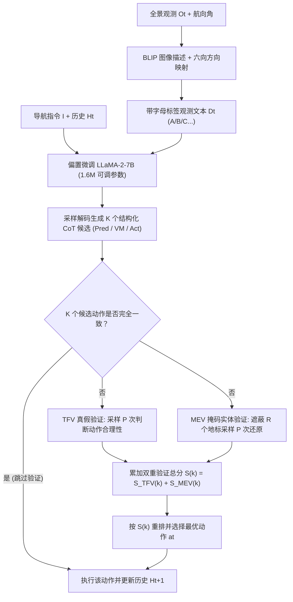

# DV-VLN: Dual Verification for Reliable LLM-Based Vision-and-Language Navigation

## 一句话定义

DV-VLN 是一种面向大语言模型视觉-语言导航（VLN）的生成-验证型推理框架，通过对开源 LLaMA-2-7B 骨干进行偏置微调以输出“Prediction–View Match–Action”结构化导航思维链，并在推理阶段利用免训练的真假验证（TFV）与掩码实体验证（MEV）对多个采样候选动作进行一致性评分与重排，从而缓解单次前向决策在局部歧义场景下的误差累积问题。

## 英文缩写速查

| 缩写 | 英文全称 | 简要说明 |
|---|---|---|
| VLN | Vision-and-Language Navigation | 视觉-语言导航，要求具身智能体依据自然语言指令在三维室内环境中导航至目标点 |
| TFV | True–False Verification | 真假验证，通过判别式提问多次采样判断候选动作是否为当前上下文下的正确下一步 |
| MEV | Masked-Entity Verification | 掩码实体验证，遮蔽指令中的关键房间或地标实体并检验假设执行候选动作后能否恢复该实体 |
| CoT | Chain-of-Thought | 思维链推理，本文中形式化为 `Prediction–View Match–Action` 三步结构化导航推理 |
| SR / SPL | Success Rate / Success weighted by Path Length | 导航成功率与路径长度加权成功率，评测到达目标 3 米内比例及路径效率的核心指标 |
| OSR / NE | Oracle Success Rate / Navigation Error | 预言机成功率（沿途任一视点看到目标）与终点导航误差（米） |

## 核心信息

| 字段 | 内容 |
|---|---|
| 论文标题 | *DV-VLN: Dual Verification for Reliable LLM-Based Vision-and-Language Navigation* |
| 作者 | Zijun Li, Shijie Li, Zhenxi Zhang, Bin Li, Shoujun Zhou |
| 机构 | Zhejiang Normal University、中国科学院深圳先进技术研究院（SIAT）、The Hong Kong Polytechnic University |
| 发表时间 / 预印本 | arXiv:2601.18492v1（2026-01-26，投稿 IEEE Sensors Journal） |
| 论文链接 | [arXiv:2601.18492](https://arxiv.org/abs/2601.18492) / [PDF](https://arxiv.org/pdf/2601.18492) |
| 官方代码仓库 | [github.com/PlumJun/DV-VLN](https://github.com/PlumJun/DV-VLN) |
| 清单分类 | `model.planning`, `harness.monitoring_and_recovery` |
| 来源条目 | `survey_ax_2601_18492` |
| 开源 / 验证范围 | 论文在 R2R、RxR（英文子集）与 REVERIE 三个室内仿真基准上完成全量对比、子集消融及推理预算敏感性分析，并在正文声明代码开源；未包含物理真机或连续环境（VLN-CE）验证 |

## 为什么重要

1. **打破纯语言 VLN“单次前向决策脆性”瓶颈**：现有基于 LLM 的 VLN 智能体（如 NavGPT、NavCoT）将全景图像转为文本描述后做单步确定性决策，当多个视角文本语义接近（如多个卧室门）时极易过早锁定局部看似合理但全局错误的路径，进而引发不可逆的轨迹漂移。
2. **以极低训练开销实现开源小模型域内对齐**：不依赖昂贵闭源模型（如 GPT-4）或海量跨模态预训练，仅对 **LLaMA-2-7B** 执行参数高效偏置微调（Bias Tuning，仅约 **1.6M** 可训练参数，4×V100 约 10 小时），即可可靠生成结构化导航思维链。
3. **免训练、可解释的推理期双通道置信度信号**：TFV 检验全局上下文合规性，MEV 检验关键地标实体语义可恢复性，二者无需额外训练验证器模型；当候选样本一致时自动跳过验证以节省开销，冲突时输出直观的通过次数得分（如 `TFV{TTTF} + MEV{TTTT} = 7`）。

## 核心方法

DV-VLN 在每个时间步 $t$ 执行“全景文本化 → 结构化 CoT 候选采样 → 双重后验验证与重排”四步流程：

1. **全景观测文本化（Sec. IV-A）**：
   - 使用视觉描述模型 **BLIP**（$F_v$）将每个可导航视角 RGB 图像 $B_{t,n}$ 转为视觉描述 $D_{t,n}^v = F_v(B_{t,n})$；将航向与俯仰角 $A_{t,n} = \{\psi_{t,n}, \theta_{t,n}\}$ 映射为 6 类离散方向短语 $D_{t,n}^a$（如 `turn left`、`go forward`），拼接后赋予字母标签 `A, B, C, ...` 构成观测文本集合 $D_t$。
2. **三步结构化导航思维链与域内训练（Sec. IV-B–IV-D）**：
   - 将单步推理约束为固定格式三元组 $\text{CoT}_t = (\text{Pred}_t, \text{VM}_t, \text{Act}_t)$：`Prediction`（预期下一场景/地标 $U_t$）、`View match`（支持该预期的视角选项 $V_t$）、`Action`（最终选择的动作选项 $a_t$）。
   - **真值 CoT 构建**：先由 LLM 从指令 $I$ 提取地标实体列表 $U^{\text{la}}$，再用 **CLIP** 计算下一真实视角图像 $B_t^*$ 与各候选实体的图文相似度，取最高分实体作为 $U_t^*$，并将 $V_t^*$ 对齐至真值动作 $a_t^*$。
   - **两阶段域内偏置微调**：先将 Prediction、View match、Action 拆分为独立任务做多任务预训练（$L_p = L_{\text{Pred}} + L_{\text{VM}} + L_{\text{Act}}$），再以完整 CoT 序列做模仿式微调（$L_f$）。
3. **推理期双重验证与早退机制（Sec. IV-E）**：
   - 使用采样解码生成 $K$ 个 CoT 候选动作 $\{a_t^k\}_{k=1}^K$。若 $K$ 个候选完全一致则直接执行以节省算力；否则激活双重验证：
   - **真假验证（TFV）**：给定 $(I, H_t, D_t)$ 询问候选 $a_t^k$ 是否为正确下一步，采样 $P$ 次布尔输出，统计 `True` 的次数 $S_{\text{TFV}}(k)$。
   - **掩码实体验证（MEV）**：依次遮蔽指令中 $R$ 个显著房间/地标实体形成 $\{I_t^r\}_{r=1}^R$，在假设已执行候选 $a_t^k$ 的条件下让同一 LLM 采样 $P$ 次恢复被遮蔽实体，统计精确复原次数 $S_{\text{MEV}}(k)$。
   - **加和重排**：总分 $S(k) = S_{\text{TFV}}(k) + S_{\text{MEV}}(k)$，选总分最高者（平局依次比较 $S_{\text{TFV}}(k)$ 与解码顺序）。实验确定推荐工作点为 **$K=4, P=4$**。

### 方法流程图

## 实验与评测

### 1. R2R 基准主对比（Table I）

在 R2R 上，DV-VLN（无额外合成轨迹或跨任务预训练）在纯语言与提示类智能体中表现突出，并在未见场景上显著超越同为可训练结构化 CoT 的 NavCoT：

| 类别 | 方法 | Val Seen (NE↓ / OSR↑ / SR↑ / SPL↑) | Val Unseen (TL / NE↓ / OSR↑ / SR↑ / SPL↑) |
|---|---|---|---:|
| 跨模态监督骨干 | HAMT | 2.52 / — / 76 / 72 | 11.46 / 2.29 / 81 / 66 / 61 |
| 跨模态监督骨干 | DUET | 2.28 / — / 79 / 73 | 13.94 / 3.31 / 84 / 72 / 60 |
| 跨模态监督骨干 | ScaleVLN‡ | 2.12 / — / 81 / 75 | 14.09 / 2.09 / 88 / 81 / 70 |
| 提示式 LLM 智能体 | NavGPT | 6.46 / 48 / 41 / 38 | 11.45 / 6.46 / 42 / 34 / 29 |
| 提示式 LLM 智能体 | DiscussNav | 5.03 / 66 / 54 / 49 | 9.69 / 5.32 / 61 / 43 / 40 |
| 提示式 LLM 智能体 | MapGPT | — | 14.01 / 5.63 / 58 / 44 / 35 |
| 提示式 LLM 智能体 | MSNav | — | 12.81 / 5.24 / 65 / 46 / 40 |
| 可训练语言智能体 | NavGPT-2†（含 PREVALENT 合成数据） | — | 12.07 / 2.98 / 84 / 74 / 61 |
| 可训练语言智能体 | NaviLLM‡（多具身数据集预训练） | — | 9.95 / 3.51 / — / 67 / 59 |
| 可训练语言智能体 | NavCoT | — | — / 6.26 / 48 / 40 / 37 |
| **可训练语言智能体** | **DV-VLN (ours)** | — | **10.70 / 5.14 / 67 / 52 / 45** |

### 2. RxR（英文子集）与 REVERIE 跨数据集泛化（Table III & Table IV）

保持与 R2R 完全一致的训练配方与推理超参直接迁移：

- **RxR 英文子集 Val Unseen（Table III）**：DV-VLN 取得 **`29.16%` SR / `25.94%` SPL / `48.41` CLS / `41.77` nDTW / `22.17` SDTW**，全面优于语言智能体 NavCoT（`24.52%` SR / `22.58%` SPL / `38.94` nDTW）与 NavGPT-2（`28.75%` SR / `22.36%` SPL / `38.50` nDTW），仅次于重度跨模态预训练模型 HAMT（`38.26%` SR / `36.23%` SPL）。
- **REVERIE Val Unseen（Table IV，高层目标指令）**：DV-VLN 取得 **`29.8%` SR / `36.7%` OSR / `21.7%` SPL**（TL `9.24`），大幅领先 NavGPT（`19.2%` SR / `14.6%` SPL）与 NavCoT（`9.2%` SR / `7.2%` SPL），并在 SR 与 OSR 上反超跨模态 HAMT（`23.8%` SR / `26.4%` OSR / `22.4%` SPL）。

### 3. 核心消融与推理预算权衡（Table II & Fig. 3）

在 R2R Val Unseen Subset（8 个扫描中抽取 90 对轨迹）上的消融表明，单纯采样多数投票收益甚微，TFV 与 MEV 具有显著互补性：

| 变体配置 | Sampling | TFV | MEV | NE ↓ | OSR ↑ | SR ↑ | SPL ↑ |
|---|---|---|---|---:|---:|---:|---:|
| 确定性单次解码基线 | ✗ | ✗ | ✗ | 6.26 | 48 | 39 | 37 |
| Sampling (Majority Vote) | ✓ | ✗ | ✗ | 6.01 | 53 | 40 | 38 |
| Sampling + TFV | ✓ | ✓ | ✗ | 5.34 | 59 | 42 | 40 |
| Sampling + MEV | ✓ | ✗ | ✓ | 5.26 | 61 | 44 | 42 |
| **DV-VLN（Sampling + TFV + MEV）** | ✓ | ✓ | ✓ | **5.11** | **65** | **52** | **47** |

- **预算敏感性（Fig. 3）**：候选数从 $K=1$（`58 OSR / 43 SR / 39 SPL`）增至 $K=4$（`65 / 52 / 47`）提升显著，至 $K=8$（`67 / 54 / 49`）趋于饱和；验证次数从 $P=1$（`60 / 46 / 41`）增至 $P=4$（`65 / 52 / 47`）同样快速收敛，$P=6$ 时 SR 持平（`67 / 52 / 48`）。

## 与现有工作的对比

| 维度 | NavGPT / MapGPT（闭源提示式） | NavCoT（单步可训练 CoT） | HAMT / ScaleVLN（跨模态骨干） | DV-VLN（本文） |
|---|---|---|---|---|
| 骨干与部署门槛 | 依赖 GPT-4 等闭源 API | 开源 7B LLM，单步输出 | 重度视觉编码器 + 大规模跨模态预训练 | **开源 LLaMA-2-7B + 1.6M 偏置微调** |
| 决策范式 | 单次生成 / 多专家讨论 | 单次前向输出固定 CoT | 隐空间特征融合直接分类 | **多候选采样 + TFV/MEV 双重后验重排** |
| 实体幻觉与漏检抑制 | 无显式后验一致性检查 | 依赖前向 CoT 自回归质量 | 隐式特征匹配，缺乏可读依据 | **MEV 强制检验动作对指令地标的可恢复性** |
| R2R Val Unseen 表现 | SR 34%–44% | SR 40% / SPL 37% | SR 66%–81% / SPL 61%–70% | **SR 52% / SPL 45%** |

## 常见误区或局限

1. **视觉转文本的信息瓶颈**：全景观测完全依赖 BLIP 图像描述，细粒度几何布局、门缝连通性或小目标纹理容易在文本化过程中丢失，这也是语言型 VLN 整体仍落后于 ScaleVLN 等跨模态端到端系统的主因。
2. **MEV 依赖英文 CLIP 预训练对齐**：真值 CoT 构建中的实体匹配采用 CLIP 文本-图像相似度，导致论文在 RxR 上仅能评测英文子集，向多语言指令推广需替换多语言图文编码器。
3. **验证阶段带来的推理延迟开销**：虽然一致输出时可早退，但在歧义步仍需针对 $K$ 个候选分别执行多次 TFV 与 MEV 采样查询（推荐 $K=4, P=4$），对实时连续导航频率构成一定压力。
4. **验证范围限于离散全景图仿真**：所有实验均在 Matterport3D 离散视点拓扑图上完成，未测试连续控制环境（VLN-CE）或实体机器人在局部避障与定位噪声下的闭环表现。

## 结论

**一句话总判：DV-VLN 证明在开源 7B 语言模型上采用“结构化三步导航思维链微调 + 免训练双重后验验证（TFV + MEV）”，是大幅提升纯语言 VLN 决策可靠性与可解释性的高性价比路径。**

1. **避免对采样结果仅做简单多数投票**：在 R2R 子集上，单纯采样投票仅将 SR 从 39% 提高到 40%，而引入 TFV 与 MEV 联合重排可将 SR 拉升至 52%（+13 个百分点）。
2. **用双通道覆盖互补的错误模式**：TFV 过滤与指令/历史整体逻辑冲突的动作，MEV 专门捕捉漏掉或错配关键房型/地标实体的候选，两者叠加带来超加性增益。
3. **推理预算优先设为 $K=4, P=4$**：该配置已覆盖大部分性能红利（SR 52%），继续增加至 $K=6, 8$ 或 $P=6$ 的边际收益明显递减。
4. **通过轻量偏置微调固化输出格式**：仅更新 1.6M 偏置参数即可消除开源模型零样本 CoT 的格式漂移，为后端自动化解析和验证奠定基础。

## 关联页面

- [Agentic Robots 综述](paper-towards-agentic-robots-survey.md)
- [全量项目节点清单](../overview/awesome-agentic-robots-node-index.md)
- [R2R 基准论文节点](paper-vln-01-r2r.md)
- [REVERIE 基准论文节点](paper-vln-03-reverie.md)
- [HAMT 论文节点](paper-vln-06-hamt.md)
- [ScaleVLN 论文节点](paper-vln-08-scalevln.md)
- [NavGPT-3 论文节点](paper-navgpt-3.md)
- [VeriVLA 测试时验证论文节点](paper-verivla-test-time-verification.md)
- [视觉-语言导航任务](../tasks/vision-language-navigation.md)
- [VLA 方法背景](../methods/vla.md)

## 参考来源

- [官方 Awesome 快照归档](../../sources/repos/awesome-agentic-robots-survey-index.md)
- [arXiv:2601.18492v1 论文页面](https://arxiv.org/abs/2601.18492)（[PDF 原文](https://arxiv.org/pdf/2601.18492)）
- [DV-VLN 官方代码仓库](https://github.com/PlumJun/DV-VLN)
