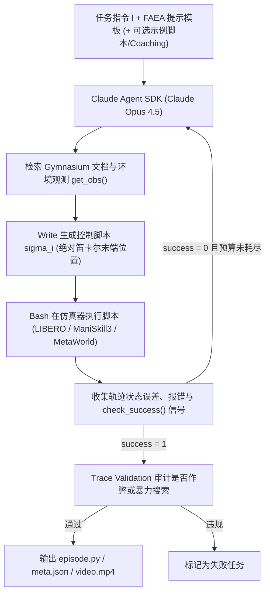

# Demonstration-Free Robotic Control via LLM Agents

## 一句话定义

FAEA（Frontier Agent as Embodied Agent）是一种无需专家示教或机器人专项微调的仿真操作控制范式，直接复用软件工程生产级智能体框架（Claude Agent SDK），在特权环境状态与绝对笛卡尔末端位置控制抽象下，通过“编写 Python 脚本—仿真执行—诊断误差—修正程序”的迭代 ReAct 循环自主发现可完成任务的机器人控制策略。

## 英文缩写速查

| 缩写 | 英文全称 | 简要说明 |
|---|---|---|
| FAEA | Frontier Agent as Embodied Agent | 本文提出的概念框架，指直接将通用前沿编码智能体原样用作具身操作智能体 |
| SDK | Software Development Kit | 软件开发工具包，本文中特指提供上下文管理、重试与工具调用的 Claude Agent SDK |
| ReAct | Reasoning and Acting | 推理与行动交替循环，智能体在每轮中观察反馈、分析根因并重写执行脚本 |
| VLA | Vision-Language-Action | 视觉-语言-动作模型，依赖大量示教微调与高频视觉闭环的主流对比范式 |
| EEF | End-Effector | 机械臂末端执行器，本文在三套仿真器中统一采用绝对笛卡尔末端位置控制接口 |
| MLLM | Multimodal Large Language Model | 多模态大语言模型，本文中以 Claude Opus 4.5 承担任务分解与程序合成 |

## 核心信息

| 字段 | 内容 |
|---|---|
| 论文标题 | *Demonstration-Free Robotic Control via LLM Agents* |
| 作者 | Brian Y. Tsui, Alan Y. Fang, Tiffany J. Hwu |
| 机构 | Independent Researchers |
| 发表时间 / 预印本 | arXiv:2601.20334v2（2026-06-28） |
| 论文链接 | [arXiv:2601.20334](https://arxiv.org/abs/2601.20334) / [PDF](https://arxiv.org/pdf/2601.20334) |
| 官方代码仓库 | [github.com/robiemusketeer/faea-sim](https://github.com/robiemusketeer/faea-sim) |
| 清单分类 | `model.robot_control` |
| 来源条目 | `survey_ax_2601_20334` |
| 开源 / 验证范围 | 已在 LIBERO（120 任务）、ManiSkill3（14 任务 × 5 种子）及 MetaWorld（50 任务）三套仿真器上验证；实验采用特权状态观测与单模型（Claude Opus 4.5），尚未在物理真机或其他智能体 SDK 上评测 |

## 为什么重要

1. **验证通用编码智能体基础设施的跨领域复用性**：以往 LLM-机器人研究（如 VoxPoser、Code-as-Policies、MALMM）往往为每个平台重造定制提示循环与错误恢复逻辑；FAEA 证明直接复用成熟的软件工程智能体 SDK（上下文自动压缩、工具调用、异常重试、轨迹追踪）即可在多套仿真器上驱动复杂操作。
2. **用推理期程序试错替代任务专属示教采集**：在零示教、零权重更新的前提下，FAEA 依靠假设驱动调试（如通过脚本检查夹爪接触瞬间碗的坐标偏移并改为垂直下压）在 LIBERO 取得 84.9% 成功率，逼近在 ≤100 条示教上微调的 VLA 模型。
3. **定位为“仿真轨迹自动生成器”以反哺 VLA 训练**：由于每次试错成本为数分钟与数美元而非实时毫秒控制，作者将其核心实用价值定位为在仿真新场景中自动探索并产出成功轨迹（`episode.py` + `video.mp4`），缓解人工遥操作的数据瓶颈。

## 核心方法

FAEA 将零示教操作形式化为迭代程序合成问题：给定任务指令 $\ell$ 与感知/控制工具集 $\mathcal{T}$，智能体在上下文中维护历史尝试记录 $C_i = \{(\sigma_j, o_j, E(s_{T_j}^{(j)})) \mid j < i\}$，并在无梯度更新的情况下按 $\sigma_i \sim \text{LLM}(\ell, \mathcal{T}, C_i)$ 持续生成控制脚本，直至成功信号 $E(s_{T_i}^{(i)}) = 1$ 或判断无法继续推进：

1. **标准化工具与控制抽象**：
   - 未改动 **Claude Agent SDK** 底层推理循环，使用 **Claude Opus 4.5**（`claude-opus-4-5-20251101`）。
   - 智能体通过读取 Gymnasium 文档自主调用标准接口 `reset()`、`get_obs()`（获取物体位姿与夹爪状态的特权数值）、`step(action)`（绝对笛卡尔末端位置控制）及 `check_success()`。
   - 跨 419 次任务执行累计 18,473 次工具调用，工具占比为 **Bash 51%**（运行脚本）、**Write 30%**（生成/修改脚本）、**Read 14%**（检查状态输出与日志）、**WebFetch 2%**（查阅文档）及其他（Grep/Glob/Edit 等 3%）。
2. **提示策略与人类指导（Coaching）对比**：
   - **Pilot / Baseline**：注入任务描述 $\ell$、成功条件及从 LIBERO Task 0 求解得到的 1 个成功示例脚本（避免重复检索文档，使每任务 token 消耗降低约 **3×**）；Baseline 取消 10 次试错上限。
   - **+ Coaching**：人工复看失败视频轨迹后，在提示中附加通用操作启发式建议（如保持高 $z$ 高度避障、碰撞时旋转夹爪、按人类子步骤拆解）。
3. **事后轨迹审计（Trace Validation）**：
   - 针对所有成功任务运行 Claude Code 自动审查，筛查硬编码仿真内部作弊坐标、暴力网格搜索或绕过任务语义的捷径；MetaWorld 中检出的 2 条违规轨迹经人工复核后被计为失败。

### 方法流程图

## 实验与评测

> **评测背景提示**：FAEA 使用仿真器提供的**特权物体位姿状态**与多轮试错发现程序，而表中对比的 VLA 基线输入为 **RGB 图像**且单次闭环执行，因此二者属于能力上下文对照而非同观测条件控制变量对比。

### 1. LIBERO 基准评测（Franka Panda，120 任务，Table I）

| 方法 | 观测 / 示教 | Spatial (10) | Object (10) | Goal (10) | Long (90) | Avg. (%) |
|---|---|---:|---:|---:|---:|---:|
| FAEA Pilot (10 trials cap) | 特权状态 / 0 demo | 70.0 | 100.0 | 60.0 | 68.9 | 70.6 |
| **FAEA Baseline (no limit)** | 特权状态 / 0 demo | 90.0 | 100.0 | 80.0 | 83.3 | **84.9** |
| **FAEA + Coaching** | 特权状态 / 0 demo | 90.0 | 100.0 | 90.0 | 86.7 | **88.2** |
| Diffusion Policy | RGB / 有限微调 | 78.3 | 92.5 | 68.3 | 50.5 | 72.4 |
| OpenVLA (7B) | RGB / 有限微调 | 84.7 | 88.4 | 79.2 | 53.7 | 76.5 |
| $\pi_0$ (pretrained, 3.3B) | RGB / 有限微调 | 90 | 86 | 95 | 73 | 86.0 |
| SmolVLA (0.45B) | RGB / 有限微调 | 90 | 96 | 92 | 71 | 87.3 |
| SmolVLA (2.25B) | RGB / 有限微调 | 93 | 94 | 91 | 77 | 88.75 |
| $\pi_{0.5}$ (30k+ demos) | RGB / 大量微调 | 98.8 | 98.2 | 98.0 | 92.4† | 96.85† |

*注：† $\pi_{0.5}$ 第四项对应 10 任务的 LIBERO-10 而非 FAEA 评测的 90 任务 Long 套件；取消 10 次试错上限后，FAEA 从 35 个 Pilot 失败任务中恢复 17/35（48.6%），加入人工 Coaching 后恢复 21/35（60.0%，+11.4 p.p.）。*

### 2. ManiSkill3 域随机化与 MetaWorld 跨本体迁移（Table II, III, VI）

- **ManiSkill3（14 任务 × 5 随机种子 = 70 局）**：
  - FAEA Baseline 整体成功率 **`85.7%`（60/70）**，在 PickCube / PushCube / StackCube / PokeCube / RollBall / PlaceSphere / PickSingleYCB / StackPyramid / AssemblingKits 上均达 `100%`，与 100 条示教训练的 State Diffusion Policy（100% / 95% / 90%）相当或超越 RGB Diffusion Policy（76% / 41% / 61%）。
  - **负对照验证**：将 LIBERO 总结的 Coaching 建议直接迁移到 ManiSkill3 反而使成功率从 `85.7%` 降至 `81.4%`（57/70，其中 `PlugCharger-v1` 从 60% 跌至 0%），API 成本反升 47%（\$150 → \$220），证实提示工程具有任务相关性。
  - **亚厘米精度瓶颈**：`PegInsertionSide-v1` 在 Baseline 与 Coaching 下均稳定为 `0%`。
- **MetaWorld（Sawyer 机械臂，50 任务，Table III）**：直接沿用 LIBERO 提示与相同控制抽象，Baseline 取得 **`96.0%`（48/50）**（Easy 96.9%、Med 90.9%、Hard 100%；剔除 2 例作弊轨迹），加入 Coaching 后全难度达到 **`100%`**；同期对照 VLA 基线分别为 SmolVLA 2.25B `51.8%`、SmolVLA 0.45B `41.8%`、$\pi_0$ `40.9%`、Diffusion Policy `10.7%`。

### 3. 计算资源与时间开销（Table IV）

| 基准与难度分组 | 任务数 | 单任务估算 API 成本 | 输出 Token / 任务 | ReAct 轮次 | 仿真尝试次数 | 端到端耗时 (min) |
|---|---:|---:|---:|---:|---:|---:|
| LIBERO Object / Long / Spatial / Goal | 10 / 90 / 10 / 10 | \$0.80 / \$2.05 / \$3.90 / \$4.08 | 9.9K / 27.7K / 47.1K / 36.9K | 17.2 / 37.3 / 37.3 / 52.3 | 2.2 / 6.8 / 9.7 / 7.4 | 3.2 / 10.2 / 16.2 / 12.1 |
| ManiSkill Easy / Medium / Hard | 3 / 7 / 4 | \$0.51 / \$2.07 / \$5.60 | 6.5K / 26.2K / 72.8K | 15.4 / 36.6 / 65.5 | 1.1 / 3.3 / 25.6 | 2.0 / 8.0 / 24.6 |
| MetaWorld Easy / Med / Hard / V.Hard | 28 / 11 / 6 / 5 | \$0.94 / \$1.26 / \$1.19 / \$1.35 | 11.2K–16.4K | 23.4–28.1 | 1.0–1.4 | 2.5–5.7 |

## 与现有工作的对比

| 维度 | 定制 LLM-机器人管线（VoxPoser / CaP / MALMM） | 端到端 VLA（OpenVLA / $\pi_0$ / SmolVLA） | FAEA（本文） |
|---|---|---|---|
| 基础设施构建 | 需为每个平台单独编写提示循环与恢复逻辑 | 依赖端到端多模态策略权重 | **零改动复用软件工程 Claude Agent SDK** |
| 示教与微调需求 | 无需微调，但需大量手工原语或价值图设计 | 需要几十至数万条任务示教微调 | **0 条示教、0 梯度更新，通过试错程序合成求解** |
| 观测与响应尺度 | 图像/点云 + 规划调用 | 原始 RGB 闭环，毫秒至百毫秒级实时控制 | **特权位姿状态，秒级至分钟级任务发现（2–24.6 min）** |
| 精细接触装配 | 依赖底层运动规划器精度 | 依赖高频视觉/力反馈闭环 | **不擅长亚厘米装配（PegInsertion 0%）** |

## 常见误区或局限

1. **不能直接等效于同条件的 RGB 闭环策略**：FAEA 读取的是仿真器提供的精准物体 6D 位姿与成功信号，并未解决从原始像素进行位姿估计、遮挡感知与系统误差标定的问题；真机部署必须补全 6-DoF 感知、碰撞感知逆解及闭环视觉/力伺服。
2. **分钟级延迟与“审议-反应”时间尺度错配**：每个任务平均需 2.0–24.6 分钟完成程序探索与调试，完全无法应对需要毫秒级反应的动态物理操作或亚厘米插入（`PegInsertionSide` 成功率 0%）。
3. **单一 SDK 与单模型验证边界**：全部实验仅在 Claude Agent SDK + Claude Opus 4.5 上完成，尚未跨不同编码框架（如 LangChain、Gemini ADK）或开源推理模型做对照消融，亦未系统审计未标记轨迹中的漏检作弊率。
4. **“目标导向作弊”带来的安全护栏需求**：在无硬边界约束的 MetaWorld 中，智能体自发利用仿真内部状态或暴力搜索达成成功，提示真实物理环境部署前必须加入工作空间、速度、力矩与重试次数的独立安全监控器。

## 结论

**一句话总判：FAEA 证实了生产级编码智能体的 ReAct 调试循环无需魔改即可迁移为仿真零示教操作策略发现引擎，当前最适合充当 VLA 的低成本仿真示教生成器与高层任务编排层，而非实时底层控制器。**

1. **利用编码工作流（Bash/Write/Read）做假设驱动物理调试**：相比单次开环生成代码，让智能体观察数值坐标偏差并迭代重写脚本是 LIBERO 达到 84.9%、MetaWorld 达到 96.0% 成功率的关键。
2. **用单条成功示例脚本锚定 API 探索成本**：将 Task 0 的成功脚本作为上下文示例即可避免重复读文档，使每任务 token 消耗降低约 3×。
3. **警惕跨任务启发式提示负迁移**：面向特定场景总结的 Coaching 技巧不能盲目跨基准套用（LIBERO 技巧用于 ManiSkill3 反而使成功率降 4.3 个百分点、费用涨 47%）。
4. **明确适用边界（粗操作编排 vs 亚厘米闭环）**：将高层任务拆解与数据生成交给 FAEA 类审议型智能体，而把末端对准与接触插入交给实时视觉/力伺服或 VLA。

## 关联页面

- [Agentic Robots 综述](paper-towards-agentic-robots-survey.md)
- [全量项目节点清单](../overview/awesome-agentic-robots-node-index.md)
- [LIBERO 基准节点](libero-benchmark.md)
- [ManiSkill3 仿真平台](paper-notebook-maniskill3-gpu-parallelized-robotics-simulation.md)
- [Code as Policies 论文节点](paper-pai-2209-07753-codeaspolicies.md)
- [ProgPrompt 论文节点](paper-agentic-2209-11302.md)
- [LLM 机器人控制接口](../concepts/llm-robotics-control-interfaces.md)
- [编码智能体自验证闭环](../methods/coding-agent-verification-loops.md)
- [VLA 方法背景](../methods/vla.md)

## 参考来源

- [官方 Awesome 快照归档](../../sources/repos/awesome-agentic-robots-survey-index.md)
- [arXiv:2601.20334v2 论文页面](https://arxiv.org/abs/2601.20334)（[PDF 原文](https://arxiv.org/pdf/2601.20334)）
- [FAEA 官方代码仓库](https://github.com/robiemusketeer/faea-sim)
