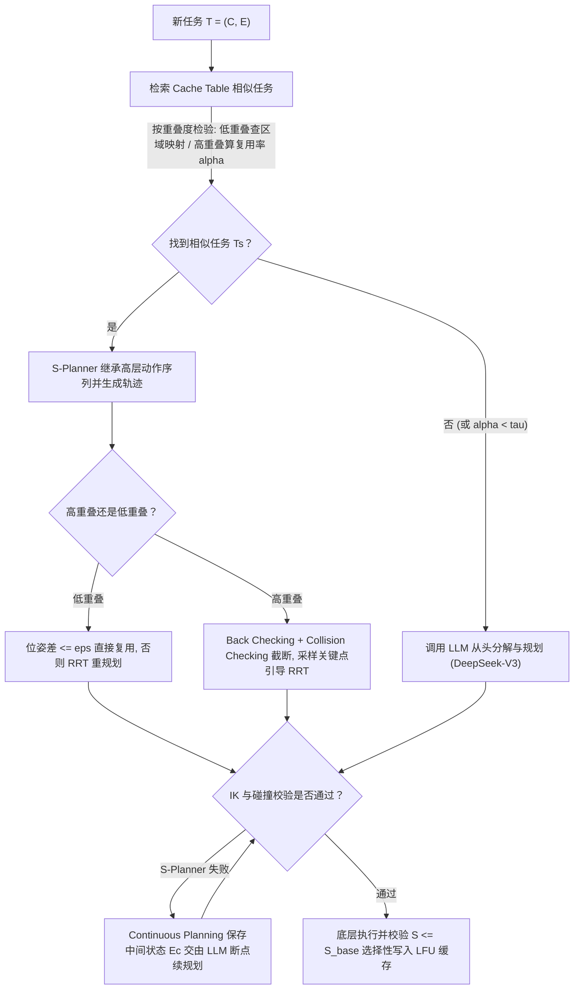

# MeCo: Enhancing LLM-Empowered Multi-Robot Collaboration via Similar Task Memoization

## 一句话定义

MeCo 是一种面向大语言模型（LLM）多机器人协作的相似任务记忆化（Memoization）框架，通过按机器人工作空间重叠度设计的任务相似性检验、免 LLM 复用规划器 S-Planner、失败断点连续规划以及基于使用频次的选择性缓存机制，在不重复调用 LLM 的前提下复用并适配历史相似任务方案。

## 英文缩写速查

| 缩写 | 英文全称 | 简要说明 |
|---|---|---|
| MeCo | Memoization-enhanced Multi-Robot Collaboration | 本文提出的基于相似任务记忆化的多机器人协作规划框架 |
| S-Planner | Similar Motion Planner | 相似运动规划器，参考历史相似任务的动作序列与关键路径点驱动底层规划 |
| RRT | Rapidly-exploring Random Tree | 快速探索随机树运动规划器，本文用于局部新目标位姿或关键参考点引导下的无碰撞轨迹生成 |
| IK | Inverse Kinematics | 逆运动学，与碰撞检测共同构成路径点合法性校验环节 |
| LFU | Least Frequently Used | 最不经常使用缓存淘汰策略，本文借鉴其频次统计思想维护缓存表与全局表去重 |
| LLM | Large Language Model | 大语言模型（实验统一采用 DeepSeek-V3），仅在无相似任务或 S-Planner 局部失败时触发 |

## 核心信息

| 字段 | 内容 |
|---|---|
| 论文标题 | *MeCo: Enhancing LLM-Empowered Multi-Robot Collaboration via Similar Task Memoization* |
| 作者 | Baiqing Wang, Helei Cui, Bo Zhang, Xiaolong Zheng, Bin Guo, Zhiwen Yu |
| 机构 | Northwestern Polytechnical University（西北工业大学）、Beijing University of Posts and Telecommunications（北京邮电大学）、Harbin Engineering University（哈尔滨工程大学） |
| 发表时间 / 会议 | arXiv:2601.20577v2（2026-02-13），已被 **AAMAS 2026** 接收 |
| 论文链接 | [arXiv:2601.20577](https://arxiv.org/abs/2601.20577) / [PDF](https://arxiv.org/pdf/2601.20577) |
| 官方代码仓库 | [github.com/TomWang-NPU/MeCo](https://github.com/TomWang-NPU/MeCo) |
| 清单分类 | `harness.memory` |
| 来源条目 | `survey_ax_2601_20577` |
| 开源 / 验证范围 | 论文代码开源，并在基于 MuJoCo 与 RoCoBench 扩展构建的 **MeCoBench**（6 类桌面多机械臂协作任务 × 3 种相似度测试模式）上完成全部仿真对比与消融；尚未在真机或异构移动多机器人上验证 |

## 为什么重要

1. **解决 LLM 多机器人协作“逐任务从零重规划”的算力与时间浪费**：RoCo、HMAS-2 等现有 LLM 多机器人框架将每个任务视作完全孤立实例，即便产线分拣或家庭整理中任务结构高度相似，仍需多轮对话与推理，造成极高的 token 成本与分钟级等待延迟。
2. **超越“完全相同缓存”的相似性适配与理论下界支撑**：不同于简单精确匹配，MeCo 针对多机器人场景区分“低工作空间重叠”与“高工作空间重叠”两类几何交互特征，推导出子任务成功概率下界随历史轨迹复用率 $\alpha_i$ 单调递增的数学性质，并能自动截断碰撞段复用有效路径。
3. **与底层现有 LLM 规划器正交可插拔**：MeCo 作为外围记忆化与运动适配层，无需修改内部对话或推理机制即可直接包裹 RoCo、Central Plan、HMAS-2 与 ReAct，并同步提升成功率与执行效率。

## 核心方法

MeCo 将任务形式化为 $T = (C, E)$（文本需求 $C$ 与环境元素 $E = (R, O, D, S)$），围绕四大组件协同运行：

1. **按工作空间重叠度分级的任务相似性检验（Sec. 4.2）**：
   - **低工作空间重叠任务**（`Sweep Floor`、`Make Sandwich`、`Sort Cubes`、`Arrange Cabinet`）：将任务空间 $\Omega$ 划分为互不相交的区域 $A = \{A_1, \dots, A_M\}$。若存在同区域内点映射 $\Pi: \Omega \to \Omega$（$p_j^{\text{ref}} \in A_m \Rightarrow p_j^{\text{cur}} \in A_m$）且 $C, R, D, S$ 一致，则判定相似。
   - **高工作空间重叠任务**（`Pack Grocery`、`Move Rope`）：碰撞风险高，基于各子任务水平面上可复用的历史轨迹长度占比 $\alpha_i = \Delta x_i^{\text{ref}} / \Delta x_i^{\text{goal}}$ 计算全局均值 $\alpha = \frac{1}{n}\sum_{i=1}^n \alpha_i$；当 $\alpha \ge \tau$ 时判定相似（实验中 `Pack Grocery` 取 $\tau=0.85$，`Move Rope` 取 $\tau=0.7$）。
2. **相似运动规划器 S-Planner（Sec. 4.3）**：
   - 在高层直接继承匹配历史任务 $T_{\text{ref}}$ 的多机子任务动作序列 $a_i^{\text{cur}} = a_i^{\text{ref}}$。
   - **低重叠模式**：计算目标位姿差 $\Delta(g_s^{\text{ref}}, g_s^{\text{cur}})$，若 $\le \varepsilon$ 直接复用历史关节轨迹；否则调用 RRT 为变动目标重规划局部轨迹。
   - **高重叠模式**：先通过正向运动学还原末端路径 $R$，依次执行**回溯检查（Back Checking）**（沿主方向截断避免折返）与**碰撞检查（Collision Checking）**得到无碰撞可用段 $R_{\text{final}}$；再以最高点 $P_{\text{peak}}$ 为中心按扩展系数 $\eta$ 两侧采样关键路标点集 $K$ 引导 RRT 生成新轨迹。
3. **失败断点连续规划（Continuous Planning，Sec. 4.4）**：
   - 若 S-Planner 在中间子步骤发生 IK 或碰撞校验失败，模块将当前最新环境状态 $E_c$ 本地保存并注入 LLM（DeepSeek-V3）提示词，使 LLM 从失败步骤接续规划而非整任务推倒重来。
4. **双表 LFU 与有效步数过滤的选择性缓存（Sec. 4.5）**：
   - 仅当任务完成的有效步数满足 $S \le S_{\text{base}}$（剔除“先放错再挪回”的低质冗余方案）才允许入库；同时维护高速检索的缓存表（容量上限 $k$）与全局频次表，按任务复用频次 $f(T)$ 淘汰低频条目以维持缓存多样性（实验中 6 类任务 $k$ 依次设为 `40, 30, 700, 50, 9, 9`）。

### 方法流程图

## 实验与评测

### 1. MeCoBench 综合对比结果（Sec. 5.3 & Appendix C.1）

基于 MuJoCo 构建的 **MeCoBench**（30 组随机种子均值，底层模型统一为 DeepSeek-V3），将 MeCo 分别挂载于 4 种多机器人基线（RoCo、Central Plan、HMAS-2、ReAct）上，在 **Random (S1)**、**Totally Similar (S2)** 与 **Totally Different (S3)** 三种模式下对比：

- **成功率（Success Rate）**：相比各原始基线，MeCo 在 S1 场景平均提升约 **+29%**，在 S2 场景提升约 **+32%**（整体约 **+30%**）；在 Move Rope、Make Sandwich、Sort Cubes 上接近 **100%**；即使在碰撞极密集的 Pack Grocery 上相比仅约 15% 的 ReAct/HMAS-2 仍提升约 **+8%**；Sweep Floor 与 Arrange Cabinet 分别提升 **+46%** 与 **+34%**。
- **规划耗时（Planning Time）**：整体节省约 **55%**；S1 场景下 Move Rope 降 **64%**、Make Sandwich 降 **78%**、Sort Cubes 降 **76%**、Pack Grocery 降 **5%**；S2 场景下降幅达 **77% / 83% / 80% / 12%**；Sweep Floor 与 Arrange Cabinet 分别减少 **68%** 与 **79%**。
- **Token 消耗**：S1 平均节省约 **73%**（Move Rope / Make Sandwich / Sort Cubes / Sweep Floor 降幅均超过 **90%**），S2 平均节省约 **82%**（Arrange Cabinet 达 **100%** 零 LLM 调用，Pack Grocery 降 **18%**）。
- **无相似任务边界测试（S3，Totally Different）**：成功率和 Token 消耗与原始基线持平，仅增加约 **6%** 的检索耗时开销。

### 2. 核心模块消融研究（Table 1 & Fig. 15，基于 RoCo）

| 配置（30 随机种子均值） | Move Rope (SR / Time / Tokens) | Pack Grocery (SR / Time / Tokens) | Make Sandwich (SR / Time / Tokens) | Sort Cubes (SR / Time / Tokens) | Sweep Floor (SR / Time / Tokens) | Arrange Cabinet (SR / Time / Tokens) |
|---|---|---|---|---|---|---|
| **MeCo（完整版）** | **0.98±0.02 / 154.63s / 1320** | **0.33±0.06 / 1300.98s / 250264** | **0.98±0.02 / 78.78s / 3304** | **0.95±0.01 / 132.70s / 19684** | **0.99±0.20 / 72.82s / 1443** | **1.00±0 / 47.82s / 0** |
| w/o Similarity Testing | 0.84±0.05 / 447.81s / 17465 | 0.25±0.06 / 1573.88s / 281165 | 0.90±0.04 / 128.30s / 7679 | 0.78±0.09 / 291.46s / 68592 | 0.99±0.10 / 75.86s / 2164 | 1.00±0 / 43.58s / 0 |
| w/o S-Planner | 0.78±0.08 / 444.35s / 25737 | 0.24±0.06 / 1502.32s / 286297 | 0.62±0.08 / 313.38s / 34537 | 0.51±0.11 / 608.80s / 123028 | 0.52±0.09 / 229.98s / 23171 | 0.66±0.12 / 229.79s / 32505 |
| w/o Continuous Planning | 0.97±0.01 / 214.29s / 2871 | 0.30±0.04 / 1381.33s / 261346 | 0.98±0.02 / 81.15s / 3368 | 0.91±0.03 / 180.37s / 51671 | 0.99±0.10 / 79.11s / 1821 | 1.00±0 / 45.94s / 0 |

- **选择性缓存消融（Fig. 15，>50 随机种子）**：相比无去重无过滤直接填满缓存，引入 LFU 去重与步数质检使成功率平均提升 **+33%**，规划时间减少 **32%**，Token 消耗减少 **47%**。

## 与现有工作的对比

| 维度 | RoCo / HMAS-2 / ReAct | 强化学习 / 模仿学习多机方法 | MeCo（本文） |
|---|---|---|---|
| 跨任务复用机制 | 无任务级缓存，相似任务每轮从头调用 LLM | 需针对新目标分布微调或重训 | **双模式相似性匹配 + S-Planner 免 LLM 运动适配** |
| 局部失败恢复 | 失败后多从头或整轮重规划 | 策略溢出分布外即失效 | **Continuous Planning 保留局部状态从失败步接续** |
| 缓存过载控制 | 不适用 | 离线经验回放易过拟合 | **双表 LFU 频次去重 + 有效步数阈值质检** |
| 任务适应性 | 通用性强但延迟与成本高 | 泛化受限于训练场景 | **与底层 LLM 规划器正交，S1/S2 降耗提效且 S3 不退化** |

## 常见误区或局限

1. **超参数（$\alpha$ 与 $k$）依赖分任务手工标定**：高重叠任务的相似度阈值（如 Pack Grocery 取 0.85、Move Rope 取 0.7）以及最优缓存上限 $k$（从 9 到 700 跨度极大，见 Fig. 4 中 Pack Grocery 超过 30 后检索耗时反超缓存收益）需按任务类型离线实验调优，限制了对全新任务类别的零配置自适应。
2. **高重叠密集碰撞任务绝对成功率仍偏低**：在 Pack Grocery 任务上，即便经过 MeCo 增强，整体成功率也仅 `0.33±0.06`（单次规划仍消耗 1300.98s 与 250K+ tokens），说明历史轨迹几何复用无法根本替代密集堆叠场景的全局避障与重排能力。
3. **非结构化场景退化假设**：低重叠判定依赖清晰的区域划分（如砧板左右侧），在无法显式分区的非结构化环境中必须整体退化为高重叠模式（以轨迹复用率 $\alpha$ 计算），导致检索复杂度显著上升。
4. **仅面向文本与空间坐标，实验限于多臂桌面仿真**：当前框架未融入视觉或力触觉实时闭环反馈，也未在移动底盘协作或真实物理机器人平台上实测通信与执行误差。

## 结论

**一句话总判：MeCo 证明“按工作空间重叠度分级的任务相似性检索 + 可截断轨迹的 S-Planner 复用 + 断点连续规划”，能作为通用外挂层在不改动现有 LLM 多机架构的前提下大幅降低重复规划成本并提高成功率。**

1. **不能直接拷贝历史轨迹，必须配备 S-Planner 适配层**：消融显示去掉 S-Planner 直接回放轨迹会导致成功率暴跌约 30%，且因额外检索耗时使总规划时间反超直接调用 LLM（+222.27%）。
2. **高重叠任务严格控制缓存容量上限 $k$**：检索复杂度随缓存线性增长（如 Pack Grocery 在 $k>30$ 后规划时间明显反弹），需在缓存多样性与匹配延迟之间设上限，而低重叠任务则可适当放宽缓存规模。
3. **缓存入库前务必做“有效步数”质检**：若不淘汰含冗余折返步骤的成功轨迹（如先放错位置再挪回），后续复用会传染式引发失败；结合 LFU 去重可额外带来 +33% 成功率收益。
4. **失败时不推倒重来**：保留 S-Planner 已完成子步骤的环境状态并交由 LLM 断点续写（Continuous Planning），能在不损失成功率的同时显著压缩冗余推理耗时与 Token。

## 关联页面

- [Agentic Robots 综述](paper-towards-agentic-robots-survey.md)
- [全量项目节点清单](../overview/awesome-agentic-robots-node-index.md)
- [多机器人协同概念](../concepts/humanoid-multi-robot-coordination.md)
- [智能体记忆与做梦机制](../concepts/agent-memory-and-dreaming.md)
- [LLM 机器人控制接口](../concepts/llm-robotics-control-interfaces.md)
- [RRT 路径规划方法](../methods/rrt.md)
- [双臂协同操作任务](../tasks/bimanual-manipulation.md)
- [VLA 方法背景](../methods/vla.md)

- [机器人智能体执行框架](../methods/robot-agent-harness.md)：对照规划、工具调用与反馈的系统边界。

## 参考来源

- [官方 Awesome 快照归档](../../sources/repos/awesome-agentic-robots-survey-index.md)
- [arXiv:2601.20577v2 论文页面](https://arxiv.org/abs/2601.20577)（[PDF 原文](https://arxiv.org/pdf/2601.20577)）
- [MeCo 官方代码仓库](https://github.com/TomWang-NPU/MeCo)
