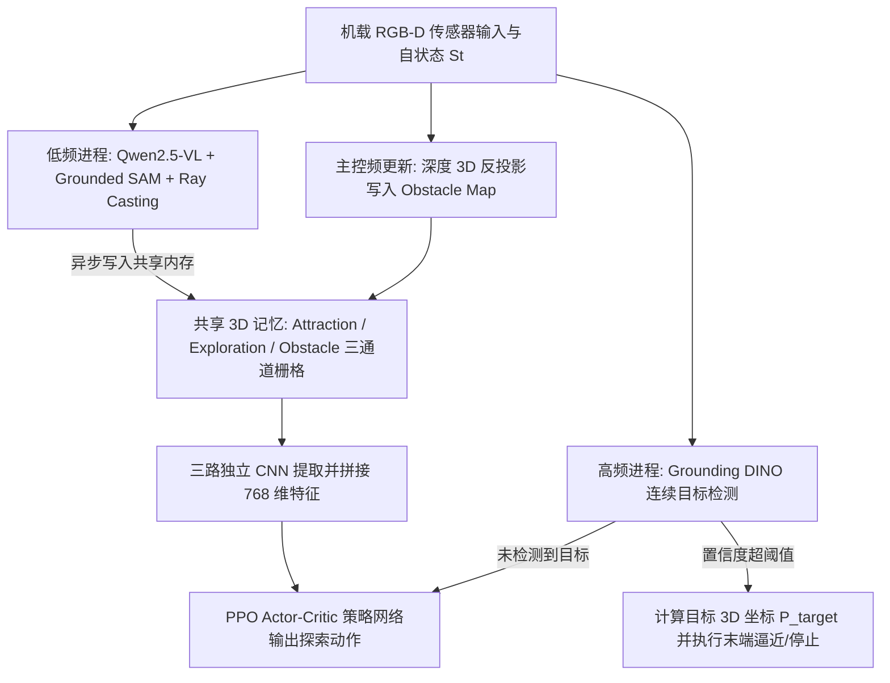

# APEX: A Decoupled Memory-based Explorer for Asynchronous Aerial Object Goal Navigation

## 一句话定义

APEX（Aerial Parallel Explorer）是一种面向无人机空中目标物体导航（Aerial ObjectNav）的分层异步并行智能体架构，通过将低频 MLLM 语义建图（3D 吸引力/探索度/障碍物地图）、主控频 PPO 动作决策与高频开放词汇目标检测定位解耦到多进程共享内存中并行运行，在规避多模态大模型前向阻塞瓶颈的同时实现安全高效的 3D 主动探索。

## 英文缩写速查

| 缩写 | 英文全称 | 简要说明 |
|---|---|---|
| APEX | Aerial Parallel Explorer | 本文提出的分层解耦异步并行空中探索智能体框架 |
| AVLN / Aerial ObjectNav | Aerial Vision-Language Navigation / Aerial Object Goal Navigation | 空中视觉-语言导航与空中目标物体导航（仅凭高层目标描述自主寻物） |
| PPO | Proximal Policy Optimization | 近端策略优化强化学习算法，本文中用于训练三维栅格地图到离散控制动作的策略网络 |
| MLLM | Multimodal Large Language Model | 多模态大语言模型（本文采用 Qwen2.5-VL），用于提取物体描述及目标语义吸引力打分 |
| SR / SPL | Success Rate / Success weighted by Path Length | 导航成功率与路径效率加权成功率 |
| OSR / NE | Oracle Success Rate / Navigation Error | 预言机成功率与终点欧氏距离误差 |

## 核心信息

| 字段 | 内容 |
|---|---|
| 论文标题 | *APEX: A Decoupled Memory-based Explorer for Asynchronous Aerial Object Goal Navigation* |
| 作者 | Daoxuan Zhang, Ping Chen, Xiaobo Xia, Xiu Su, Ruichen Zhen, Jianqiang Xiao, Shuo Yang |
| 机构 | 哈尔滨工业大学（深圳）、National University of Singapore、中南大学、美团机器人研究院（深圳） |
| 发表时间 / 预印本 | arXiv:2602.00551v1（2026-01-31） |
| 论文链接 | [arXiv:2602.00551](https://arxiv.org/abs/2602.00551) / [PDF](https://arxiv.org/pdf/2602.00551) |
| 官方代码仓库 | [github.com/4amGodvzx/apex](https://github.com/4amGodvzx/apex) |
| 清单分类 | `harness.memory` |
| 来源条目 | `survey_ax_2602_00551` |
| 开源 / 验证范围 | 论文在 **UAV-ON** 大规模逼真户外仿真基准（14 个场景、10,000 回合）上完成主对比、安全性/延迟评测及消融实验，并声明已在 GitHub 开源源码；未包含真实无人机户外飞控验证 |

## 为什么重要

1. **解决空中大尺度 3D 场景的记忆与几何保真度难题**：地面导航常用的 2D 地图或抽象拓扑图在无人机三维空间中会丢失高度与几何障碍细节；APEX 利用 RGB-D 反投影构建三通道 3D 体素栅格地图（Attraction / Exploration / Obstacle），兼顾高层语义线索与底层避障几何精度。
2. **用多频异步并行机制消除 VLM 的“Stop-and-Think”卡顿**：现有基于 MLLM 的空中智能体通常在每步等待大模型前向完成才运动，单步耗时高达 1.7–5.3 秒；APEX 将最耗时的 MLLM + Grounded SAM 语义更新下沉为低频异步进程，而让 PPO 避障控制与 Grounding DINO 目标锁定以高频运行。
3. **语义理解与运动控制彻底解耦，提升可解释性与安全性**：与直接用 MLLM 输出端到端动作的黑盒方法（如 MLLM-Direct）相比，中间 3D 地图提供了人类可审查的决策依据，且两阶段 RL 课程训练使平均安全避障距离优于对比基线。

## 核心方法

APEX 由三大专业化模块通过多进程共享内存（$M_{\text{attr}}, M_{\text{expl}}, M_{\text{obst}}$）按不同频率异步协同：

1. **动态时空语义建图模块（Dynamic Spatio-Semantic Mapping，最低频）**：
   - **吸引力地图（$M_{\text{attr}}$）**：MLLM（**Qwen2.5-VL**）基于当前观测 $O_t$ 与目标描述 $D$ 输出显著物体描述及语义相关度分数 $\{(c_i, s_i)\}$；随后用 **Grounded SAM** 分割像素掩码并经 3D 反投影写入体素栅格，遵循**多数归属（Majority Ownership）**与**最近观测优先（Closest Observation First，$d_{\text{new}} < M_{\text{depth}}(v)$ 才更新）**原则防止远距离模糊覆盖。
   - **探索地图（$M_{\text{expl}}$）**：从相机位置向深度点云投射光线（Ray Casting）遍历可见体素 $V_{\text{visible}}$，按指数距离衰减 $\Delta M_{\text{expl}}(v) = \exp(-\lambda \cdot \|p_v - t_t\|_2)$ 累加观测密度。
   - **障碍物地图（$M_{\text{obst}}$）**：直接由深度反投影在控制主频实时置位占据体素（$M_{\text{obst}}(v) \leftarrow 1$），确保即使语义图略有滞后，避障仍始终依据最新几何状态。
2. **基于 PPO 的动作决策模块（RL Action Decision，主控频率）**：
   - **网络结构**：将 $40 \times 40 \times 10$（将 $z$ 轴作为通道维）的三张 3D 地图分别送入三个独立 CNN 特征提取器（各自输出 $256 \times 1$），拼接为 $768 \times 1$ 特征向量后共享给 Actor 与 Critic MLP 头（基于 Stable-Baselines3 `MultiInputPolicy`）。
   - **复合奖励与两阶段课程训练**：总奖励 $R_t = R_{\text{attr}} + \alpha R_{\text{expl}} + R_{\text{spar}}$（最优平衡系数 $\alpha=0.2$），其中 $R_{\text{attr}}$ 与 $R_{\text{expl}}$ 引入线性距离衰减；为避免训练时在线调用 VLM 过慢，在 9 个环境 36 个任务上预先离线采集完整吸引力地图供训练查表；训练先仅用探索奖励与碰撞惩罚预训练安全漫游能力，再引入吸引力与成功奖励微调目标趋近策略。
3. **目标定位模块（Target Grounding，最高频）**：
   - 持续并行运行开放词汇检测器 **Grounding DINO**（`GD(Ot, D)`），一旦置信度超过阈值即通过 3D 反投影计算目标世界坐标 $P_{\text{target}}$，接管“最后一公里”精准靠近与停止决策。

### 方法流程图

## 实验与评测

### 1. UAV-ON 基准主对比（Table 1）

在包含 14 个大型户外场景、共 10,000 回合的 **UAV-ON** 基准上，APEX 在 Seen、Unseen 与 Overall 三个维度上的 SR、OSR 与 SPL 均超越全部对比基线（较此前最优 L3MVN-Z 整体提升 `+4.16` 个百分点 SR / 论文摘要记作 `+4.2%`，SPL 提升 `+2.77` 个百分点 / 摘要记作 `+2.8%`）：

| 方法 | Seen (SR↑ / NE↓ / OSR↑ / SPL↑) | Unseen (SR↑ / NE↓ / OSR↑ / SPL↑) | Overall (SR↑ / NE↓ / OSR↑ / SPL↑) |
|---|---:|---:|---:|
| Random Exploration (RE) | 1.12 / 32.75 / 3.37 / 0.62 | 0.0 / 28.45 / 9.68 / 0.0 | 0.83 / 31.64 / 5.00 / 0.46 |
| Frontier-based Exploration (FBE) | 4.49 / 66.02 / 11.24 / 2.57 | 6.45 / 63.52 / 12.90 / 6.45 | 5.00 / 65.38 / 11.67 / 3.50 |
| MLLM-Direct Navigation | 0.0 / 30.39 / 3.37 / 0.0 | 3.23 / 29.83 / 12.88 / 3.23 | 0.83 / 30.25 / 5.83 / 0.83 |
| CLIP-H | 6.74 / 46.38 / 12.36 / 4.58 | 3.23 / 49.51 / 16.13 / 3.67 | 5.83 / 47.19 / 13.33 / 4.34 |
| TravelUAV | 6.74 / 56.66 / 13.48 / 4.82 | 9.68 / 53.12 / 16.15 / 7.60 | 7.48 / 55.75 / 14.17 / 5.54 |
| AOA-F | 7.87 / 47.68 / 17.98 / 4.21 | 6.45 / 48.57 / 16.09 / 3.98 | 7.50 / 47.90 / 17.50 / 4.15 |
| L3MVN-Z | 8.99 / 61.64 / 15.73 / 6.57 | 9.69 / 63.07 / 16.12 / 9.68 | 9.17 / 62.01 / 15.83 / 7.37 |
| **APEX（本文）** | **12.36 / 55.59 / 19.10 / 9.13** | **16.13 / 51.74 / 22.58 / 13.03** | **13.33 / 54.59 / 20.00 / 10.14** |

### 2. 运行效率、安全性与核心模块消融（Table 2, Table 3, Table 4）

- **单步延迟与安全距离（Table 2）**：APEX 平均单步控制延迟降至 **`0.97 s`**（对比 L3MVN-Z `1.26 s`、TRAVEL `1.71 s`、AOA-F `5.29 s`），同时取得最高的平均安全距离 **`345.51 m`**（L3MVN-Z `330.64 m`、TRAVEL `223.17 m`、AOA-F `212.36 m`）。
- **模块化消融（Table 4）**：
  - `w/o 3D-Map`（直接向 RL 策略输入原始 RGB-D）：难以收敛，SR 骤降至 `1.67%`（SPL `0.73%`）；
  - `w/o RL-AD`（用预测奖励启发式搜索替代 PPO）：SR 降至 `12.50%`（OSR `19.17%`，SPL `10.11%`），易陷入局部最优；
  - `w/o TG`（去掉 Grounding DINO 改为走向吸引力地图最高激活点）：SR 大幅跌至 `5.00%`（SPL `4.17%`），验证开放词汇精准定位对完成“最后一公里”不可或缺。
- **探索-利用系数 $\alpha$（Table 3）**：$\alpha = 0.2$ 时综合 SR 与 OSR 最优（SR `13.33%` / OSR `20.00%` / SPL `10.14%`）；过高探索权重（$\alpha = 1.0$）会使智能体过度偏离高吸引力区域（SR 降至 `7.50%`，NE 升至 `66.44`）。

## 与现有工作的对比

| 维度 | 端到端 VLM/MLLM（MLLM-N / AOA-F / TravelUAV） | 地面语义前沿探索（L3MVN-Z） | APEX（本文） |
|---|---|---|---|
| 空间记忆形式 | 无持久化 3D 记忆或依赖拓扑/文本历史 | 2D 语义前沿地图，缺乏完整 3D 高度几何 | **三通道 3D 体素栅格（吸引力/探索/障碍物）** |
| 控制策略生成 | MLLM 直接输出动作或路径点，耦合度高 | 启发式选择前沿航点 | **PPO 双阶段课程训练策略网络** |
| 执行时序架构 | 同步串行“停下思考再走”（延迟 1.71–5.29 s） | 串行地图与决策更新（1.26 s） | **多频异步并行（单步控制延迟 0.97 s）** |
| 末端确认机制 | 依赖 MLLM 自身输出停止指令 | 依赖语义图阈值判定 | **高频并行 Grounding DINO 独立确认与 3D 定位** |

## 常见误区或局限

1. **户外大空间绝对成功率仍较低且平均 NE 较高**：虽然在 UAV-ON 上显著超越基线，但 APEX 的整体绝对 SR 仅为 `13.33%`（Unseen `16.13%`），且由于激进主动探索策略在失败回合中可能飞向较远未知区域，其总体平均导航误差（NE `54.59 m`）高于保守停滞的基线（如 CLIP-H `47.19 m`）。
2. **体素离散化对稀疏障碍物的漏检风险**：附录失败案例（目标 `Sandbox`）显示无人机撞击树木导致终止，说明基于固定分辨率 3D 栅格反投影的障碍物地图对枝叶等细长稀疏障碍物存在表征盲区。
3. **VLM 骨干未做空中视角专项微调且训练依赖离线先验图**：系统直接使用通用预训练 Qwen2.5-VL，在俯视/斜视航拍小目标上的语义误判可能误导吸引力地图；此外 RL 训练依赖预先飞扫生成的离线吸引力图，尚未打通完全在线端到端联合演化。

## 结论

**一句话总判：APEX 通过“3D 三通道栅格记忆 + PPO 决策 + 独立目标检测”的模块化异步多进程架构，在维持安全避障与低步长延迟的前提下显著优于同步耦合的端到端无人机 VLM 导航方法。**

1. **高开销 VLM 前向计算必须与高频避障和目标检测解耦**：通过共享内存异步传递低频语义吸引力图与高频障碍物/目标位置，APEX 将单步动作控制延迟压至 0.97s，并将平均安全距离提升至 345.51 m。
2. **显式 3D 空间记忆是 RL 策略在空中大尺度场景收敛的前提**：消融实验显示移除 3D 动态地图直接输入原始 RGB-D 会使 PPO 基本失效（SR 从 13.33% 跌至 1.67%）。
3. **语义探索地图不能替代专用末端目标检测**：依赖 MLLM 吸引力峰值做最终停靠会使 SR 跌至 5.00%，必须结合 Grounding DINO 等高召回开放词汇检测器完成精确 3D 落点确认。
4. **用离线预建语义图加速强化学习训练**：训练阶段通过预先采集全场景吸引力图做深度可见性查表，能低成本绕开在线调用 VLM 的算力墙并稳定收敛双阶段课程策略。

## 关联页面

- [Agentic Robots 综述](paper-towards-agentic-robots-survey.md)
- [全量项目节点清单](../overview/awesome-agentic-robots-node-index.md)
- [空中视觉-语言导航综述节点](paper-vln-ar-aerial-navigation.md)
- [WorldVLN 论文节点](paper-worldvln-aerial-vln-wam.md)
- [ImagineUAV 论文节点](paper-rcl-2606-01205-imagineuav-aerial-vision-language-navigation-via.md)
- [零样本目标导航任务](../tasks/zero-shot-object-navigation.md)
- [自主探索任务](../tasks/autonomous-exploration.md)
- [具身语义认知地图](../concepts/embodied-semantic-cognitive-map.md)
- [PPO 强化学习算法](../methods/ppo.md)
- [VLA 方法背景](../methods/vla.md)

- [机器人智能体执行框架](../methods/robot-agent-harness.md)：对照规划、执行接口与反馈机制。

## 参考来源

- [官方 Awesome 快照归档](../../sources/repos/awesome-agentic-robots-survey-index.md)
- [arXiv:2602.00551v1 论文页面](https://arxiv.org/abs/2602.00551)（[PDF 原文](https://arxiv.org/pdf/2602.00551)）
- [APEX 官方代码仓库](https://github.com/4amGodvzx/apex)
