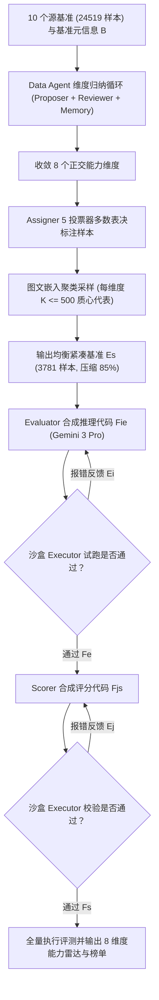

# A2Eval: Agentic and Automated Evaluation for Embodied Brain

## 一句话定义

A2Eval（Agentic and Automated Evaluation）是一个面向具身视觉-语言模型（“具身大脑”）的全自动双智能体评测框架，通过 **Data Agent** 自主归纳能力维度并执行多样性感知压缩采样以消除基准冗余与能力失衡，再由 **Eval Agent** 结合沙盒执行器自动合成并验证可运行的模型推理与评分代码流水线。

## 英文缩写速查

| 缩写 | 英文全称 | 简要说明 |
|---|---|---|
| A2Eval | Agentic and Automated Evaluation | 本文提出的双智能体协作自动化基准构建与模型评测框架 |
| VLM | Vision-Language Model | 视觉-语言模型，本文中被评测的具身大脑核心推理骨干（覆盖 3B–241B 参数尺度） |
| IAA | Inter-Annotator Agreement | 标注者间一致性（采用 Fleiss' $\kappa$），用于衡量 5 位领域专家在维度标注上的一致度 |
| UMAP | Uniform Manifold Approximation and Projection | 均匀流形逼近与投影，用于可视化采样前后样本语义流形覆盖情况 |
| PercepObj / SpatGeo | Perception & Object Grounding / Spatial & Geometric Reasoning | Data Agent 归纳的感知定位与空间几何推理能力维度缩写 |
| PhysCaus / DecPlan | Physical & Causal Reasoning / Decision & Task Planning | Data Agent 归纳的物理因果推理与决策任务规划维度缩写 |

## 核心信息

| 字段 | 内容 |
|---|---|
| 论文标题 | *A2Eval: Agentic and Automated Evaluation for Embodied Brain* |
| 作者 | Shuai Zhang, Jiayu Hu, Zijie Chen, Zeyuan Ding, Yi Zhang, Yingji Zhang, Ziyi Zhou, Junwei Liao, Shengjie Zhou, Yong Dai, Zhenzhong Lan, Xiaozhu Ju |
| 机构 | 浙江大学、西湖大学、北京人形机器人创新中心、University of Manchester、南方科技大学、厦门大学马来西亚分校 |
| 发表时间 / 预印本 | arXiv:2602.01640v1（2026-02-02） |
| 论文链接 | [arXiv:2602.01640](https://arxiv.org/abs/2602.01640) / [PDF](https://arxiv.org/pdf/2602.01640) |
| 官方代码与数据 | 论文正文声明代码与数据将在公开（*Our code and data will be public soon*）；当前尚未核实到独立公开仓库地址 |
| 清单分类 | `environment.benchmarking` |
| 来源条目 | `survey_ax_2602_01640` |
| 开源 / 验证范围 | 已在 10 个既有具身推理基准（24,519 样本）与 13 个开源/闭源 VLM 上完成压缩率、加速比、人类对齐度及代码合成保真度实验；目前主要覆盖图像/视频具身推理评测，尚未扩展到物理闭环交互控制评测 |

## 为什么重要

1. **破除具身基准“高冗余、重偏倚、高开销”的恶性循环**：对单个前沿模型跑完主流具身推理基准已需数百至上千 GPU 小时（如 Qwen3-VL-235B-A22B-Thinking 在 8 卡下需 412.9 小时，即超 3,300 GPU 小时），且 RefSpatial 与 Where2Place 等基准样本语义相似度最高达 91%–92%；同时简单空间定位题占比极高（SpatGeo 达 43.1%），而物理因果（PhysCaus 仅 1.5%）严重欠采样，导致榜单排名失真。
2. **用智能体协商替代主观人工维度定义**：Data Agent 无需人工预设分类体系，通过 Proposer–Reviewer–Assigner 记忆驱动博弈自动收敛出 8 个覆盖“感知—推理—规划”全栈的能力维度（24,519 条样本中仅 19 条落入 `Other`）。
3. **端到端打通“数据策展 + 代码合成”全链路**：Eval Agent 通过沙盒报错闭环自动生成并验证 `run_vlm_inference` 与 `eval_score` 函数，省去针对异构基准和模型框架逐个手写适配脚本的工程瓶颈。

## 核心方法

A2Eval 由 **Data Agent**（基准策展）与 **Eval Agent**（代码合成与执行）两大模块构成（实验配置中 Assigner 使用 **GPT-4o**，Proposer、Reviewer 与 Eval Agent 均使用 **Gemini 3 Pro**）：

1. **Data Agent（Sec. 3.1 & Algorithm 1）**：
   - **迭代维度归纳（Dimension Induction）**：Proposer $A_p$ 读取源基准元信息、历史记忆 $M$ 与评审意见生成候选维度集；Reviewer $A_r$ 从概念正交性（Specificity）、精简性（Minimality）与分布均衡性（Balance）输出反馈；经 Assigner $A_a$ 试分派后的统计量触发合并或微调，最终稳定归纳出 **8 个能力维度**：`PercepObj`、`SceneAct`、`SpatGeo`、`QuantNum`、`AffdFunc`、`PhysCaus`、`DecPlan`、`DynScene`。
   - **多投票维度归类（Dimension Assignment）**：使用 5 个独立投票智能体（$N_v=5$）对每条样本进行多数表决归类。
   - **多样性感知聚类采样（Diversity-Aware Sampling）**：将样本的文本（`all-MiniLM-L6-v2`）与视觉（CLIP，视频均匀采样 32 帧均值池化）嵌入拼接，在每个维度内部聚类为 $K=500$ 簇并选取距质心最近的代表样本（不足 $K$ 条则全量保留，如 `PhysCaus` 保留 366 条、`DynScene` 保留 425 条），将 24,519 条原始样本均衡压缩至 **3,781 条**。
2. **Eval Agent（Sec. 3.2 & Algorithm 2）**：
   - **推理逻辑合成（Phase I）**：Evaluator $A_e$ 根据目标模型类型与测试样例生成自包含推理函数 `run_vlm_inference(...)`（禁止 `try/except` 掩盖异常），交由沙盒执行器 $X$ 在样本子集上试跑，并将报错信息 $E_i$ 回传迭代修正直至零报错。
   - **评分逻辑合成（Phase II）**：Scorer $A_s$ 读取基准规则、样例及模型预测，迭代合成并通过沙盒验证 `eval_score(pred, answer)` 函数。
   - **全量评测执行（Phase III）**：使用已验证的 $(F^e, F^s)$ 对重平衡基准 $E^s$ 执行分维度评估。

### 方法流程图

## 实验与评测

实验涵盖 **10 个主流具身推理基准**（COSMOS、ERQA、Where2Place、VSI-Bench、OmniSpatial、EgoSchema、BLINK、RefSpatial、RoboSpatial、EmbSpatial）以及 **13 个不同量级模型**（Qwen2.5-VL 3B–72B、InternVL3.5 8B–241B、Qwen3-VL 30B–235B、GPT-5-Mini）。

### 1. 样本压缩、分布纠偏与榜单人类对齐（Table 2, Table 3, Table 4）

- **样本压缩与平衡（Table 2）**：总样本量由 `24,519` 压缩至 `3,781`（**压缩约 85%**，准确率为 84.6%），计算总成本降低 **77%**。原始池中占比高达 `43.1%`（10,565 条）的 `SpatGeo` 与仅占 `1.5%`（366 条）的 `PhysCaus` 在重平衡后分别占 `13.2%`（500 条）与 `9.7%`（366 条）。
- **人类评价对齐与排序纠偏（Table 3 & Table 4）**：
  - 与原始全量基准 $B$ 的排序相关性达 Spearman's $\rho = \mathbf{0.94}$、Kendall's $\tau = \mathbf{0.81}$；
  - 与 8 类真实视频场景（家庭、商超、实验室、医院等，1–5 Likert 人工盲评）人类评价 $H$ 的相关性提升至 Spearman's $\rho = \mathbf{0.85}$（源基准 $0.83$）、Kendall's $\tau = \mathbf{0.72}$（源基准 $0.64$）；
  - **典型排序反转案例**：源基准 $B$ 将 `Qwen2.5-VL-72B-Instruct`（51.07）排在 `Qwen3-VL-30B-A3B-Instruct`（48.36）之前，但 A2Eval（$\tilde{B}$）将其反转为 `Qwen3-VL-30B-A3B-Instruct`（61.47）领先 `Qwen2.5-VL-72B-Instruct`（54.76），与人类盲评结论一致（62.5 vs 61.3），原因在于 Qwen3-VL-30B-A3B 在被原基准严重低估权重的 `PhysCaus`（67.10 vs 45.60）和 `DecPlan`（66.30 vs 55.16）上具有显著优势。
  - **采样消融（Table 4）**：源比例采样人类对齐最低（$\rho=0.81$），仅维度平衡采样升至 $\rho=0.82$，加入多样性聚类采样后达最优（$\rho=0.85$，同时保持源相关性 $\rho=0.94$）。

### 2. 评测加速比与人工/代码保真度（Table 5, Table 6, Table 9, Table 10, Table 11）

| 指标类别 | 代表模型 / 范围 | 对比基线 / 原始耗时 | A2Eval 实测结果 |
|---|---|---|---|
| 8 卡 A800 评测耗时（Table 5） | Qwen3-VL-235B-A22B-Thinking | 412.9 h | **89.4 h（4.6× 加速）** |
| 8 卡 A800 评测耗时（Table 5） | InternVL-3.5-241B-A28B / Qwen2.5-VL-7B | 80.0 h / 2.4 h | **18.9 h（4.2×）/ 0.7 h（3.4×）** |
| 人-机维度归类一致性（Table 9） | 5 名专家盲审（每维 100 样本） | — | **平均 Cohen's $\kappa = 0.78$，IAA $= 0.80$** |
| Eval Agent 端到端保真度（Table 6） | Qwen2.5-7B / Qwen3-8B / IVL3.5-8B | 官方参考实现得分 | **平均 96.9%**（各模型 97.2% / 96.2% / 97.4%） |
| 推理 / 打分拆分保真度（Table 10 & 11） | 上述 3 模型全 8 维度均值 | 官方参考输出与评分脚本 | **推理保真度 93.6%**，**打分保真度 97.9%** |

## 与现有工作的对比

| 维度 | 静态多基准全量聚合（如 lmms-eval 直跑） | 新建合成基准流水线（Code2Bench / OKBench） | A2Eval（本文） |
|---|---|---|---|
| 维度来源与结构 | 继承各子基准手工定义，重叠高且能力失衡 | 面向单一任务域生成新题，未整合已有池 | **Data Agent 自动归纳 8 个正交维度并重平衡** |
| 样本去重与压缩 | 无去重（基准间最高 91% 语义重合） | 从零生成新测试题 | **图文聚类采样压缩 85%，成本降 77%** |
| 榜单公平性 | 易受占比 43.1% 的空间题主导而失真 | 仅反映新造题分布 | **提升物理/规划权重，人类相关性 $\tau$ 由 0.64 升至 0.72** |
| 流水线工程自动化 | 需手工编写各基准加载与评分适配代码 | 侧重题目生成而非异构代码合成 | **Eval Agent 沙盒闭环自动生成代码（96.9% 保真度）** |

## 常见误区或局限

1. **主要面向静态图像与离线视频问答，而非在线交互式具身控制**：虽然名为“Embodied Brain”评测，但所整合的 10 个源基准（VSI-Bench、ERQA、Where2Place 等）均为图文或短视频 VQA/指代预测，尚未涵盖需要在物理仿真器或真机中多步闭环执行动作的交互评测。
2. **依赖强闭源前沿模型驱动评测器本身**：Data Agent（GPT-4o + Gemini 3 Pro）与 Eval Agent（Gemini 3 Pro）高度依赖顶级闭源 LLM 的归纳与代码纠错能力，且随着新基准和新模型框架出现，代码合成仍需沙盒运行时环境支持。
3. **仅能在已有样本池内重平衡，无法凭空补足稀缺能力题**：多样性采样将物理因果（`PhysCaus`）和动态场景（`DynScene`）的占比提升到了 `9.7%` 与 `11.2%`，但二者原始样本绝对数量仅 366 与 425 条（不足 $K=500$ 上限），绝对题库丰富度仍受制于上游数据集。
4. **开源仓库与完整数据集尚待发布验证**：论文声明“code and data will be public soon”，目前论文及勘查入口均未提供可直接拉取复现的 GitHub URL。

## 结论

**一句话总判：A2Eval 证明在评测具身大脑 VLM 时，“智能体自动归纳能力维度 + 聚类去重重平衡 + 沙盒验证代码合成”可以在压缩 85% 测试量的同时修正榜单偏差并保持 96.9% 的评测保真度。**

1. **盲目扩大多基准合集只会放大偏倚与算力浪费**：直接拼接现有 10 个具身基准会导致 SpatGeo 占比达 43.1% 而 PhysCaus 仅 1.5%，必须经过能力维度级均衡配额才能真实反映模型短板。
2. **“维度平衡 + 类内聚类采样”缺一不可**：仅按原分布比例抽样会继承原偏差（$\rho=0.81$），仅做维度均匀抽样无法剔除类内 90%+ 的同质冗余，二者结合才实现 $\rho=0.85$ 的最高人类对齐。
3. **用“禁 `try/except` + 沙盒报错闭环”约束代码合成智能体**：强制暴露底层运行时异常让 Evaluator 与 Scorer 基于真实报错迭代修改，使自动化评测脚本的平均得分保真度达到 96.9%（打分保真度达 97.9%）。
4. **算力受限团队可优先采用均衡压缩子集做高频迭代**：对 235B 级别大模型而言，4.6× 的评测加速（412.9h → 89.4h）能将多天级评测缩短至半天内完成。

## 关联页面

- [具身大模型评测基准选型闭环](../queries/embodied-eval-benchmark-selection-loop.md)
- [Agentic Robots 综述](paper-towards-agentic-robots-survey.md)
- [全量项目节点清单](../overview/awesome-agentic-robots-node-index.md)
- [A2-MEAS 具身智能评测论文节点](paper-a2-meas-agentic-embodied-intelligence.md)
- [EmbodiedBench 论文节点](paper-agentic-2502-09560.md)
- [AI Agent 评测体系概念](../concepts/ai-agent-evaluation.md)
- [3D 空间 VQA 概念](../concepts/3d-spatial-vqa.md)
- [仿真评测基础设施](../concepts/simulation-evaluation-infrastructure.md)
- [VLA 方法背景](../methods/vla.md)

- [具身智能体评测方法](../methods/embodied-agent-benchmarking.md)：对照任务设置、接口与评估指标。

## 参考来源

- [官方 Awesome 快照归档](../../sources/repos/awesome-agentic-robots-survey-index.md)
- [arXiv:2602.01640v1 论文页面](https://arxiv.org/abs/2602.01640)（[PDF 原文](https://arxiv.org/pdf/2602.01640)）
