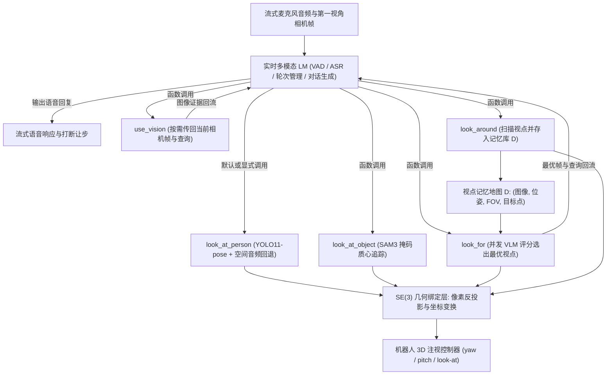

# A Modern System Recipe for Situated Embodied Human-Robot Conversation with Real-Time Multimodal LLMs and Tool-Calling

## 一句话定义

**一套面向具身情境人机对话的极简系统配方**：将实时多模态大语言模型（Realtime Multimodal LLM）作为流式对话与轮次调度核心，通过结构化函数调用（Function Calling）驱动五类注视控制与主动感知工具，并经由 $SE(3)$ 几何绑定层把图像目标映射为机器人 3D 凝视指令。

## 英文缩写速查

| 缩写 | 英文全称 | 简要说明 |
|---|---|---|
| HRI | Human-Robot Interaction | 人机交互研究领域，本文聚焦物理共享环境中的情境对话 |
| LLM | Large Language Model | 大语言模型；本文中实时多模态 LLM 兼作对话管理与工具策略 |
| VLM | Vision-Language Model | 视觉语言模型；用于 `look_for` 并发对视点记忆库打相关性评分 |
| VAD | Voice Activity Detection | 语音活动检测；由实时 API 运行时负责轮次切分与打断检测 |
| ASR | Automatic Speech Recognition | 自动语音识别；实时流式处理用户输入语音 |
| FOV | Field of View | 相机视场角；用于像素射线反投影及视野边界判断 |

## 为什么重要

- **弥合「能流式聊天」与「物理在场感」的鸿沟**：OpenAI Realtime、Gemini Live 等实时多模态 API 原生解决了低延迟语音输入输出、轮次切换与插话打断（barge-in），但直接将其接入机器人仍缺少「何时看、看哪里、如何找视野外物体」的主动感知闭环。
- **用工具调用替代手工规则状态机**：传统情境对话系统往往依赖手工编写的联合注意力规则或复杂对话管理管线；该配方证明预训练实时多模态大模型借助 5 个轻量函数原语即可在多种家庭任务中直接决策注意力转移。
- **可量化拆解后端与感知工具的独立贡献**：通过 4 组受控消融（全量 OpenAI、去物体工具、去人物追踪、全量 Gemini）对比发现，纯语言连贯性在各变体间均接近满分，真正决定「情境理解与在场感」差异的是工具介导的主动感知能力。

## 核心信息

| 字段 | 内容 |
|---|---|
| **作者** | Dong Won Lee, Sarah Gillet, Louis-Philippe Morency, Cynthia Breazeal, Hae Won Park |
| **机构** | 麻省理工学院（MIT）；卡内基梅隆大学（CMU） |
| **发表时间** | 2026-02-04（arXiv:2602.04157v1 [cs.RO]，9 页，7 图） |
| **论文链接** | [arXiv:2602.04157](https://arxiv.org/abs/2602.04157) / [arXiv HTML v1](https://arxiv.org/html/2602.04157) |
| **项目与代码** | 未确认（正文及附录未给出 GitHub 仓库或独立项目页 URL；仅提及补充材料演示视频） |
| **清单分类** | `model.perception`（来源条目：`survey_ax_2602_04157`） |
| **开源状态** | **未确认开源代码**（截至 2026-11-27，arXiv v1 原文未附公开仓库或权重下载入口） |

## 核心原理

系统采用「**流式多模态对话管理器 + 工具介导主动感知 + 几何绑定层**」三层解耦架构（原文 §III 及 Appendix -A）：

### 1. 实时多模态大模型层（§III-A）

- **流式输入与对话机制**：机器人持续将第一视角相机画面与麦克风音频送入实时多模态 API（OpenAI Realtime API 或 Gemini Live API），由平台内置运行时承担 VAD、流式 ASR、轮次边界判定与打断响应；VAD 语音边界触发下游推理与工具决策，或抢占中断当前机器人动作。
- **按需视觉注入**：为避免持续全帧流式输入导致图像 token 累积与费用飙升，系统默认仅在模型显式调用感知工具时按需发送高信息量相机帧。

### 2. 五类注意力与主动感知工具（§III-B，Algorithm 1–4）

模型根据对话上下文与当前感知状态，以 JSON-schema 函数调用形式选择以下原语：

| 工具接口 | 核心机制与本地模块 | 设计意图与默认策略 |
|---|---|---|
| `use_vision(ws, q)` | 截取当前相机帧 $I$，与文本查询 $q$ 一并经 WebSocket 发送给实时模型 | 按需视觉问答，降低持续视频流 token 开销 |
| `look_at_person(enabled)` | 本地运行 **YOLO11-pose**（$49.3 \pm 3.50\text{ ms}$，$20.37\text{ Hz}$）提取人脸/鼻尖关键点；遮挡或出画时回退至空间音频定位 $A$ | 闭环追踪说话人；无其他工具触发时的**默认安全行为** |
| `look_at_object(...)` | 本地运行 **SAM3**（$161.7 \pm 4.31\text{ ms}$，$6.18\text{ Hz}$）进行开放词汇分割与时序追踪，取掩码质心或边界框中心 | 帧率级闭环凝视当前视野内的被指代物体 |
| `look_around(C, D)` | 按预置目标列表 $C = \{\mathbf{p}_i\}$ 依次转动头部并等待运动完成，记录 $(I_i, T_i, \mathrm{fov}_i, \mathbf{p}_i)$ 存入目录 $D$ | 构建轻量级环境视点「记忆地图」（Memory Map） |
| `look_for(q, D)` | 在 $|\mathcal{V}|$ 个并发线程中用 VLM 对 $D$ 中每个视点评分 $s_i = \mathrm{VLM}(I_i, q) \in [0, 1]$，选取 $i^* = \arg\max_i s_i$，驱动凝视 $\mathbf{p}_{i^*}$ 并将 $(I_{i^*}, q)$ 回传实时模型 | 面向视野外目标的语言检索与视角复现 |

### 3. 几何绑定层（Appendix -A）

为让同一套闭环控制逻辑同时服务于人物追踪与物体追踪并跨本体复用，系统通过运动学/IMU 实时维护相机光学坐标系 $\mathcal{F}_C$ 到机器人坐标系 $\mathcal{F}_R$ 的刚体变换 ${}^{R}\mathbf{T}_{C}(t) \in SE(3)$：

1. **像素到相机射线**：给定相机水平/垂直视场角 $(\mathrm{hfov}, \mathrm{vfov})$ 与归一化像素坐标 $(u_n, v_n) \in [0, 1]^2$，由针孔模型得到单位视线向量：
   $$\tilde{\mathbf{r}}_C = \begin{bmatrix} (2u_n - 1)\tan(\mathrm{hfov}/2) \\ (2v_n - 1)\tan(\mathrm{vfov}/2) \\ 1 \end{bmatrix}, \qquad \mathbf{r}_C = \frac{\tilde{\mathbf{r}}_C}{\|\tilde{\mathbf{r}}_C\|}$$
2. **图像中心角误差**：相对光轴 $+\hat{\mathbf{z}}_C$ 的偏航与俯仰误差为 $\Delta\mathrm{yaw} = \arctan2(r_x, r_z)$、$\Delta\mathrm{pitch} = -\arctan2(r_y, r_z)$（负号对应图像 $v$ 轴向下增加）。
3. **机器人系 3D 注视目标**：经旋转矩阵变换 $\mathbf{r}_R(t) = {}^{R}\mathbf{R}_C(t)\,\mathbf{r}_C$ 后，沿射线取标称距离 $d$（无深度估计时固定 $d \in [1, 2]\text{ m}$，有深度时可替换为估计距离）生成控制目标 ${}^{R}\mathbf{g}(t) = {}^{R}\mathbf{p}_C(t) + d\,\mathbf{r}_R(t)$，直接发布至机器人头部/凝视控制器。

## 流程总览

## 源码运行时序图

**不适用**（截至 2026-11-27，arXiv:2602.04157v1 原文及公开检索材料未确认可运行的官方源码实现、GitHub 仓库或可执行脚本入口，原文仅给出 Algorithm 1–4 伪代码与硬件适配说明，因此不绘制源码级运行时序图。）

## 实验与评测

作者在 **Jibo** 社交机器人上设计了 6 个视觉作用域逐步扩大的家庭交互场景（Table I，每段 01:39–02:21），与 4 种系统变体交叉组合共录制 24 段交互视频，并由 2 名对系统变体盲测的标注员（35F, 18F）进行轮次级工具决策标注（4 段视频复核的 Cohen's $\kappa = 0.41$，主要分歧集中在 `look_for` 与 `look_at_object` 的边界）与 5 分制主观问卷评估：

### 1. 六类交互场景设计（Table I）

| 场景 | 任务目标 | 时长 | 视觉实体需求（Person / Object / Map 更新次数） |
|---|---|---|---|
| Posture coach | 识别坐姿问题并指导纠正、复核改善 | 01:39 | Y(1) / N / N |
| Whiteboard | 结合白板几何草图解答三角学问题 | 02:12 | Y(1) / Y(1) / N |
| Lamp placement | 扫视房间后推荐台灯摆放位置 | 02:05 | Y(1) / Y(1) / Y(1) |
| Plant doctor | 寻找室内植物并诊断叶片健康状况 | 02:12 | Y(1) / Y(1) / Y(1) |
| Outfit check | 在房间内寻找外套并对比试穿效果 | 02:21 | Y(1) / Y(2) / Y(1) |
| Pack / find objects | 扫描定位物品并在环境改动后重新扫描 | 02:03 | Y(1) / Y(3) / Y(2) |

### 2. 轮次级工具决策准确率（Table II：宏平均 Accuracy / Precision / Recall）

| 系统变体 | Overall Acc / P / R | `look_at_person` (Acc / P / R) | `look_at_object` (Acc / P / R) | `look_for` (Acc / P / R) | `use_vision` (Acc / P / R) |
|---|---|---|---|---|---|
| **OpenAI Realtime** | $0.72 \pm 0.10$ / $0.88 \pm 0.18$ / $0.62 \pm 0.23$ | 0.63 / 0.52 / 1.00 | 0.70 / 1.00 / 0.19 | 0.93 / 1.00 / 0.70 | 0.64 / 1.00 / 0.60 |
| **OpenAI w/o Object** | $0.28 \pm 0.28$ / $0.50 \pm 0.50$ / $0.26 \pm 0.26$ | 0.42 / 1.00 / 0.42 | — | — | 0.70 / 1.00 / 0.64 |
| **OpenAI w/o Person** | $0.48 \pm 0.24$ / $0.54 \pm 0.27$ / $0.35 \pm 0.18$ | — | 0.69 / 0.62 / 0.40 | 0.71 / 0.53 / 0.53 | 0.51 / 1.00 / 0.48 |
| **Gemini Live** | $0.77 \pm 0.07$ / $0.84 \pm 0.16$ / $0.60 \pm 0.22$ | 0.76 / 0.68 / 1.00 | 0.76 / 0.67 / 0.17 | 0.91 / 1.00 / 0.60 | 0.65 / 1.00 / 0.62 |

- **关键发现**：全量 OpenAI 与 Gemini Live 的整体工具决策精度接近；`look_for()` 精确率高达 1.00（Recall 0.70 / 0.60），`use_vision()` 精确率同样为 1.00 但调用偏保守（Recall 0.60 / 0.62），`look_at_object()` 的召回率最低（0.19 / 0.17），说明模型倾向采取「少触发」的保守策略，易漏掉应主动注视或看图的轮次。

### 3. 主观交互质量、延迟与 API 成本（Table III & Table IV）

| 评估维度 | Gemini Live | OpenAI Realtime | OpenAI w/o Person | OpenAI w/o Objects |
|---|---|---|---|---|
| Fluent and Smooth (1–5) | $4.42 \pm 0.85$ | $4.62 \pm 0.43$ | $3.96 \pm 0.96$ | $3.79 \pm 0.92$ |
| Convo. Quality (1–5) | $4.79 \pm 0.33$ | $4.79 \pm 0.26$ | $4.50 \pm 0.60$ | $4.50 \pm 0.64$ |
| Attention to Person (1–5) | $4.29 \pm 1.18$ | $4.75 \pm 0.34$ | $4.12 \pm 1.03$ | $4.67 \pm 0.39$ |
| Reference to Object (1–5) | $4.61 \pm 0.55$ | $4.83 \pm 0.33$ | $4.08 \pm 1.09$ | $3.47 \pm 0.96$ |
| Response Timing & Turn Taking (1–5) | $3.89 \pm 1.35$ | $4.83 \pm 0.17$ | $4.92 \pm 0.15$ | $4.72 \pm 0.34$ |
| Interruption & Pauses (1–5) | $4.94 \pm 0.19$ | $5.00 \pm 0.00$ | $4.97 \pm 0.10$ | $4.97 \pm 0.10$ |
| 单次交互成本 (USD) | $\$0.018 \pm 0.002$ | $\$0.047 \pm 0.013$ | — | — |
| 端到端延迟 (ms) | $739.10 \pm 593.45$ | $689.98 \pm 389.08$ | — | — |

- **后端价格差异（Table IV-B，USD / 1M Tokens）**：OpenAI Realtime 输入（文本/音频/图像）为 $4.00 / 32.00 / 5.00$、输出（文本/音频）为 $16.00 / 64.00$；Gemini Live 输入为 $0.50 / 3.00 / 3.00$、输出为 $2.00 / 12.00$。在平均延迟处于同一量级（约 690–739 ms）的前提下，Gemini Live 单次交互费用约为 OpenAI Realtime 的 $38\%$。

## 与其他工作对比

- **对比经典规则式/管线式情境对话系统**（如早期 HRI 联合注意与参照消解框架）：本文用实时多模态 API 原生接管 VAD 与流式语音交互，并把「何时看何物」交给大模型函数调用而非显式状态机，大幅简化工程耦合，但在亚轮次（sub-turn）精细注视时序上仍受限于 API 轮次粒度。
- **对比基于 LLM 函数调用的操作/导航智能体**（如 SayCan、Inner Monologue、Voyager、LAMI 等）：既有工作多面向离散任务执行或物理操作；本文将函数调用嵌入「全时在线、可被打断」的社交互动闭环，把凝视控制本身同时作为信息采集策略与社交信号。
- **对比端到端 [VLA](../methods/vla.md) 与通用 [人形机器人智能语音交互](../methods/humanoid-voice-interaction.md) 管线**：本文不直接输出连续机械臂关节或末端执行器轨迹，而是聚焦上层多模态对话、视点记忆与头部注意力伺服；其中 `SE(3)` 几何绑定层和「对话核心 + 薄硬件适配层」设计已从 Jibo 迁移至 Reachy Mini（§VI-D），可作为人形机器人语音交互系统的主动感知前端参考。

## 结论

**一句话总判：实时多模态大模型配合少量结构化主动感知工具即可构建可用的具身情境对话闭环，当前真正的性能瓶颈不在「说话质量」而在工具触发的召回率（何时主动去“看”）与语义边界设计。**

1. **后端可替换但成本差异显著**：在固定工具层与几何绑定层的前提下，OpenAI Realtime（Acc 0.72, 690 ms）与 Gemini Live（Acc 0.77, 739 ms）均可支撑相同交互结构，但单次交互成本相差约 2.6 倍（$\$0.047$ vs. $\$0.018$），Gemini Live 在轮次结束时机（Response Timing）上标准差更大（1.35 vs. 0.17）。
2. **「精确率易、召回率难」是工具调用核心痛点**：`look_for()` 与 `use_vision()` 精确率均为 1.00，但模型策略偏向保守，导致 `look_at_object()` 召回率仅 0.17–0.19、`use_vision()` 召回率仅 0.60–0.62，漏看会直接破坏人机共同关注基础。
3. **工具描述重叠会引发混淆**：去掉 `look_at_person` 后，`look_for()` 准确率从 0.93 跌至 0.71（精确率从 1.00 跌至 0.53），原因在于模型难以区分「视野内持续凝视（`look_at_object`）」与「记忆库跨视角检索（`look_for`）」，工程实现时应让工具语义尽量互斥并返回明确结构化状态。
4. **本体无关的薄适配层可行**：只要新平台能提供音频流、第一视角图像流、相机外参 ${}^{R}\mathbf{T}_{C}(t)$ 与头部 `yaw/pitch` 凝视控制（文中已在 Jibo 与 Reachy Mini 上验证），上层对话与工具调度无需重写。

## 工程实践

- **本地高频视觉伺服 + 云端按需推理分层**：将 `look_at_person`（YOLO11-pose 约 20.4 Hz）与 `look_at_object`（SAM3 约 6.2 Hz）留在本地端侧运行，仅向控制器输出紧凑 3D 坐标，避免云端往返延迟拖垮跟踪闭环。
- **用 `use_vision` 控制图像 Token 成本**：不要向实时多模态 API 持续高帧率推送原始视频流，应由模型在需要视觉证据时主动触发单帧/短突发抓帧请求。
- **遮挡与出画回退**：人物关键点检测失败时结合空间音频声源方位 $A$ 驱动粗略转向，可减少说话人离开视野后的交互断档。
- **硬件迁移检查清单**：接入新机器人需实现（1）麦克风/egocentric 相机流适配；（2）相机内参 $(\mathrm{hfov}, \mathrm{vfov})$ 与实时运动学/IMU 位姿 ${}^{R}\mathbf{T}_{C}(t)$ 标定；（3）针对具体工作空间重设 `look_around` 的扫描视点集合 $C$（无深度传感器时标称距离 $d$ 取 $1\text{–}2\text{ m}$）。

## 局限与风险

- **未开源代码与权重**：截至 2026-11-27，原文未公开可运行代码仓库、完整提示词模板或 24 段实验视频的独立下载页，直接复现需自行搭建实时 API 桥接、YOLO11-pose / SAM3 封装及机器人运动学绑定。
- **轮次级架构难以捕捉亚轮次（sub-turn）动态**：实时 API 基于 VAD 轮次边界调度工具，无法原生处理边说话边微调视线、瞬时指示消歧等亚秒级并发行为。
- **评测规模与标注者主观性受限**：仅覆盖 6 个作者设定的家庭场景、每种条件 1 轮交互采样（共 24 段视频）及 2 名内部标注员；行为标注一致性为中等（$\kappa = 0.41$），且作者明确指出原型系统中存在偶发感知失败、工具误触发与时序毛刺可能产生级联误差。
- **静态记忆地图假设**：`look_around` 采集的视点记忆库 $D$ 不会自动随环境动态变化实时增量刷新，物品移动后需要重新扫描（如 Pack / find objects 场景需执行 2 次扫描）。

## 关联页面

- [机器人视觉感知栈选型闭环](../queries/robot-perception-stack-selection-loop.md)：对照视觉感知与开放词汇定位选型闭环。
- [Agentic Robots 综述](paper-towards-agentic-robots-survey.md)
- [全量项目节点清单](../overview/awesome-agentic-robots-node-index.md)
- [VLA 方法背景](../methods/vla.md)
- [人形机器人智能语音交互](../methods/humanoid-voice-interaction.md)：对照传统 ASR→LLM→TTS 管线与实时多模态 API 方案
- [Agent Tool-use Interface · 智能体工具调用接口](../methods/agent-tool-use-interface.md)：结构化函数调用契约与参数/状态边界设计
- [Robot Agent Harness · 机器人智能体执行框架](../methods/robot-agent-harness.md)：上层语言模型提议工具与底层执行器解耦架构
- [Visual Servoing · 视觉伺服](../methods/visual-servoing.md)：对照本文基于图像中心偏移角误差的闭环凝视伺服层
- [Embodied Agent Benchmarking · 具身智能体评测基准](../methods/embodied-agent-benchmarking.md)：参考交互任务套件与多维度质量评测设计

## 推荐继续阅读

- [arXiv 原文 HTML v1（含 Algorithm 1–4、Table I–IV 与 Appendix -A 推导）](https://arxiv.org/html/2602.04157)
- [arXiv 摘要页（arXiv:2602.04157）](https://arxiv.org/abs/2602.04157)
- [OpenAI Realtime API 官方参考文档](https://platform.openai.com/docs/api-reference/realtime)
- [Google Gemini Live API 官方文档](https://ai.google.dev/gemini-api/docs/live)

## 参考来源

- [论文一手全文核对归档（arXiv:2602.04157v1）](../../sources/papers/paper-agentic-2602-04157.md)
- [官方 Awesome 快照归档](../../sources/repos/awesome-agentic-robots-survey-index.md)
- [arXiv:2602.04157 论文原文入口](https://arxiv.org/abs/2602.04157)
